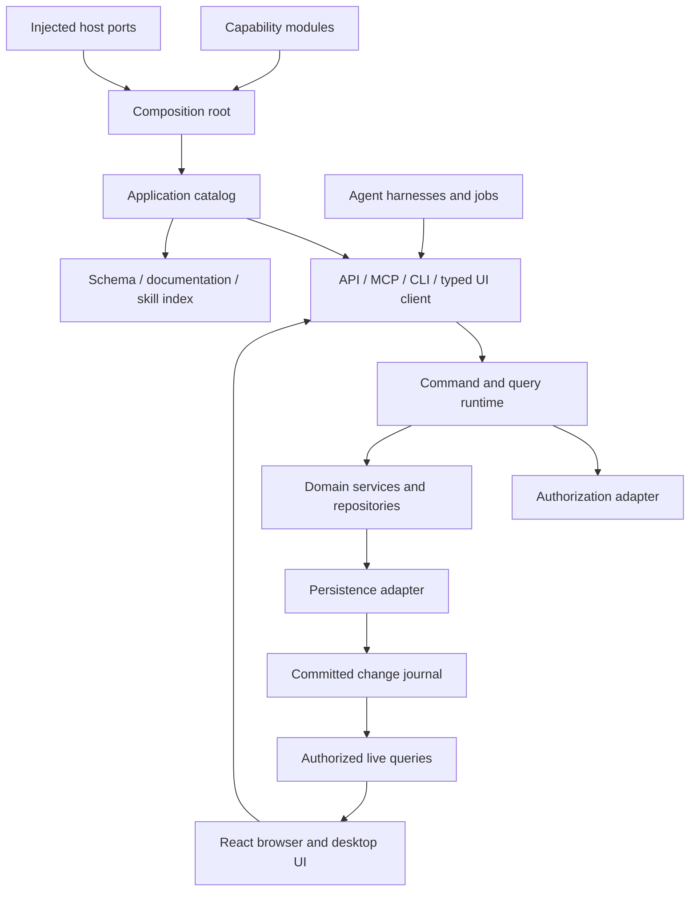

# Agent-native application framework and starter kit

Status: design baseline implemented in this repository. See `docs/implementation-status.md` for verified gates and remaining platform/provider evidence.

Product direction: specialize bounded task/workflow interfaces over existing systems of record. The [pattern](docs/task-workflow-pattern.md) and [next reference plan](docs/system-of-record-reference-plan.md) extend this baseline with point-of-work capture, external delivery and sandboxed tool composition. Part of that extension is implemented: the quality-inspection reference with outbox delivery, inbound sync, a capture UI kit and sandbox CLI/MCP (see `docs/system-of-record-pattern.md` and milestone M8). The operator workstation bridge (`docs/operator-workstation-pattern.md`, milestone M9) extends it to screen-only station software. Its remaining gates are proposed.

Decision baseline: 7 October 2026.

## 1. Purpose and agreed direction

Build a reusable application architecture in which humans, agents and background processes operate through the same business capabilities. A capability is defined once, registered through a composition root, and exposed through UI bindings, MCP, skills, schemas, documentation, CLI and API.

The central abstraction is the **application interaction contract**. It describes what an application can do, what information it can return, what permissions are required, and how clients observe changes. It sits above domain services and injected storage interfaces.

The first deliverable consists of:

1. Reusable TypeScript framework packages.
2. A runnable local project/task workspace with React browser and Electron desktop clients.
3. Local adapters for Codex app-server, Claude Agent SDK and an AI SDK tool loop.
4. A complete architecture and development documentation set.
5. A setup skill and deterministic scaffolder for creating another application.
6. Shared conformance tests proving behavior and authorization across surfaces.

The starter uses Bun workspace tooling and a local SQLite adapter. Those are reference implementation choices, not requirements imposed on application capabilities. The architecture supports different persistence, identity, policy and runtime implementations through ports.

The first implementation is local-first: desktop and browser clients connect to the same local authority. Hosted deployment is documented as an adaptation. Cloud-specific primitives, multi-device synchronization, public hosting, package publication and signed distribution are subsequent work.

## 2. Architectural invariants

- **One business implementation:** transports and UI bindings invoke the same registered command and query handlers.
- **One catalog:** modules contribute contracts to one validated application catalog. Individual surfaces do not maintain separate operation lists.
- **One write authority per workspace:** UI processes, agent processes and jobs submit commands; they do not independently modify authoritative application records.
- **Visible committed changes:** changes committed by any client propagate to authorized subscribed frontends without manual refresh.
- **Equivalent authorization:** the same principal, resource, operation and delegation grant produce the same access decision through every surface.
- **Storage independence:** the kernel owns execution rules and ports; feature repositories and storage adapters own data representations and queries.
- **Provider independence:** provider SDK types, credentials and transport events remain behind harness adapters.
- **Explicit extensibility:** adding a capability adds its contract, handler, UI binding, workflow guidance and behavioral scenarios together.
- **Honest execution state:** accepted, awaiting approval, running, committed, interrupted and failed work are distinguishable. Streamed text is not proof of a committed change.

## 3. System structure

### Planned repository layout

| Location                         | Responsibility                                                                                                      |
| -------------------------------- | ------------------------------------------------------------------------------------------------------------------- |
| `packages/contracts`             | Browser-safe descriptors, schemas, operation identifiers, errors and protocol types.                                |
| `packages/runtime`               | Module composition, dispatch, authorization enforcement, command receipts and transaction coordination.             |
| `packages/client`                | Typed command/query client, subscriptions, query cache and reconnect behavior.                                      |
| `packages/react`                 | React hooks, action bindings, UI context publication and UI-intent handling.                                        |
| `packages/adapters`              | Explicit subpath exports for memory/SQLite persistence, CASL policy, HTTP/SSE, MCP and CLI adapters.                |
| `packages/agents`                | Harness port, run supervisor, credential integration and vendor adapters.                                           |
| `packages/testing`               | Reusable behavioral scenarios, transport drivers, permission matrices and deterministic harness fixtures.           |
| `packages/scaffold`              | Application export/scaffolding command and template manifest.                                                       |
| `examples/project-tasks`         | Example domain, capability contracts, handlers, policies, repository mappings, UI contributions and workflows.      |
| `packages/station`               | Server-only station bridge: profiles, screen observer, screen connector behind the outbox, perception, golden gate. |
| `packages/devices`               | Browser-safe scanner profiles, sources, decoding, calibration, routing; the reusable device configuration module.   |
| `packages/operator-ui`           | Thick-finger operator primitives as the `operator` shadcn registry over stock shadcn components.                    |
| `examples/line-station`          | Operator workstation domain over a homebrew MES, with a fake MES, a fake HMI and a station profile.                 |
| `apps/service`                   | Local authority, composition root, HTTP server, event delivery and harness supervision.                             |
| `apps/web`                       | Shared React application and browser entrypoint.                                                                    |
| `apps/desktop`                   | Electron lifecycle, trusted native bridge, secure credential storage and service supervision.                       |
| `skills/create-agent-native-app` | Setup and extension skill, references and scaffolder invocation.                                                    |
| `docs`                           | Architecture, decisions, extension guides, generated reference and verification records.                            |

Framework packages must not import application or example packages. Browser entrypoints must not import storage drivers, process APIs, secret stores or provider SDKs. Feature contracts, server implementations and UI implementations use separate entrypoints so importing a descriptor does not load its runtime dependencies.

## 4. Capability modules and the interaction contract

### Authoring model

Introduce `defineCapability`, `defineModule` and `createApplication({ modules, ports })` as the public authoring entrypoints. Register modules explicitly; avoid filesystem discovery or global registration side effects.

A module contributes:

- Stable namespaced command and query identifiers.
- Input, output and error schemas, with TypeScript inference and JSON Schema export.
- Permission requirements: action, resource type, resource resolution and field implications.
- Domain events and query dependencies used for invalidation.
- Named handlers and required host/domain ports.
- UI binding declarations and session-scoped UI intents.
- Authored workflows/skills referencing its operations.
- Behavioral scenarios and intentional surface exceptions.

Use Zod schemas behind the schema-authoring helper in v1. The exported interaction contract is JSON Schema and serializable metadata; consumers do not need Zod. Author ordinary product screens explicitly with typed bindings. Automatic form generation is not required for parity.

The composition root validates uniqueness, dependencies, schema validity, handler coverage, UI/agent coverage and workflow references. It then supplies every adapter with the same catalog.

### Generated and runtime surfaces

| Surface       | Derived behavior                                                                                 |
| ------------- | ------------------------------------------------------------------------------------------------ |
| Typed client  | Execute commands, run queries, subscribe to changes and inspect capabilities.                    |
| HTTP API      | Versioned command/query endpoints, discovery and change subscriptions.                           |
| MCP           | Tools for registered operations; resources for the contract, schemas and workflow documentation. |
| CLI           | Operation discovery, help, schema inspection and JSON input/output dispatch.                     |
| Documentation | Operation references, input/output examples, permission requirements and errors.                 |
| Skills        | Authored workflows packaged with a generated index and checked operation references.             |
| UI            | Typed actions and live queries associated with capability IDs.                                   |

Use `/api/v1/commands/:operation`, `/api/v1/queries/:operation`, `/api/v1/events` and `/api/v1/contract` for the reference HTTP adapter. Queries are side-effect-free even when their structured arguments are submitted using POST. Generate operation documentation and OpenAPI from the same descriptors.

Maintain two views of the catalog:

- **Build-time contract:** complete application definition for generation and validation.
- **Runtime contract:** caller-appropriate discovery with availability marked as available, conditional or denied. Resource-dependent permission remains conditional until evaluated against the resource.

Expose safe requirements and decisions, not secrets or unrestricted policy internals. Catalog filtering improves discovery; every invocation is independently authorized.

The initial contract format is version 1. Generated artifacts are deterministic. A check command compares generated output with the current registry and fails on drift. Breaking contract changes require an explicit version change and migration note.

## 5. Authorization, identity and delegation

### Separate responsibilities

| Port or concern             | Responsibility                                                                        |
| --------------------------- | ------------------------------------------------------------------------------------- |
| Identity/session adapter    | Derive a trusted principal from a local session or external authentication mechanism. |
| Authorization adapter       | Decide permitted actions, accessible records and allowed fields.                      |
| Delegation grant            | Restrict an agent run to a subset of the initiating principal's authority.            |
| Approval workflow           | Obtain any required confirmation for an already authorized action.                    |
| Provider credential adapter | Authorize model inference using an explicitly selected provider account or key.       |

ChatGPT identity and permission to use a ChatGPT plan do not themselves grant workspace access. Approval does not elevate denied authorization. The agent cannot supply its own principal, roles or unrestricted grant through tool arguments.

### Required permission levels

| Level      | Example                              | Required behavior                                                        |
| ---------- | ------------------------------------ | ------------------------------------------------------------------------ |
| Operation  | Execute `task.complete`.             | Check before handler dispatch.                                           |
| Object     | Modify a particular project or task. | Check current ownership, membership, state and other trusted attributes. |
| Row/record | List only accessible tasks.          | Scope reads before pagination, counts, search and aggregation.           |
| Field      | Edit task status but not ownership.  | Validate every changed field and filter restricted output fields.        |

Provide authorization-port operations for operation checks, resource checks and query scoping. Permission decisions include safe reason codes and applicable field restrictions. Resolve authorization-relevant resources inside the authority; do not trust caller-supplied ownership or membership attributes.

Use **CASL as the initial policy adapter**. Keep CASL types and rule syntax out of the public interaction contract. Its rule-to-query helpers support the adapter, but do not supply automatic translation to arbitrary persistence.

For v1, implement a documented declarative condition subset covering equality, membership and boolean composition, including denial semantics. Translate it into private query-scope representations consumed by the memory and SQLite repository adapters. Use parameterized SQL and registered field mappings. Reject unsupported conditions; never silently omit them. Test object decisions against scoped-query results to prove agreement.

Storage adapters apply these scopes before limits and aggregates. Field restrictions also govern allowed filtering, sorting and aggregation so a hidden field cannot be queried indirectly. SQL row-level security may reinforce the policy in future adapters; the framework does not require it.

Authorize writes against both the current object and the proposed change. Protect ownership, workspace and relationship changes from permission escalation. Default-deny an operation with no applicable policy.

### Agent grants and permission changes

For delegated runs, effective authority is the intersection of current user permissions and the run's grant. Bind grants to a principal, workspace, allowed operations/resources and run identity. Recheck them at each tool invocation and before accepting delayed work.

The local policy adapter uses an authorization revision so queued work can detect policy changes. Re-evaluate stale decisions before commit. Future external policy adapters must document their consistency and revocation behavior; the kernel must not promise atomic revocation across unrelated remote systems.

Apply read authorization to event delivery and subscriptions as well as queries. Permission changes invalidate capability discovery and affected client caches. Revocation stops further protected delivery and clears inaccessible cached views. Event payloads contain minimal change references rather than unrestricted record snapshots; re-fetches pass through authorized query handlers.

The runnable app starts with a trusted local-owner identity. Automated scenarios use isolated owner, editor and viewer sessions to verify restrictions; production endpoints do not accept arbitrary role or identity overrides.

## 6. Command execution, storage and consistency

### Command path

1. Derive trusted execution context and validate the command input.
2. Resolve referenced resources through the application service and evaluate authorization.
3. Perform any external preparation outside a database transaction.
4. Inside the commit boundary, recheck expected revisions, current local authorization revision and domain invariants.
5. Commit business changes, query-model changes, an idempotency receipt and change-journal entries atomically.
6. Return the committed receipt; deliver change notifications only after commit.

Receipts identify the command, result, affected resource revisions and committed change cursor. Scope idempotency keys to the workspace and principal. Reusing a key with the same request returns the stored result after current access checks; reusing it for different input returns an explicit conflict.

Queries return data and a cursor from one consistent read snapshot. The v1 read models are derived from current transactional state or maintained in the same transaction. Asynchronous projections are an extension requiring explicit progress/watermark semantics.

### Persistence ports

Define ports for unit-of-work execution, module repositories, command receipts, change journal and run storage. The framework does not impose a universal business-record table or ORM. Each feature supplies the repository operations and mappings its domain needs.

Implement an in-memory adapter for conformance tests and a SQLite adapter for the local app. Keep workspace data in a user-owned directory outside application binaries. Use transactional migrations and record the schema version.

The local host acquires exclusive workspace ownership and exposes its endpoint for peer clients. A second client connects to the existing authority. A second authority must fail safely rather than compete for ownership. Crash recovery must distinguish a dead owner from a running process before reclaiming the workspace.

Persist the journal so a crash after commit but before notification does not lose the update. Commands perform no model or network calls while holding storage transactions. Jobs and agent turns produce commands for subsequent commits.

## 7. Reactive clients and UI context

Provide `useCommand`, `useLiveQuery` and typed action bindings over the transport-neutral client.

- Start from a query snapshot and subscribe from its cursor, closing the query/subscription race.
- Use ordered change cursors, replay and deduplication. An expired or unavailable cursor triggers a fresh snapshot.
- Invalidate affected entity and collection queries using registered query dependencies, including list membership changes caused by create/delete/filter changes.
- Coalesce rapid invalidations and prevent an older request result from replacing newer cached state.
- Preserve dirty editor drafts separately from committed query data. A conflicting external update prompts reconciliation; it does not overwrite unsaved input.
- Treat authorization changes as cache and subscription changes, including removal of newly inaccessible records.

The initial client uses confirmed command results rather than a generic optimistic-write mechanism. UI-local pending state remains available.

Publish active workspace, selected resource IDs and observed revisions as session-scoped UI context. Bind an agent run to an explicit UI session and captured target context. A later selection change must not silently redirect an in-flight mutation.

Support typed intents such as `openResource`, `selectResource` and `requestReview`. The target frontend acknowledges, rejects or reports an unavailable session. Keep these ephemeral interactions separate from durable business events. Agents operating without a frontend can still use all permitted business capabilities.

## 8. Local host, transports and agent harnesses

### Runtime and transport boundaries

The service owns the workspace and application runtime. Serve the production browser application and HTTP/SSE API from one local origin. Electron launches and supervises the service as a sidecar and connects the shared React frontend to it.

Bind the service to loopback. Use scoped local sessions, validate the Host and Origin, protect writes against cross-origin requests, and keep provider credentials out of browser storage. Bootstrap browser sessions using a short-lived, single-use launch credential. Supply local process clients with narrowly scoped credentials through the trusted host.

The MCP stdio bridge and CLI are clients of this service. They never open an independent writable copy of the workspace. Electron's native bridge exposes only required host functions, including secure credential operations and native dialogs.

### Harness abstraction

Define a harness interface for availability, supported features, starting/continuing a turn, cancellation, question/approval responses and an event stream. Preserve native session identifiers as adapter-owned resume data. Declare unsupported features explicitly; do not imply that a session can move between providers without loss.

Implement:

- **Codex:** local app-server over stdio, with the application's MCP tools and supported native lifecycle events.
- **Claude:** Claude Agent SDK with application tools and API credentials by default.
- **AI SDK:** a local tool loop using tools derived from the capability catalog and explicitly configured provider credentials.

Use application-domain tools for business writes. Give harnesses dedicated working directories and an explicit tool/permission configuration. Keep arbitrary filesystem and shell access outside the default task-workspace profile. Document the actual isolation provided by each harness; a local process under the same OS user is not automatically a security sandbox.

Persist run state and command correlation. Stream text/progress separately from committed domain events. Serialize turns within a conversation while allowing independent runs to submit commands concurrently. Cancellation revokes future work for that run and interrupts the provider where supported; it does not roll back completed commands. A host restart marks unsettled runs interrupted and requires explicit recovery rather than silently replaying them.

### Provider accounts and funding

Keep account connection and funding source explicit. Implement ChatGPT plan authorization using the current documented local-app flow: stable host identity, dynamic registration, PKCE/state/nonce validation, verified identity, granted-scope checks, protected profile storage, token refresh and logout.

Supply authorized tokens to Codex app-server through the documented Responses provider configuration. Refresh/restart/resume as required by that integration. Distinguish model catalogs from confirmed inference access and handle limits or incomplete streams as failures, including failures received after text starts streaming.

Claude subscription reuse requires provider approval; the shipped Claude adapter uses API credentials. Keep AI SDK API-key execution distinct from ChatGPT-plan execution. Do not silently fall back from an exhausted plan to a chargeable API credential.

Use host-injected credential storage backed by the operating system. A browser connected to the local host can initiate a connection flow but never receives provider tokens. Provider features and availability are documented with dated source links and a manual verification procedure.

## 9. Reference application

Build a small project/task workspace to demonstrate the architecture:

- Projects with names and recoverable archive state.
- Tasks with a project, title, description, status and revision.
- Project membership policies and restricted ownership/membership changes.
- List/detail queries, permission-aware counts and filtered task views.
- Commands to create and update tasks, transition status, and archive/restore projects.
- An agent workflow that breaks a project brief into tasks and updates progress through ordinary commands.
- An optional review workflow for applying a proposed task plan.
- A deterministic background job that updates task data through the same command client.
- Run activity, conflicts and live updates visible in browser and desktop clients.

The default workflow applies ordinary permitted edits directly. Review is an explicit capability, not a compulsory interception of every agent action. All domain behavior is exposed through the catalog; the UI remains useful without starting an agent.

## 10. Implementation milestones

| Milestone                                    | Work                                                                                                                                                                                                                                                                                              | Completion gate                                                                                                                                                                                                                                                                                                                    |
| -------------------------------------------- | ------------------------------------------------------------------------------------------------------------------------------------------------------------------------------------------------------------------------------------------------------------------------------------------------- | ---------------------------------------------------------------------------------------------------------------------------------------------------------------------------------------------------------------------------------------------------------------------------------------------------------------------------------- |
| **M1 — Contracts and composition**           | Establish workspace/package boundaries; implement schemas, module definitions, registry validation and deterministic catalog generation.                                                                                                                                                          | Two small modules compose successfully; duplicates, missing dependencies and unresolved skill/UI bindings fail with useful errors. Browser-safe exports pass boundary checks.                                                                                                                                                      |
| **M2 — Authorized runtime**                  | Implement command/query dispatch, the authorization port, CASL adapter, memory repositories, receipts and change journal. Add the first project/task vertical slice.                                                                                                                              | Operation/object/record/field tests pass; scoped query results agree with object checks; duplicate and stale commands are safe.                                                                                                                                                                                                    |
| **M3 — Durable local authority**             | Add SQLite, transactions, migrations, workspace ownership, recovery and the service composition root.                                                                                                                                                                                             | Memory/SQLite conformance passes; a committed update survives restart and remains discoverable after notification loss.                                                                                                                                                                                                            |
| **M4 — External interfaces**                 | Implement typed HTTP/SSE client, CLI, MCP bridge, discovery, schema/OpenAPI and reference-doc generation.                                                                                                                                                                                         | The same scenarios pass through every transport; discovery does not bypass invocation checks; reconnect replays committed changes.                                                                                                                                                                                                 |
| **M5 — Reactive browser and desktop**        | Build shared React UI, live-query hooks, draft/conflict handling, UI context/intents, Electron supervision and credential bridge.                                                                                                                                                                 | Browser and Electron views update from external commands without refresh; dirty edits survive concurrent changes; revoked records leave the visible cache.                                                                                                                                                                         |
| **M6 — Harnesses and account connections**   | Implement run supervisor, deterministic harness, vendor adapters, credential flows and agent tool integration.                                                                                                                                                                                    | Fixture tests cover streaming, questions, cancellation, failure and recovery; configured live checks are reported separately for each provider.                                                                                                                                                                                    |
| **M7 — Scaffolder, skill and complete docs** | Export a clean starter, write the setup/extension skill and documentation, generate references and add CI gates.                                                                                                                                                                                  | A fresh scaffold builds and runs its scenarios independently; adding one capability updates every required surface; skill validation and documented setup checks pass.                                                                                                                                                             |
| **M8 — System-of-record capture reference**  | Transactional outbox, integration dispatcher and inbound sync, quality-inspection module composed beside project/task, TanStack + shadcn capture kit and registry, compiled CLI with embedded MCP and drain.                                                                                      | Outbox, dispatcher, composition, domain, binding, CLI and sandbox suites pass; browser capture records once per sample and shows SoR outcomes live; the compiled binary passes the sandbox scenario with an empty environment.                                                                                                     |
| **M9 — Operator workstation bridge**         | Held outbox effects, `packages/station` (profiles, observer, screen connector, scripted driver, Playwright transport, perception adapters, golden gate), `packages/devices`, the `operator` shadcn registry in `packages/operator-ui`, and the line-station example with a fake MES and fake HMI. | Station, device, registry and held-effect suites pass; the composed conformance test shows surface parity and lane separation; the golden gate passes; the browser test classifies an observed stop, loads a scanned order's recipe through the HMI screen with readback, and blocks the bridge while the operator holds the seat. |

Complete a runnable vertical slice at each milestone. Track implementation and verification status separately in `docs/implementation-status.md` once development starts. Do not label an adapter live-verified solely because mocked protocol tests pass.

## 11. Documentation and skill deliverables

Write the following documentation alongside the implementation:

| Document                          | Content                                                                                                          |
| --------------------------------- | ---------------------------------------------------------------------------------------------------------------- |
| `README.md`                       | Purpose, working quickstart, example workflow and package/documentation map.                                     |
| `docs/architecture.md`            | Capability layer, composition, dependency direction, process boundaries and diagrams.                            |
| `docs/interaction-contract.md`    | Descriptor model, generated surfaces, runtime discovery, versioning and errors.                                  |
| `docs/capability-authoring.md`    | Complete worked example from domain behavior through UI, tools, skills and scenarios.                            |
| `docs/authorization.md`           | Permission levels, identity, query scoping, field restrictions, delegation, approval and revocation.             |
| `docs/state-and-reactivity.md`    | CQRS, revisions, receipts, transactions, subscriptions, conflict handling and recovery.                          |
| `docs/adapters.md`                | Host ports and recipes for existing storage, identity/policy systems and future hosted services.                 |
| `docs/agent-harnesses.md`         | Harness contracts, feature differences, account/funding boundaries and recovery behavior.                        |
| `docs/development-and-testing.md` | Commands, test drivers, provider-independent CI and opt-in live verification.                                    |
| `docs/desktop-packaging.md`       | Sidecar build, platform targets, runtime discovery, lifecycle and packaging checks.                              |
| `docs/reference/`                 | Generated API, MCP, CLI, schema, permissions and workflow references.                                            |
| `docs/decisions/`                 | Short decisions for contract composition, logical CQRS, authorization adapters and credential boundaries.        |
| `docs/design-lineage.md`          | Lessons from reference projects and current primary sources, clearly distinguished from implementation evidence. |

The `create-agent-native-app` skill covers both starting an app and adding a capability. Its concise `SKILL.md` links to focused references and calls the deterministic scaffolder. It preserves the requested application's domain and asks only for decisions that materially change the result.

The scaffolder exports a versioned snapshot of the framework and canonical starter, substitutes app identifiers, and excludes credentials, workspace data, build output and repository-specific paths. It refuses to overwrite existing files by default. Generated projects must work without unpublished registry packages or access to the original checkout.

Add generated end-user application skills separately from the developer setup skill. The former teach agents to operate the created app; the latter teaches coding agents to extend it. Neither silently installs global agent configuration.

## 12. Test and acceptance plan

### Contract and surface conformance

- Run reusable scenarios through direct invocation, HTTP, MCP and CLI and compare outcomes and structured errors.
- Verify all registered business capabilities have the required UI and agent bindings or a documented exception.
- Validate generated schemas, documentation links, workflow references and deterministic artifacts.
- Check dependency boundaries so browser code cannot import host secrets, storage drivers or provider runtimes.

### Authorization matrix

- Allowed and denied operations for owner/editor/viewer principals.
- Same operation allowed on one object and denied on another.
- List, search, counts, pagination and aggregates restricted to accessible records.
- Field restrictions on reads, writes, filtering and sorting.
- Ownership/workspace changes that would otherwise escalate access.
- Missing policy, unsupported scope expressions and unavailable policy engines fail closed.
- Agent grants narrower than their user's permissions, expired/revoked grants and attempts to forge identity context.
- Permission changes during queued work, delayed tool calls and active subscriptions.
- No restricted record contents or fields in errors, receipts, discovery or event payloads.

### Concurrency and delivery

- Two clients write the same revision; one receives a conflict with no lost update.
- Idempotent retry, including a lost response after commit and a reused key with different input.
- Crash before commit, after commit and before event publication.
- Query/subscription race, duplicate delivery, disconnect/reconnect and cursor reset.
- External updates arriving while a user edits a draft or while an older query is in flight.
- Cancellation and host restart prevent late agent writes while preserving completed commands.

### End-to-end evidence

- Show a task changed through an external MCP client in both open browser and Electron views without refresh.
- Show a UI edit observed by a subsequent agent query.
- Verify session-specific navigation/review intents and behavior when no target UI exists.
- Run the project-planning workflow using the deterministic harness without credentials.
- Package and launch the desktop app with its service sidecar and persisted workspace.
- Scaffold a new application, install, build and run its tests independently.
- Add a new capability in the scaffold and prove catalog, API, MCP, CLI, docs, skill references and UI coverage update together.

CI covers typechecking, package boundaries, unit/conformance tests, generated-artifact checks, service integration, browser/Electron smoke tests and scaffold validation. Run platform-specific packaging smoke checks in the supported OS matrix; report local and CI results separately. Provider login and inference checks are opt-in, require a configured account, and must never reuse discovered credentials automatically.

## 13. Sources and boundaries of evidence

The plan uses the reference projects for architectural lessons, not as proof that every proposed mechanism is already implemented or correct. Write generic framework code and preserve applicable attribution when deliberately reusing source.

- [CASL](https://github.com/stalniy/casl) — operation, subject, condition and field authorization.
- [CASL ability-to-query guidance](https://github.com/stalniy/casl/blob/master/docs-src/src/content/pages/advanced/ability-to-database-query/en.md) — helpers and adapter responsibilities for query scoping.
- [OpenFGA authorization concepts](https://openfga.dev/docs/authorization-concepts) — an example future relationship-based authorization adapter, outside v1 implementation.
- [CQRS pattern](https://learn.microsoft.com/en-us/azure/architecture/patterns/cqrs) — separation of command and query models and consistency tradeoffs.
- [ChatGPT plan usage](https://developers.openai.com/siwc/token-sharing-open-source) — current eligibility and authorization model.
- [ChatGPT registration and sign-in](https://developers.openai.com/siwc/token-sharing-open-source/sign-in) — local registration, identity and granted scopes.
- [Codex app-server with ChatGPT plan usage](https://developers.openai.com/siwc/token-sharing-open-source/codex-app-server) — runtime configuration and token renewal.
- [ChatGPT plan preview limitations](https://developers.openai.com/siwc/token-sharing-open-source/preview-limitations) — supported request and tool behavior.
- [Claude Agent SDK](https://code.claude.com/docs/en/agent-sdk/overview) — embedding, permissions and authentication restrictions.
- [AI SDK tool calling](https://ai-sdk.dev/docs/ai-sdk-core/tools-and-tool-calling) — typed tool execution and agent loops.
- [AI SDK harnesses](https://ai-sdk.dev/docs/ai-sdk-harnesses/overview) — related experimental abstraction; vendor harness types remain outside this framework's public API.
- [Bun executable documentation](https://github.com/oven-sh/bun/blob/main/docs/bundler/executables.mdx) — compiling the local service sidecar.

Recheck current library documentation through Context7 when implementing library-specific code. Pin and record the versions actually tested. Public publication, provider approval, signed releases and live provider behavior require their own evidence and are not established by this plan.
