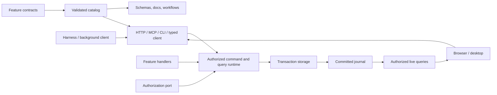

# Architecture

The [primitives](primitives.md) describe the building blocks and where they live. The checks in `bun run check` are the rules; the [design rules](#design-rules) below say what each one protects.

The product unit is a bounded task or workflow application over existing systems of record, operated by people and agents together. Where it runs is a deployment choice: on site beside the work ([edge applications](edge-applications.md)) or on a server. This page describes the kernel. The patterns build on it:

- [task/workflow](task-workflow-pattern.md): ownership, capture at the point of work, and execution boundaries;
- [system of record](system-of-record-pattern.md): outbox, inbound sync, live search and the sandboxed CLI;
- [operator workstation](operator-workstation-pattern.md): station software that has only a screen, used as a connector;
- [next reference plan](system-of-record-reference-plan.md): the gates still open.

## Layers

| Layer     | Location                         | Holds                                                                                                                |
| --------- | -------------------------------- | -------------------------------------------------------------------------------------------------------------------- |
| Framework | `packages/*`                     | Domain-neutral primitives, ports, adapters and UI registries, including the generic host and web frame.              |
| Plugins   | `plugins/*`                      | Cross-cutting concerns an application chooses to compose, such as site policy, network, audit and compliance.        |
| Starter   | `apps/*`                         | Thin wiring its owner forks and extends: configuration, entrypoints, web root, stock UI primitives, desktop wrapper. |
| Content   | `examples/*` or the owner's code | Applications: a browser-safe manifest, a server definition and screens, with their tests and demo scripts.           |

Each layer depends only on the layers beneath it. If the starter knew its examples, every new application would edit it, and a team that forked it would stop receiving framework changes; so the starter stays thin, generic behavior goes into framework packages, and the starter learns its application from configuration. Configuration names the hosted application. The service and CLI load its server definition into the host, and the frame binds its screens. Compiled builds generate a static entry for the same application. A running authority hosts one application, with its own catalog, generated reference, web build and workspace. Frame files are registry sources that a starter file at the same path can shadow.

## One runtime for every caller

People, agents and background processes all use the same capabilities. A feature writes browser-safe contracts, separate server handlers and ordinary screens. The application definition composes modules, state, authorization and services, and the host adds storage, sessions and surfaces. HTTP, MCP and the CLI call the same runtime, and generators read the same catalog.

| Package           | Role                                                                                                                  |
| ----------------- | --------------------------------------------------------------------------------------------------------------------- |
| `contracts`       | Serializable metadata, schemas and protocol errors.                                                                   |
| `runtime`         | Composes contracts with handlers, storage and authorization.                                                          |
| `client`, `react` | Typed actions, live queries and UI session context.                                                                   |
| `adapters`        | HTTP/SSE, MCP, CLI, CASL, SQLite and workspace ownership, each on its own subpath.                                    |
| `agents`          | Harness and run interfaces, with provider details kept inside.                                                        |
| `kernel`          | Composes an application and its plugins and opens its authority on a host platform, with no Node or Bun API.          |
| `host`            | Runs one application and its plugins: workspace ownership, sessions, HTTP, embedded MCP, the CLI, runs and providers. |
| `frame`           | The web frame registry: session bindings, routing, palette, run panel and accounts.                                   |
| `mobile`          | The Android and iOS host platform: device SQLite and files, an exclusive lock, app lifecycle.                         |
| `frame-native`    | The native frame and its registry: tabs or rail, session context, live invalidation, glove-sized components.          |
| `testing`         | Direct and scenario drivers, conformance checks and the UI-binding check.                                             |
| `scaffold`        | Exports the starter, framework and one or all examples as a standalone project.                                       |

Contracts never import handlers, drivers or provider SDKs. Handlers receive trusted context and injected services, never a transport request. Literal operation IDs carry their types through composition into the typed client, and dynamic adapters still validate at runtime.

## The reference host

The host is a Bun loopback service that owns its workspace exclusively. It stores feature state and the framework's receipts, revisions and journal in SQLite. Browsers sign in through a one-time launch exchange and an HttpOnly cookie, and processes use a narrow bearer connection issued by the host. MCP and the CLI either attach to the running host or embed the runtime under the same workspace lock. Electron supervises the service and loads the shared frontend. These are deployment choices, separate from feature behavior.

Opening an authority is portable. The kernel composes the definition and its plugins, checks identity, opens storage and the runtime, runs the plugins' `ready` hooks and builds the integrations, on whatever host platform the starter passes in. A platform supplies workspace ownership, storage, the host's own components and its capabilities (raw sockets, child processes, ingress). The Bun host is one platform; a mobile host is another, and a deployment that needs a capability its platform lacks refuses startup.

## Plugins and a closed kernel

Network access, devices and child processes are declared by modules, components and plugins, never discovered at runtime. The host is a kernel with ports for the network, inbound connections, identity and an audit log. By default those ports refuse every destination, bind loopback, admit the trusted local owner and keep no log. Host plugins provide the ports and add modules, state, policy and lifecycle hooks. A plugin has the same three entrypoints as an application, and the application lists its plugins in each of them, so generated artifacts follow from the application alone. A plugin's state is its own slice, and its policy decides only its own operations and resource types. `open` runs before storage and may refuse startup, `ready` runs before the first request, `start` runs once a serving host listens, with a delegated grant, and `close` runs in reverse order. A setting that no composed plugin claims, or a port that configuration needs and no plugin provides, refuses startup, so configuration never looks enforced while it is ignored.

The examples compose four framework plugins:

- **site** loads the site policy and enforces its identity floor;
- **network** guards outbound connections;
- **audit** keeps the tamper-evident log;
- **compliance** adds auditor queries, the posture monitor and the Compliance screen.

Plugins reach each other through the composed ports, never through imports. The port view resolves once every plugin has opened, so two concerns can use each other without a construction cycle: the network guard records into the audit log, and the log forwarder sends through the guard. Middleware around every call was not enough, because it cannot write an audit record inside the transaction, bind outbound connections or refuse startup. `project-tasks` also composes an example third-party webhook plugin. See [security and compliance](security-and-compliance.md).

## Storage

Storage is generic, with atomic transaction and read callbacks. There is no universal record ORM. Core state must be structured-clone-compatible, and shared memory is refused because it would alias across a transaction's copies. The SQLite snapshot adapter accepts only JSON, and rejects sparse arrays rather than reloading their holes as nulls. This is a small snapshot reference, not a relational backend for large data. A replacement keeps the atomicity and snapshot guarantees its conformance suite checks.

## Systems of record

A remote system of record is its own authority, connected through an integration port, never disguised as local storage. A command commits an outbox effect with its receipt. The dispatcher delivers the effect outside the transaction, at least once, relying on the target's idempotency or a lookup, and a settle command records the outcome. Inbound sync pulls changes in through commands. There are no cross-system transactions.

## Authorization and reactivity

Authorization is injected; see [authorization](authorization.md). The reactive client refetches only queries whose declared dependencies changed, ignores stale responses, clears protected data when authorization changes and reconnects from a snapshot cursor; see [state and reactivity](state-and-reactivity.md). Drafts stay separate from committed data, and UI intents are ephemeral, not business events.

## Agents

Harness output and application commits are separate streams. The supervisor captures the initiating context, limits tools to catalog operations and cancels through run state; see [agent harnesses](agent-harnesses.md). Fixture and protocol tests are one kind of evidence. Live credentials, plan eligibility and real inference need separate configured checks.

Cloud hosting, multi-device sync, package publication and signed distribution are outside the current reference.

## Design rules

Each rule names what enforces it. When a rule gets in the way of a better design, change the rule and its check in the same change.

| Rule                                                                                                                                                                                                                          | Enforced by                                                                        |
| ----------------------------------------------------------------------------------------------------------------------------------------------------------------------------------------------------------------------------- | ---------------------------------------------------------------------------------- |
| Every operation is one handler that the UI, HTTP, MCP and the CLI reach with the same validation, authorization, results and errors. An operation without a UI binding declares why.                                          | Catalog validation; each example's transport conformance and UI-binding tests      |
| Surfaces, schemas, API descriptions and agent skills are generated from the catalog. Contracts are data and import no handlers, drivers or provider SDKs.                                                                     | `check:generated`, `check:boundaries`                                              |
| The host derives principal, workspace and grant; input cannot choose or widen them. Authorization is rechecked inside the transaction and on replay and event delivery, and rows are scoped before they are counted or paged. | The security conformance and role-matrix suites, runtime and policy-adapter suites |
| One authority writes each workspace. A command commits state, revisions, receipt, journal and outbox effects together, or nothing.                                                                                            | Runtime and storage conformance suites                                             |
| Handlers make no network or model calls. Other systems are changed through outbox effects delivered outside the transaction, and read through declared remote queries that store nothing.                                     | Outbox, dispatcher and remote-query suites                                         |
| A receipt is not upstream acceptance. Uncertain outcomes are held for a person, never guessed or blindly retried.                                                                                                             | Outbox, held-delivery, observer and run-supervision suites                         |
| Committed changes reach every view that may see them, without a refresh; a permission change clears protected data at once.                                                                                                   | Client and React binding suites, browser specs                                     |
| Server code reaches the network and child processes only through the network port, to destinations the catalog declares.                                                                                                      | `check:boundaries`, egress and host-plugin suites, `test:isolated`                 |
| A command that cannot be recorded in the audit log does not commit unless the site chose otherwise.                                                                                                                           | Audit and event-log suites                                                         |
| Framework packages and the starter import no example or plugin, and content imports no starter.                                                                                                                               | `check:boundaries`                                                                 |
| Framework packages name no domain; a concept moves into the framework once a second application needs it.                                                                                                                     | Review                                                                             |
| A module has one job; barrels only re-export.                                                                                                                                                                                 | `check:size`                                                                       |
| A capability is called supported only once it ran where the claim applies.                                                                                                                                                    | The [implementation status](implementation-status.md) ledger, `test:sandbox`       |

## Lineage

Other projects informed the design, but no application code was copied. They contributed a portable engine boundary, explicit domain commands and desktop harness integration. This starter adds one interaction catalog for UI and agents, commit receipts, authorization in the runtime and live invalidation in the frontend.

- **Logical CQRS** separates commands from authorized query snapshots over one local database ([Microsoft's CQRS guidance](https://learn.microsoft.com/en-us/azure/architecture/patterns/cqrs)). Event sourcing is not required: the journal delivers committed changes and is not a model each domain rebuilds from.
- **[CASL](https://github.com/stalniy/casl)** makes the object and field decisions. The repository owns a small condition translator, with tests that it agrees with in-memory and SQL evaluation, because no policy language translates losslessly to every database.
- **Provider plans and SDKs** each have their own execution and funding boundaries, and none of them grants workspace permissions ([providers](providers.md)).

Vendor documentation describes intended behavior. Only the [implementation status](implementation-status.md) records what was exercised here.
