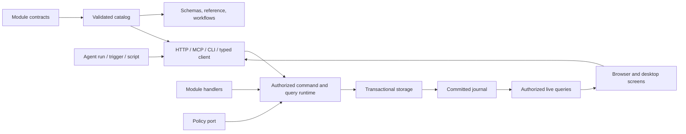

# Architecture

The [framework](glossary.md#framework) is built in layers. Every capability is served through the same set of [surfaces](glossary.md#surface), runs in an instance on a host and commits to [storage](glossary.md#storage). Host plugins add cross-cutting concerns.

## Concepts

Terms: [application](glossary.md#application), [instance](glossary.md#instance), [host](glossary.md#host), [embedded mode](glossary.md#embedded-mode), [attached mode](glossary.md#attached-mode) and [host plugin](glossary.md#host-plugin).

## Layers

| Layer | Location | Holds |
| --- | --- | --- |
| [Framework](glossary.md#framework) | `packages/*` | Domain-neutral primitives, ports, adapters and [UI registries](glossary.md#ui-registry), including the generic host and the [web frame](glossary.md#web-frame). |
| [Workstation](glossary.md#workstation) | `workstations/*` | The edge-workstation opinion: the [screen bridge](glossary.md#screen-bridge) and [workstation sign-in](glossary.md#workstation-sign-in). |
| Plugins | `plugins/*` | [Host plugins](#host-plugins) for cross-cutting concerns an application chooses to compose, such as [deployment policy](glossary.md#deployment-policy), network, audit and compliance. |
| [Starter](glossary.md#starter) | `apps/*` | Thin wiring its owner forks and extends: configuration, entrypoints, web root, stock UI primitives and the desktop and mobile wrappers. |
| Content | `examples/*` or the owner's code | [Applications](#application-entrypoints), with their tests and demo scripts. |
| Driver SDKs | `sdks/*` | The driver protocol in Python and C#, for [hardware drivers](hardware-drivers.md). |

The starter learns its application from configuration. Generic behavior goes into framework packages. A new application therefore does not edit the starter, and an owner who forks it keeps receiving framework changes.

The web frame files are registry sources. A file in `apps/web/src` replaces the frame file at the same path.

## Application entrypoints

An application has three entrypoints:

- **Manifest:** the browser-safe [manifest](glossary.md#manifest) with the application's modules.
- **Application definition:** the server [application definition](glossary.md#application-definition) with state, [handlers](glossary.md#handler), authorization, services and the [targets](glossary.md#target) that reach other systems. It runs with the host's privileges; only callers are untrusted.
- **Screens:** the application's [screens](glossary.md#screen).

`app.config.json` names the application the starter hosts. The `apps/service` entrypoint and the CLI load its application definition into the host, and the web frame binds its screens. Compiled builds generate a static entry for the same application.

Each application has its own [catalog](glossary.md#catalog), generated reference, web build and workspace. `bun run generate` writes the reference to `dist/reference/<id>/`, and nothing generated is committed.

## Surfaces and identity

Every surface calls the same instance.

| Surface | Entry | Identity |
| --- | --- | --- |
| HTTP | `/api/v1/commands/<id>`, `/api/v1/queries/<id>`, `/api/v1/blobs` | Browser: a one-time [launch exchange](glossary.md#launch-exchange), then an HttpOnly cookie. Process: a bearer token the host issues. |
| Live updates | `/api/v1/events` (SSE) | The same session, filtered by current read access. |
| MCP | stdio, one tool per [capability](glossary.md#capability) (`task.create` becomes `task_create`) | A [connection file](glossary.md#connection-file) in [attached mode](#embedded-and-attached-modes), a [grant file](glossary.md#grant-file) in [embedded mode](#embedded-and-attached-modes). |
| CLI | Subcommands generated from the catalog | A connection file in attached mode, a grant file in embedded mode. |
| Typed client | The React bindings | The browser session. |

## Request flow

A module declares the browser-safe contracts of its capabilities; the handlers are separate server code and the screens are ordinary React components. The application definition composes modules, state, authorization and services. The host adds storage, sessions and surfaces, and the [generators](glossary.md#generator) read the same catalog.

A handler receives the trusted [execution context](glossary.md#execution-context) and injected services, never a transport request. Literal operation IDs carry their types through composition into the typed client. Surface adapters still validate input at runtime.

## Instances and hosts

### Instance startup

The [composition](glossary.md#composition) opens an instance in the same steps on every host platform (`packages/kernel/src/instance.ts`):

1. Refuse a deployment whose requirements the host platform cannot meet.
2. Open the plugins, and with them the ports. A plugin that refuses stops startup before the workspace opens.
3. Check the launcher's identity against the identity port, when the host asks for it.
4. Open storage and the [blob](glossary.md#blob) store, then the runtime with the [audit log](glossary.md#audit-log) port and the plugins' services.
5. Run each plugin's `ready` hook before the first request or integration pass.
6. Build the [dispatchers](glossary.md#dispatcher) and [inbound sync](glossary.md#inbound-sync) from the application's connections. The process that opened the instance starts them.

On a failure, the composition closes everything it opened, newest first.

### Host platforms

A host platform is trusted host code that the starter chooses; an application cannot choose it. The host platforms differ in workspace ownership, storage and the capabilities they offer:

| Host platform | Ownership | Storage | Capabilities |
| --- | --- | --- | --- |
| Bun (`bunPlatform`) | An OS lock on the workspace directory | SQLite row storage | Sockets, child processes, ingress, folders |
| Hosted (`hostedPlatform`) | A [workspace lease](glossary.md#workspace-lease) in Postgres, plus the OS lock on the local directory | Postgres row storage | As the Bun platform |
| Mobile (`packages/mobile`) | An exclusive transaction on the workspace's lock database | SQLite snapshot storage | None |

The desktop window starts the host or attaches to a running one, and loads the shared web build. These are deployment choices, and module behavior does not depend on them.

A [hosted instance](glossary.md#hosted-instance) is the Bun host on the hosted platform. Synchronization of one workspace across several devices is out of scope.

### Embedded and attached modes

A CLI call or an MCP bridge with `--embedded` runs in embedded mode, and so does a phone that opens its own workspace. A CLI call with a connection file, the MCP bridge without `--embedded`, the desktop window and an attached tablet run in attached mode.

An embedded CLI or MCP process takes the same OS lock as a serving host. It fails with `CONFLICT` while a live instance owns the workspace.

## Storage

The storage port has an atomic transaction callback and a read callback. It imposes no record model on module state. Module state must be structured-clone compatible. Storage refuses shared memory, because it would alias across a transaction's copies.

| Adapter | Layout | Used by |
| --- | --- | --- |
| Memory | Structured clones in memory | Tests |
| SQLite (`SQLiteStorage`) | One row per record; a commit writes only the rows it changed | The Bun host platform |
| Postgres (`PostgresStorage`) | The same row layout, shared safely by several hosts | The hosted platform |
| Snapshot (`SnapshotStorage`) | One JSON document per workspace | The mobile host platform |

The SQLite, Postgres and snapshot adapters accept only JSON. The adapters reject sparse arrays instead of reloading the holes as nulls. The row layout is not a relational model of module state.

A replacement adapter passes the storage conformance suite in `packages/testing`, which checks the atomicity, isolation and persistence the composition relies on.

## Systems of record

A [system of record](glossary.md#system-of-record) owns records the application reads or changes, and decides what it accepts. It cannot join the application's transaction. The application reaches it through a target and the target's [connector](glossary.md#connector).

A command commits an [outbox effect](glossary.md#effect) with its [receipt](glossary.md#receipt). The dispatcher delivers the effect outside the transaction, at least once. It relies on the system of record's idempotency or on a lookup, and a settle command records the outcome. The effect's phase keeps accepted, rejected and held outcomes apart.

Inbound sync imports changes through ordinary commands. No transaction spans two systems.

## Authorization and reactivity

The policy port is injected; [authorization](authorization.md) explains it. Every open screen receives live updates after a commit that changes what it reads.

In the React bindings, a [live query](glossary.md#live-query) refetches when a declared dependency changes, or on every change when it declares none. It ignores stale responses. It clears protected data when authorization changes, and reconnects from a [snapshot](glossary.md#snapshot) cursor.

Drafts stay separate from committed data. [UI intents](glossary.md#ui-session-context) expire and are not business events.

## Agents

An [agent run](glossary.md#agent-run) keeps [harness](glossary.md#harness) output and application commits in separate streams. The run supervisor captures the initiating context, offers the harness only catalog capabilities as tools, and cancels through run state.

Fixture and protocol tests are one kind of evidence. Live credentials, plan eligibility and real inference need separate configured checks, and the [ledger](implementation-status.md) records them.

## Host plugins

Modules, [host components](glossary.md#host-component) and plugins declare their network access, devices, [exchange folders](glossary.md#exchange-folder) and child processes as [requirement declarations](glossary.md#requirement-declaration). Nothing is discovered at runtime.

### Ports

The host is a composition with ports. A plugin provides a port; without one, the composition's default applies.

| Port | Default without a plugin | Provided by |
| --- | --- | --- |
| Network | Refuses every destination | `plugins/network`, the [egress guard](glossary.md#egress-guard); `plugins/hub-link` on a paired device, without an egress guard |
| Ingress | The host platform's own listener: loopback on the Bun platform | `plugins/network` (TLS or mTLS from the deployment policy) |
| Identity | Admits the trusted [local owner](glossary.md#owner) | `plugins/site` |
| Audit log | No log | `plugins/audit` |
| Shell | No OS integration | `plugins/os` |
| Processes | Refuses every child process | `plugins/process` |
| Folders | No exchange folders | `plugins/site` |

Plugins provide ports because a wrapper around each call cannot write an audit record inside the command's transaction, bind outbound connections or refuse startup.

### Composition

A plugin has the same entrypoints as an application: a manifest, a server entrypoint and, when it has any, screens. The application lists its plugins in each of its own entrypoints, so generated artifacts follow from the application alone. A plugin's state is its own slice under its ID. Its policy decides only its own capabilities and resource types.

A plugin imports the packages of the plugins it requires, for their types, policy helpers and service accessors. The network plugin, for example, imports the site plugin's policy types. At runtime, plugins reach each other through the composed ports and the services the plugins expose. The port view resolves once every plugin has opened, so two plugins can use each other without a construction cycle. The egress guard records into the audit log, and the audit log's forwarder sends through the guard. The two plugins do not import each other.

### Lifecycle

- `open` runs before storage, in composition order, and may refuse startup.
- `ready` runs in every instance, including an embedded CLI or MCP instance, before the first request.
- `start` runs in a serving host once it listens, and on the mobile host each time it returns to the foreground. It never runs in an embedded CLI or MCP instance, and it acts as the local owner narrowed by a [delegated grant](glossary.md#grant).
- `close` runs in reverse order.

Startup refuses the composition in these cases:

- a supplied setting that no composed plugin declares;
- a port that a plugin's configuration needs and no plugin provides;
- two plugins that provide the same port;
- server plugins that differ from the manifest's list or order, or a plugin composed before one it requires.

`packages/host/test/plugins.test.ts` covers the composition rules and the lifecycle.

### Plugins in the examples

`project-tasks` also composes [webhook](../plugins/webhook/README.md), an example plugin written as a third party would write one. Most examples compose these:

- **site** loads the deployment policy and enforces its identity floor.
- **network** guards outbound connections.
- **audit** keeps the tamper-evident audit log.
- **compliance** adds auditor queries, the posture monitor and the Compliance screen.

### Telemetry

The telemetry plugin derives OpenTelemetry metrics and spans from the audit log and the [outbox](glossary.md#outbox), so handlers and adapters carry no metrics code. It exports through the network port to a collector on the same machine. The export carries operation, target, harness and channel IDs, fixed states, error codes, counts and durations, and digests of correlation, effect and run IDs. It carries no record contents, inputs, [principals](glossary.md#principal) or resource IDs ([telemetry plugin](../plugins/telemetry/README.md)).

## Invariants

`bun run check` and the conformance suites test these:

- Each capability has one handler. The screens, HTTP, MCP and the CLI reach it with the same validation, authorization, results and errors (`examples/project-tasks/test/transport-conformance.test.ts`).
- Surfaces, schemas, API descriptions and agent skills are generated from the catalog. Contracts import no handlers, adapters or provider SDKs.
- The host derives the principal, the workspace and the grant from the session. Input cannot choose or widen them.
- Authorization is rechecked inside the transaction, on replay and on event delivery. Rows are filtered before they are counted or paged.
- One instance writes each workspace. A command commits state, [revisions](glossary.md#revision), its receipt, journal entries and outbox effects in one transaction, or the command fails.
- Handlers make no network or model calls. Other systems are changed through outbox effects and read through declared remote queries.
- Server code reaches the network only through the network port, and starts child processes only through the [process port](glossary.md#process-port). The boundary check enforces both, and `scripts/boundary-rules.ts` lists each reviewed exemption with its reason.
- The framework imports no workstation, plugin, starter or example code. A workstation package imports the framework only. A plugin imports no workstation package, starter or example. The starter imports none of them. An example imports no starter code, and nothing imports a driver SDK.

The reviewed exemptions include the harness launches in `packages/agents` and the Postgres connection of the hosted platform, which opens before any plugin.

## Packages

| Package | Role |
| --- | --- |
| `contracts` | Serializable metadata, schemas and protocol errors. |
| `runtime` | Composes contracts with handlers, storage and authorization. |
| `kernel` | The [composition](glossary.md#composition): composes an application and its plugins and opens its instance on a host platform, with no Node or Bun API. |
| `host` | Runs one application and its plugins: workspace ownership, sessions, HTTP, embedded MCP, the CLI, agent runs, providers and the hosted platform. |
| `adapters` | HTTP and SSE, MCP, the CLI, CASL, SQLite and Postgres storage, the workspace lease and workspace ownership, each on its own subpath. |
| `client`, `react` | The typed client, live queries and UI session context. |
| `agents` | Harness and run interfaces, with provider details kept inside. |
| `integration` | Targets, the dispatcher and inbound sync for systems of record. |
| `event-log` | The hash-chained audit log that the audit plugin opens. |
| `frame` | The web frame registry: session bindings, routing, palette, run panel and accounts. |
| `operator-ui` | Glove-sized operator input parts as a shadcn registry. |
| `devices` | Scanner input normalized and routed to capabilities without a model turn. |
| `observation` | Readings from sources that cannot be queried, submitted through ingest commands. |
| `shell` | [OS handlers](glossary.md#os-handler) and [OS actions](glossary.md#os-action), and the platform registrations generated from them. |
| `bundle` | Signed, versioned [site bundles](glossary.md#site-bundle), checked before a site installs one. |
| `mobile` | The Android and iOS host platform: device SQLite and files, an exclusive lock and the foreground and background lifecycle. |
| `frame-native` | The native frame and its registry: tabs or rail, session context, live invalidation and glove-sized components. |
| `testing` | Direct and scenario drivers, conformance checks and the [UI-binding](glossary.md#ui-binding) check. |
| `scaffold` | Exports the starter, the framework and one or all examples as a standalone project, or generates a new application. |

The framework packages can be packed and published at one version. The workstation packages are published with them. None is on a public registry.

## Stack

- Bun and TypeScript.
- Zod for schemas.
- SQLite for local storage, and Postgres for a hosted instance.
- CASL for the policy adapter.
- React with Vite, TanStack Query, shadcn and Tailwind for the screens.
- Electron for the desktop.
- Expo and React Native for the mobile host.
- Playwright for browser tests.

`bun.lock` pins the versions. Desktop packaging produces an unsigned directory. Signed distribution is out of scope; [desktop](desktop.md) describes the build.

## Examples

Each [example](glossary.md#example) is an application under `examples/` and serves as a test fixture.

| Example | Exercises | Host plugins |
| --- | --- | --- |
| [`project-tasks`](../examples/project-tasks/README.md) | Roles, field projection, revisions, live updates and a deterministic agent, with no system of record. The fixture for the transport, storage and security conformance suites. | site, network, audit, compliance, os, share-target, notifications, os-shortcuts, webhook |
| [`quality-inspection`](../examples/quality-inspection/README.md) | Outbox delivery and inbound sync against a fake quality system, keyboard capture and an instrument driver. The CLI and MCP run under a grant file in a stripped environment, from source or as the compiled binary. | site, network, audit, compliance, process, connector-driver |
| [`line-station`](../examples/line-station/README.md) | A workstation application driven through its screen as an outbox connector, MES sync, scanner routing and held effects ([operator workstations](operator-workstations.md)). | site, network, process, audit, compliance, automation, connector-driver |
| [`crm-capture`](../examples/crm-capture/README.md) | Remote queries of a fake CRM with each caller's own access, adoption through the outbox and the CRM's feed, and an unreachable CRM shown as a status. | site, network, audit, compliance |
| [`asset-survey`](../examples/asset-survey/README.md) | A site structure under reference designations, assignments for paired phones, model extraction from photos with review, and filing into a fake EAM. Blobs, [device link](glossary.md#device-link) pairing and a compact tablet screen. | site, network, process, audit, compliance, device-link |
| [`receiving`](../examples/receiving/README.md) | Goods receiving against an ERP through files: notices arrive in an inbox folder, and receipts are posted as files and settled from receipt files. An agent requests approval for discrepancy reasons. Generated with the [scaffold](glossary.md#scaffold) and built on collections, the policy builder, a target, default screens and approval requests. | site, network, audit, compliance |
| [`fleet`](../examples/fleet/README.md) | The [fleet](hosting.md#fleet) that site instances report to: enrollment through device link, signed releases on channels, a health screen, audit events checked against each site's hash chain, and relayed remote access. Runs on a site host or as a hosted instance. | site, network, audit, device-link |
| [`asset-survey-field`](../examples/asset-survey-field/README.md) | The phone side of the survey on the [mobile host](mobile.md): offline capture with photos and scans, delivered to the [hub](glossary.md#hub) through the peer connector, and assignments received through the hub's feed. | hub-link, managed-config, intent-scanner |

[Getting started](getting-started.md#other-examples) runs each example and gives its port.

## References

- [Getting started](getting-started.md)
- [Capability authoring](capability-authoring.md)
- [Interaction contract](interaction-contract.md)
- [Authorization](authorization.md)
- [State and reactivity](state-and-reactivity.md)
- [Adapters](adapters.md)
- [Systems of record](systems-of-record.md)
- [Operator workstations](operator-workstations.md)
- [Point-of-work input](point-of-work-input.md)
- [Hardware drivers](hardware-drivers.md)
- [Agents](agents.md)
- [Providers](providers.md)
- [Hosting](hosting.md)
- [Security and compliance](security-and-compliance.md)
- [Desktop](desktop.md)
- [Mobile](mobile.md)
- [Development and testing](development-and-testing.md)
- [Implementation status](implementation-status.md)
