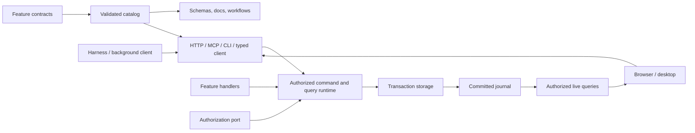

# Architecture

The [principles](principles.md) state what this architecture is for, and the [primitives](primitives.md) describe its building blocks and where they live.

The product unit is a bounded task or workflow application over existing systems of record. It runs at the edge beside the work, and people and local agents operate it together ([edge applications](edge-applications.md)). This page describes the local kernel. The patterns build on it:

- [task/workflow](task-workflow-pattern.md): ownership, capture at the point of work, and execution boundaries;
- [system of record](system-of-record-pattern.md): outbox, inbound sync, live search and the sandboxed CLI;
- [operator workstation](operator-workstation-pattern.md): station software that has only a screen, used as a connector;
- [next reference plan](system-of-record-reference-plan.md): the gates still open.

## Layers

| Layer     | Location                         | Holds                                                                                                                |
| --------- | -------------------------------- | -------------------------------------------------------------------------------------------------------------------- |
| Framework | `packages/*`                     | Domain-neutral primitives, ports, adapters and UI registries, including the generic host and web frame.              |
| Plugins   | `plugins/*`                      | Cross-cutting concerns an application chooses to compose, such as site policy, network, audit and compliance.        |
| Starter   | `apps/*`                         | Thin wiring its owner forks and extends: configuration, entrypoints, web root, stock UI primitives, desktop wrapper. |
| Content   | `examples/*` or the owner's code | Applications: a browser-safe manifest, a server definition and screens, with their tests and demo scripts.           |

Each layer depends only on the layers beneath it ([P11](principles.md#p11--layers-depend-inward-and-an-authority-runs-one-application), [ADR 005](decisions/005-framework-shell-content.md)). Configuration names the hosted application. The service and CLI load its server definition into the host, and the frame binds its screens. Compiled builds generate a static entry for the same application. A running authority hosts one application, with its own catalog, generated reference, web build and workspace. Frame files are registry sources that a starter file at the same path can shadow.

## One runtime for every caller

People, agents and background processes all use the same capabilities. A feature writes browser-safe contracts, separate server handlers and ordinary screens. The application definition composes modules, state, authorization and services, and the host adds storage, sessions and surfaces. HTTP, MCP and the CLI call the same runtime, and generators read the same catalog.

| Package           | Role                                                                                                                  |
| ----------------- | --------------------------------------------------------------------------------------------------------------------- |
| `contracts`       | Serializable metadata, schemas and protocol errors.                                                                   |
| `runtime`         | Composes contracts with handlers, storage and authorization.                                                          |
| `client`, `react` | Typed actions, live queries and UI session context.                                                                   |
| `adapters`        | HTTP/SSE, MCP, CLI, CASL, SQLite and workspace ownership, each on its own subpath.                                    |
| `agents`          | Harness and run interfaces, with provider details kept inside.                                                        |
| `host`            | Runs one application and its plugins: workspace ownership, sessions, HTTP, embedded MCP, the CLI, runs and providers. |
| `frame`           | The web frame registry: session bindings, routing, palette, run panel and accounts.                                   |
| `testing`         | Direct and scenario drivers, conformance checks and the UI-binding check.                                             |
| `scaffold`        | Exports the starter, framework and one or all examples as a standalone project.                                       |

Contracts never import handlers, drivers or provider SDKs. Handlers receive trusted context and injected services, never a transport request. Literal operation IDs carry their types through composition into the typed client, and dynamic adapters still validate at runtime.

## The reference host

The host is a Bun loopback service that owns its workspace exclusively. It stores feature state and the framework's receipts, revisions and journal in SQLite. Browsers sign in through a one-time launch exchange and an HttpOnly cookie, and processes use a narrow bearer connection issued by the host. MCP and the CLI either attach to the running host or embed the runtime under the same workspace lock. Electron supervises the service and loads the shared frontend. These are deployment choices, separate from feature behavior.

## Plugins and a closed kernel

Network access, devices and child processes are declared by modules, components and plugins, never discovered at runtime. The host is a kernel with ports for the network, inbound connections, identity and an audit log. By default those ports refuse every destination, bind loopback, admit the trusted local owner and keep no log. Host plugins provide the ports and add modules, state, policy and lifecycle hooks ([ADR 010](decisions/010-host-plugins.md)).

The examples compose four framework plugins:

- **site** loads the site policy and enforces its identity floor;
- **network** guards outbound connections;
- **audit** keeps the tamper-evident log;
- **compliance** adds auditor queries, the posture monitor and the Compliance screen.

Plugins reach each other through the composed ports, never through imports. `project-tasks` also composes an example third-party webhook plugin. See [security and compliance](security-and-compliance.md).

## Storage

Storage is generic, with atomic transaction and read callbacks. There is no universal record ORM. Core state must be structured-clone-compatible, and shared memory is refused because it would alias across a transaction's copies. The SQLite snapshot adapter accepts only JSON, and rejects sparse arrays rather than reloading their holes as nulls. This is a small snapshot reference, not a relational backend for large data. A replacement keeps the atomicity and snapshot guarantees its conformance suite checks.

## Systems of record

A remote system of record is its own authority, connected through an integration port, never disguised as local storage. A command commits an outbox effect with its receipt. The dispatcher delivers the effect outside the transaction, at least once, relying on the target's idempotency or a lookup, and a settle command records the outcome. Inbound sync pulls changes in through commands. There are no cross-system transactions ([P7](principles.md#p7--other-systems-change-only-through-durable-intents)).

## Authorization and reactivity

Authorization is injected; see [authorization](authorization.md). The reactive client refetches only queries whose declared dependencies changed, ignores stale responses, clears protected data when authorization changes and reconnects from a snapshot cursor; see [state and reactivity](state-and-reactivity.md). Drafts stay separate from committed data, and UI intents are ephemeral, not business events.

## Agents

Harness output and application commits are separate streams. The supervisor captures the initiating context, limits tools to catalog operations and cancels through run state; see [agent harnesses](agent-harnesses.md). Fixture and protocol tests are one kind of evidence. Live credentials, plan eligibility and real inference need separate configured checks.

Cloud hosting, multi-device sync, package publication and signed distribution are outside the current reference.

## Lineage

Other projects informed the design, but no application code was copied. They contributed a portable engine boundary, explicit domain commands and desktop harness integration. This starter adds one interaction catalog for UI and agents, commit receipts, authorization in the runtime and live invalidation in the frontend.

- **Logical CQRS** separates commands from authorized query snapshots over one local database ([Microsoft's CQRS guidance](https://learn.microsoft.com/en-us/azure/architecture/patterns/cqrs)). Event sourcing is not required: the journal delivers committed changes and is not a model each domain rebuilds from.
- **[CASL](https://github.com/stalniy/casl)** makes the object and field decisions. The repository owns a small condition translator, with tests that it agrees with in-memory and SQL evaluation, because no policy language translates losslessly to every database.
- **Provider plans and SDKs** each have their own execution and funding boundaries, and none of them grants workspace permissions ([providers](providers.md)).

Vendor documentation describes intended behavior. Only the [implementation status](implementation-status.md) records what was exercised here.
