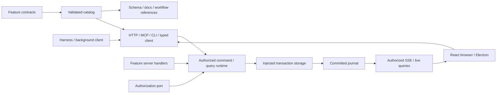

# Architecture

The [principles](principles.md) state the commitments this architecture serves; [primitives](primitives.md) explains the concepts that deliver them and where each lives in code.

The intended product unit is a bounded task or workflow application over existing systems of record, running at the edge beside the work and operated by people and local agents together ([edge applications](edge-applications.md)). See the [task/workflow pattern](task-workflow-pattern.md) for ownership, point-of-work capture and execution boundaries. The architecture below describes the implemented local kernel. The [system-of-record reference](system-of-record-pattern.md) describes the implemented outbox, inbound sync, capture kit and sandbox CLI/MCP; the [operator workstation pattern](operator-workstation-pattern.md) treats screen-only station software as a connector behind the same outbox ([ADR 004](decisions/004-screen-mediated-authority.md)); the [next reference plan](system-of-record-reference-plan.md) covers the remaining delivery and execution-boundary gates.

The repository has four layers ([P11](principles.md), [ADR 005](decisions/005-framework-shell-content.md), [ADR 010](decisions/010-host-plugins.md)): framework, host plugins, starter and content. Content depends on framework contracts; the starter depends on the framework and names its content only in configuration.

| Layer     | Location                         | Holds                                                                                                                                                            |
| --------- | -------------------------------- | ---------------------------------------------------------------------------------------------------------------------------------------------------------------- |
| Framework | `packages/*`                     | Domain-neutral primitives, ports, adapters and UI registries, including the generic host (`@agent-native/host`) and web frame (`@agent-native/frame`).           |
| Starter   | `apps/*`                         | A thin boilerplate its owner forks or generates and extends: `app.config.json`, service/CLI entrypoints, the web root, stock primitives and the desktop wrapper. |
| Content   | `examples/*` or the owner's code | Applications: a browser-safe `manifest`, a server `application` definition and `screens`, plus their tests, end-to-end specs and demo scripts.                   |

`app.config.json` names the hosted application (`AGENT_NATIVE_APPLICATION` overrides it in development). The service and CLI load its `application` entrypoint and hand it to `@agent-native/host`. The frame's Vite plugin binds its `screens` as `virtual:agent-native/screens`. Compiled builds generate a static entry for the same application. Each running authority hosts one application, with its own catalog, generated references (`docs/reference/<id>/`), web build (`dist/web/<id>/`) and workspace. Frame files are shadcn registry sources used in place behind the `@/` alias; a starter file at the same `src/` path shadows one.

Business capabilities are the shared entrypoint for humans, agents and background processes. A feature authors browser-safe contracts, separate server handlers and ordinary product screens. The application definition explicitly composes modules, state, authorization and services; the host adds transaction storage, sessions and surfaces. API, MCP and CLI adapters invoke that same runtime; generators consume its pure catalog.

`packages/contracts` contains serializable metadata, schemas and protocol errors. `packages/runtime` composes those contracts with private handlers and generic storage/authorization ports. `packages/client` and `packages/react` implement typed actions, live-query consumption and session-local UI primitives. `packages/adapters` has explicit server subpaths for HTTP/SSE, MCP, CLI, CASL, SQLite and workspace ownership; importing its root does not eagerly load every adapter. `packages/agents` isolates provider SDK/process details behind harness/run interfaces. `packages/host` runs one application definition and composes its plugins: workspace ownership, sessions and launch, HTTP/SSE, embedded MCP, the CLI, run supervision and provider access. `plugins/security` and `plugins/assurance` are host plugins. `packages/frame` is the web frame registry (session bindings, routing from an application's screens, palette, run panel, accounts). `packages/testing` supplies direct/scenario drivers, independent conformance checks and the UI-binding check. `packages/scaffold` exports the starter, the framework and all or one example into a standalone application.

Framework packages never import the example domain, and the starter never imports an example. Feature contracts never import handlers, database drivers or provider SDKs. Server handlers receive trusted execution context and injected services, not a transport request. Catalog generation imports only contracts and does not open a workspace or discover credentials. Literal operation IDs carry inferred input/output types through composition and the typed client; dynamic adapters still validate at runtime.

The reference host is a Bun loopback service with exclusive OS workspace ownership. It persists a JSON feature-state snapshot and framework receipts/revisions/journal in SQLite. Browser clients use a one-use launch exchange and HttpOnly session cookie; process clients use a narrow host-issued bearer connection. The MCP bridge and CLI attach to the host rather than opening another writable database, or run the runtime embedded under the same exclusive workspace lock (`--embedded`). Electron supervises the local service and loads the shared frontend. Workspace ownership and trusted local sessions are reference deployment choices, separate from feature behavior.

Network, devices and child processes are declared, not discovered. Modules and components declare `requirements`: the application's modules, its manifest's `components`, its plugins' components and the generic host's own. The deployment catalog composes them with their owners.

The host is a kernel with ports ([ADR 010](decisions/010-host-plugins.md)): `network`, `ingress`, `identity` and an optional `eventLog`. Their defaults refuse every destination, bind loopback, admit the trusted local owner and keep no log. An application lists host plugins in its manifest, application and screens entrypoints. Each plugin brings modules, a state slice under its id, a policy over its resource types, ports and lifecycle hooks: `open` before storage, `ready` before the first request, `start` once a serving host listens, then `close`. Every example composes the four framework plugins, in this order ([ADR 011](decisions/011-plugins-by-port.md)):

- `@agent-native/site` loads the site policy, refuses one below its floor, enforces the identity floor through the identity port and adds `site check`.
- `@agent-native/network` provides the egress guard (`packages/egress`) as the network port, the child proxy in a serving host and mTLS as ingress, and adds `network export`.
- `@agent-native/audit` injects the hash-chained event log (`packages/event-log`) into the runtime as the event-log port, so commands, queries, denials, outbox transitions and connections are recorded; it attests, recovers and adds `audit verify`.
- `@agent-native/compliance` adds the auditor queries, the posture monitor, `compliance report` and the Compliance screen.

Plugins use each other through the composed ports: the guard records into the event-log port and the audit forwarder connects through the network port. With no policy the site plugin runs isolated; with no network plugin the kernel defaults refuse the network; a policy that binds destinations or asks for an audit trail refuses to start without the plugin that enforces it. `project-tasks` also composes `plugins/webhook`, an example third-party plugin that posts change notifications through the network port. See [security-and-compliance.md](security-and-compliance.md) and [ADR 007](decisions/007-declared-egress-and-audit-log.md).

Storage is generic `Storage<State>` with atomic transaction/read callbacks; there is no universal domain-record ORM. State must be structured-clone-compatible in the core and hold no shared memory (a `SharedArrayBuffer` would alias across the transaction's copies, so the memory adapter refuses it). The memory adapter supports cloneable state such as Maps; the SQLite snapshot adapter deliberately accepts only JSON state, and the JSON check rejects sparse arrays rather than reloading holes as null. The example uses project/task dictionaries directly. This is a small snapshot reference, not an implemented relational repository framework or a demonstrated large-dataset backend. Replacing storage requires preserving the atomic receipt/journal/revision and snapshot guarantees in its conformance suite.

A remote system of record is a separate authority, connected through a business integration port rather than disguised as local transactional storage. An external-write workflow distinguishes local capture/intent commit from remote acceptance, then publishes connector acknowledgements and imported changes through runtime commands. The runtime commits outbox effects with the receipt (`ctx.enqueue`) and records outcomes through domain settle commands (`ctx.settleEffect`); `packages/integration` delivers them outside transactions and pulls inbound changes. Delivery is at least once, using the target's idempotency or lookup; there are no cross-system transactions or reconciliation of uncertain outcomes.

Authorization is injected. The CASL adapter supports a bounded condition profile translated independently to object decisions and SQL scopes; its types do not escape into capability contracts. The example scopes list/search/count operations before pagination and projects restricted fields. Every command checks current authorization inside the transaction and again before commit. Resource grants narrow feature reads as well as changed resources. Event delivery applies current read permissions, with synchronous delivery inside the read boundary to exclude concurrent local revocation commits.

The initial reactive client re-queries conservatively on committed changes. It fences older requests, clears protected data on authorization revision/reset and reconnects from a snapshot cursor. Dependency metadata is cataloged. `@agent-native/react/query` uses it for resource-type-indexed TanStack Query invalidation with coalescing; generalized optimistic writes are not implemented. UI drafts remain separate from committed data. The reference frontend registers session-local selection/revision context; the host validates and captures it when starting a run. UI intents use bounded expiring queues, current authorization and explicit acknowledgements. They are not durable business events.

Harness text/progress and application commits are separate streams. The supervisor captures trusted initiating context, restricts tool calls to catalog operations and cancels future work through run state/signals. Provider adapter tests establish fixture/protocol behavior; live credentials, plan eligibility, provider approval and actual inference require separate configured checks. Cloud-hosted deployment, multi-device synchronization, package publication and signed distribution are outside the current reference implementation.
