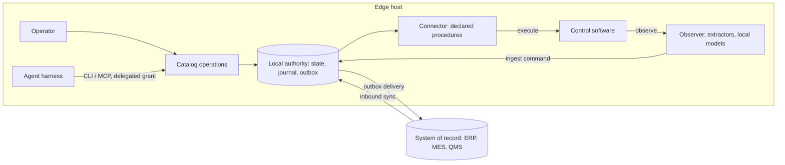

# Edge applications

An edge application runs on or next to the machine where work happens. People and AI agents on that machine operate it together. It runs scripts and procedures locally against the software that controls the equipment, interprets the results locally, and reports them to the systems of record that own enterprise data. This repository is a reference architecture for that class of application.

This document explains the concept: why these applications run at the edge, the loop they implement, how they reach local control software, how agents take part, and how they are deployed. The [overview](overview.md) describes the code. The [operator workstation pattern](operator-workstation-pattern.md) and the [system-of-record reference](system-of-record-pattern.md) describe the two implemented integrations in detail.

## Why at the edge

For years the direction was to move business software to the web. For this class of application, three things point the other way.

**Agent harnesses run locally and work through CLIs.** Codex, Claude Code and similar harnesses run on a workstation or server and act through shell commands, local CLIs and MCP servers over stdio. The CLI is a primary interface again. An application that ships a CLI and an MCP server next to its UI can be operated by a harness on the same machine, under a grant narrowed from the person who started it.

**The software that stayed on the desktop is close to hardware.** Business applications moved to the browser. Control software did not: the vendor HMI, test bench, measurement program or line client that runs a machine costing millions and stays in service for 20 years. It is often validated or under warranty, may run on an old operating system, and rarely has a usable API. These applications are where most of the manual, error-prone work around production still happens.

**Reaching that software requires presence.** Control software can often be instrumented: through COM or another automation interface, local RPC, its files and database, a decoded network protocol, or its screen. Each of these routes needs code running on that machine or on its network segment. Plant networks are segmented, often without internet access, and the connection to enterprise systems can be slow or interrupted. A cloud service cannot do this work directly.

The result is an application whose authority, agent harness and connectors all run at the edge, and which talks to central systems only through a durable outbox and inbound sync.

## The loop: execute, interpret, report

Every edge application implements the same loop.

**Execute.** Something runs locally: a person records a measurement, an agent runs a script that reads the station's result files, a connector loads a recipe through a declared procedure. Reads are free to explore within the caller's sandbox and grant. Anything that changes state in the application goes through a catalog command. Anything that changes state in the control software goes through an outbox effect delivered by a connector, never through an ad hoc script.

**Interpret.** Raw output becomes a fact the application can act on. Deterministic parsing comes first: a structured export, an automation interface value, an accessibility tree. Local models come second: OCR, vision, classifiers and language models running on the edge host, so frames and measurements stay on site. A model reading is a proposal with a value, confidence, source, model identity and observation time. It becomes current only when it is stable across reads, and a reading below the field's confidence threshold goes to a person to confirm. Deterministic code validates and acts; a model never actuates directly.

**Report.** The interpreted fact is committed locally as a command: authorized, attributed to a person or agent, journaled and visible on every open screen. The command enqueues delivery to the system of record in the same transaction. The dispatcher delivers it when the connection allows, and the outcome (accepted, rejected or uncertain) is recorded as a further command. Reporting keeps working while the connection is down: the local commit succeeds, the effect stays visibly pending, and inbound sync resumes from its watermark.

The loop keeps two things separate that ad hoc scripts usually merge: what was observed or done locally, and what the system of record has accepted. A receipt is not acceptance, and an exit code is not a delivery outcome ([P6](principles.md#p6--status-reports-what-is-known-not-what-is-hoped)).

## Reaching control software

Choose the most structured route the software supports. Prefer reading to writing, and vendor-supported interfaces to reverse-engineered ones. A station can combine routes: read counters from a log file, read state from the accessibility tree, and write through a COM call.

| Route                    | Examples                                                                           | Reads        | Writes                         | Needs                                             | In this repository                                                                                                                |
| ------------------------ | ---------------------------------------------------------------------------------- | ------------ | ------------------------------ | ------------------------------------------------- | --------------------------------------------------------------------------------------------------------------------------------- |
| Automation interface     | COM/DCOM, ActiveX, .NET assemblies, vendor SDK, an OPC server the software exposes | Yes          | Yes, if the vendor supports it | On-machine process, or DCOM/network configuration | Not implemented                                                                                                                   |
| Local RPC or IPC         | Localhost TCP or HTTP service, named pipes, WCF, gRPC                              | Yes          | Sometimes                      | On-machine or same segment                        | Not implemented                                                                                                                   |
| Files and local database | Result exports, CSV/XML, logs, recipe files, an embedded SQL database              | Yes          | Rarely; file drops             | File share or local access                        | Not implemented as an adapter; `SystemOfRecordPort.pull` and the observer's `Extractor` are the slots                             |
| Network protocol         | Traffic between station and controller or MES, captured and decoded                | Yes, passive | Not recommended                | Mirror port or tap on the segment                 | Not implemented                                                                                                                   |
| Accessibility tree       | Windows UI Automation on Win32 or WPF applications                                 | Yes          | Through UI actions             | On-machine agent                                  | Adapter slot on `ScreenTransport`; not implemented                                                                                |
| Screen                   | Frame capture with OCR or vision; mouse and keyboard injection                     | Yes          | Through UI actions             | On-machine, VNC/RDP, or KVM-over-IP               | Implemented with a Playwright transport against a fake HMI; no live model ([ADR 004](decisions/004-screen-mediated-authority.md)) |

Every route maps onto the same ports, so replacing one route with another changes an adapter and leaves contracts, handlers and screens unchanged ([P9](principles.md#p9--every-external-dependency-sits-behind-a-port)):

- **Observation** (reads that track live state) runs through `createStationObserver` and `Extractor` implementations, and enters the authority through an ingest command.
- **Inbound sync** (reads of records owned elsewhere) runs through `SystemOfRecordPort.pull`.
- **Actuation** (writes) runs through `SystemOfRecordPort.deliver` as a declared procedure, with `lookup` or readback deciding whether a retry is safe.

Writes to control software follow the rules of the [operator workstation pattern](operator-workstation-pattern.md#desired-versus-observed). Each procedure is declared in a versioned station profile with preconditions, steps, readback and a hazard class. The connector observes before acting and settles `accepted` if the desired state is already present. It verifies by reading back afterwards. If the result is uncertain, the effect is held for a person to reconcile and is never blindly re-run. Safety functions and direct controller writes are out of scope: profiles mark safety controls as forbidden regions, and machine safety stays with the machine and its builder.

## Agents at the edge

An agent harness runs on the edge host beside the authority. It reaches the application in one of two ways ([system-of-record reference](system-of-record-pattern.md#topologies)):

- **Attached.** The host runs `serve` and writes a connection file bound to a delegated grant. The harness, possibly running as a different OS user, uses the CLI or MCP with that file.
- **Embedded.** The harness starts `mcp --embedded --grant-file <file>` or one-shot CLI calls inside its sandbox. The authority runs in that process without a network listener. `bun run build:cli` produces one executable for this, with no runtime install. Observers never start in an embedded authority (`ApplicationConnections.observe` runs only in a serving host), so a station that needs live observation runs the attached topology.

In both cases the grant names the operations, resources, expiry and run it covers, and can only narrow the permissions of the person who started the run ([P3](principles.md#p3--authority-comes-from-trusted-context-never-from-input-and-is-enforced-at-commit)). The agent sees the same catalog as the UI. It gets no private tools and no upstream credentials; the connector holds those.

An agent at the edge typically:

- runs scripts that read local files, logs or interfaces, interprets the output, and submits the result as a command for a person to confirm or as a direct record;
- proposes a classification for an observed event, such as a stop reason from alarm text and history, which the operator confirms with one tap;
- prepares a sequence of commands from a work instruction or brief;
- queries delivery status and explains a rejection from the system of record.

The deterministic path stays available without a model. A scan and a confirm submit the same command as an agent's tool call, so the station keeps working when inference is unavailable. Where the operator and an agent share one control screen, a recorded seat decides who holds it; the operator always preempts ([seat](operator-workstation-pattern.md#seat)).

A harness that executes scripts needs containment. That comes from the operating system, container or VM and the network egress policy, not from a prompt or tool manifest. This repository does not ship a sandbox backend or credential broker; see the [reference plan](system-of-record-reference-plan.md).

## Deployment

Three placements cover most sites. All of them run one authority per application and workspace.

| Placement          | When                                                                   | Reaches the control software through                       |
| ------------------ | ---------------------------------------------------------------------- | ---------------------------------------------------------- |
| On the station PC  | Installation is allowed and the OS can run the host                    | COM, local RPC, files, UI Automation, screen               |
| Edge box beside it | The vendor PC must stay untouched, is validated, or runs an old OS     | Network RPC, file share, mirror port, VNC/RDP, KVM-over-IP |
| Line or site host  | Several stations share one application and their software is networked | Network routes only; per-station profiles                  |

Constraints that shape these choices:

- **Operating system.** The desktop build targets current macOS, Windows x64 and Linux x64. An old station PC often cannot run it, which is the usual reason for an edge box.
- **Network.** Plant networks are segmented. The edge host needs a path to the control software on one side and a permitted path to the system of record on the other. Model endpoints must be loopback or explicitly allowlisted.
- **Connectivity.** Local commits never wait for the system of record. Pending effects are visible, and `drain` reports undelivered work.
- **Variation.** Stations of the same type differ in software version, screen layout, scanners and procedures. These differences live in versioned, validated station and scanner profiles, checked by a golden replay before activation ([P8](principles.md#p8--specialization-is-composition-and-configuration-never-a-fork)).
- **Operators.** Stations are shared, operators wear gloves and may have no personal account. Input design is covered in [point-of-work input](point-of-work-input.md); per-operator identity at a shared station is open work.

## Status

| Part of the concept                                              | Status                                                                                                     |
| ---------------------------------------------------------------- | ---------------------------------------------------------------------------------------------------------- |
| Local authority, outbox, inbound sync, live updates              | Implemented and tested against in-memory fakes                                                             |
| Attached and embedded CLI/MCP with delegated grants              | Implemented; compiled binary tested with an empty environment                                              |
| Screen route: observer, controller, profiles, seat, held effects | Implemented against a fake HMI in Chromium; no live computer-use model                                     |
| Local perception models                                          | Adapters exist (accessibility, worker subprocess, OpenAI-compatible vision); none run against a real model |
| Scanner and device input                                         | Implemented in software; no hardware checked                                                               |
| COM, RPC, file, database and protocol routes                     | Not implemented; they fit the existing ports                                                               |
| Offline operation                                                | Outbox queues locally; not exercised against a disconnected device                                         |
| Sandbox backend, credential broker, fleet updates                | Not implemented                                                                                            |
| Safety rating, regulated validation                              | Out of scope                                                                                               |

The [implementation ledger](implementation-status.md) holds the evidence for each item.
