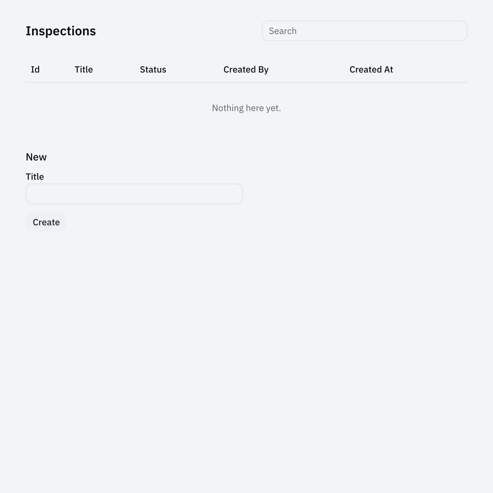
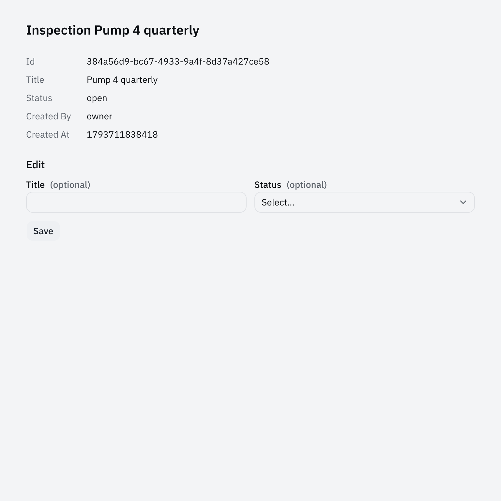

# Getting started

You will build an inspection desk: a list of equipment inspections that people edit on a screen and agents edit over the CLI and MCP. Each step is one action and what you should see. It takes about 20 minutes.

## New application

You need Bun and a clone of this repository.

**1. Install the framework.** In the framework repository:

```sh
bun install --frozen-lockfile
```

You should see the count of installed packages.

**2. Export a new app.** Use a path outside this repository that does not exist yet:

```sh
bun run scaffold new /tmp/inspection-desk --name inspection-desk --display-name "Inspection Desk" --collection inspection
```

You should see:

```text
Exported <count> source files for inspection-desk to /tmp/inspection-desk
Next: bun install --frozen-lockfile && bun run format && bun run generate && bun run typecheck && bun test
```

The new directory is a full copy of the framework plus your app in `showcase/examples/inspection-desk/`. `app.config.json` already points at it.

**3. Install and test it.**

```sh
cd /tmp/inspection-desk
git init && git add -A && git commit -qm "scaffold"
bun install --frozen-lockfile
bun run generate
bun run typecheck
bun test showcase/examples/inspection-desk
```

You should see `Generated 10 reference artifacts for 1 applications in dist/reference`, no typecheck output, and `4 pass  0 fail`.

## Run it

**4. Start the app.**

```sh
bun run dev:web
```

You should see one JSON line with `"application":"inspection-desk"` and a `launchUrl` like `http://127.0.0.1:4317/#launch=...`.

**5. Open the `launchUrl` in a browser.** It works once, within one minute. You should see an **Inspections** table (Id, Title, Status, Created By, Created At) and a **New** form with a Title field and a **Create** button.



Create one inspection. The row appears in the table without a reload, and opening it shows the record with its Edit form.



**6. Use the CLI.** In a second terminal, from `/tmp/inspection-desk`:

```sh
export AGENT_NATIVE_CONNECTION="$(pwd)/.workspace/.connection.json"
bun run cli help
bun run cli inspection list --output text
```

You should see the command list, ending in `Exit status: 0 ok, 2 invalid input, 3 not found, 4 forbidden, 5 conflict, ...`, then a table with the inspection you created in the browser. The screen, the CLI and MCP all call the same operations.

Stop the app with Ctrl+C before you change code.

## Add a field

Every inspection needs the ID of the equipment it checks.

**7. Add the field to the record.** In `showcase/examples/inspection-desk/contracts/inspection.ts`, add one line to `inspectionSchema`:

```ts
export const inspectionSchema = z.strictObject({
  id: recordKeySchema,
  title: z.string().min(1).max(200),
  equipmentId: z.string().min(1).max(80), // new
  status: z.enum(['open', 'done']),
  // ...
});
```

In the same file, add `'equipmentId'` to the `fields` of the create and update commands:

```ts
inspectionCreate: collectionCreate(inspections, { /* ... */ fields: ['title', 'equipmentId'] }),
inspectionUpdate: collectionUpdate(inspections, { /* ... */ fields: ['title', 'equipmentId', 'status'] }),
```

**8. Run the tests.**

```sh
bun test showcase/examples/inspection-desk
```

You should see `3 fail` with `Input does not match operation schema`. The old tests create inspections without an equipment ID.

**9. Fix the tests.** In `test/inspection.test.ts` and `test/conformance.test.ts`, add `equipmentId: 'PUMP-4'` to every `inspection.create` input. In `e2e/default-screens.pw.ts`, fill the new field after the title:

```ts
await page.getByRole('textbox', { name: 'Equipment Id', exact: true }).fill('PUMP-4');
```

Add a test for the new rule at the end of `test/inspection.test.ts`:

```ts
test('an inspection without an equipment ID is refused', async () => {
  const app = await open();
  await expect(
    app.invokeRaw(
      { operation: 'inspection.create', input: { title: 'No ID', equipmentId: '' }, idempotencyKey: 'no-id' },
      owner,
    ),
  ).rejects.toMatchObject({ code: 'INVALID_INPUT' });
});
```

Run `bun test showcase/examples/inspection-desk` again. You should see `5 pass  0 fail`.

**10. Try it from the CLI.** Start `bun run dev:web` again, then in the second terminal:

```sh
bun run cli help inspection create
bun run cli inspection create --title "Check pump 4" --equipment-id PUMP-4 --key inspection-pump-4
bun run cli inspection create --title "No equipment" --equipment-id "" --key bad-1; echo "exit $?"
```

You should see:

```text
inspection-desk inspection create --equipment-id <string> --title <string> [--key <idempotency-key>]
{"operation":"inspection.create","result":{"id":"97d4b14c-...","title":"Check pump 4","equipmentId":"PUMP-4","status":"open",...},...}
{"error":{"code":"INVALID_INPUT","message":"Input does not match operation schema"}}
exit 2
```

The browser form now has an **Equipment Id** field too. `--key` is an idempotency key: run the same create twice with the same key and you get one inspection.

## Add a command

**11. Generate the command.** Stop the app, then:

```sh
bun run scaffold add capability inspection.close --kind command --description "Mark an open inspection done. Editors only."
```

You should see `Wrote 6 files in showcase/examples/inspection-desk`. It created `contracts/inspection-close.ts`, `handlers/inspection-close.ts` and `test/inspection-close.test.ts`, and registered them in `contracts.ts`, `policy.ts` (editors only) and `server.ts`. The generated command takes `{}` and does nothing yet.

**12. Write the contract.** Replace `contracts/inspection-close.ts`:

```ts
import { z } from 'zod';
import { defineCapability, jsonSchema, recordKeySchema } from '@tortoise/contracts';
import { inspectionSchema } from './inspection';

export const inspectionClose = defineCapability({
  id: 'inspection.close',
  kind: 'command',
  description: 'Mark an open inspection done. Editors only.',
  input: jsonSchema(z.strictObject({ id: recordKeySchema })),
  output: jsonSchema(inspectionSchema),
  permission: { action: 'write', resourceType: 'Inspection' },
  ui: { exception: 'headless until a screen binds it' },
});
```

**13. Write the handler.** Replace `handlers/inspection-close.ts`:

```ts
import { ApplicationError } from '@tortoise/contracts';
import { own, type HandlerContribution } from '@tortoise/runtime';
import { operations } from '../contracts';
import type { AppState } from '../domain';
import { handler, type Services } from './context';

export function inspectionCloseHandlers(): HandlerContribution<AppState, Services>[] {
  return [
    handler(operations.inspectionClose, (input, ctx) => {
      const inspection = own(ctx.state.inspections, input.id);
      if (!inspection) throw new ApplicationError('NOT_FOUND', 'No such inspection');
      if (inspection.status === 'done')
        throw new ApplicationError('CONFLICT', 'Inspection is already done');
      inspection.status = 'done';
      ctx.change(`inspection:${inspection.id}`);
      return inspection;
    }),
  ];
}
```

`ctx.change` marks the record as changed, so open screens refresh it.

**14. Write the test.** `bun test showcase/examples/inspection-desk` now fails in `inspection-close.test.ts`, because the generated test still sends `{}`. Replace its test body so it creates an inspection, then checks that a viewer gets `FORBIDDEN`, the owner gets `status: 'done'`, and a second close gets `CONFLICT`:

```ts
test('editors close an open inspection once; viewers cannot', async () => {
  const workspacePath = await mkdtemp(join(tmpdir(), 'inspection-desk-inspection-close-'));
  const instance = await openEmbeddedInstance(
    createInspectionDeskApplication({
      members: { viewer: 'viewer' },
      services: { newId: () => 'i-1', now: () => 1_000 },
    }),
    { workspacePath },
  );
  cleanup.push(() => rm(workspacePath, { recursive: true, force: true }));
  cleanup.push(() => instance.close());
  const app = instance.application;
  const close = (key: string, who: typeof owner) =>
    app.invokeRaw({ operation: 'inspection.close', input: { id: 'i-1' }, idempotencyKey: key }, who);

  await app.invokeRaw(
    { operation: 'inspection.create', input: { title: 'Pump 4', equipmentId: 'PUMP-4' }, idempotencyKey: 'c' },
    owner,
  );
  await expect(close('v', viewer)).rejects.toMatchObject({ code: 'FORBIDDEN' });
  expect((await close('close', owner)).result).toMatchObject({ id: 'i-1', status: 'done' });
  await expect(close('again', owner)).rejects.toMatchObject({ code: 'CONFLICT' });
});
```

Then run all checks:

```sh
bun run format && bun run generate && bun run typecheck && bun test showcase/examples/inspection-desk
```

You should see `6 pass  0 fail`.

**15. Close an inspection from the CLI.** Start `bun run dev:web`, then:

```sh
bun run cli inspection list --output text           # copy an id
bun run cli inspection close --id <id> --key close-1
bun run cli inspection close --id <id> --key close-2; echo "exit $?"
```

You should see the inspection with `"status":"done"`, then `{"error":{"code":"CONFLICT","message":"Inspection is already done"}}` and `exit 5`.

The command has no button yet; `ui: { exception: ... }` says so. To add one, see [build-screens](../packages/frame/skills/build-screens/SKILL.md).

## Connect an agent over MCP

**16. List the tools.** With the app running and `AGENT_NATIVE_CONNECTION` set:

```sh
printf '%s\n' \
  '{"jsonrpc":"2.0","id":1,"method":"initialize","params":{"protocolVersion":"2025-06-18","capabilities":{},"clientInfo":{"name":"t","version":"0"}}}' \
  '{"jsonrpc":"2.0","method":"notifications/initialized"}' \
  '{"jsonrpc":"2.0","id":2,"method":"tools/list"}' | bun run --silent mcp
```

You should see tools named `inspection_list`, `inspection_create`, `inspection_close` and so on. To give Claude Code or Codex these tools, register `bun run mcp` as an MCP server with `AGENT_NATIVE_CONNECTION` in its environment. For Claude Code:

```sh
claude mcp add --scope project inspection-desk -e AGENT_NATIVE_CONNECTION=$AGENT_NATIVE_CONNECTION -- bun run mcp
```

## Run the browser test

**17.** Install the browser once, then run the app's Playwright spec:

```sh
bunx playwright install chromium
bunx playwright test showcase/examples/inspection-desk
```

You should see `1 passed`.

## Next

- Send finished inspections to a quality system: [Systems of record](systems-of-record.md).
- Build a bigger app with Claude Code or Codex: [Tutorials](tutorials/index.md).
- Read a finished app: `cd showcase/examples/quality-inspection && bun run dev:web`, then its [README](../showcase/examples/quality-inspection/README.md).
- Start from an example instead of a blank app: `bun run scaffold /tmp/my-app --name my-app --example field-service`.
- Install the framework from a registry instead of copying it: add `--registry <url>` (or `--published`) to `scaffold new`, and use `bun install` without `--frozen-lockfile`. No registry has the packages yet; `bun run release:serve` runs a local one.
- In an export, the full `bun run check` fails because `check:skills` points at examples the export left out. Use the commands in step 14.
