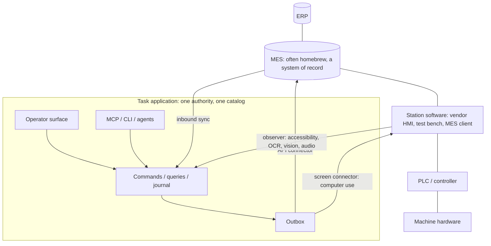

# Operator workstations

This pattern treats legacy station software as a screen-mediated authority. It extends the [system-of-record pattern](system-of-record-pattern.md) to the point where work meets machines. On many shop floors, controller-level hardware sits behind proprietary station software: a vendor HMI, a test-bench program, a measurement application or a homebrew MES client. That software rarely has a usable API, is often validated or under warranty, and must not be modified. This pattern covers the case where the only stable interface is its screen. Where the software exposes an automation interface such as COM, a local RPC service, files or a decodable network protocol, the same ports apply with a different adapter: a [hardware driver](hardware-drivers.md) in its own process, as in [Automation route](#automation-route).

The goal is instrumentation on top of that stack. Monitor the station, let operators and agents act through the application's interaction contract, and reach the legacy software only through its screen, by way of a background computer-use agent that the application controls. The hardware stays behind the legacy software, which keeps all controller interaction.

The worked example is `examples/line-station`. Status and evidence are recorded at the end of this document and in the [implementation ledger](implementation-status.md).

## Where the pattern sits

The application wraps two levels:

- **The MES** is an ordinary system of record. It owns orders, recipes and reason catalogs, and it accepts confirmations. Homebrew MES installations are often reachable through a database, file drop or small HTTP service. A connector implements the system-of-record port against whichever of those exists.
- **The station software** is a screen-mediated authority. It owns the actual machine state, the recipe that is actually loaded, and the counters. The application reads these by observing the screen. It changes them only through declared procedures that a computer-use controller performs and then verifies by reading the screen back.

The application never talks to the PLC or the hardware. Safety functions remain with the machine and its builder.

## Where the computer-use agent sits

The central decision is where the computer-use agent lives. It is **not** an application harness with catalog tools in front of the authority. It is a connector behind the outbox, on the same footing as an ERP API client:

- A person or agent issues a catalog command, such as starting an order. The handler validates the command, records the _desired_ state and enqueues an effect for target `legacy-hmi`, all in one transaction.
- The station connector, another system-of-record connector, claims the effect outside any transaction. It runs the declared procedure on the station screen and reports an outcome through the domain's settle command.
- The station observer, on the inbound side like inbound sync, reads the screen and submits readings through an ingest command. It never writes storage.

Frontends, MCP clients and agents therefore keep one CQRS contract. They never address the computer-use agent, and the computer-use agent never holds business tools. Its integration principal can only ingest observations, settle station effects and read its control state. Removing the bridge leaves a monitoring-free but fully functional application. Adding a better computer-use model changes one driver, not the contract.

## Bridge modes

The pattern has three rungs, each worth deploying alone:

1. **Observe.** This is read-only instrumentation. Machine state, counters, alarms and the loaded recipe become authorized live projections with freshness and confidence. Stops are detected from observed state transitions. This rung carries most of the value, carries no actuation risk, and is the default bridge mode (`monitor-only`).
2. **Annotate.** People and agents add meaning to observed events: stop reasons, scrap reasons, confirmation of counts. Each annotation is an ordinary command, forwarded to the MES through the outbox. An agent can propose an explanation from the alarm text and history; the operator confirms with one tap.
3. **Actuate.** The bridge writes into the legacy GUI, for example to load the recipe for a scanned order. This rung requires bridge mode `actuate`, an explicit hazard class per procedure, the operator's hold-to-confirm for operator-present procedures, and readback verification.

## Settling screen procedures

Screen actions are not idempotent and can be interrupted. The connector therefore treats acceptance as convergence:

| Step                | Rule                                                                                                                                                       |
| ------------------- | ---------------------------------------------------------------------------------------------------------------------------------------------------------- |
| Before any action   | Observe. If the readback already matches the desired state, settle `accepted` without acting. This makes a redelivery after a lost settlement harmless.    |
| Preconditions       | If declared preconditions fail (for example, the machine is running), settle `rejected` with `PRECONDITION`. Nothing was done, so rejection is definitive. |
| During the steps    | Each action passes the controller's policy gate. An unexpected screen, an alarm, operator input or a timeout aborts the run and is a transient failure.    |
| After the steps     | Observe again. A matching readback settles `accepted`, with a readback digest as the external reference.                                                   |
| Uncertain afterward | If the readback does not match, a procedure declared `rerunnable` is redelivered. Any other effect is **held** for operator reconciliation, never re-run.  |

A held effect stays visible as "needs reconciliation". The operator states whether the change was applied, through a reconcile command. A lost reply is not a rejection, and an empty observation is not proof that nothing happened.

## Screen transport, driver and controller

"Any computer-use agent, as long as we control it" becomes a port split:

- A **screen transport** reaches the screen. It captures frames, optionally reads an accessibility tree, performs one action and reports local operator input where it can detect it. The reference transport drives a Playwright page. VNC, RDP, HDMI capture with USB HID injection (KVM-over-IP), and Windows UI Automation are adapter slots for sites where nothing may be installed on the vendor PC.
- A **computer-use driver** only resolves a declared target to a screen location and, for future goal-directed drivers, proposes the next action. It never holds the mouse.
- The **controller** executes every action itself, after a gate. The gate checks that the screen is the expected one, that the target is outside every forbidden region and inside the procedure's allowed set, that the step budget and timeout are not exceeded, that the bridge mode permits actuation and that the agent holds the seat.

The reference implementation ships a deterministic scripted driver that resolves targets from locators. A live computer-use model implements the same port later. Local models, such as open UI-grounding models, and cloud models can then be swapped without changing the gate.

### Seat

The operator and the agent share one legacy screen. Exactly one holds it at a time: `operator`, `agent` or `idle`. The operator always preempts. The seat is recorded state, not a lease: it has no expiry and no fencing token, so a holder that disappears keeps it until someone changes it. The station UI's takeover command changes the desired seat in domain state, and the controller reads it through its control query. Where the transport detects local keyboard or mouse input, the controller aborts immediately and reports the seat as `operator`. An aborted procedure is uncertain and follows the reconciliation rules above.

## Observation and local models

Prefer the most deterministic source available, in this order:

1. Vendor exports, log files, the station's own database, or an automation interface such as COM or local RPC, as a regular inbound connector or extractor where one exists.
2. The accessibility tree of the legacy application (UI Automation on Windows). This is often available on old Win32 software and is exact.
3. OCR and vision on screen pixels, through local models.
4. Audio, for example classifying alarm horns or spoken notes.

Each source implements the extractor port. Every reading carries its value, confidence, extractor, model identity (`id`, `version`, `digest`), observation time and frame digest. A reading becomes current only after it is stable across a configured number of consecutive frames. A reading below the field's minimum confidence creates an attention item instead of silently updating state. The operator confirms or corrects it with a large button, and its provenance becomes `operator-verified`.

Local inference keeps frames on site. The reference adapters are:

- `accessibility`: deterministic, confidence 1.
- `worker`: a JSON-lines subprocess protocol, so any local runtime can serve OCR, classifiers or audio models in any language.
- `openai-compatible-vision`: a local vision-language model behind an OpenAI-compatible endpoint, for example Ollama, llama.cpp server or vLLM. Output is constrained to a JSON schema per field. The base URL must be loopback or explicitly allowlisted. Its confidence is agreement across reads, which is a heuristic and is documented as one.

### Station profiles

Everything specific to one installation is versioned data, not code. A station profile names the application and its version pattern, identifies screens by anchors, maps fields to locators or regions and extractors, marks forbidden regions, and declares procedures with preconditions, steps, readback, hazard class and rerun safety. Profile validation rejects any procedure step that targets a forbidden region or an unknown field.

When the vendor updates the HMI or a model changes, the golden-frame gate replays labeled frames through the profile's extractors. It reports per-field accuracy and confidence before the new version is activated.

## Automation route

A station whose software has an automation interface can be reached through a driver instead of its screen. The driver's contract carries the fields the screen profile reads and the same procedures, with the same preconditions, readback and hazard classes. Its bridge runs as the same station principal with the same grant, target and control query. Observations and outbox effects look the same to the domain, so handlers, contracts and screens do not change with the route. The driver's `control` field takes the place of the screen's local input check. The bridge mode and the seat gate it as they gate the screen route.

`examples/line-station` configures each station on one route. Its automation driver is written in C# against the station software's COM server; see [hardware drivers](hardware-drivers.md#examples).

## Safety

- The bridge never operates safety functions. Profiles mark emergency-stop reset, interlock override, manual jog and similar controls as forbidden regions, and no procedure can target them.
- Procedures declare a hazard class: `none`, `low` or `operator-present`. Operator-present procedures require a hold-to-confirm at the station by a person with the operator role.
- The default bridge mode is `monitor-only`. A supervisor can pause actuation at any time; pending effects then wait visibly.
- Machine guarding and safety remain the responsibility of the machine and its builder. This is not a safety-rated system. Regulated environments (GMP, 21 CFR Part 11 and similar) require deployment-specific validation.

## Ownership

| Data                                                                                       | Owner                                                                     |
| ------------------------------------------------------------------------------------------ | ------------------------------------------------------------------------- |
| Orders, recipes, reason catalogs, accepted confirmations                                   | MES (system of record), imported through inbound sync                     |
| Actual machine state, loaded recipe, counters, alarms                                      | Station software; the application holds observed copies with provenance   |
| Stops and their classification, count confirmations, operator verifications, desired state | Task application, forwarded to the MES or station through the outbox      |
| Observation history                                                                        | Task application, bounded, with frame digests rather than retained frames |
| Scanner and device profiles per station                                                    | Task application, through the reusable device configuration module        |

## Point-of-work input

Operators wear gloves, stand at a distance and look at the machine, not the screen. The [point-of-work input guide](point-of-work-input.md) covers the glove-sized operator UI registry and the scanner kit: sources, calibration, decoding and layout correction.

## Status

The status table is maintained in the [implementation ledger](implementation-status.md#operator-workstation-bridge). It separates deterministic tests, browser checks, device checks and opt-in live local-model checks. No live computer-use driver is part of this reference.
