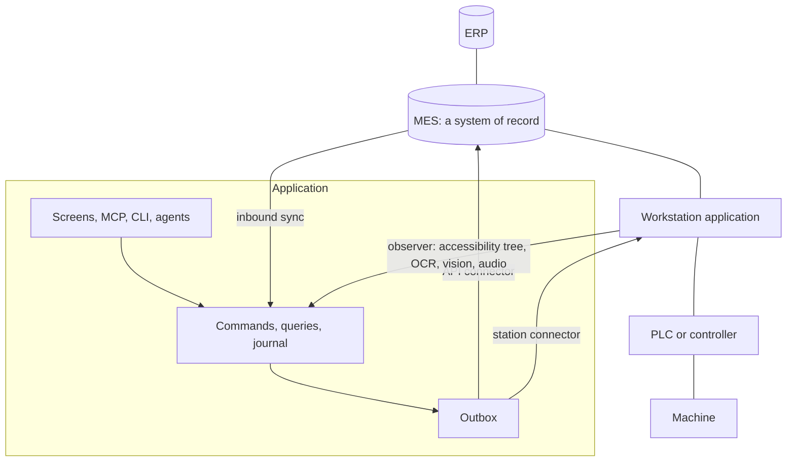

# Operator workstations

Your application can watch and operate a workstation application, such as a vendor HMI or an MES client, through its screen. The vendor software stays unmodified. If it has an automation interface (COM, local RPC, files), use a [driver](hardware-drivers.md) instead; see [Automation route](#automation-route). The example is [`showcase/examples/winding-line`](../showcase/examples/winding-line/README.md).

## Try it

```sh
bun test workstations/screen-bridge
bun test showcase/examples/winding-line
cd showcase/examples/winding-line && bun run dev:web        # fake HMI in process, bridged, port 4323
cd showcase/examples/winding-line && bun run station:golden # replay labelled frames
```

`dev:web` prints `Fake HMI: http://127.0.0.1:<port>` and the launch link; `bun run dev` does the same in the desktop shell. Otherwise a host starts a bridge only if `STATION_HMI_URL` has a value.

## Who owns what



The application never talks to the PLC or the hardware.

### Data ownership

| Data | Owner |
| --- | --- |
| Orders, recipes, reason catalogs, accepted confirmations | MES; inbound sync imports them. |
| Machine state, loaded recipe, counters, alarms | Workstation application; the application keeps observed copies with provenance. |
| Stops and reasons, count confirmations, operator verifications, desired state | Application; the outbox sends them to the MES or station. |
| Observation history | Application, bounded; frame digests instead of frames. |
| Scanner profiles and scan routes | Application, through the `device` feature. |

## Screen bridge

The screen bridge is a connector behind the outbox, like an ERP client. Screens, MCP clients and agents never call it.

1. Someone submits a command, e.g. start an order. The handler records the desired state and enqueues an effect for the station, in one transaction.
2. The dispatcher hands the effect to the bridge, which runs the declared procedure on the screen and completes it through the domain's complete command.
3. The observer reads the screen and submits readings through an ingest command.

In `winding-line` each bridge runs as `station-bridge:<station>` with three capabilities: `line.observation.ingest`, `line.effect.complete` (target `legacy-hmi:<station>`) and `line.control.get`. Without a bridge the app still runs, with no observations.

### Procedure delivery

A screen action can break off midway and is not idempotent, so procedures use convergent [delivery](hardware-drivers.md#delivery-modes). For each effect the connector:

1. rejects a missing presence confirmation (`PRECONDITION`) or input value (`INVALID_PAYLOAD`);
2. fails transiently if the bridge mode or control holder forbids it;
3. accepts at once if the readback already matches, so redelivery is harmless;
4. fails transiently if the screen is not the start screen or a precondition is unreadable; rejects with `PRECONDITION` if one is unmet;
5. runs each step through the [interlock](#interlock);
6. accepts when the readback matches, with a readback digest as the external reference.

An alarm popup, local input, a timeout or an exhausted step budget stops the procedure. If it stopped after its first action, the dispatcher redelivers a `rerunnable` procedure and puts any other effect in [`held`](systems-of-record.md#held-effects) until the operator says, with the reconcile command, whether the change took effect. No procedure for the type: `UNSUPPORTED`. Test: `workstations/screen-bridge/test/controller.test.ts`.

## Bridge modes and risk levels

| Bridge mode | Allows |
| --- | --- |
| `monitor-only` (default) | Observing only. |
| `assist` | Procedures with risk `none`. |
| `actuate` | Every declared procedure. |

| Risk level | Meaning |
| --- | --- |
| `none` | No machine motion. |
| `low` | Changes settings, no motion. |
| `operator-present` | Payload must confirm a person is at the station. |

Drivers use the same modes and levels. In `winding-line` only a supervisor at the station changes the mode, and can pause actuation at any time.

Roll out in three stages: **observe** (state, counters, alarms, stops), **annotate** (people and agents add stop reasons and confirmations, sent to the MES), **actuate** (e.g. load the recipe for a scanned order). In `winding-line` the stop explainer agent proposes a stop reason and the operator approves it with one tap; loading a recipe is `operator-present` and needs a long press (`hold-to-confirm`).

## Interlock

The bridge has three ports: a **screen transport** (captures frames, reads the accessibility tree, performs one action, reports local input), a **computer-use driver** (turns a target into a screen point, never acts) and a **controller** (performs every action after the interlock).

Before every click, key or typed text the interlock checks the bridge mode and control holder, local input since the start, the expected screen on a fresh capture, that the point is outside every forbidden region, and the step budget and timeout. Only declared steps and keys from the station profile's allowed list run.

The reference transport drives a Playwright page; the reference driver follows a script of locators. VNC, RDP, KVM-over-IP, UI Automation or a local grounding model fit the same ports.

## Control holder

The control holder is `operator`, `agent` (the bridge) or `idle`. The bridge does not act while the control holder is `operator`, and only a person can request it. Control never expires: a holder that disappears keeps it until someone changes it. The operator's takeover command changes it, and local input stops a procedure at once where the transport detects it.

## Observation

Each observation source is an extractor. Prefer, in order: vendor exports, logs, the station database or an automation interface; the accessibility tree; OCR and vision; audio.

A reading has value, confidence, extractor, model, time and frame digest. It becomes current only after it agrees across the field's configured number of frames. A stable reading below the field's minimum confidence creates an attention item instead; the operator confirms or corrects it and it becomes `operator-verified`.

Screen recognizers that ship, all local:

- `accessibility`: deterministic, confidence 1.
- `worker`: a JSON-lines child process in any language.
- `openai-compatible-vision`: Ollama, llama.cpp server or vLLM; the recognizer checks each field against a JSON schema. The endpoint must be loopback or on the allowlist.

Tests: `workstations/screen-bridge/test/observer.test.ts`, `recognition.test.ts`.

## Station profiles

A station profile is versioned data for one installation: the application and validated versions, screens, fields (locator or region plus extractor), forbidden regions, and procedures (preconditions, steps, readback, risk, rerunnable). Validation rejects a step on a forbidden region or unknown field (`profile.test.ts`). After a vendor update or model change, the golden test replays labelled frames and fails on any confident wrong reading or wrong screen.

## Automation route

If the workstation application has an automation interface, reach it through a driver. The driver contract declares the same fields and procedures, and the bridge runs as the same principal with the same grant, so handlers and screens don't change. The driver's `control` field replaces the local-input check. `winding-line`'s automation driver is C# against the vendor COM server ([examples](hardware-drivers.md#examples)).

## Workstation sign-in

At a shared terminal, an operator scans a badge and enters a 4–8 digit PIN, then works under a short session as themselves. [`workstations/sign-in`](../workstations/sign-in/README.md) provides this; `showcase/patterns/sign-in` composes it.

- A terminal is the local owner or a principal in the `station-sign-in-terminals` setting. Only its own session, never a delegated grant, can sign people in, so an agent cannot.
- Sessions last 15 minutes by default, 720 at most. A new sign-in ends the previous one.
- Five wrong PINs lock the badge for 15 minutes. Unknown, revoked and wrong-PIN attempts look the same.
- Badge and PIN never reach a stored command input. State keeps digests and a salted scrypt PIN hash.
- Signing in does not take control from the bridge; use the takeover command.

Test: `workstations/sign-in/test/sign-in.test.ts`.

## Limits

- The bridge never operates safety functions; list e-stop reset, interlock override and jog as forbidden regions. Nothing here is safety-rated. GMP or 21 CFR Part 11 need per-deployment validation.
- No live computer-use driver and no VNC, RDP, KVM or UI Automation transport ship.
- Activating a profile does not require a passing golden test.
- No test has run against a physical badge reader.

## See also

[Implementation status](implementation-status.md#operator-workstation-bridge) · [Point-of-work input](point-of-work-input.md) · [Systems of record](systems-of-record.md) · [`workstations/screen-bridge`](../workstations/screen-bridge/README.md) · [bridge-station-screen skill](../workstations/screen-bridge/skills/bridge-station-screen/SKILL.md) · [Station bridge demo](development-and-testing.md#station-bridge-demo-and-opt-in-recognition)
