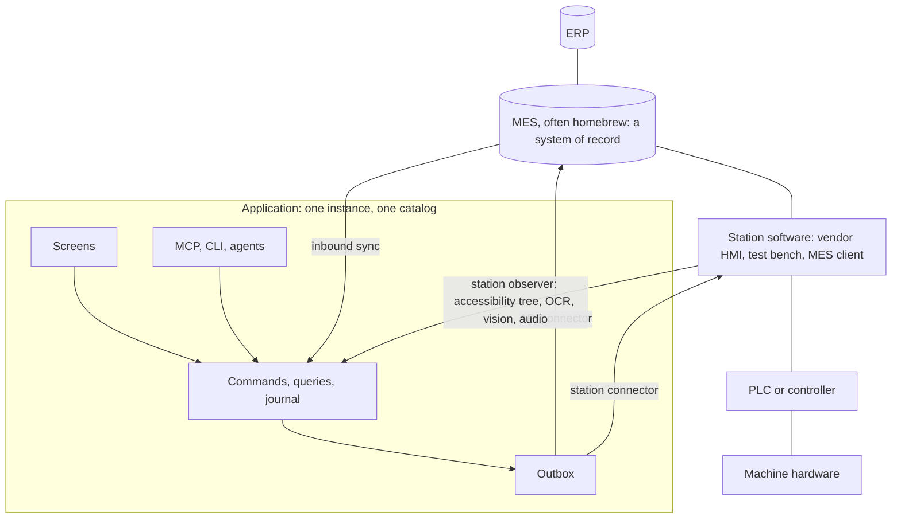

# Operator workstations

An [application](glossary.md#application) observes and drives [station](glossary.md#station) software through its [station screen](glossary.md#screen). Coding agents follow the [bridge-station-screen](../packages/station/skills/bridge-station-screen/SKILL.md) skill. The example is [`examples/line-station`](../examples/line-station/README.md).

Station software rarely has a usable API, is often validated or under warranty, and must not be modified. Where its only stable interface is its station screen, the application treats it as a [system of record](systems-of-record.md) reached through that screen. Software with an automation interface, such as COM, a local RPC service, files or a decodable network protocol, is reached through a [driver](hardware-drivers.md) instead, as [Automation route](#automation-route) describes.

The application monitors the station and lets operators and agents act through its [catalog](glossary.md#catalog). A bridge the application controls is its only path to the station software, which keeps all interaction with the controller and the hardware.

## Concepts

Terms: [station profiles](glossary.md#station-profile), [procedures](glossary.md#procedure), [bridge modes](glossary.md#bridge-mode), [hazard classes](glossary.md#hazard-class), the [seat](glossary.md#seat) and [station sign-in](glossary.md#station-sign-in).

## Station software and the MES



The MES is an ordinary system of record. It owns orders, recipes and reason catalogs, and it accepts confirmations. A homebrew MES is often reachable through a database, a file drop or a small HTTP service, and a [connector](glossary.md#connector) uses whichever exists.

The station software owns the actual machine state, the loaded recipe and the counters. The application reads them by observing the station screen. It changes them only through declared procedures, which the controller performs and then confirms by reading the station screen back.

The application never talks to the PLC or the hardware. Safety functions remain with the machine and its builder.

## Screen bridge

The screen bridge sits behind the [outbox](glossary.md#outbox), as a connector on the same footing as an ERP API client. It is not a [harness](glossary.md#harness) and holds no catalog tools. A request travels like this:

1. A person or an agent submits a [command](glossary.md#command), such as starting an order. The handler validates it, records the desired state and enqueues an [outbox effect](glossary.md#effect) for the station's target, in one transaction.
2. The [dispatcher](glossary.md#dispatcher) claims the effect outside any transaction and hands it to the station connector. The connector runs the declared procedure on the station screen, and the dispatcher settles the outcome through the domain's settle command.
3. The station observer reads the station screen and submits readings through an ingest command. It never writes storage.

Screens, MCP clients and agents never address the bridge, and the bridge holds no business capabilities. In `line-station`, each station's bridge runs as the [integration principal](glossary.md#integration-principal) `station-bridge:<station>`. Its [grant](glossary.md#grant) holds three capabilities:

| Capability | Use |
| --- | --- |
| `line.observation.ingest` | Submit what the station screen shows. |
| `line.effect.settle` | Settle the station's effects, for target `legacy-hmi:<station>`. |
| `line.control.get` | Read the bridge mode and the seat. |

The application runs without a bridge, and then has no observations. A different computer-use model replaces one computer-use driver and leaves the catalog unchanged.

## Procedure delivery

Screen actions are not idempotent and can be interrupted. A station procedure therefore uses convergent delivery, one of the [delivery modes](hardware-drivers.md#delivery-modes) that hardware drivers define. The station connector handles an effect in this order:

| Step | Rule |
| --- | --- |
| Payload check | A missing presence confirmation rejects with `PRECONDITION`; a missing input value with `INVALID_PAYLOAD`. |
| Bridge state | While the bridge mode or the seat forbids the procedure, delivery fails transiently. |
| Convergence | A readback that already matches is accepted without acting, so a redelivery after a lost settlement is harmless. |
| Start screen | If the station screen is not the procedure's start screen, delivery fails transiently. |
| Preconditions | Unreadable ones fail transiently. Unmet ones reject with `PRECONDITION`, and nothing was done. |
| Steps | Each action passes the controller's gate. A stop before the first action is a transient failure. |
| Readback | A match across the fields' stable reads accepts, with a readback digest as the external reference. |
| Interruption | After the first action, a stop or failed readback redelivers a `rerunnable` procedure and holds any other effect. |

An unexpected screen such as an alarm popup, local input, a timeout or an exhausted step budget stops a procedure. An effect for a type with no procedure is rejected with `UNSUPPORTED`. `packages/station/test/controller.test.ts` tests this order.

A held effect never re-runs and stays visible as needing [reconciliation](glossary.md#reconciliation). The operator states through a reconcile command whether the change was applied. A lost reply does not reject the effect, and an empty observation does not prove that nothing happened. [Held effects](systems-of-record.md#held-effects) explains reconciliation.

## Bridge modes and hazard classes

Each station has a bridge mode:

| Bridge mode | What the bridge may do |
| --- | --- |
| `monitor-only` | Observe only. This is the default. |
| `assist` | Run procedures of hazard class `none`. |
| `actuate` | Run every declared procedure. |

Each procedure declares a hazard class:

| Hazard class | Meaning |
| --- | --- |
| `none` | No machine motion. |
| `low` | Changes settings, with no motion. |
| `operator-present` | The effect payload must carry a confirmation that a person is at the station. |

Driver actions use the same bridge modes and hazard classes, as the hardware drivers [gate](hardware-drivers.md#gate) describes. In `line-station`, only a supervisor at the station may change the bridge mode. A supervisor can pause actuation at any time, and pending effects then wait visibly.

## Deployment stages

Each stage is worth deploying alone:

1. **Observe.** Machine state, counters, alarms and the loaded recipe become authorized live data with freshness and confidence, and stops are detected from state transitions. This stage has no actuation risk.
2. **Annotate.** People and agents add meaning to observed events, such as stop reasons and count confirmations. Each annotation is an ordinary command, forwarded to the MES through the outbox.
3. **Actuate.** The bridge writes into the station software, for example to load the recipe for a scanned order. The bridge mode must permit the procedure's hazard class.

In `line-station`, the stop explainer agent proposes a stop reason from the alarm text and history. The station shows the [proposal](glossary.md#proposal), and the operator accepts it with one tap. Loading a recipe has hazard class `operator-present` and so needs actuate mode. The operator starts the order with a hold-to-confirm, and the command records them as the confirming person.

## Controller gate

The bridge splits the work across three ports:

- **Screen transport:** captures frames, reads the accessibility tree where it can, performs one action, and reports local input at the station where it can detect it.
- **Computer-use driver:** resolves a declared target to a point on the station screen. It never acts.
- **Controller:** performs every action itself, after a gate.

The gate runs before every click, key press and typed text. It checks:

- the bridge mode and the seat, read again through the control query;
- local input since the procedure started, where the transport reports it;
- the expected station screen, on a fresh capture;
- that the resolved point lies outside every forbidden region;
- the procedure's step budget and timeout.

A procedure performs only its declared steps and presses only keys from the station profile's allowed list. The reference transport drives a Playwright page. VNC, RDP, KVM-over-IP and Windows UI Automation fit the same port, for sites where nothing may be installed on the vendor PC. The reference computer-use driver is scripted and resolves targets from locators. A local UI-grounding model or a cloud model can implement that port without changing the gate.

## Seat

The operator and the bridge share one station screen. The seat records who holds it: `operator`, `agent` for the bridge, or `idle`. The bridge does not act while the operator holds the seat, and only a person can request it. The seat has no expiry and no fencing token, so a holder that disappears keeps it until someone changes it.

The operator's takeover command changes the seat in the domain state, and the gate reads it before every action. Local input at the station stops a procedure at once, where the transport detects it. A procedure stopped after its first action follows the interruption rule in [Procedure delivery](#procedure-delivery).

## Observation

Each source of an [observation](glossary.md#observation) implements the [extractor](glossary.md#extractor) port. Prefer the most deterministic source available, in this order:

1. Vendor exports, log files, the station's own database, or an automation interface such as COM or local RPC, read by an inbound connector or an extractor.
2. The accessibility tree of the station software, such as UI Automation on Windows. Old Win32 software often has one, and it is exact.
3. OCR and vision on screen pixels, through local models.
4. Audio, for example to classify alarm horns or spoken notes.

Every reading carries its value, confidence, extractor, model identity, observation time and frame digest. A reading becomes current only after it agrees across the field's configured number of consecutive frames. A stable reading below the field's minimum confidence creates an attention item and does not update state. The operator confirms or corrects it with a large button, and its provenance becomes `operator-verified`.

Local inference keeps frames on site. These [perception sources](glossary.md#perception-source) ship:

- **`accessibility`:** deterministic, with confidence 1 for a field it finds.
- **`worker`:** a JSON-lines child process, so any local runtime in any language can serve OCR, classifiers or audio models.
- **`openai-compatible-vision`:** a local vision model behind an OpenAI-compatible endpoint, such as Ollama, llama.cpp server or vLLM. Its output is checked against a JSON schema per field.

A vision endpoint must be loopback or explicitly allowlisted. Its confidence is the agreement across repeated reads, which is a heuristic. `packages/station/test/observer.test.ts` and `packages/station/test/perception.test.ts` test these rules.

## Station profiles

A station profile holds everything specific to one installation as versioned data. It names:

- the station software and the versions it was validated against;
- its screens, recognized by accessibility anchors or a classifier label;
- its fields, each with a locator or region and an extractor;
- the forbidden regions;
- the procedures, each with preconditions, steps, readback, hazard class and whether it is rerunnable.

Validation rejects a step that targets a forbidden region or an unknown field, as `packages/station/test/profile.test.ts` shows. A station profile is unrelated to a [scanner profile](point-of-work-input.md) and to a [hardening profile](glossary.md#hardening-profile).

When the vendor updates the station software or a model changes, the [golden check](glossary.md#golden-check) replays labeled frames through the profile's extractors. It reports per-field accuracy and confidence. It fails on any confident wrong reading or misidentified screen.

## Automation route

A station whose software has an automation interface can be reached through a driver instead of its station screen. The [driver contract](glossary.md#driver-contract) carries the fields the station profile reads and the same procedures, with the same preconditions, readback and hazard classes. Its bridge runs as the same station principal, with the same grant, target and control query. Observations and outbox effects look the same to the domain, so handlers, contracts and screens do not change with the route.

The driver's `control` field takes the place of the station screen's local input check. The bridge mode and the seat gate the driver as they gate the station screen. `line-station` configures each station on one route. Its automation driver is written in C# against the station software's COM server, as the hardware drivers [examples](hardware-drivers.md#examples) describe.

## Station sign-in

At a shared station, an operator scans a badge at a seat and enters a PIN of four to eight digits. They get a short-lived [session](glossary.md#session) of their own and act as themselves. The seat's screen keeps its own session, used only to sign people in. [`plugins/station-sign-in`](../plugins/station-sign-in/README.md) provides this on a serving Bun host.

A seat is the local owner or a principal listed in the `station-sign-in-seats` setting, such as a tablet's in [attached mode](glossary.md#attached-mode). The rules:

- Only a seat's own session may sign people in, and never under a delegated grant. An agent at the seat cannot open a person's session.
- A session lasts 15 minutes by default, and at most 720. Signing in at a seat ends the previous session there.
- Five wrong PINs in a row lock the badge for fifteen minutes, even against the right PIN.
- An unknown badge, a revoked badge and a wrong PIN get the same answer.
- The badge value and the PIN reach only the plugin's routes and never a stored command input. State keeps digests of badge values and tokens, and a salted scrypt hash of the PIN.
- Sign-out, expiry and badge revocation take effect at the operator's next request.

Signing in does not move a seat that the bridge holds. The operator takes the station screen back with the takeover command. `plugins/station-sign-in/test/sign-in.test.ts` tests these rules.

## Data ownership

| Data | Owner |
| --- | --- |
| Orders, recipes, reason catalogs, accepted confirmations | MES, imported through [inbound sync](glossary.md#inbound-sync). |
| Actual machine state, loaded recipe, counters, alarms | Station software; the application holds observed copies with provenance. |
| Stops and their classification, count confirmations, operator verifications, desired state | Application, forwarded to the MES or station through the outbox. |
| Observation history | Application, bounded, with frame digests in place of retained frames. |
| Scanner profiles and scan routes per station | Application, through the device configuration module. |

## Use

```sh
bun test packages/station
bun test examples/line-station
cd examples/line-station && bun run dev
cd examples/line-station && bun run station:golden
```

`bun run dev` starts the fake HMI in the same process and bridges it. A host starts a bridge only when `STATION_HMI_URL` is set. [Development and testing](development-and-testing.md#station-bridge-demo-and-opt-in-perception) lists the variables that choose the station, the station profile and the perception source.

## Limits

- The bridge never operates safety functions. Station profiles mark emergency-stop reset, interlock override, manual jog and similar controls as forbidden regions, and no procedure can target them.
- Machine guarding and safety remain the responsibility of the machine and its builder. Nothing here is safety-rated. Regulated environments, such as Good Manufacturing Practice (GMP) or 21 CFR Part 11, need validation for each deployment.
- No live computer-use driver ships, and no VNC, RDP, KVM-over-IP or UI Automation transport.
- The station observer reads frames from a screen transport only.
- Activating a station profile does not require a passing golden check.
- No physical badge reader has been tested, and no example's station screen signs people in.

## Related pages

- [Implementation status](implementation-status.md#operator-workstation-bridge): deterministic, browser, device and live local-model evidence, kept apart.
- [Point-of-work input](point-of-work-input.md): scanners and the operator UI registry.
- [Hardware drivers](hardware-drivers.md): delivery modes and the automation route's driver.
- [Systems of record](systems-of-record.md): the outbox, settlement and held effects.
- [`packages/station`](../packages/station/README.md) and [`plugins/station-sign-in`](../plugins/station-sign-in/README.md): the parts and their tests.
