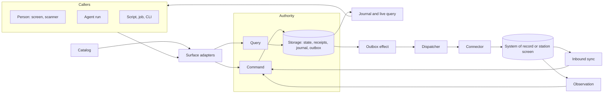

# Primitives

At its core the framework is one idea: **a capability catalog over a logical CQRS authority, where every caller uses the same contract.** Commands change state through one authority; queries read authorized snapshots; a journal tells every view what changed. People, agents, scripts, jobs, scanners and connectors are all callers of that contract. None of them gets a private path.

AI is not the center of this design and not a special case. An agent is a caller like any other, reaching the catalog through MCP or the CLI under a delegated grant. Where models work inside the system, reading a screen or proposing a click, they sit behind ports and only propose; deterministic code validates, acts and verifies. Everything here works without a model.

The other primitives extend that core in three directions: **callers** reaching it from every surface, **edges** connecting it to systems that keep their own records, and the **trust, configuration and proof** that let one framework serve many sites. Each primitive exists because a [principle](principles.md) requires it.

## How to read an entry

Each entry gives a one-line definition, the problem the primitive solves and how it relates to its neighbors, the **guarantees** an application may rely on, and any known **gaps**. The last line points to the code:

`Serves <principles> · <status> · <locations> · <symbols>`

Status is `implemented`, `partial` or `proposed`, and changes only with evidence in the [implementation ledger](implementation-status.md) (P10). Adapters, such as SQLite storage or the Codex harness, are listed with the port they implement. Domain code in `examples/*` is not a primitive (P8); a domain concept is promoted only when a second application needs it.

## The core: describe, write, read

### Capability

_A named command or query, defined once as data._

Everything else in the framework hangs off capabilities. A capability names a business behavior with a stable ID, strict JSON schemas, the permission it needs and how the UI binds it. Because it is plain data, a browser, a generator and a test can all import it without loading handlers or drivers.

Guarantees: IDs and inferred types survive composition into typed clients. Wire values are JSON only, and validation rejects input it would have to strip or transform. A command that forwards to another system declares that its receipt is not upstream acceptance.

Serves P1, P2 · implemented · `packages/contracts` · `defineCapability`, `jsonSchema`, `PermissionRequirement`, `IntegrationDeclaration`

### Module

_The unit a domain contributes: capabilities, handlers, a state slice, a policy route, workflows and scenarios._

Modules are how one framework hosts many task applications. Each is composed explicitly at the root, owns its slice of state and routes its own policy, so a quality-inspection module and a line-station module can share one authority without seeing each other's data.

Guarantees: nothing is discovered or registered globally. Handlers see only their module's slice. Operations and resources no module claims are denied.

Serves P2, P8 · implemented · `packages/contracts` `packages/runtime` · `defineModule`, `CapabilityModule`, `sliceHandlers`, `composeAuthorization`, `authorizationRoute`

### Catalog

_The composed, validated description of everything the application can do._

The catalog is the single list that every surface and artifact reads. It is what makes "every operation from UI, MCP, CLI and API" true by construction instead of by discipline.

Guarantees: deterministic output. Composition fails before startup on duplicate IDs, missing or cyclic dependencies, missing UI declarations, unresolved workflow references and colliding MCP names.

Serves P1, P2 · implemented · `packages/contracts` · `buildCatalog`, `Catalog`, `CatalogOperation`

### Generator

_A pure transformation from the catalog to a checked-in artifact._

JSON Schema, OpenAPI, the operation and workflow references, and the application skill with CLI forms are generated, not written. Agents learn the application from the same source the UI is built from.

Guarantees: generation opens no workspace, reads no credential and starts no server. Drift fails the build, and a boundary check keeps contract and browser code free of host-only modules.

Serves P2 · implemented · `scripts` · `generate`, `check-boundaries`, `boundary-rules`

### Authority

_The single runtime that owns a workspace and executes its commands and queries._

CQRS here is logical: one transactional authority with separate command and query paths, not two databases or an event-sourced model. One owner per workspace removes a whole class of dual-writer bugs; every other process attaches to it or runs it embedded.

Guarantees: an OS-held lock admits one owner per workspace, across path aliases, and a crash releases it without PID-file guessing.

Serves P4 · implemented · `packages/runtime` `packages/adapters` · `createApplication`, `ApplicationOptions`, `acquireWorkspaceOwnership`, `WorkspaceOwnedError`

### Command

_An authorized write, submitted the same way by every caller._

The write side. A handler validates, mutates its state slice, declares what changed and may queue effects for other systems; the authority does the rest. Retries, double taps and restarted agent runs are safe because the receipt, not the caller, decides whether work already happened.

Guarantees: feature state, revisions, the idempotency receipt, journal entries and outbox effects commit atomically or not at all. Keys are scoped to workspace and principal; a reused key with other input conflicts. `expectedRevisions` makes stale writes conflict. Authorization and cancellation are rechecked before commit. An undeclared change fails. Errors share one caller-safe envelope.

Serves P3, P4 · implemented · `packages/runtime` `packages/contracts` · `createHandlerFactory`, `HandlerContext`, `CommandReceipt`, `ApplicationError`, `errorEnvelope`

### Query

_An authorized, side-effect-free read._

The read side. Queries are computed from the same transactional state, so there is no projection lag, and each returns a cursor so a caller can follow changes from exactly that point.

Guarantees: data and cursor come from one snapshot. Rows are scoped before filtering, pagination and counts. Output is projected to readable fields, then validated. Mutation inside a query fails.

Serves P3, P5 · implemented · `packages/runtime` · `QueryResult`

### Execution context

_Who is calling, in which workspace, under which delegation grant._

This is how a person, an agent and a job can share operations without sharing authority. The host derives the context; an agent run inherits a narrowed grant from the person who started it.

Guarantees: operation input cannot set or widen it. Grants narrow by operation, resource, expiry and run and are rechecked after every awaited step. Launchers fix the grant of embedded or attached agent processes through a grant file.

Serves P3 · implemented · `packages/runtime` `packages/adapters` · `ExecutionContext`, `DelegationGrant`, `readGrantFile`, `readConnection`

### Policy

_The port that decides operation, object, row and field access._

Policy is injected so an application can bring its own rules engine. The reference adapter uses a bounded CASL profile whose row scopes translate to both memory predicates and SQL.

Guarantees: decisions use authoritative state, never caller-supplied attributes. Scope translations are tested for agreement. Unknown operations and unsupported conditions fail closed.

Serves P3, P9 · implemented · `packages/runtime` `packages/adapters` · `AuthorizationPort`, `AuthorizationRequest`, `Decision`, `createScopedAbility`, `scopeToSql`

### Storage

_The port for the authority's transactional state._

Storage holds feature state together with the framework's receipts, revisions, journal and outbox, which is what lets a command commit all of them at once. Memory and SQLite snapshot adapters ship; a production store implements the same port.

Guarantees: atomic `transact` and consistent `read` per workspace; rejected work commits nothing. A replacement passes the storage conformance suite.

Gaps: the SQLite adapter rewrites one JSON snapshot per commit, and the journal is never pruned.

Serves P4, P9 · implemented · `packages/runtime` `packages/adapters` · `Storage`, `WorkspaceSnapshot`, `createMemoryStorage`, `SQLiteStorage`

### Journal and live query

_The ordered record of committed changes, and the client machinery that follows it._

The journal closes the CQRS loop: whatever wrote the change, every view that may see it learns about it and re-reads through an authorized query. That is why a change made by an agent over MCP appears on an operator's screen without a refresh.

Guarantees: events carry resource references and revisions, never record contents, and are filtered by current access. Clients subscribe from their query's cursor, so nothing falls between snapshot and stream. Invalidation follows the catalog's resource dependencies and is coalesced. An authorization change resets views without leaking identifiers. It clears cached data at once, even while a refetch is still pending, and it covers snapshots cached before the stream's first batch.

Serves P5 · implemented · `packages/runtime` `packages/client` `packages/react` · `ChangeEvent`, `EventBatch`, `createClient`, `LiveQuery`, `createLiveBindings`

## Callers: every surface on the same contract

### Surface adapter

_Maps one surface onto the authority's raw command and query entry points._

HTTP, MCP, the CLI and in-process calls are thin translations. They carry no business logic and keep no operation list, so adding a capability adds it to all of them.

Guarantees: MCP tool names, CLI subcommands and typed flags are derived from the catalog. Errors keep their meaning across surfaces: HTTP status, MCP tool error and CLI exit code map from the same code. A per-request signal only adds to the trusted context's cancellation (`withSignal`). Direct and HTTP cursors both carry the authorization revision they were issued under, so a subscription resets when access changed after the snapshot.

Serves P1, P5 · implemented · `packages/adapters` · `createHttpHandler`, `createMcpServer`, `runCli`, `createDirectTransport`, `withSignal`, `exitCodes`

### Capability binding

_A UI control bound to a capability through the typed client._

The UI's equivalent of a tool call. It turns a person's intent into exactly one command, however many times they tap.

Guarantees: one idempotency key per intent, kept across retries until commit. Validation uses the contract's schema and field errors map back to inputs. Drafts stay separate from committed data and conflict explicitly: a draft pins the object it edits (capture pins its characteristic and sample; scanner setup keeps the revision it loaded and saves with it as the expected revision), so an external write shows a conflict instead of retargeting or discarding the entry. Every operation that claims a UI binding is referenced by a screen of the reference web app; an operation no screen offers declares an exception instead.

Gaps: the reference check proves a screen names the capability, not that a control renders it.

Serves P1, P4 · implemented · `packages/react` · `useCapabilityForm`, `useCommand`, `useLiveQuery`

### UI session context

_What a person is looking at, captured for an agent, and the intents an agent can send back._

This is the bridge between a person and an agent working on the same screen. The agent acts on what the person selected, at the revision they saw, and can ask the frontend to open or select something.

Guarantees: the host issues and binds sessions. Capture revalidates access and freezes the target, so later selection changes cannot retarget a run. Intents expire, are acknowledged and never write business records.

Serves P3 · implemented · `packages/adapters` `packages/react` · `UiSessionStore`, `captureUiContext`

### Agent run

_An agent session acting as one more caller on the catalog._

The supervisor makes an agent an ordinary caller: its tools are catalog operations, its authority is the narrowed grant of whoever started it, and its narration is kept apart from what it actually committed. Codex, Claude and AI SDK harnesses are adapters behind one port, next to a deterministic harness that needs no provider.

Guarantees: tools are catalog operations only. Text and progress stream separately from commits. Cancellation stops future work without undoing commits, and a restart marks unfinished runs interrupted instead of replaying them.

Serves P1, P3, P6, P9 · implemented · `packages/agents` · `Harness`, `HarnessEvent`, `createRunSupervisor`, `RunState`, `RunStore`, `deterministicHarness`, `CodexHarness`, `ClaudeHarness`, `AiSdkHarness`

### Input source

_Device input normalized into events and routed to an intent without a model turn._

Scanners are callers too. A wedge, serial, HID or camera scanner produces a normalized scan; a configured route turns it into the same command a button or tool call would submit.

Guarantees: sources are registered explicitly. Decoding validates GS1 check digits and AIM symbologies and corrects keyboard-layout mismatch. Routes are site configuration.

Gaps: no source has been checked on real hardware.

Serves P1, P8 · implemented · `packages/devices` · `ScannerSource`, `ScanEvent`, `decodeScan`, `calibrate`, `createScanRouter`, `createWedgeSource`, `createSerialSource`, `createHidPosSource`, `createCameraSource`

### UI registry

_Reusable screen parts published as shadcn registries over stock shadcn primitives._

Specialized interfaces are cheap only if their parts are shared. Apps pull registry items with `shadcn add` and own the copied source, while trust-relevant behavior stays in versioned bindings.

Guarantees: no shadcn primitive is forked; sizing comes from tokens and `cva` variants. The registry manifest is generated and drift-checked. Operator items follow the point-of-work rules: glove-sized targets, hold-to-confirm for consequential actions, state as icon plus text.

Gaps: `capture-station` and `sync-status` still bind to quality-inspection contracts. No scratch-app `shadcn add` acceptance test.

Serves P1, P8 · implemented · `packages/operator-ui` `apps/web/src/components` · `operator-surface`, `big-action`, `use-press-and-hold`, `use-tap-guard`, `status-strip`, `capability-form`, `live-data-table`, `sync-status`

## Edges: systems that keep their own records

### Outbox effect

_A durable intent to change another system, committed with the command that causes it._

The outbox extends the write side past the authority's own transaction without pretending to a distributed one. The command records what should happen elsewhere; delivery happens later, outside any transaction, and its outcome comes back as another command.

Guarantees: the effect commits with its command or not at all. Its ID derives from the receipt, so a replay never enqueues twice, and it doubles as the target's idempotency key. It is settled exactly once. A held effect waits for a person and returns to delivery only through a reconciliation command.

Serves P4, P6, P7 · implemented · `packages/runtime` · `Effect`, `EffectRequest`, `EffectOutcome`, `HandlerContext`

### Connector

_The port that delivers effects to one target and looks up their outcome._

A connector is the only code that talks to an external system. The same port covers an ERP API, a file drop and legacy station software that can only be reached through its screen.

Guarantees: a target declares idempotent delivery or implements a lookup consulted before every send. A business rejection is data, never retried. An outcome the connector cannot establish is reported as uncertain, never guessed.

Serves P7, P9 · implemented · `packages/integration` `packages/station` · `SystemOfRecordPort`, `TargetDescription`, `LookupResult`, `DeliveryUncertain`, `createStationConnector`

### Dispatcher

_The worker that delivers pending effects and settles them under a narrow integration principal._

Guarantees: at-least-once delivery with backoff and journaled attempts, so screens can show retrying. The integration grant can only settle, sync and read status. `drain` reports whether anything is still pending, and its deadline aborts a delivery in flight. `drainTargets` drains every dispatcher a host composed and accounts for the whole outbox by target, so a target with work but no dispatcher in this process is reported as not deliverable instead of being left out. An uncertain outcome is recorded and held even when shutdown interrupts the pass.

Gaps: no worker claims or fencing, no upstream-pending state, no cancel-before-dispatch, no dispatch-time recheck of the original actor's authority.

Serves P6, P7 · partial · `packages/integration` · `createEffectDispatcher`, `drainTargets`, `TargetBacklog`, `DeliveryFailure`, `DispatchReport`

### Inbound sync

_Imports upstream changes as ordinary commands._

Other systems change too. Inbound sync brings those changes in through the write side, so they are authorized, journaled and visible like any local change.

Guarantees: the watermark is part of the command's input, so a stale page conflicts and two pullers cannot apply it twice.

Gaps: no upstream versions for out-of-order feeds.

Serves P5, P7 · implemented · `packages/integration` · `createInboundSync`, `PullBatch`

### Observation

_A reading from a source that cannot be queried, submitted through an ingest command._

Observation is the inbound counterpart for systems with no feed, such as a vendor HMI read by accessibility, OCR or a local vision model. The observer never writes storage; it submits readings like any caller.

Guarantees: each reading carries its source, model identity and digest, frame digest, time and confidence. It becomes current only after it is stable across consecutive reads. A low-confidence reading becomes an attention item for a person. Unchanged content is resubmitted at most once per heartbeat window, and each submission's idempotency key fingerprints its exact payload. A vision endpoint never follows a redirect, so screenshots reach only the validated host, and a perception worker that exits is restarted with a fresh handshake.

Gaps: implemented for screens only; promote out of `packages/station` when a second kind of source needs it.

Serves P4, P6 · implemented · `packages/station` · `createStationObserver`, `StabilityGate`, `Reading`, `ModelIdentity`

### Gated actuator

_Lets a model propose screen actions while deterministic code executes and verifies them._

This is how a computer-use model can operate legacy software without becoming a privileged caller. It sits inside a connector, behind the outbox. A driver resolves targets or proposes actions; the controller decides.

Guarantees: the controller performs every action itself, after a gate covering the expected screen (verified before every click, type and key), forbidden regions, the allowed set, step budget, timeout, bridge mode and seat lease. Acceptance requires a matching readback on as many consecutive views as the fields' `stableReads` declare; convergence, preconditions and lookup use the same standard. An interrupted procedure that is not declared rerunnable is held, never re-run.

Gaps: no live computer-use model driver; no VNC, RDP, KVM or UI Automation transport.

Serves P6, P7, P9 · implemented · `packages/station` · `ComputerUseDriver`, `ScreenTransport`, `BridgeControl`, `createScriptedDriver`, `createPlaywrightTransport`

### Reconciliation

_A tracked state and procedure for outcomes no one can establish automatically._

Held effects resolved by a person are the first form; a general state machine across connectors is not built yet.

Serves P6, P7 · proposed

### Worker claims

_Attempt identities, expirations and fencing tokens so a stale worker cannot overwrite a newer outcome._

Serves P7 · proposed

## Trust, configuration and proof

### Credential vault

_The port for provider secrets._

Provider credentials pay for inference; they never grant workspace access. The vault keeps them in the operating system's store.

Guarantees: fails closed when the store is unavailable. Secrets never reach browser state, domain data, model context or run logs, and are never discovered or reused implicitly. Account connections (`OidcAccountConnection`, the ChatGPT account) serialize credential writes, so a logout cannot be undone by a sign-in or refresh already in flight.

Serves P3, P9 · implemented · `packages/agents` · `CredentialVault`, `OsCredentialVault`, `MemoryCredentialVault`

### Execution host

_An isolation boundary and credential broker for tools an agent runs._

Serves P3, P9 · proposed

### Profile

_Versioned, schema-validated data describing one site._

A station's screens, fields and procedures, a scanner's behavior and scan routes are data, so a new site is configuration rather than a fork.

Guarantees: validation rejects procedure steps that target forbidden regions or unknown fields.

Serves P8 · implemented · `packages/station` `packages/devices` · `StationProfile`, `stationProfileSchema`, `validateProfile`, `ScannerProfile`, `scannerProfileSchema`, `ScanRoute`

### Configuration module

_A reusable capability module that makes site configuration an ordinary operation._

Configuration is itself part of the catalog, so a supervisor's screen, a CLI script and an agent change it the same way, under policy and revisions.

Serves P1, P8 · implemented · `packages/devices` · `deviceConfigModule`, `createDeviceHandlers`

### Golden check

_Replays labeled inputs through a profile and its extractors before activation._

Guarantees: reports per-field accuracy and confidence and fails on a confident misread.

Gaps: the current golden set exercises recorded expectations, not a model.

Serves P8, P10 · implemented · `packages/station` · `runGolden`, `GoldenReport`

### Behavioral scenario

_A reusable test of one capability's allowed, denied, stale, replayed and visible behavior._

Scenarios are what prove the core idea: the same test runs through every surface and must produce the same outcome.

Guarantees: results and structured errors are compared across drivers.

Serves P1, P3, P10 · implemented · `packages/testing` · `BehavioralScenario`, `runScenarios`, `directDriver`, `assertEquivalent`

### Scaffold

_Exports the framework and canonical example as a standalone application._

Guarantees: a versioned file-hash manifest; no credentials, workspace data or build output; never overwrites an existing target.

Serves P8 · implemented · `packages/scaffold` · `scaffold`, `ScaffoldManifest`

### Task package

_A signed, versioned package with declared requirements, staged activation and rollback._

Serves P8, P10 · proposed

## Adding or changing a primitive

1. Name the principles it serves. If none fits, propose a principle first (see [keeping principles current](principles.md#keeping-this-current)).
2. Check that it is a concept, not an adapter. An adapter belongs with its port.
3. Check that it is domain-neutral (P8). If only one example needs it, keep it in that example.
4. Prefer extending a primitive or extracting existing code over writing a new one.
5. Update the entry in the same change as the code, including its guarantees and gaps.
6. Change the status only with evidence in the [implementation ledger](implementation-status.md).
