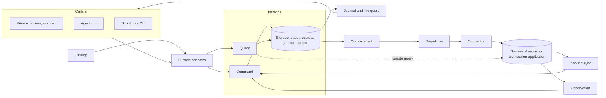

# Primitives

The status is `implemented`, `partial` or `proposed`.

## Core

### Capability

_A named command or query, defined once as data._

implemented · [`packages/contracts`](../packages/contracts/README.md)

### Module

_The unit a domain contributes to the catalog: capabilities, requirement declarations, OS declarations, workflows and agent definitions, declared with `defineModule`. The application definition or host plugin that composes it supplies the handlers, the state slice and the policy._

implemented · [`packages/contracts`](../packages/contracts/README.md) [`packages/runtime`](../packages/runtime/README.md)

### Catalog

_The composed, validated description of everything the application can do._

implemented · [`packages/contracts`](../packages/contracts/README.md)

### Generator

_A pure transformation from the catalog to a reference document. Nothing generated from the catalog is committed; `bun run generate` writes the documents to `dist/reference/`._

implemented · [`scripts/generate.ts`](../scripts/generate.ts) [`scripts/reference-artifacts.ts`](../scripts/reference-artifacts.ts)

### Instance

_One application opened on one workspace, and while open its only writer. It executes the workspace's commands and queries._

implemented · [`packages/runtime`](../packages/runtime/README.md) [`packages/kernel`](../packages/kernel/README.md) [`packages/adapters`](../packages/adapters/README.md)

### Command

_An authorized write, submitted the same way by every caller._

implemented · [`packages/runtime`](../packages/runtime/README.md) [`packages/contracts`](../packages/contracts/README.md)

### Query

_An authorized read that changes nothing._

implemented · [`packages/runtime`](../packages/runtime/README.md)

### Collection

_A typed set of records a module keeps in its state slice, with generated reads._

implemented · [`packages/contracts`](../packages/contracts/README.md) [`packages/runtime`](../packages/runtime/README.md)

### Execution context

_Who is calling, in which workspace, under which grant, through which channel and with which cancellation signal, and for an agent, in which run. A trusted host supplies it; a surface never builds it from caller input._

implemented · [`packages/runtime`](../packages/runtime/README.md) [`packages/adapters`](../packages/adapters/README.md)

### Policy

_The port that decides operation, object, row and field access._

implemented · [`packages/runtime`](../packages/runtime/README.md) [`packages/adapters`](../packages/adapters/README.md)

### Membership

_Roles that people hold in a container: a project, plant or station._

implemented · [`packages/contracts`](../packages/contracts/README.md) [`packages/runtime`](../packages/runtime/README.md)

### Storage

_The port for the instance's transactional state. The memory, SQLite and Postgres adapters pass one conformance suite. The mobile host platform uses a snapshot adapter that keeps one JSON document per workspace._

implemented · [`packages/runtime`](../packages/runtime/README.md) [`packages/adapters`](../packages/adapters/README.md) [`packages/testing`](../packages/testing/README.md)

### State migration

_Numbered versions of an application's and each plugin's state, with the steps between them, stamped per workspace. Storage runs the steps when it loads a workspace; the `migrate` command runs them on a checked copy before it replaces the database._

implemented · [`packages/kernel/src/migrations.ts`](../packages/kernel/src/migrations.ts) [`packages/kernel/src/state-upgrade.ts`](../packages/kernel/src/state-upgrade.ts) [`packages/host/src/cli/migrate-command.ts`](../packages/host/src/cli/migrate-command.ts)

### Blob store

_Content-addressed bytes, such as photos and documents, that commands reference from resources._

partial · [`packages/contracts`](../packages/contracts/README.md) [`packages/runtime`](../packages/runtime/README.md) [`packages/adapters`](../packages/adapters/README.md) [`packages/client`](../packages/client/README.md) [`packages/kernel`](../packages/kernel/README.md)

### Journal and live query

_The ordered record of committed changes, and the client code that follows it._

implemented · [`packages/runtime`](../packages/runtime/README.md) [`packages/client`](../packages/client/README.md) [`packages/react`](../packages/react/README.md)

### Application

_One unit of content that a host runs: its manifest, its application definition and its screens._

implemented · [`packages/kernel`](../packages/kernel/README.md) [`packages/host`](../packages/host/README.md) [`packages/frame`](../packages/frame/README.md)

### Host

_The domain-neutral process that opens an instance for one application definition on a host platform._

implemented · [`packages/kernel`](../packages/kernel/README.md) [`packages/host`](../packages/host/README.md) [`packages/mobile`](../packages/mobile/README.md)

### Host plugin

_A cross-cutting part an application composes: modules, a state slice, a policy, ports and lifecycle hooks._

implemented · [`packages/kernel`](../packages/kernel/README.md) [`packages/host`](../packages/host/README.md) [`packages/frame`](../packages/frame/README.md) [`packages/mobile`](../packages/mobile/README.md) [`plugins/managed-config`](../plugins/managed-config/README.md)

### Host platform

_What the composition needs from the machine it runs on: workspace ownership, storage and the host's own components. It also states which of sockets, child processes, ingress and folders the machine offers._

partial · [`packages/kernel`](../packages/kernel/README.md) [`packages/host`](../packages/host/README.md) [`packages/mobile`](../packages/mobile/README.md)

### Workspace lease

_One instance's hold on a workspace kept in a shared database, with a fencing token that every commit checks. A stalled holder cannot overwrite the instance that took the workspace over._

implemented · [`packages/adapters`](../packages/adapters/README.md) [`packages/host`](../packages/host/README.md)

### Web frame

_The domain-neutral browser UI around one application's screens._

implemented · [`packages/frame`](../packages/frame/README.md)

### Native frame

_The domain-neutral React Native UI around one application's native screens._

partial · [`packages/frame-native`](../packages/frame-native/README.md) [`apps/mobile`](../apps/mobile/README.md)

### Starter

_The thin application host that an application's developers fork or generate and then own. It hosts the one application named in `app.config.json`._

implemented · [`apps/service`](../apps/service/README.md) [`apps/web`](../apps/web/README.md) [`apps/desktop`](../apps/desktop/README.md) [`apps/mobile`](../apps/mobile/README.md) [`app.config.json`](../app.config.json)

## Callers

### Surface adapter

_The adapter that maps one surface onto the instance's raw command and query entry points._

implemented · [`packages/adapters`](../packages/adapters/README.md)

### Capability binding

_A UI control bound to a capability through the typed client._

implemented · [`packages/react`](../packages/react/README.md)

### UI session context

_What a person is looking at, captured for an agent, and the intents an agent can send back._

implemented · [`packages/adapters`](../packages/adapters/README.md) [`packages/react`](../packages/react/README.md) [`packages/agents`](../packages/agents/README.md)

### Agent run

_An agent acting as one more caller on the catalog, under a grant narrowed from its issuer's._

implemented · [`packages/agents`](../packages/agents/README.md)

### Agent definition

_A named agent in the catalog: its instructions, the capabilities it may call, the resource types it works on, its model requirement, its output mode and its budgets._

implemented · [`packages/contracts`](../packages/contracts/README.md) [`packages/runtime`](../packages/runtime/README.md) [`packages/agents`](../packages/agents/README.md) [`packages/adapters`](../packages/adapters/README.md)

### Model entry

_A model the model server may serve, named by the digests of its base weights, its adapter and the dataset the adapter was tuned on. The model server starts it only after the weights match their digests and a fine-tune has passed its gate._

implemented · [`packages/agents`](../packages/agents/README.md) [`plugins/model-server`](../plugins/model-server/README.md) [`packages/testing`](../packages/testing/README.md)

### Approval request

_A command that one caller, usually an agent run, asks a person to approve before it runs. The approved command runs under the approver's own grants and policy._

implemented · [`packages/contracts`](../packages/contracts/README.md) [`packages/runtime`](../packages/runtime/README.md) [`packages/frame`](../packages/frame/README.md) [`packages/operator-ui`](../packages/operator-ui/README.md)

### Approval dataset

_The approval requests people approved, rejected or let expire, exported as training data with redaction and a digest._

implemented · [`packages/runtime`](../packages/runtime/README.md)

### Trigger

_Work that starts on a committed change or a schedule instead of a person's prompt._

implemented · [`plugins/automation`](../plugins/automation/README.md)

### Standing grant

_A person's recorded, expiring permission for a trigger to act as that principal._

implemented · [`plugins/automation`](../plugins/automation/README.md)

### Input source

_Device input normalized into events and routed to a command without a model turn._

implemented · [`packages/devices`](../packages/devices/README.md) [`plugins/intent-scanner`](../plugins/intent-scanner/README.md)

### OS handler

_A declared registration with the operating system, such as a link path, file type, share target, Android intent, shortcut or notification reply, and where its requests go._

partial · [`packages/contracts`](../packages/contracts/README.md) [`packages/shell`](../packages/shell/README.md) [`plugins/os`](../plugins/os/README.md) [`plugins/share-target`](../plugins/share-target/README.md) [`plugins/notifications`](../plugins/notifications/README.md) [`plugins/android-intents`](../plugins/android-intents/README.md) [`plugins/os-shortcuts`](../plugins/os-shortcuts/README.md) [`packages/frame`](../packages/frame/README.md) [`packages/frame-native`](../packages/frame-native/README.md) [`packages/mobile`](../packages/mobile/README.md) [`plugins/compliance`](../plugins/compliance/README.md) [`apps/desktop`](../apps/desktop/README.md) [`apps/mobile`](../apps/mobile/README.md) [`examples/project-tasks`](../examples/project-tasks/README.md)

### OS action

_A declared request to the operating system to open a URL, reveal or open a file, share, notify or send an Android intent, with the data classes it carries._

partial · [`packages/contracts`](../packages/contracts/README.md) [`packages/shell`](../packages/shell/README.md) [`plugins/os`](../plugins/os/README.md) [`plugins/share-target`](../plugins/share-target/README.md) [`plugins/notifications`](../plugins/notifications/README.md) [`plugins/android-intents`](../plugins/android-intents/README.md) [`plugins/compliance`](../plugins/compliance/README.md) [`packages/agents`](../packages/agents/README.md) [`apps/desktop`](../apps/desktop/README.md) [`packages/frame`](../packages/frame/README.md) [`packages/mobile`](../packages/mobile/README.md)

### Shell port

_The host port that receives OS requests and performs OS actions. Its default refuses both._

partial · [`packages/kernel`](../packages/kernel/README.md) [`packages/host`](../packages/host/README.md) [`packages/adapters`](../packages/adapters/README.md) [`packages/shell`](../packages/shell/README.md) [`packages/mobile`](../packages/mobile/README.md) [`plugins/os`](../plugins/os/README.md) [`apps/desktop`](../apps/desktop/README.md) [`apps/mobile`](../apps/mobile/README.md)

### Process port

_The host port that starts declared child processes from the deployment policy's bindings. Its default refuses._

partial · [`packages/kernel`](../packages/kernel/README.md) [`packages/host`](../packages/host/README.md) [`plugins/site`](../plugins/site/README.md) [`plugins/process`](../plugins/process/README.md)

### UI registry

_Reusable screen parts published as registries over stock shadcn primitives._

implemented · [`packages/operator-ui`](../packages/operator-ui/README.md) [`packages/frame`](../packages/frame/README.md) [`packages/frame-native`](../packages/frame-native/README.md) [`plugins/compliance`](../plugins/compliance/README.md) [`plugins/connector-driver`](../plugins/connector-driver/README.md)

## Integrations

### Outbox effect

_A recorded intent to change another system, committed with the command that causes it._

implemented · [`packages/runtime`](../packages/runtime/README.md)

### Connector

_The implementation of a target's port, `SystemOfRecordPort`. It delivers effects to one system of record and looks up their outcome._

implemented · [`packages/integration`](../packages/integration/README.md) [`workstations/screen-bridge`](../workstations/screen-bridge/README.md) [`packages/testing`](../packages/testing/README.md) [`plugins/connector-driver`](../plugins/connector-driver/README.md) [`plugins/connector-files`](../plugins/connector-files/README.md) [`plugins/connector-http`](../plugins/connector-http/README.md) [`plugins/notifications`](../plugins/notifications/README.md)

### Dispatcher

_The worker that delivers pending effects and settles them under the narrow integration principal._

implemented · [`packages/integration`](../packages/integration/README.md)

### Inbound sync

_Importing a system of record's changes as ordinary commands._

implemented · [`packages/integration`](../packages/integration/README.md)

### Target

_A system of record declared once: its settle, sync and status capabilities, the integration principal's grant and its policy lane._

implemented · [`packages/contracts`](../packages/contracts/README.md) [`packages/integration`](../packages/integration/README.md)

### Remote query

_A query that reads another system when the caller runs the query, and stores nothing. The query acts with the caller's credential, or with a service credential where the query declares that fallback._

partial · [`packages/contracts`](../packages/contracts/README.md) [`packages/runtime`](../packages/runtime/README.md) [`packages/integration`](../packages/integration/README.md) [`packages/host`](../packages/host/README.md) [`packages/react`](../packages/react/README.md) [`examples/crm-capture`](../examples/crm-capture/README.md)

### Data provider

_One declaration of what a system of record can be searched for, which becomes ordinary catalog entries for every surface._

partial · [`packages/contracts`](../packages/contracts/README.md) [`packages/integration`](../packages/integration/README.md) [`examples/crm-capture`](../examples/crm-capture/README.md)

### Observation

_A reading from a source that cannot be queried, submitted through an ingest command._

implemented · [`packages/observation`](../packages/observation/README.md) [`workstations/screen-bridge`](../workstations/screen-bridge/README.md) [`plugins/connector-driver`](../plugins/connector-driver/README.md) [`plugins/connector-mqtt`](../plugins/connector-mqtt/README.md) [`plugins/connector-opcua`](../plugins/connector-opcua/README.md)

### Gated actuator

_A connector in which a model may suggest screen actions and deterministic code executes and verifies them._

implemented · [`workstations/screen-bridge`](../workstations/screen-bridge/README.md) [`packages/integration`](../packages/integration/README.md) [`plugins/connector-driver`](../plugins/connector-driver/README.md)

### Driver contract

_A driver's state fields, its actions with delivery mode and hazard class, and its events, as data with a digest the driver must echo at its handshake._

partial · [`plugins/connector-driver`](../plugins/connector-driver/README.md) [`examples/quality-inspection`](../examples/quality-inspection/README.md) [`examples/line-station`](../examples/line-station/README.md)

### Driver process

_A supervised child process that controls or reads equipment, speaking JSON-RPC over its standard streams and started through the process port. Its events can enter as ingest commands._

partial · [`plugins/connector-driver`](../plugins/connector-driver/README.md) [`plugins/process`](../plugins/process/README.md) [`examples/quality-inspection`](../examples/quality-inspection/README.md) [`examples/line-station`](../examples/line-station/README.md)

### Driver SDK

_A library in another language that answers the driver protocol for a driver author: bridge-mode gating, once-per-effect delivery with a journal, events and stubs generated from the driver contract. Each SDK proves itself against the reference contract in `plugins/connector-driver`._

partial · [`sdks/driver-python`](../sdks/driver-python/README.md) [`sdks/driver-dotnet`](../sdks/driver-dotnet/README.md)

### Reconciliation

_A tracked state and procedure for outcomes no one can establish automatically._

implemented · [`packages/contracts`](../packages/contracts/README.md) [`packages/runtime`](../packages/runtime/README.md) [`packages/integration`](../packages/integration/README.md) [`packages/frame`](../packages/frame/README.md) [`examples/receiving`](../examples/receiving/README.md) [`examples/line-station`](../examples/line-station/README.md)

### Worker claims

_Attempt identities, expirations and fencing tokens, so a stale worker cannot overwrite a newer outcome._

implemented · [`packages/runtime`](../packages/runtime/README.md) [`packages/integration`](../packages/integration/README.md)

## Trust and configuration

### Credential vault

_The port for provider secrets._

implemented · [`packages/agents`](../packages/agents/README.md)

### Device link

_Pairing a phone or tablet with a hub, and the credential the device presents afterwards._

partial · [`plugins/device-link`](../plugins/device-link/README.md) [`plugins/hub-link`](../plugins/hub-link/README.md)

### Requirement declaration

_What a module or host component needs outside the process, as data: network destinations, exchange folders, devices and child processes, with the outbox targets each carries._

implemented · [`packages/contracts`](../packages/contracts/README.md) [`packages/kernel`](../packages/kernel/README.md)

### Deployment policy

_Deployment data that binds declared destinations to addresses and exchange folders to directories, and sets a hardening floor._

implemented · [`plugins/site`](../plugins/site/README.md)

### Workforce sign-in

_People signing in to a serving host through the site's identity provider, under `identity: external`._

partial · [`plugins/site/src/workforce`](../plugins/site/src/workforce) [`packages/kernel/src/plugin.ts`](../packages/kernel/src/plugin.ts) [`packages/adapters/src/http`](../packages/adapters/src/http)

### Workstation sign-in

_An operator signing in at a shared workstation seat by badge and PIN, for a short-lived session issued to that operator._

partial · [`workstations/sign-in`](../workstations/sign-in/README.md) [`packages/kernel/src/plugin.ts`](../packages/kernel/src/plugin.ts)

### Egress guard

_The only path from server code, and from declared child processes, to the network. `bun run check:boundaries` fails a direct network call outside the reviewed exemptions in `scripts/boundary-rules.ts`._

implemented · [`plugins/network`](../plugins/network/README.md) [`scripts/boundary-rules.ts`](../scripts/boundary-rules.ts)

### Audit log

_An injected, tamper-evident record of every command, query, denial, outbox transition, session, egress connection and agent run._

implemented · [`packages/contracts`](../packages/contracts/README.md) [`packages/runtime`](../packages/runtime/README.md) [`packages/event-log`](../packages/event-log/README.md) [`plugins/audit`](../plugins/audit/README.md)

### Execution host

_An isolation boundary and credential broker for tools an agent runs._

partial · [`plugins/execution-host`](../plugins/execution-host/README.md) [`plugins/process`](../plugins/process/README.md) [`plugins/network`](../plugins/network/README.md)

### Station and scanner profiles

_Schema-validated data about one site's equipment. A station profile describes one kind of workstation application and is versioned; a scanner profile describes how one scanner at one workstation reaches the application._

implemented · [`workstations/screen-bridge`](../workstations/screen-bridge/README.md) [`packages/devices`](../packages/devices/README.md)

### Device configuration module

_A reusable module that makes per-workstation device configuration, the scanner profiles and scan routes, ordinary commands and queries._

implemented · [`packages/devices`](../packages/devices/README.md)

### Golden check

_A replay of labeled inputs through a station profile and its extractors, run before a station profile change or a model change is used._

implemented · [`workstations/screen-bridge`](../workstations/screen-bridge/README.md)

### Compliance bundle

_The evidence an auditor checks, generated from the catalog and deployment policy and re-checked while the application runs._

implemented · [`plugins/compliance`](../plugins/compliance/README.md) [`packages/host`](../packages/host/README.md)

### Behavioral scenario

_A named test of business behavior that runs unchanged through the direct, HTTP, CLI and MCP drivers, whose results must agree._

implemented · [`packages/testing`](../packages/testing/README.md)

### Agent scenario

_A test of an agent definition on a task and fixture state, judged by the commands the run committed and the approval requests it submitted instead of by its text._

implemented · [`packages/testing`](../packages/testing/README.md)

### Scaffold

_The tool that exports the framework, the starter and content as a standalone application, or the starter and a new application over installed framework versions. It also generates new applications and their parts._

implemented · [`packages/scaffold`](../packages/scaffold/README.md)

### Framework release

_The framework and plugin packages published together at one version, each with the dependencies its published files import, and a check that refuses an install with mixed versions._

implemented · [`scripts/release.ts`](../scripts/release.ts) [`scripts/check-manifests.ts`](../scripts/check-manifests.ts) [`scripts/local-registry.ts`](../scripts/local-registry.ts) [`packages/scaffold/src/versions.ts`](../packages/scaffold/src/versions.ts) [`.changeset`](../.changeset)

### Task package

_A signed, versioned package with declared requirements and staged activation. A failed install step leaves the previous release current._

partial · [`packages/bundle`](../packages/bundle/README.md) [`scripts/bundle.ts`](../scripts/bundle.ts) [`plugins/site/src/install`](../plugins/site/src/install)

### Fleet agent

_A site's outbound-only link to a fleet: health reports with the outbox backlog by target, audit forwarding, verified release staging and a remote-access relay that adds no credential._

partial · [`plugins/fleet-agent`](../plugins/fleet-agent/README.md)

### Telemetry

_OpenTelemetry metrics and traces of commands, outbox delivery, backlog by target, and agent and job runs, derived from the audit log and the outbox and exported through the egress guard without record contents._

partial · [`plugins/telemetry`](../plugins/telemetry/README.md)

## New and changed entries

Add an entry when a concept is domain-neutral and more than one application uses it. An adapter belongs with its port, and a concept only one example needs stays in that example. Prefer extending or extracting existing code. Keep the definition true across adapters and defaults, and put the details in the README.
