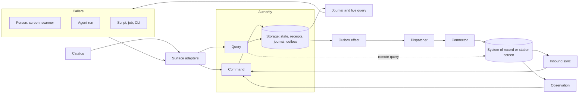

# Primitives

The building blocks of the framework: a capability catalog over one authority per workspace, which people, agents, scripts and connectors all call through the same contract. Commands change state, queries read authorized snapshots, and the journal tells every view what changed.

Each entry has a one-line definition and a line `<status> · <locations>`. Status is `implemented`, `partial` or `proposed`. How a primitive works, its settings and its limits are in the README of each location; what has been run is in the [implementation ledger](implementation-status.md).

## Core

### Capability

_A named command or query, defined once as data._

implemented · `packages/contracts`

### Module

_The unit a domain contributes: capabilities, handlers, a state slice, a policy route, workflows and scenarios._

implemented · `packages/contracts` `packages/runtime`

### Catalog

_The composed, validated description of everything the application can do._

implemented · `packages/contracts`

### Generator

_A pure transformation from the catalog to a checked-in artifact._

implemented · `scripts`

### Authority

_The single runtime that owns a workspace and executes its commands and queries._

implemented · `packages/runtime` `packages/adapters`

### Command

_An authorized write, submitted the same way by every caller._

implemented · `packages/runtime` `packages/contracts`

### Query

_An authorized, side-effect-free read._

implemented · `packages/runtime`

### Collection

_A typed set of records a module keeps in its state slice, with generated reads._

implemented · `packages/contracts` `packages/runtime`

### Execution context

_Who is calling, in which workspace, under which delegation grant._

implemented · `packages/runtime` `packages/adapters`

### Policy

_The port that decides operation, object, row and field access._

implemented · `packages/runtime` `packages/adapters`

### Membership

_Roles that people hold in a container: a project, plant or station._

implemented · `packages/contracts` `packages/runtime`

### Storage

_The port for the authority's transactional state._

implemented · `packages/runtime` `packages/adapters`

### State migration

_Numbered versions of an application's and each plugin's state, with the steps between them, stamped per workspace and applied to a checked copy before it replaces the database._

implemented · `packages/kernel/src/migrations.ts` `packages/kernel/src/state-upgrade.ts` `packages/host/src/cli/migrate-command.ts`

### Blob store

_Content-addressed bytes, such as photos and documents, that commands reference from resources._

partial · `packages/contracts` `packages/runtime` `packages/adapters` `packages/client` `packages/kernel`

### Journal and live query

_The ordered record of committed changes, and the client machinery that follows it._

implemented · `packages/runtime` `packages/client` `packages/react`

### Application

_One unit of content: the definition a host runs._

implemented · `packages/kernel` `packages/host` `packages/frame`

### Host

_The domain-neutral authority process that runs one application definition._

implemented · `packages/kernel` `packages/host`

### Host plugin

_A cross-cutting part an application composes: modules, a state slice, a policy, ports and lifecycle hooks._

implemented · `packages/kernel` `packages/host` `packages/frame` `packages/mobile` `plugins/managed-config`

### Host platform

_What the kernel needs from the machine it runs on: workspace ownership, storage, the host's own components and its capabilities._

partial · `packages/kernel` `packages/host` `packages/mobile`

### Web frame

_The domain-neutral browser shell around one application's screens._

implemented · `packages/frame`

### Native frame

_The domain-neutral React Native shell around one application's native screens._

partial · `packages/frame-native` `apps/mobile`

### Starter

_The thin application a team forks or generates and then owns._

implemented · `apps/service` `apps/web` `apps/desktop` `app.config.json`

## Callers

### Surface adapter

_Maps one surface onto the authority's raw command and query entry points._

implemented · `packages/adapters`

### Capability binding

_A UI control bound to a capability through the typed client._

implemented · `packages/react`

### UI session context

_What a person is looking at, captured for an agent, and the intents an agent can send back._

implemented · `packages/adapters` `packages/react` `packages/agents`

### Agent run

_An agent session acting as one more caller on the catalog._

implemented · `packages/agents`

### Agent definition

_A named agent in the catalog: its instructions, the operations it may call, its scope, model requirement, output mode and budgets._

implemented · `packages/contracts` `packages/runtime` `packages/agents` `packages/adapters`

### Proposal

_A command one caller proposes and another accepts under their own authority._

implemented · `packages/contracts` `packages/runtime` `packages/frame` `packages/operator-ui`

### Trigger

_Work that starts on a committed change or a schedule instead of a person's prompt._

implemented · `plugins/automation`

### Standing grant

_A person's recorded, expiring permission for a trigger to act as them._

implemented · `plugins/automation`

### Input source

_Device input normalized into events and routed to an intent without a model turn._

implemented · `packages/devices` `plugins/intent-scanner`

### OS handler

_A declared registration with the operating system, such as a link path, file type, share target, Android intent, shortcut or reply, and where its requests go._

partial · `packages/contracts` `packages/shell` `plugins/os` `plugins/share-target` `plugins/notifications` `plugins/android-intents` `plugins/os-shortcuts` `packages/frame` `packages/frame-native` `packages/mobile` `plugins/compliance` `apps/desktop` `apps/mobile` `examples/project-tasks`

### OS action

_A declared request to the operating system to open a URL, reveal or open a file, share, notify or send an Android intent, with the data classes it carries._

partial · `packages/contracts` `packages/shell` `plugins/os` `plugins/share-target` `plugins/notifications` `plugins/android-intents` `plugins/compliance` `packages/agents` `apps/desktop` `packages/frame` `packages/mobile`

### Shell port

_The kernel port that receives OS requests and performs OS actions; its default refuses both._

partial · `packages/kernel` `packages/host` `packages/adapters` `packages/shell` `packages/mobile` `plugins/os` `apps/desktop` `apps/mobile`

### Process port

_The kernel port that starts declared child processes from the site policy's bindings; its default refuses._

partial · `packages/kernel` `packages/egress` `packages/host` `plugins/process`

### UI registry

_Reusable screen parts published as registries over stock shadcn primitives._

implemented · `packages/operator-ui` `packages/frame` `packages/frame-native` `plugins/compliance` `plugins/connector-driver`

## Integrations

### Outbox effect

_A durable intent to change another system, committed with the command that causes it._

implemented · `packages/runtime`

### Connector

_The port that delivers effects to one target and looks up their outcome._

implemented · `packages/integration` `packages/station` `packages/testing` `plugins/connector-driver` `plugins/notifications`

### Dispatcher

_The worker that delivers pending effects and settles them under a narrow integration principal._

implemented · `packages/integration`

### Inbound sync

_Imports upstream changes as ordinary commands._

implemented · `packages/integration`

### Target

_A system of record declared once: its settle, feed and status operations, its principal's grant and its policy lane._

implemented · `packages/contracts` `packages/integration`

### Remote query

_A query that reads another system at the moment someone asks, with the caller's own access, and stores nothing._

partial · `packages/contracts` `packages/runtime` `packages/integration` `packages/host` `packages/react` `examples/crm-capture`

### Data provider

_One declaration of what a system of record can be searched for, which becomes ordinary catalog entries for every surface._

partial · `packages/contracts` `packages/integration` `examples/crm-capture`

### Observation

_A reading from a source that cannot be queried, submitted through an ingest command._

implemented · `packages/observation` `packages/station` `plugins/connector-driver`

### Gated actuator

_Lets a model propose screen actions while deterministic code executes and verifies them._

implemented · `packages/station` `packages/integration` `plugins/connector-driver`

### Driver contract

_A driver's state fields, actions with delivery mode and hazard class, and events, as data with a digest the driver must echo at its handshake._

partial · `plugins/connector-driver` `examples/quality-inspection`

### Driver process

_A supervised child process that controls or reads equipment, speaking JSON-RPC over its stdio and started through the process port. Its events can enter as ingest commands._

partial · `plugins/connector-driver` `plugins/process` `examples/quality-inspection`

### Driver SDK

_A library in another language that answers the driver protocol for a driver author: mode gating, once-per-effect delivery with a journal, events and stubs generated from the contract. Each proves itself against the base's reference contract._

partial · `sdks/driver-python` `sdks/driver-dotnet`

### Reconciliation

_A tracked state and procedure for outcomes no one can establish automatically._

partial · `packages/runtime` `packages/integration`

### Worker claims

_Attempt identities, expirations and fencing tokens so a stale worker cannot overwrite a newer outcome._

implemented · `packages/runtime` `packages/integration`

## Trust and configuration

### Credential vault

_The port for provider secrets._

implemented · `packages/agents`

### Device link

_Pairing a phone or tablet with a hub, and the credential it presents afterwards._

partial · `plugins/device-link` `plugins/hub-link`

### Requirement declaration

_What a module or host component needs outside the process, as data: network destinations, devices and child processes, with the outbox targets each carries._

implemented · `packages/contracts`

### Site policy

_Deployment data that binds declared destinations to addresses and sets a hardening floor._

implemented · `packages/egress` `plugins/site`

### Workforce sign-in

_People signing in to a serving host through the site's identity provider, under `identity: external`._

partial · `plugins/site/src/workforce` `packages/kernel/src/plugin.ts` `packages/adapters/src/http`

### Station sign-in

_An operator signing in at a shared station seat by badge and PIN, for a short-lived session of their own._

partial · `plugins/station-sign-in` `packages/kernel/src/plugin.ts`

### Egress guard

_The only path from server code, and from declared child processes, to the network._

implemented · `packages/egress` `plugins/network` `scripts`

### Event log

_An injected, tamper-evident record of every command, query, denial, outbox transition, sync pass, connection and run._

implemented · `packages/contracts` `packages/runtime` `packages/event-log` `plugins/audit`

### Execution host

_An isolation boundary and credential broker for tools an agent runs._

partial · `packages/egress` `plugins/network`

### Profile

_Versioned, schema-validated data describing one site._

implemented · `packages/station` `packages/devices`

### Configuration module

_A reusable capability module that makes site configuration an ordinary operation._

implemented · `packages/devices`

### Golden check

_Replays labeled inputs through a profile and its extractors, as a separate procedure run before a profile or model change is used._

implemented · `packages/station`

### Compliance bundle

_The evidence an auditor checks, generated from the catalog and site policy and re-checked while the application runs._

implemented · `plugins/compliance` `packages/host`

### Behavioral scenario

_A reusable test of one capability's allowed, denied, stale, replayed and visible behavior._

implemented · `packages/testing`

### Scaffold

_Exports the framework, the starter and content as a standalone application, and generates new applications and their parts._

implemented · `packages/scaffold`

### Task package

_A signed, versioned package with declared requirements, staged activation and rollback._

partial · `packages/bundle` `scripts/bundle.ts` `plugins/site/src/install`

## Adding or changing a primitive

Add an entry when a concept is domain-neutral and more than one application uses it; an adapter belongs with its port, and a concept only one example needs stays in that example. Prefer extending or extracting existing code. Keep the definition true across adapters and defaults, and put the details in the README.
