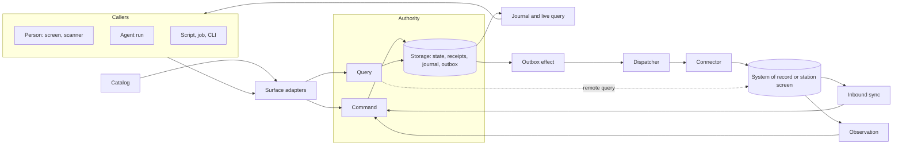

# Primitives

At its core the framework is one idea: **a capability catalog over a logical CQRS authority, where every caller uses the same contract.** Commands change state through one authority; queries read authorized snapshots; a journal tells every view what changed. People, agents, scripts, jobs, scanners and connectors are all callers of that contract. None of them gets a private path.

AI is not the center of this design and not a special case. An agent is a caller like any other, reaching the catalog through MCP or the CLI under a delegated grant. Where models work inside the system, reading a screen or proposing a click, they sit behind ports and only propose; deterministic code validates, acts and verifies. Everything here works without a model.

The other primitives extend that core in three directions: **callers** reaching it from every surface, **integrations** connecting it to systems that keep their own records, and the **trust, configuration and proof** that let one framework serve many sites. [Edge applications](edge-applications.md) describes the on-site deployment: the application, its connectors and the agents that call it, on or beside the machine where work happens.

## How to read an entry

Each entry gives a one-line definition, the problem the primitive solves and how it relates to its neighbors, the **guarantees** an application may rely on, and any known **gaps**. The last line points to the code:

`<status> · <locations>`

Each location has a README that links back to every entry naming it and lists the exports, entrypoints, trust boundary, dependencies and tests. `bun run check:readmes` fails when the two disagree. Entries describe concepts and stay true across renames; names of exports live in the READMEs.

Status is `implemented`, `partial` or `proposed`, and changes only with evidence in the [implementation ledger](implementation-status.md). Adapters, such as SQLite storage or the Codex harness, are listed with the port they implement. Domain code in `examples/*` is not a primitive; a domain concept is promoted only when a second application needs it.

## The core: describe, write, read

### Capability

_A named command or query, defined once as data._

Everything else in the framework hangs off capabilities. A capability names a business behavior with a stable ID, strict JSON schemas, the permission it needs and how the UI binds it. Because it is plain data, a browser, a generator and a test can all import it without loading handlers or drivers.

Guarantees: IDs and inferred types survive composition into typed clients. Wire values are JSON only, and validation rejects input it would have to strip or transform. A command that forwards to another system declares that its receipt is not upstream acceptance. A query that reads another system declares its target and the identity it may use (see [Remote query](#remote-query)).

implemented · `packages/contracts`

### Module

_The unit a domain contributes: capabilities, handlers, a state slice, a policy route, workflows and scenarios._

Modules are how an application is assembled from independently authored parts. Each is composed explicitly in the application definition, owns its slice of state and routes its own policy, so the line-station module and the reusable device configuration module share one authority without seeing each other's data.

Guarantees: nothing is discovered or registered globally. Handlers see only their module's slice. Operations and resources no module claims are denied.

implemented · `packages/contracts` `packages/runtime`

### Catalog

_The composed, validated description of everything the application can do._

The catalog is the single list that every surface and artifact reads. It is what makes "every operation from UI, MCP, CLI and API" true by construction instead of by discipline.

Guarantees: deterministic output. Composition fails before startup on duplicate IDs, missing or cyclic dependencies, missing UI declarations, unresolved workflow references and colliding MCP names.

implemented · `packages/contracts`

### Generator

_A pure transformation from the catalog to a checked-in artifact._

JSON Schema, OpenAPI, the operation and workflow references, the application skill with CLI forms, and the security manifest, data flows and SBOM are generated, not written. Agents and auditors learn the application from the same source the UI is built from. Each application gets its own set under `docs/reference/<id>/`, built from its browser-safe manifest; the control mapping is the framework's and sits beside them.

Guarantees: generation opens no workspace, reads no credential, starts no server and loads no handler. Drift fails the build, including a reference directory no application produces any more. A boundary check keeps contract and browser code free of host-only modules, keeps the starter from importing content and content from importing the starter, and bundles every application's web entry to prove its browser graph.

implemented · `scripts`

### Authority

_The single runtime that owns a workspace and executes its commands and queries._

CQRS here is logical: one transactional authority with separate command and query paths, not two databases or an event-sourced model. One owner per workspace removes a whole class of dual-writer bugs; every other process attaches to it or runs it embedded.

Guarantees: an OS-held lock admits one owner per workspace, across path aliases, and a crash releases it without PID-file guessing.

implemented · `packages/runtime` `packages/adapters`

### Command

_An authorized write, submitted the same way by every caller._

The write side. A handler validates, mutates its state slice, declares what changed and may queue effects for other systems; the authority does the rest. Retries, double taps and restarted agent runs are safe because the receipt, not the caller, decides whether work already happened.

Guarantees: feature state, revisions, the idempotency receipt, journal entries and outbox effects commit atomically or not at all. Keys are scoped to workspace and principal; a reused key with other input conflicts. `expectedRevisions` makes stale writes conflict. Authorization and cancellation are rechecked before commit. An undeclared change fails. Errors share one caller-safe envelope.

implemented · `packages/runtime` `packages/contracts`

### Query

_An authorized, side-effect-free read._

The read side. Queries are computed from the same transactional state, so there is no projection lag, and each returns a cursor so a caller can follow changes from exactly that point.

Guarantees: data and cursor come from one snapshot. Rows are scoped before filtering, pagination and counts. Output is projected to readable fields, then validated. Mutation inside a query fails. A [remote query](#remote-query) keeps every guarantee except the single snapshot: its items come from another system between two snapshots.

implemented · `packages/runtime`

### Execution context

_Who is calling, in which workspace, under which delegation grant._

This is how a person, an agent and a job can share operations without sharing authority. The host derives the context; an agent run inherits a narrowed grant from the person who started it.

Guarantees: operation input cannot set or widen it. Grants narrow by operation, resource, expiry and run and are rechecked after every awaited step. Launchers fix the grant of embedded or attached agent processes through a grant file.

implemented · `packages/runtime` `packages/adapters`

### Policy

_The port that decides operation, object, row and field access._

Policy is injected so an application can bring its own rules engine. The reference adapter uses a bounded CASL profile whose row scopes translate to both memory predicates and SQL.

Guarantees: decisions use authoritative state, never caller-supplied attributes. Scope translations are tested for agreement. Unknown operations and unsupported conditions fail closed.

implemented · `packages/runtime` `packages/adapters`

### Storage

_The port for the authority's transactional state._

Storage holds feature state together with the framework's receipts, revisions, journal and outbox, which is what lets a command commit all of them at once. Memory and SQLite snapshot adapters ship; the SQLite one runs over a small synchronous driver, so the desktop and the phone share it. A production store implements the same port.

Guarantees: atomic `transact` and consistent `read` per workspace; rejected work commits nothing. A replacement passes the storage conformance suite.

Gaps: the SQLite adapter rewrites one JSON snapshot per commit, and the journal is never pruned.

implemented · `packages/runtime` `packages/adapters`

### Blob store

_Content-addressed bytes, such as photos and documents, that commands reference from resources._

Photos and scanned pages are too large for a snapshot that is rewritten on every commit. A caller uploads the bytes first and gets back a reference (digest, size, media type). A command then attaches that reference to a resource it changes, in the same transaction as the change, and state, input and effect payloads carry only the reference. The workspace records which resources reference each blob. A caller may read a blob when it may read one of those resources, so a blob follows the policy of the records it belongs to. Commands declare the size and media types they accept, and an upload is refused unless an operation the caller may invoke would accept it. Connectors read the blobs attached to an effect's resource and upload them before delivering the record.

Guarantees: an attachment commits with its command or not at all. Attaching needs the caller's own recent upload or read access to a resource that already references the blob, so learning a digest grants nothing; every refusal looks the same. Reads re-evaluate policy each time, so a revocation takes effect on the next read, and HTTP serves blobs sandboxed, unsniffed and uncached. Unreferenced blobs are removed after a grace period; a referenced blob is never removed. Uploads, reads and refusals are audited by digest.

Gaps: bytes travel whole, not streamed. MCP and the CLI do not carry blobs. Staged uploads live in memory, so an upload must be attached before the authority restarts. A serving authority sweeps only when it opens. No mobile store exists yet.

partial · `packages/contracts` `packages/runtime` `packages/adapters` `packages/client` `packages/kernel`

### Journal and live query

_The ordered record of committed changes, and the client machinery that follows it._

The journal closes the CQRS loop: whatever wrote the change, every view that may see it learns about it and re-reads through an authorized query. That is why a change made by an agent over MCP appears on an operator's screen without a refresh.

Guarantees: events carry resource references and revisions, never record contents, and are filtered by current access. Clients subscribe from their query's cursor, so nothing falls between snapshot and stream. Invalidation follows the catalog's resource dependencies and is coalesced. An authorization change resets views without leaking identifiers. It clears cached data at once, even while a refetch is still pending, and it covers snapshots cached before the stream's first batch. Remote query results are excluded from change-driven refetches but not from that reset.

implemented · `packages/runtime` `packages/client` `packages/react`

### Application

_One unit of content: the definition a host runs._

An application is a package with three entrypoints. `manifest` is browser-safe: its id, title, composed modules and the components it brings (a screen bridge, device drivers), with their declared requirements. `application` is server code: state factory and upgrades, composed policy, handlers, services, selectable resources and `connect`, which wires systems of record (demo fakes included) and observers once per authority. `screens` is browser code: routes (each in the sidebar shell or, with `layout: 'full'`, full-window for a station), navigation with optional count badges, capability screens, and the shell's slots: title, context line, a sidebar section above the navigation, and status. Layouts are pathless routes, so screens read route params with `useParams({ strict: false })`. The starter names one application in its configuration and the host and frame resolve these entrypoints, so adding an application changes no framework or starter code. Each example in `examples/*` is one application. Each entrypoint also lists the application's [host plugins](#host-plugin), in the same order. The manifest may name its `targets` (desktop, web, mobile); each target maps to [host platforms](#host-platform) and every listed plugin must run on them.

Guarantees: one catalog, generated reference set, web bundle and workspace per application. `defineApplication` fails when a selectable resource names an operation the manifest does not compose; `defineManifest` rejects an invalid id or a duplicate module, plugin modules included; `defineApplication` rejects a plugin list that differs from the manifest's; `defineScreens` rejects a navigation target with no route, after merging plugin screens. A definition is trusted code; only callers are untrusted.

implemented · `packages/kernel` `packages/host` `packages/frame`

### Host

_The domain-neutral authority process that runs one application definition._

The host owns everything an application should not rewrite: workspace ownership, storage, launch and sessions, HTTP/SSE, embedded MCP, the CLI, run supervision and background delivery. It receives a definition and composes the runtime, integrations and observers from it; it names no domain and no security concept. It is a kernel: what crosses the process boundary (network, ingress, caller identity, the audit log) goes through [ports](#host-plugin) whose defaults refuse the network, bind loopback and keep no log, and the definition's plugins provide anything more.

Guarantees: one authority per workspace, enforced by the same OS lock for a serving host and an embedded one. Embedded authorities never start observers. Observers start only after the host listens, and a failed start stops the ones already running. `loadApplication` and `loadManifest` resolve the configured application at runtime; compiled builds use a generated static entry because a binary cannot follow that import. Opening an authority (plugins, identity, storage, runtime, `ready`, integrations) is portable and runs on any [host platform](#host-platform); the Bun host supplies one platform.

implemented · `packages/kernel` `packages/host`

### Host plugin

_A cross-cutting part an application composes: modules, a state slice, a policy, ports and lifecycle hooks._

Some concerns belong to many applications but to no domain: a site policy, an audit trail, compliance evidence, a notifier. A plugin has the same three entrypoints as an application, and the application lists its plugins in each of them. Plugins can provide the kernel's ports, hand a service to later plugins, and use each other through the composed ports rather than through imports. A plugin declares the [host platforms](#host-platform) it runs on (absent means Bun only). A plugin can provide settings for other plugins before any of them opens, as a managed-configuration reader would. A plugin runs code at fixed points: before storage opens, before the first request, once a serving host listens (as a delegated caller), and at shutdown in reverse order. `plugins/webhook` stands in for a third-party plugin.

Guarantees: a plugin's state is its own slice, which the application's upgrade and other plugins cannot rewrite, and its policy decides only its own operations and resource types. The kernel's ports default closed: no network, the platform's own listener (loopback on Bun, none on a platform without ingress) and no event log. A plugin listed on a platform it does not declare refuses startup. Provided settings override launcher settings unless the launcher is a development build; two providers of one key refuse startup. A refusal while opening stops startup before state is opened. Two providers of one port, a supplied setting no plugin claims, and a port a plugin's configuration needs that nobody provides all refuse startup. `check:boundaries` keeps the framework and the starter from importing plugins, and plugins from importing the starter or content.

Gaps: plugins are trusted code with the host's privileges. Nothing sandboxes one plugin from another's services. Environment variables that no plugin claims are ignored rather than refused. The kernel fixes the set of port kinds, so a plugin cannot introduce a new one.

implemented · `packages/kernel` `packages/host` `packages/frame`

### Host platform

_What the kernel needs from the machine it runs on: workspace ownership, storage, the host's own components and its capabilities._

The kernel opens an authority without any Node, Bun or React Native API. A platform supplies exclusive ownership of a workspace, the workspace's snapshot storage and [blob store](#blob-store), the requirements the host itself adds to every deployment (the Bun host's listener and agent providers), an optional default listener, and the set of capabilities it has: raw sockets, child processes and ingress. The Bun host is one platform; Android and iOS share the mobile platform, which has none of the three capabilities and owns its workspace with a lock database. Before plugins open, the kernel checks that the JavaScript host has the Web globals the runtime calls and installs the ones it can write in JavaScript.

Guarantees: a deployment that declares a socket destination, an ingress destination or a child process refuses startup on a platform without the matching capability, naming the component that declared it. A missing global refuses startup before any state opens. The runtime, client, integration and kernel suites also run with the globals Hermes may lack removed and the kernel's replacements installed. `check:boundaries` keeps Node and Bun imports and globals out of the portable packages.

Gaps: the mobile platform has run only in Bun tests with Bun's SQLite and files, not yet on a device. A platform is trusted code; nothing checks that its ownership is really exclusive beyond its own tests.

partial · `packages/kernel` `packages/host` `packages/mobile`

### Web frame

_The domain-neutral browser shell around one application's screens._

The frame supplies session and launch exchange, routing, navigation, the command palette, the run panel and accounts, and fills them from the application's screens. Its Vite plugin binds the configured application's `screens` entry to a virtual module and resolves `@/` imports from the starter first, then the frame, then the operator registry, so a starter file at the same path replaces the frame's.

Guarantees: the frame imports no application; the boundary check bundles every application through it. The same parts ship as a shadcn registry, so a starter can copy and own any of them.

implemented · `packages/frame`

### Starter

_The thin application a team forks or generates and then owns._

The starter wires framework to content: `app.config.json` names its identity and the application it hosts, `apps/service` serves it, `apps/web` frames its screens and `apps/desktop` wraps both. It holds no domain and no generic host code, so changing it never forks the framework; extending it is the owner's business. `AGENT_NATIVE_APPLICATION` overrides the configured application for one developer's launch. `bun run dev` opens that desktop window against the source service; a packaged build is the integrity-checked distribution of the same window.

Guarantees: the starter imports no content statically; the boundary check fails a direct import from `examples/*`. A development desktop launch cannot skip packaged digest checks: the development flag is honored only when Electron reports the app is unpackaged (`apps/desktop/test/development-launch.test.ts`).

Gaps: `apps/mobile` is an Expo shell for Android and iOS that does not yet host the configured application.

implemented · `apps/service` `apps/web` `apps/desktop` `app.config.json`

## Callers: every surface on the same contract

### Surface adapter

_Maps one surface onto the authority's raw command and query entry points._

HTTP, MCP, the CLI and in-process calls are thin translations. They carry no business logic and keep no operation list, so adding a capability adds it to all of them.

Guarantees: MCP tool names, CLI subcommands and typed flags are derived from the catalog. Errors keep their meaning across surfaces: HTTP status, MCP tool error and CLI exit code map from the same code. A per-request signal only adds to the trusted context's cancellation (`withSignal`). Direct and HTTP cursors both carry the authorization revision they were issued under, so a subscription resets when access changed after the snapshot.

implemented · `packages/adapters`

### Capability binding

_A UI control bound to a capability through the typed client._

The UI's equivalent of a tool call. It turns a person's intent into exactly one command, however many times they tap.

Guarantees: one idempotency key per intent, kept across retries until commit. Validation uses the contract's schema and field errors map back to inputs. Drafts stay separate from committed data and conflict explicitly: a draft pins the object it edits (capture pins its characteristic and sample; scanner setup keeps the revision it loaded and saves with it as the expected revision), so an external write shows a conflict instead of retargeting or discarding the entry. Every operation that claims a UI binding is referenced by a screen of its application; an operation no screen offers declares an exception instead.

A search box binds a [remote query](#remote-query) through `remoteQueryOptions`, or `remoteInfiniteQueryOptions` for "show more" paging. It keeps the previous result on screen while the next input loads, and it aborts the superseded request at the source.

Gaps: the reference check proves a screen names the capability, not that a control renders it.

implemented · `packages/react`

### UI session context

_What a person is looking at, captured for an agent, and the intents an agent can send back._

This is the bridge between a person and an agent working on the same screen. The agent acts on what the person selected, at the revision they saw, and can ask the frontend to open or select something.

Guarantees: the host issues and binds sessions. Capture revalidates access and freezes the target, so later selection changes cannot retarget a run. Intents expire, are acknowledged and never write business records. Every provider adapter shows its model the captured selection through `modelPrompt`: resource references and the revisions the person saw, never identity, grant, provider selection or session ID. Contents still come only through tools.

implemented · `packages/adapters` `packages/react` `packages/agents`

### Agent run

_An agent session acting as one more caller on the catalog._

The supervisor makes an agent an ordinary caller: its tools are catalog operations, its authority is the narrowed grant of whoever started it, and its narration is kept apart from what it actually committed. Codex, Claude and AI SDK harnesses are adapters behind one port, next to a deterministic harness that needs no provider.

Guarantees: tools are catalog operations only. Text and progress stream separately from commits. Cancellation stops future work without undoing commits, and a restart marks unfinished runs interrupted instead of replaying them.

implemented · `packages/agents`

### Input source

_Device input normalized into events and routed to an intent without a model turn._

Scanners are callers too. A wedge, serial, HID or camera scanner produces a normalized scan; a configured route turns it into the same command a button or tool call would submit.

Guarantees: sources are registered explicitly. Decoding validates GS1 check digits and AIM symbologies and corrects keyboard-layout mismatch. Routes are site configuration.

Each non-wedge source is declared as a device requirement, so the security manifest lists it.

Gaps: no source has been checked on real hardware. Device access is declared but not mediated.

implemented · `packages/devices`

### UI registry

_Reusable screen parts published as shadcn registries over stock shadcn primitives._

Specialized interfaces are cheap only if their parts are shared. Apps pull registry items with `shadcn add` and own the copied source, while trust-relevant behavior stays in versioned bindings. A plugin that brings a screen ships it as its own registry, as the compliance plugin does with `compliance-screen`.

Guarantees: no shadcn primitive is forked; sizing comes from tokens and `cva` variants. The registry manifest is generated and drift-checked. Operator items follow the point-of-work rules: glove-sized targets, hold-to-confirm for consequential actions, state as icon plus text. The app shell exports `NavigationCount`, `SidebarSection` and `SidebarLink` for the slots; `status-strip` adds `SignalBanner`, the one signal readable from the machine; `operator-station` lays out a full-window station (dark header with seat control, machine banner, task panel beside attention, history footer) with `OperatorPanel` for the task.

Gaps: no scratch-app `shadcn add` acceptance test.

implemented · `packages/operator-ui` `packages/frame` `plugins/compliance`

## Integrations: systems that keep their own records

### Outbox effect

_A durable intent to change another system, committed with the command that causes it._

The outbox extends the write side past the authority's own transaction without pretending to a distributed one. The command records what should happen elsewhere; delivery happens later, outside any transaction, and its outcome comes back as another command.

Guarantees: the effect commits with its command or not at all. Its ID derives from the receipt, so a replay never enqueues twice, and it doubles as the target's idempotency key. It is settled exactly once. A held effect waits for a person and returns to delivery only through a reconciliation command.

implemented · `packages/runtime`

### Connector

_The port that delivers effects to one target and looks up their outcome._

A connector is the only code that talks to an external system. The same port covers an ERP API, a file drop and legacy station software that can only be reached through its screen.

Guarantees: a target declares idempotent delivery or implements a lookup consulted before every send. A business rejection is data, never retried. An outcome the connector cannot establish is reported as uncertain, never guessed. A port may also implement `search`, which a [remote query](#remote-query) calls with the access it resolved for the caller; delivery never uses it.

implemented · `packages/integration` `packages/station`

### Dispatcher

_The worker that delivers pending effects and settles them under a narrow integration principal._

Guarantees: at-least-once delivery with backoff and journaled attempts, so screens can show retrying. The integration grant can only settle, sync and read status. `drain` reports whether anything is still pending, and its deadline aborts a delivery in flight. `drainTargets` drains every dispatcher a host composed and accounts for the whole outbox by target, so a target with work but no dispatcher in this process is reported as not deliverable instead of being left out. An uncertain outcome is recorded and held even when shutdown interrupts the pass.

`createTargetIntegration` builds one target's connector, integration context, dispatcher and inbound sync from a port, so an application's `connect` declares targets instead of wiring workers.

Gaps: no worker claims or fencing, no upstream-pending state, no cancel-before-dispatch, no dispatch-time recheck of the original actor's authority.

partial · `packages/integration`

### Inbound sync

_Imports upstream changes as ordinary commands._

Other systems change too. Inbound sync brings those changes in through the write side, so they are authorized, journaled and visible like any local change.

Guarantees: the watermark is part of the command's input, so a stale page conflicts and two pullers cannot apply it twice.

Gaps: no upstream versions for out-of-order feeds.

implemented · `packages/integration`

### Remote query

_A query that reads another system at the moment someone asks, with the caller's own access, and stores nothing._

Outbox effects and inbound sync keep local records in step with a system of record, but neither lets a person or agent ask the system of record something now. A remote query does: the runtime calls the target's source between two read snapshots, outside any transaction. The handler only builds the request and maps what comes back, both without I/O. What the caller keeps from a result is a separate command.

Guarantees:

- The order is: authorize; build the request; call the source with a deadline and the caller's signal; authorize again in a fresh snapshot; map, project and validate; authorize once more. A denied caller never reaches the source, and a revocation during the call drops the result.
- The source receives the execution context, so it resolves the caller's credential, or the delegator's for an agent run. A service credential is used only under `caller-or-service`; a service answer to a `caller` query is refused.
- An unreachable, slow or missing source is `source.status: 'unavailable'` with a caller-safe message. `FORBIDDEN` and cancellation propagate.
- Results carry target, identity and fetch time and are never stored. The audit records target, status, identity, item count and whether more pages exist, never the query, the cursor or the items.
- Paging belongs to the source. The caller passes back the opaque `next` of the previous page as `cursor`, and the runtime returns the source's next cursor untouched. A page can be short or empty after scoping, so only a missing `next` ends the list. A source binds each cursor to the search and the credential that produced it, and refuses it otherwise, so a cursor never widens what a caller reads.

Gaps: proven on one example (two providers). That a source binds its cursors is a port contract, checked only by the example's fake. Credentials are resolved by the application's `CallerCredentials`; no vault adapter ships for it yet.

partial · `packages/contracts` `packages/runtime` `packages/integration` `packages/host` `packages/react` `examples/crm-capture`

### Data provider

_One declaration of what a system of record can be searched for, which becomes ordinary catalog entries for every surface._

A data provider names a target, its identity rule, a query schema and an item schema. `defineDataProvider` turns that into `<id>.search` and `<id>.lookup` remote queries, so the same provider serves a screen through TanStack Query, an agent through MCP, a script through the CLI and HTTP. `implementDataProvider` supplies the item mapper, where local state and scoping apply; `createRemoteSource` adapts a port's `search` and resolves credentials.

Guarantees: capability IDs and inferred types stay literal. Both queries need `search` permission on the provider's resource type and declare `remote`, so composition requires a destination that reads the target. Search takes the provider's query plus an optional `cursor`, which a provider cannot redefine. Lookup takes only an external ID.

Gaps: proven on one example with two providers. Adoption is domain code and is not generated.

partial · `packages/contracts` `packages/integration` `examples/crm-capture`

### Observation

_A reading from a source that cannot be queried, submitted through an ingest command._

Observation is the inbound counterpart for systems with no feed, such as a vendor HMI read by accessibility, OCR or a local vision model. The observer never writes storage; it submits readings like any caller.

Guarantees: each reading carries its source, model identity and digest, frame digest, time and confidence. It becomes current only after it is stable across consecutive reads. A low-confidence reading becomes an attention item for a person. Unchanged content is resubmitted at most once per heartbeat window, and each submission's idempotency key fingerprints its exact payload. A vision endpoint never follows a redirect, so screenshots reach only the validated host, and a perception worker that exits is restarted with a fresh handshake.

Gaps: implemented for screens only; promote out of `packages/station` when a second kind of source needs it.

The station's vision endpoints and perception worker are declared requirements; a site binds a vision service or the observer degrades.

implemented · `packages/station`

### Gated actuator

_Lets a model propose screen actions while deterministic code executes and verifies them._

This is how a computer-use model can operate legacy software without becoming a privileged caller. It sits inside a connector, behind the outbox. A driver resolves targets or proposes actions; the controller decides.

Guarantees: the controller performs every action itself, after a gate covering the expected screen (verified before every click, type and key), forbidden regions, the allowed set, step budget, timeout, bridge mode and seat (recorded state without expiry). Acceptance requires a matching readback on as many consecutive views as the fields' `stableReads` declare; convergence, preconditions and lookup use the same standard. An interrupted procedure that is not declared rerunnable is held, never re-run.

Gaps: no live computer-use model driver; no VNC, RDP, KVM or UI Automation transport.

implemented · `packages/station`

### Reconciliation

_A tracked state and procedure for outcomes no one can establish automatically._

Held effects resolved by a person are the first form; a general state machine across connectors is not built yet.

proposed

### Worker claims

_Attempt identities, expirations and fencing tokens so a stale worker cannot overwrite a newer outcome._

proposed

## Trust, configuration and proof

### Credential vault

_The port for provider secrets._

Provider credentials pay for inference; they never grant workspace access. The vault keeps them in the operating system's store.

Guarantees: fails closed when the store is unavailable. Secrets never reach browser state, domain data, model context or run logs, and are never discovered or reused implicitly. Account connections (`OidcAccountConnection`, the ChatGPT account) serialize credential writes, so a logout cannot be undone by a sign-in or refresh already in flight.

implemented · `packages/agents`

### Requirement declaration

_What a module or host component needs outside the process, as data: network destinations, devices and child processes._

Security teams admit software when they can see what it talks to and what data leaves. Declarations make that a property of the catalog. Each destination names its purpose, scope, protocol, data classes, availability and offline behavior, and the generated manifest, data flows and SBOM show every change to reviewers.

Guarantees: declarations are browser-safe data, composed with their owners. Composition rejects duplicate IDs, a process that names an undeclared destination, an outbox target that no destination carries or whose destination does not queue offline, and a remote query whose target no destination `reads`. The security manifest lists each operation that leaves the host with its path, `outbox` or `remote-read`. A capability's input is logged in plain text only for the fields its `audit.fields` names.

implemented · `packages/contracts`

### Site policy

_Deployment data that binds declared destinations to addresses and sets a hardening floor._

What a site permits is configuration, like everything else that differs per site. Without a policy the application is isolated: loopback only, outbox targets queue, providers report unavailable.

Guarantees: bindings must name declared destinations and match their protocol, host and port. In connected mode a required destination is bound or explicitly disabled, and every closed destination lists its offline consequence. The `desktop-local`, `sandbox` and `zero-trust` profiles are floors on plain HTTP, ingress (loopback or mTLS), identity, grant lifetime and audit mode; `site check` and startup report the same findings, and the site plugin refuses to start below its floor. A policy that asks for something no composed plugin enforces refuses to start. Certificate files are referenced by path and must be readable.

Gaps: `external` identity refuses to start because no workforce identity adapter exists. No certificate issuance or rotation.

Provided by the `site` [host plugin](#host-plugin), which also enforces the identity floor.

implemented · `packages/egress` `plugins/site`

### Egress guard

_The only path from server code, and from declared child processes, to the network._

Guarantees: a destination-scoped fetch allows only the bound scheme, host and port, rechecks every redirect hop, checks DNS answers against bound addresses, applies CA bundles and certificate pins, and caps response size and time. Provider SDKs get a fetch routed by origin, TCP transports a scoped socket, and declared children a loopback CONNECT proxy limited to their declared destinations. Every decision is logged; a refusal is an `UNAVAILABLE` error. `check:boundaries` fails on direct network or process APIs in server code outside a reviewed exemption list, and on an exemption that no longer matches.

Gaps: an in-process control, not an isolation boundary. A child that ignores proxy settings, or a compromised process, is contained only once the exported OS rules are applied.

Provided as the network port by the `network` [host plugin](#host-plugin), together with mTLS ingress when the policy selects it.

implemented · `packages/egress` `plugins/network` `scripts`

### Event log

_An injected, hash-chained record of every command, query, denial, outbox transition, sync pass, connection and run._

The journal tells views what changed; the event log tells an auditor who did what, through which surface, and what was refused. Injecting the port makes every layer observable without code in handlers.

Guarantees: events carry the actor and channel, operation, a safe reason code, correlation IDs and an input digest; input values appear only for allow-listed fields. `command.accepted` is appended inside the transaction, so in required mode a failed append rolls the command back, and startup resolves accepted commands a crash left open. The JSONL adapter chains SHA-256 across rotated segments, syncs every append, writes 0600 files and admits one writer per directory. The verifier reports edits, gaps and truncated segments. Forwarding sends RFC 5424 syslog through the network port.

Gaps: removing the newest events is detectable only against an anchor or a forwarded copy. No off-host collector has been exercised.

Provided as the event-log port by the `audit` [host plugin](#host-plugin), which also attests the build and recovers after a crash at startup.

implemented · `packages/contracts` `packages/runtime` `packages/event-log` `plugins/audit`

### Execution host

_An isolation boundary and credential broker for tools an agent runs._

The egress guard confines declared children to their destinations, launchers fix an embedded agent's grant, and the hardening exports describe an OS sandbox for the service. The network plugin's `network export` renders the site policy as default-deny rules for nftables, Windows Firewall, systemd, Kubernetes, Compose and JSON; each carries the policy digest and lists what it could not enforce.

Gaps: no isolation backend applies those rules, and there is no credential broker. Exports are compared as text, not loaded into a firewall or cluster.

partial · `packages/egress` `plugins/network`

### Profile

_Versioned, schema-validated data describing one site._

A station's screens, fields and procedures, a scanner's behavior and scan routes are data, so a new site is configuration rather than a fork.

Guarantees: validation rejects procedure steps that target forbidden regions or unknown fields.

implemented · `packages/station` `packages/devices`

### Configuration module

_A reusable capability module that makes site configuration an ordinary operation._

Configuration is itself part of the catalog, so a supervisor's screen, a CLI script and an agent change it the same way, under policy and revisions.

implemented · `packages/devices`

### Golden check

_Replays labeled inputs through a profile and its extractors, as a separate procedure run before a profile or model change is used._

Guarantees: reports per-field accuracy and confidence and fails on a confident misread.

Gaps: the current golden set exercises recorded expectations, not a model. Activation does not require a passing report: nothing ties a running profile to a golden result, so the check is a procedure, not a gate.

implemented · `packages/station`

### Compliance bundle

_The evidence an auditor checks, generated from the catalog and site policy and re-checked while the application runs._

Guarantees: the security manifest, data flows, control mapping (ISO/IEC 27001 Annex A, NIST SP 800-53 and CSF, IEC 62443-4-2) and CycloneDX SBOM are deterministic and drift-checked. Every control names tests, artifacts and event kinds that exist. A posture monitor re-verifies the log and records `posture.checked`. Through the `compliance` [host plugin](#host-plugin), listed auditors read posture and the log with ordinary authorized queries and a screen, and an offline report works against a copied log.

Gaps: control mappings are indicative, not a certification. The SBOM covers the whole lockfile, so every application's bill lists the desktop, web and mobile toolchains (Electron, Vite, Expo, React Native) as `required`, not only what that application ships on one target.

implemented · `plugins/compliance` `packages/host`

### Behavioral scenario

_A reusable test of one capability's allowed, denied, stale, replayed and visible behavior._

Scenarios are what prove the core idea: the same test runs through every surface and must produce the same outcome.

Guarantees: results and structured errors are compared across drivers.

implemented · `packages/testing`

### Scaffold

_Exports the framework, the starter and content as a standalone application._

`--example <name>` exports one example as the hosted application and leaves the others, their reference sets, root dependencies and lockfile entries out.

Guarantees: a versioned file-hash manifest; no credentials, workspace data or build output; never overwrites an existing target. A single-example export installs frozen and passes its own checks.

Gaps: framework packages are unpublished, so an export vendors `packages/*` instead of depending on published versions.

implemented · `packages/scaffold`

### Task package

_A signed, versioned package with declared requirements, staged activation and rollback._

proposed

## Adding or changing a primitive

1. Check that it is a concept, not an adapter. An adapter belongs with its port.
2. Check that it is domain-neutral. If only one example needs it, keep it in that example.
3. Prefer extending a primitive or extracting existing code over writing a new one.
4. Update the entry in the same change as the code, including its guarantees and gaps, and link it from the README of every location it names.
5. Change the status only with evidence in the [implementation ledger](implementation-status.md).
