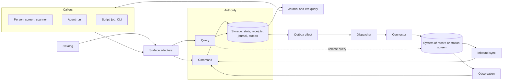

# Primitives

At its core the framework is one idea: **a capability catalog over a logical CQRS authority, where every caller uses the same contract.** Commands change state through one authority; queries read authorized snapshots; a journal tells every view what changed. People, agents, scripts, jobs, scanners and connectors are all callers of that contract. None of them gets a private path.

AI is not the center of this design and not a special case. An agent is a caller like any other, reaching the catalog through MCP or the CLI under a delegated grant. Where models work inside the system, reading a screen or proposing a click, they sit behind ports and only propose; deterministic code validates, acts and verifies. Everything here works without a model.

The other primitives extend that core in three directions: **callers** reaching it from every surface, **integrations** connecting it to systems that keep their own records, and the **trust, configuration and proof** that let one framework serve many sites. [Edge applications](edge-applications.md) describes the on-site deployment: the application, its connectors and the agents that call it, on or beside the machine where work happens.

## How to read an entry

Each entry gives a one-line definition, the problem the primitive solves and how it relates to its neighbors, the **guarantees** an application may rely on, and any known **gaps**. The last line points to the code:

`<status> · <locations>`

Entries describe concepts and stay true across renames, new adapters and changed defaults. Export names, entrypoints, adapters, settings, commands and tunable values live in the README of each location, which links back to every entry naming it; `bun run check:readmes` fails when the two disagree.

Status is `implemented`, `partial` or `proposed`, and changes only with evidence in the [implementation ledger](implementation-status.md). Adapters are listed with the port they implement, not as primitives. Domain code in `examples/*` is not a primitive; a domain concept is promoted only when a second application needs it.

## The core: describe, write, read

### Capability

_A named command or query, defined once as data._

Everything else in the framework hangs off capabilities. A capability names a business behavior with a stable ID, strict schemas, the permission it needs and how the UI binds it. Because it is plain data, a browser, a generator and a test can all import it without loading handlers or drivers.

Guarantees: IDs and inferred types survive composition into typed clients. Wire values are JSON only, and validation rejects input it would have to strip or transform. A command that forwards to another system declares that its receipt is not upstream acceptance. A query that reads another system declares its target and the identity it may use (see [Remote query](#remote-query)).

implemented · `packages/contracts`

### Module

_The unit a domain contributes: capabilities, handlers, a state slice, a policy route, workflows and scenarios._

Modules are how an application is assembled from independently authored parts. Each is composed explicitly, owns its slice of state and routes its own policy, so a domain module and a reusable one share one authority without seeing each other's data.

Guarantees: nothing is discovered or registered globally. Handlers see only their module's slice. Operations and resources no module claims are denied.

implemented · `packages/contracts` `packages/runtime`

### Catalog

_The composed, validated description of everything the application can do._

The catalog is the single list that every surface and artifact reads. It is what makes "every operation from UI, MCP, CLI and API" true by construction instead of by discipline.

Guarantees: deterministic output. Composition fails before startup on duplicate IDs, missing or cyclic dependencies, missing UI declarations, unresolved workflow references and colliding tool names.

implemented · `packages/contracts`

### Generator

_A pure transformation from the catalog to a checked-in artifact._

Schemas, the API description, operation and workflow references, the agent skill and the compliance evidence are generated, not written, one set per application from its browser-safe manifest. Agents and auditors learn the application from the same source the UI is built from.

Guarantees: generation opens no workspace, reads no credential, starts no server and loads no handler. Drift fails the build, including a set no application produces any more. A boundary check keeps contract and browser code free of host-only modules and keeps the starter and content from importing each other.

implemented · `scripts`

### Authority

_The single runtime that owns a workspace and executes its commands and queries._

CQRS here is logical: one transactional authority with separate command and query paths, not two databases or an event-sourced model. One owner per workspace removes a whole class of dual-writer bugs; every other process attaches to it or runs it embedded.

Guarantees: one owner per workspace, across path aliases, and a crash releases ownership without guessing from stale files.

implemented · `packages/runtime` `packages/adapters`

### Command

_An authorized write, submitted the same way by every caller._

The write side. A handler validates, mutates its state slice, declares what changed and may queue effects for other systems; the authority does the rest. Retries, double taps and restarted agent runs are safe because the receipt, not the caller, decides whether work already happened.

Guarantees: feature state, revisions, the idempotency receipt, journal entries and outbox effects commit atomically or not at all. Keys are scoped to workspace and principal; a reused key with other input conflicts. A caller can name the revisions it saw, and a stale write conflicts. Authorization and cancellation are rechecked before commit. An undeclared change fails. Errors share one caller-safe envelope.

implemented · `packages/runtime` `packages/contracts`

### Query

_An authorized, side-effect-free read._

The read side. Queries are computed from the same transactional state, so there is no projection lag, and each returns a cursor so a caller can follow changes from exactly that point.

Guarantees: data and cursor come from one snapshot. Rows are scoped before filtering, pagination and counts. Output is projected to readable fields, then validated. Mutation inside a query fails. A [remote query](#remote-query) keeps every guarantee except the single snapshot.

implemented · `packages/runtime`

### Execution context

_Who is calling, in which workspace, under which delegation grant._

This is how a person, an agent and a job can share operations without sharing authority. The host derives the context; an agent run inherits a narrowed grant from the person who started it.

Guarantees: operation input cannot set or widen it. Grants narrow by operation, resource, expiry and run and are rechecked after every awaited step. A launcher can fix the grant of an agent process it starts.

implemented · `packages/runtime` `packages/adapters`

### Policy

_The port that decides operation, object, row and field access._

Policy is injected so an application can bring its own rules engine.

Guarantees: decisions use authoritative state, never caller-supplied attributes. A row scope evaluates the same in memory and in the database, and the agreement is tested. Unknown operations and unsupported conditions fail closed.

implemented · `packages/runtime` `packages/adapters`

### Storage

_The port for the authority's transactional state._

Storage holds feature state together with the framework's receipts, revisions, journal and outbox, which is what lets a command commit all of them at once. One SQL adapter serves both the desktop and the phone; a production store implements the same port.

Guarantees: atomic transactions and consistent reads per workspace; rejected work commits nothing. A replacement passes the storage conformance suite.

Gaps: the shipped SQL adapter rewrites the whole state per commit, and the journal is never pruned.

implemented · `packages/runtime` `packages/adapters`

### Blob store

_Content-addressed bytes, such as photos and documents, that commands reference from resources._

Photos and scanned pages are too large for transactional state. A caller uploads the bytes first and gets a reference; a command attaches the reference to a resource it changes, in the same transaction, and state, input and effect payloads carry only the reference. A blob is readable by whoever may read a resource that references it, so it follows the policy of the records it belongs to. Connectors upload the blobs an effect references before delivering the record.

Guarantees: an attachment commits with its command or not at all. Attaching needs the caller's own recent upload or read access to a resource that already references the blob, so learning a digest grants nothing, and every refusal looks the same. An upload is refused unless an operation the caller may invoke would accept its size and type. Reads re-evaluate policy each time. Unreferenced blobs are removed after a grace period; a referenced blob never is. Uploads, reads and refusals are audited.

Gaps: bytes travel whole, not streamed. MCP and the CLI do not carry blobs. A staged upload must be attached before the authority restarts.

partial · `packages/contracts` `packages/runtime` `packages/adapters` `packages/client` `packages/kernel`

### Journal and live query

_The ordered record of committed changes, and the client machinery that follows it._

The journal closes the CQRS loop: whatever wrote the change, every view that may see it learns about it and re-reads through an authorized query. That is why a change made by an agent appears on an operator's screen without a refresh.

Guarantees: events carry resource references and revisions, never record contents, and are filtered by current access. Clients subscribe from their query's cursor, so nothing falls between snapshot and stream. Invalidation follows the catalog's resource dependencies. An authorization change resets views and clears cached data at once, without leaking identifiers. Remote query results are not refetched on changes but are cleared on that reset.

implemented · `packages/runtime` `packages/client` `packages/react`

### Application

_One unit of content: the definition a host runs._

An application has three entrypoints: a browser-safe manifest (its modules, the components it brings and their requirements), a server definition (state, policy, handlers and the connections to systems of record), and its screens. Each lists the application's [host plugins](#host-plugin) in the same order. The manifest names the targets the application runs on, which map to [host platforms](#host-platform). The starter names one application in its configuration and the host and frames resolve these entrypoints, so adding an application changes no framework or starter code.

Guarantees: one catalog, reference set, bundle and workspace per application. Definition fails on an invalid id, a duplicate module, a plugin list that differs between entrypoints, a selectable resource that names an operation the manifest lacks, and a navigation target with no screen. A definition is trusted code; only callers are untrusted.

implemented · `packages/kernel` `packages/host` `packages/frame`

### Host

_The domain-neutral authority process that runs one application definition._

The host owns everything an application should not rewrite: workspace ownership, storage, launch and sessions, the HTTP, MCP and CLI surfaces, run supervision and background delivery. It names no domain and no security concept. What crosses the process boundary (network, ingress, caller identity, the audit log) goes through ports whose defaults refuse the network, listen only locally and keep no log; plugins provide anything more.

Guarantees: one authority per workspace, for a serving host and an embedded one alike. Embedded authorities never start observers. Observers start only after the host listens, and a failed start stops the ones already running. Opening an authority is portable and runs on any [host platform](#host-platform).

implemented · `packages/kernel` `packages/host`

### Host plugin

_A cross-cutting part an application composes: modules, a state slice, a policy, ports and lifecycle hooks._

Some concerns belong to many applications but to no domain: a site policy, an audit trail, compliance evidence, a notifier, device pairing. A plugin has the same three entrypoints as an application. Plugins provide the kernel's ports, hand services to later plugins and use each other through ports rather than imports. A plugin declares the [host platforms](#host-platform) it runs on and may bring native code for mobile platforms. It runs at fixed points: settings for other plugins before any opens, before storage opens, before the first request, once a serving host listens (as a delegated caller), and at shutdown. A plugin on a serving host may answer a public route before the session check and resolve a credential it issued to an execution context. It may keep secrets in the platform's store, scoped to itself and the workspace.

Guarantees: a plugin's state is its own slice and its policy decides only its own operations and resource types. The kernel's ports default closed. Startup refuses a plugin on a platform it does not declare, native code the build lacks, two providers of one port or one setting, a setting no plugin claims, and a port a plugin needs that nobody provides. A credential a plugin resolves passes the same policy and grant checks as a session, and a refused credential is distinguishable from a denied operation. A plugin cannot read another plugin's secrets through its scoped store. The framework and the starter never import plugins, and plugins never import the starter or content.

Gaps: plugins are trusted code with the host's privileges; nothing sandboxes one from another's services. Unclaimed environment variables are ignored rather than refused. The set of port kinds is fixed. Native plugin code is not compiled by the deterministic checks.

implemented · `packages/kernel` `packages/host` `packages/frame` `packages/mobile` `plugins/managed-config`

### Host platform

_What the kernel needs from the machine it runs on: workspace ownership, storage, the host's own components and its capabilities._

The kernel opens an authority without any server or mobile runtime API. A platform supplies exclusive ownership of a workspace, its storage and [blob store](#blob-store), optionally a secret store, the components the host itself adds to every deployment, an optional default listener, and the capabilities it has, such as sockets, child processes and ingress. The desktop and service host is one platform; phones and tablets are another, without those capabilities.

Guarantees: a deployment that needs a capability the platform lacks refuses startup, naming the component that declared it. A missing language global refuses startup before any state opens, and the portable suites run with the mobile engine's missing globals removed. A boundary check keeps server runtime imports and globals out of portable code.

Gaps: the mobile platform has run only in tests on the server runtime, not on a device. Nothing checks a platform's exclusivity beyond its own tests.

partial · `packages/kernel` `packages/host` `packages/mobile`

### Web frame

_The domain-neutral browser shell around one application's screens._

The frame supplies session and launch exchange, routing, navigation, the command palette, the run panel and accounts, and fills them from the application's screens. A starter can replace any frame part by providing its own at the same path.

Guarantees: the frame imports no application; the boundary check bundles every application through it. Its parts ship as a registry, so a starter can copy and own any of them.

implemented · `packages/frame`

### Native frame

_The domain-neutral React Native shell around one application's native screens._

An application that targets mobile declares native screens once, and the frame supplies navigation, the session, plugin services and live invalidation over the in-process authority. Navigation adapts to the screen size. Screens and capability targets are named by path, as on the web, so a capability opens the same screen in both frames.

Guarantees: the frame imports no application; definition fails on a dead target, a duplicate screen or a home outside the navigation, across the application's and its plugins' screens. A new transport starts a new query cache. States look the same on a phone and at a station.

Gaps: bundled and type-checked, not rendered on a device. No compact web variant for attached tablets yet.

partial · `packages/frame-native` `apps/mobile`

### Starter

_The thin application a team forks or generates and then owns._

The starter wires framework to content: its configuration names its identity and the application it hosts, and its apps serve that application, frame its screens on the web, wrap both on the desktop and host it on phones and tablets. It holds no domain and no generic host code, so changing it never forks the framework.

Guarantees: the starter imports no content statically. A development desktop launch cannot skip the integrity checks of a packaged build.

Gaps: the mobile app has not run on a device, and attached mode does not exist.

implemented · `apps/service` `apps/web` `apps/desktop` `app.config.json`

## Callers: every surface on the same contract

### Surface adapter

_Maps one surface onto the authority's raw command and query entry points._

HTTP, MCP, the CLI and in-process calls are thin translations. They carry no business logic and keep no operation list, so adding a capability adds it to all of them.

Guarantees: tool names, subcommands and flags are derived from the catalog. Errors keep their meaning across surfaces. A request's cancellation can only add to the trusted context's. Cursors carry the authorization revision they were issued under, so a subscription resets when access changed after the snapshot.

implemented · `packages/adapters`

### Capability binding

_A UI control bound to a capability through the typed client._

The UI's equivalent of a tool call. It turns a person's intent into exactly one command, however many times they tap.

Guarantees: one idempotency key per intent, kept across retries until commit. Validation uses the contract's schema and field errors map back to inputs. A draft pins the object and revision it edits, so an external write shows a conflict instead of retargeting or discarding the entry. Every operation that claims a UI binding is referenced by a screen; an operation no screen offers declares an exception. A search bound to a [remote query](#remote-query) keeps the previous result while the next loads and cancels the superseded request at the source.

Gaps: the reference check proves a screen names the capability, not that a control renders it.

implemented · `packages/react`

### UI session context

_What a person is looking at, captured for an agent, and the intents an agent can send back._

This is the bridge between a person and an agent working on the same screen. The agent acts on what the person selected, at the revision they saw, and can ask the frontend to open or select something.

Guarantees: the host issues and binds sessions. Capture revalidates access and freezes the target, so later selection changes cannot retarget a run. Intents expire, are acknowledged and never write business records. A model sees resource references and revisions, never identity, grant or session; contents come only through tools.

implemented · `packages/adapters` `packages/react` `packages/agents`

### Agent run

_An agent session acting as one more caller on the catalog._

The supervisor makes an agent an ordinary caller: its tools are catalog operations, its authority is the narrowed grant of whoever started it, and its narration is kept apart from what it committed. Provider harnesses are adapters behind one port, next to a deterministic harness that needs no provider.

Guarantees: tools are catalog operations only. Text and progress stream separately from commits. Cancellation stops future work without undoing commits, and a restart marks unfinished runs interrupted instead of replaying them.

implemented · `packages/agents`

### Input source

_Device input normalized into events and routed to an intent without a model turn._

Scanners are callers too. Every scanner transport produces the same normalized scan, and a configured route turns it into the command a button or tool call would submit.

Guarantees: sources are registered explicitly. Decoding validates check digits and symbologies and corrects keyboard-layout mismatch. Routes are site configuration. Each source beyond a keyboard wedge is a declared device requirement.

Gaps: no source has been checked on real hardware. Device access is declared but not mediated. A source that receives system broadcasts accepts them from any app unless its profile restricts the sender.

implemented · `packages/devices` `plugins/intent-scanner`

### UI registry

_Reusable screen parts published as registries over stock shadcn primitives._

Specialized interfaces are cheap only if their parts are shared. Apps pull registry items and own the copied source, while trust-relevant behavior stays in versioned bindings. A plugin that brings a screen ships it as its own registry. A native registry carries the same point-of-work rules to phones and tablets.

Guarantees: no stock primitive is forked; sizing comes from tokens and variants. Registry manifests are generated and drift-checked. Point-of-work items keep glove-sized targets, hold-to-confirm for consequential actions, and state as icon plus text.

Gaps: no acceptance test pulls items into a fresh app.

implemented · `packages/operator-ui` `packages/frame` `packages/frame-native` `plugins/compliance`

## Integrations: systems that keep their own records

### Outbox effect

_A durable intent to change another system, committed with the command that causes it._

The outbox extends the write side past the authority's own transaction without pretending to a distributed one. The command records what should happen elsewhere; delivery happens later, outside any transaction, and its outcome comes back as another command.

Guarantees: the effect commits with its command or not at all. Its ID derives from the receipt, so a replay never enqueues twice, and it doubles as the target's idempotency key. It is settled exactly once. A held effect waits for a person and returns to delivery only through a reconciliation command.

implemented · `packages/runtime`

### Connector

_The port that delivers effects to one target and looks up their outcome._

A connector is the only code that talks to an external system. The same port covers a business API, a file drop, legacy software reachable only through its screen, and another host built on this framework, such as the hub a field device is paired with.

Guarantees: a target declares idempotent delivery or implements a lookup consulted before every send. A business rejection is data, never retried. An outcome the connector cannot establish is reported as uncertain, never guessed. A refused credential is a delivery failure, not a rejection, so the record waits for new credentials. A connector may also serve [remote queries](#remote-query) with the access resolved for the caller; delivery never uses that path.

implemented · `packages/integration` `packages/station`

### Dispatcher

_The worker that delivers pending effects and settles them under a narrow integration principal._

Guarantees: at-least-once delivery with backoff and recorded attempts, so screens can show retrying. The integration principal can only settle, sync and read status. Draining reports what is still pending per target, including targets this process cannot deliver, and its deadline aborts a delivery in flight. An uncertain outcome is held even when shutdown interrupts the pass. An application declares targets; the framework builds the workers.

Gaps: no worker claims or fencing, no upstream-pending state, no cancel-before-dispatch, no dispatch-time recheck of the original actor's authority.

partial · `packages/integration`

### Inbound sync

_Imports upstream changes as ordinary commands._

Other systems change too. Inbound sync brings those changes in through the write side, so they are authorized, journaled and visible like any local change.

Guarantees: the watermark is part of the command's input, so a stale page conflicts and two pullers cannot apply it twice.

Gaps: no upstream versions for out-of-order feeds.

implemented · `packages/integration`

### Remote query

_A query that reads another system at the moment someone asks, with the caller's own access, and stores nothing._

Outbox effects and inbound sync keep local records in step with a system of record, but neither lets a person or agent ask it something now. A remote query does: the runtime calls the target between two read snapshots, outside any transaction, and the handler only builds the request and maps the answer. Keeping a result is a separate command.

Guarantees: the caller is authorized before the call, after it in a fresh snapshot, and again after mapping, so a denied caller never reaches the target and a revocation during the call drops the result. The target sees the caller's identity, or the delegator's for an agent run; a service identity is used only where the query allows it. An unreachable or slow target is reported as unavailable, not as an error. Results are never stored, and the audit never records the query, cursor or items. Paging cursors are opaque and bound to the search and credential that produced them, so a cursor never widens what a caller reads.

Gaps: proven on one example. Cursor binding is a port contract checked only by that example's fake. No vault adapter resolves caller credentials yet.

partial · `packages/contracts` `packages/runtime` `packages/integration` `packages/host` `packages/react` `examples/crm-capture`

### Data provider

_One declaration of what a system of record can be searched for, which becomes ordinary catalog entries for every surface._

A data provider names a target, its identity rule, a query and an item shape, and becomes a search and a lookup [remote query](#remote-query), so one provider serves screens, agents, scripts and HTTP alike. The application supplies the mapping from items to its own view, where local state and scoping apply.

Guarantees: capability IDs and types stay literal. Both queries need search permission on the provider's resource type and require a destination that reads the target. A provider cannot redefine paging.

Gaps: proven on one example. Adopting a found item is domain code.

partial · `packages/contracts` `packages/integration` `examples/crm-capture`

### Observation

_A reading from a source that cannot be queried, submitted through an ingest command._

Observation is the inbound counterpart for systems with no feed, such as a vendor screen read by accessibility, OCR or a local vision model. The observer never writes storage; it submits readings like any caller.

Guarantees: each reading carries its source, model identity, frame digest, time and confidence. It becomes current only once stable across consecutive reads; a low-confidence reading becomes an attention item. Unchanged content is resubmitted at most once per heartbeat. Frames reach only the validated vision endpoint, and its workers are declared requirements a site binds or the observer degrades.

Gaps: implemented for screens only; promote out of the station package when a second kind of source needs it.

implemented · `packages/station`

### Gated actuator

_Lets a model propose screen actions while deterministic code executes and verifies them._

This is how a computer-use model can operate legacy software without becoming a privileged caller. It sits inside a connector, behind the outbox. A driver resolves targets or proposes actions; the controller decides.

Guarantees: the controller performs every action itself, after a gate covering the expected screen, forbidden regions, allowed actions, budgets, bridge mode and seat. Acceptance requires matching readbacks across consecutive views. An interrupted procedure that is not declared rerunnable is held, never re-run.

Gaps: no live computer-use model driver; no remote-desktop or OS automation transport.

implemented · `packages/station`

### Reconciliation

_A tracked state and procedure for outcomes no one can establish automatically._

Held effects resolved by a person are the first form; a general state machine across connectors is not built yet.

proposed

### Worker claims

_Attempt identities, expirations and fencing tokens so a stale worker cannot overwrite a newer outcome._

proposed

## Trust, configuration and proof

### Credential vault

_The port for provider secrets._

Provider credentials pay for inference; they never grant workspace access. The vault keeps them in the operating system's store.

Guarantees: fails closed when the store is unavailable. Secrets never reach browser state, domain data, model context or run logs, and are never discovered or reused implicitly. Credential writes for one account are serialized, so a logout cannot be undone by a sign-in or refresh in flight.

implemented · `packages/agents`

### Device link

_Pairing a phone or tablet with a hub, and the credential it presents afterwards._

A field device keeps its own workspace and delivers to the hub through its outbox; a tablet shows the hub's screens. Each needs a credential the hub can revoke without touching anyone's account. An administrator on the hub issues a short-lived, one-use code; the device exchanges it for its own credential and keeps that in the platform's secret store. A device that syncs acts as its own principal, limited to the operations the hub names for sync. A tablet acts as the person who enrolled it, limited to the operations chosen at enrollment.

Guarantees: the hub keeps only digests of codes and credentials. Failed exchanges are throttled. Every request resolves the credential through the authority, so revocation applies to the next request, and the resolved context still passes policy and its grant. On the device, the credential is sent only to the paired hub's origin, over an encrypted connection except on loopback, and never through a redirect. Records delivered while the credential is refused stay pending.

Gaps: no QR pairing yet. The device must trust the hub's certificate authority. A shared tablet has no per-person identity. Device contexts bypass the identity port's admission. Not yet run on a device.

partial · `plugins/device-link` `plugins/hub-link`

### Requirement declaration

_What a module or host component needs outside the process, as data: network destinations, devices and child processes._

Security teams admit software when they can see what it talks to and what data leaves. Declarations make that a property of the catalog. Each destination names its purpose, scope, protocol, data classes, availability and offline behavior, and the generated evidence shows every change to reviewers.

Guarantees: declarations are browser-safe data, composed with their owners. Composition rejects duplicate IDs, a process that names an undeclared destination, an outbox target no destination carries or whose destination does not queue offline, and a remote query no destination reads. Each operation that leaves the host is listed with how it leaves. Input is logged in plain text only for the fields a capability allows.

implemented · `packages/contracts`

### Site policy

_Deployment data that binds declared destinations to addresses and sets a hardening floor._

What a site permits is configuration, like everything else that differs per site. Without a policy the application is isolated: local listener only, outbox targets queue, providers report unavailable.

Guarantees: bindings must name declared destinations and match their protocol, host and port. A connected deployment binds or explicitly disables each required destination, and every closed destination states its offline consequence. Named profiles, from a single desktop to zero trust, set floors on plain-text traffic, ingress, identity, grant lifetime and audit; a hub that paired devices reach over the site network has its own. The policy check and startup report the same findings, and the host refuses to start below the floor or when the policy asks for something no composed plugin enforces.

Gaps: no external workforce identity adapter. No certificate issuance or rotation.

Provided by the `site` [host plugin](#host-plugin).

implemented · `packages/egress` `plugins/site`

### Egress guard

_The only path from server code, and from declared child processes, to the network._

Guarantees: a destination-scoped connection reaches only the bound scheme, host and port, rechecks every redirect, checks resolved addresses, applies trust anchors and pins, and caps response size and time. Declared child processes reach only their declared destinations. Every decision is logged, and a refusal reads as unavailable. A boundary check fails direct network or process access in server code outside a reviewed exemption list, and fails a stale exemption.

Gaps: an in-process control, not an isolation boundary, until the exported OS rules are applied. On a phone, the device's own network port stands in for it.

Provided as the network port by the `network` [host plugin](#host-plugin), together with the network listener when the policy selects one.

implemented · `packages/egress` `plugins/network` `scripts`

### Event log

_An injected, tamper-evident record of every command, query, denial, outbox transition, sync pass, connection and run._

The journal tells views what changed; the event log tells an auditor who did what, through which surface, and what was refused. Injecting the port makes every layer observable without code in handlers.

Guarantees: events carry the actor and channel, operation, a safe reason, correlation IDs and an input digest; input values appear only for allowed fields. In required mode an accepted command is logged in its transaction, so a failed append rolls it back, and startup resolves commands a crash left open. The log is hash-chained across segments, written durably by a single writer, and a verifier reports edits, gaps and truncation. Events can be forwarded off the host.

Gaps: removing the newest events is detectable only against an anchor or a forwarded copy. No off-host collector has been exercised.

Provided as the event-log port by the `audit` [host plugin](#host-plugin).

implemented · `packages/contracts` `packages/runtime` `packages/event-log` `plugins/audit`

### Execution host

_An isolation boundary and credential broker for tools an agent runs._

The egress guard confines declared children, launchers fix an embedded agent's grant, and the site policy can be exported as default-deny rules for common firewalls and orchestrators, each listing what it could not enforce.

Gaps: no isolation backend applies those rules, and there is no credential broker. Exports are compared as text, not loaded.

partial · `packages/egress` `plugins/network`

### Profile

_Versioned, schema-validated data describing one site._

A station's screens, fields and procedures, a scanner's behavior and scan routes are data, so a new site is configuration rather than a fork.

Guarantees: validation rejects procedure steps that target forbidden regions or unknown fields.

implemented · `packages/station` `packages/devices`

### Configuration module

_A reusable capability module that makes site configuration an ordinary operation._

Configuration is itself part of the catalog, so a supervisor's screen, a script and an agent change it the same way, under policy and revisions.

implemented · `packages/devices`

### Golden check

_Replays labeled inputs through a profile and its extractors, as a separate procedure run before a profile or model change is used._

Guarantees: reports per-field accuracy and confidence and fails on a confident misread.

Gaps: the current golden set exercises recorded expectations, not a model. Nothing ties a running profile to a passing result, so the check is a procedure, not a gate.

implemented · `packages/station`

### Compliance bundle

_The evidence an auditor checks, generated from the catalog and site policy and re-checked while the application runs._

Guarantees: the security manifest, data flows, control mapping and software bill of materials are deterministic and drift-checked. Every mapped control names tests, artifacts and event kinds that exist. A posture monitor re-verifies the log while the application runs. Listed auditors read posture and the log through ordinary authorized queries, and an offline report works against a copied log.

Gaps: control mappings are indicative, not a certification. The bill of materials covers every toolchain in the repository, not only what one application ships on one target.

implemented · `plugins/compliance` `packages/host`

### Behavioral scenario

_A reusable test of one capability's allowed, denied, stale, replayed and visible behavior._

Scenarios are what prove the core idea: the same test runs through every surface and must produce the same outcome.

Guarantees: results and structured errors are compared across drivers.

implemented · `packages/testing`

### Scaffold

_Exports the framework, the starter and content as a standalone application._

An export can carry one example as the hosted application and leave the others out.

Guarantees: a versioned file-hash manifest; no credentials, workspace data or build output; never overwrites an existing target. A single-example export installs frozen and passes its own checks.

Gaps: framework packages are unpublished, so an export vendors them.

implemented · `packages/scaffold`

### Task package

_A signed, versioned package with declared requirements, staged activation and rollback._

proposed

## Adding or changing a primitive

1. Check that it is a concept, not an adapter. An adapter belongs with its port.
2. Check that it is domain-neutral. If only one example needs it, keep it in that example.
3. Prefer extending a primitive or extracting existing code over writing a new one.
4. Write what holds for any adapter and any default. Names, settings, values and commands go in the README of the location.
5. Update the entry in the same change as the code, including its guarantees and gaps, and link it from the README of every location it names.
6. Change the status only with evidence in the [implementation ledger](implementation-status.md).
