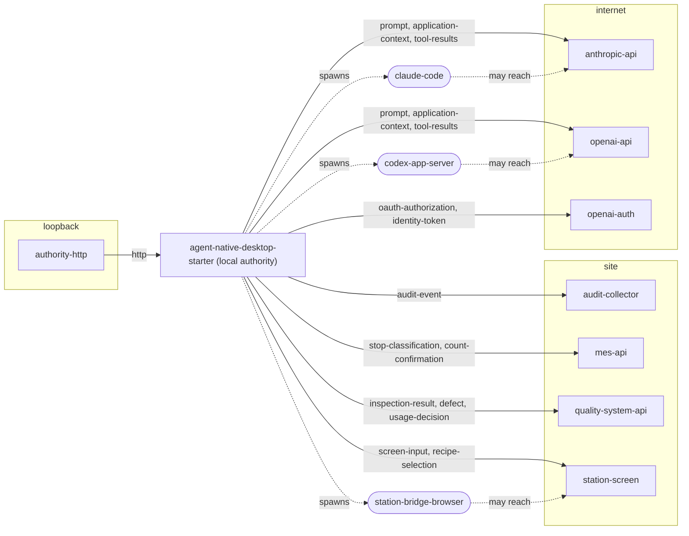

# Data flows

Generated by `bun run generate` from the declarations composed into `agent-native-desktop-starter`. A site policy decides which of these are bound; nothing here is reachable until it is.

## Network destinations

| ID | Owner | Direction | Scope | Protocol | Host | Data classes | Availability | Offline |
| --- | --- | --- | --- | --- | --- | --- | --- | --- |
| `anthropic-api` | anthropic | egress | internet | https | api.anthropic.com | prompt, application-context, tool-results | optional | unavailable |
| `audit-collector` | authority | egress | site | tcp | site policy | audit-event | optional | degrade |
| `authority-http` | authority | ingress | loopback | http | site policy | — | required | — |
| `mes-api` | line-station | egress | site | https | site policy | stop-classification, count-confirmation | required | queue |
| `openai-api` | openai | egress | internet | https | api.openai.com | prompt, application-context, tool-results | optional | unavailable |
| `openai-auth` | openai | egress | internet | https | auth.openai.com | oauth-authorization, identity-token | optional | unavailable |
| `quality-system-api` | quality-inspection | egress | site | https | site policy | inspection-result, defect, usage-decision | required | queue |
| `station-screen` | line-station | egress | site | https | site policy | screen-input, recipe-selection | optional | queue |

- `anthropic-api`: Inference for Claude runs.
- `audit-collector`: Forward audit events off the host (RFC 5424 syslog over TLS).
- `authority-http`: Serve the frontend, API, events and attach connections.
- `mes-api`: Forward stop classifications and count confirmations to the MES and pull orders and reasons.
- `openai-api`: Model catalog and inference for Codex and AI SDK runs.
- `openai-auth`: ChatGPT sign-in: token exchange, OIDC discovery, signing keys and revocation.
- `quality-system-api`: Forward results, defects and usage decisions to the quality system and pull lots and characteristics from it.
- `station-screen`: Reach the legacy station software screen to observe it and run declared procedures (web HMI, VNC or RDP, per site).

## Operations that leave the host

Each is committed locally first and forwarded through the outbox; a receipt proves the local commit, not acceptance by the target.

| Operation | Target | Destinations | Data classes | Audited fields |
| --- | --- | --- | --- | --- |
| `inspection.decision.set` | quality-system | `quality-system-api` | defect, inspection-result, usage-decision | digest only |
| `inspection.defect.record` | quality-system | `quality-system-api` | defect, inspection-result, usage-decision | digest only |
| `inspection.result.correct` | quality-system | `quality-system-api` | defect, inspection-result, usage-decision | digest only |
| `inspection.result.record` | quality-system | `quality-system-api` | defect, inspection-result, usage-decision | digest only |
| `inspection.result.record-batch` | quality-system | `quality-system-api` | defect, inspection-result, usage-decision | digest only |
| `line.count.confirm` | mes | `mes-api` | count-confirmation, stop-classification | digest only |
| `line.order.start` | legacy-hmi | `station-screen` | recipe-selection, screen-input | digest only |
| `line.stop.classify` | mes | `mes-api` | count-confirmation, stop-classification | digest only |

## Child processes

A child may reach only the destinations listed here. Children launched with proxy settings tunnel through the audited loopback proxy, which enforces this list; any child that does not use the proxy is contained only by the exported OS rules.

| ID | Owner | Executable | May reach | Purpose |
| --- | --- | --- | --- | --- |
| `claude-code` | anthropic | `claude` | `anthropic-api` | Claude Code process driven by the Agent SDK. |
| `codex-app-server` | openai | `codex` | `openai-api` | Codex app-server harness under a delegated grant. |
| `station-bridge-browser` | authority | `chromium (Playwright)` | `station-screen` | Browser that reaches a web-based station HMI for the screen bridge. |
