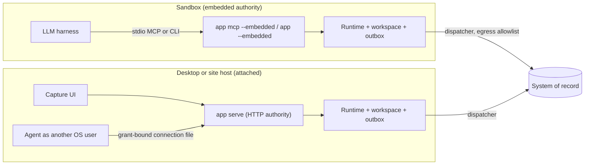
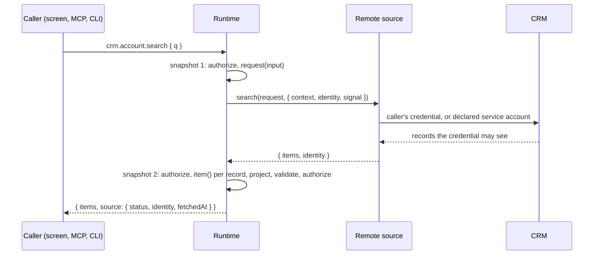

# System-of-record capture reference

This document describes what the repository implements for the [task/workflow pattern](task-workflow-pattern.md): a bounded capture application that sits in front of a system of record (SoR), forwards what it captures through a transactional outbox, and exposes every operation to people, CLIs and MCP clients. The [reference plan](system-of-record-reference-plan.md) defines a fuller set of acceptance gates; the [last section](#status-against-the-reference-plan) records which of them this implementation meets.

The worked example is quality inspection (`examples/quality-inspection`). Inspection lots, specifications and code groups arrive from a deterministic in-memory quality system. Inspectors record measured values and codes at a capture station, and an agent can do the same through MCP or the CLI. Each result is forwarded to the quality system, which accepts or rejects it. The project/task example remains composed beside it as the kernel fixture.

## Topologies

**Embedded.** `app mcp --embedded --workspace <dir> --grant-file <file>` runs the runtime in the MCP process; there is no network listener. The orchestrator writes the grant file and starts the process; tool arguments cannot change the principal or widen the grant. One-shot CLI calls with `--embedded` open the same workspace, run one operation and exit. The workspace's OS lock admits one writer, so a second embedded process gets `CONFLICT` (exit 5) while an MCP session is live.

**Attached.** `app serve` is the HTTP authority used by the web and desktop frontends. With `--grant-file <file> --grant-connection <out>` it also writes a connection file bound to a delegated session, so an agent running as a different OS user can attach without reading the owner's credential. The file is a bearer credential with mode `0600`; the orchestrator hands it to the agent's user and it is deleted when the authority stops.

Choose by where the SoR credential may live. In embedded mode the dispatcher runs in the sandboxed process, so the SoR adapter and its credential are inside the sandbox. That suits a customer-controlled container whose only egress is the SoR host. Where the agent's environment is untrusted, run `serve` outside it and attach with a grant-bound connection: the agent then reaches only catalog operations. A process running as the same OS user as the workspace owner can read the workspace files directly. Neither topology is an isolation boundary by itself. The boundary is the container or user separation, egress policy and delegated grant that the deployment provides.

## Outbox and settlement

A command handler calls `ctx.enqueue({ target, type, payload, resource })`. The effect commits atomically with the domain change, receipt and journal entry, or not at all. Its ID derives from the receipt, so an idempotent replay never enqueues twice, and the dispatcher uses that ID as the SoR idempotency key.

`createEffectDispatcher` (`packages/integration`) reads pending effects through `application.pendingEffects`, delivers each one **outside** any transaction, and records the outcome by invoking the domain's settle command under the integration principal with key `settle:<effectId>`. The settle handler calls `ctx.settleEffect` and updates domain state such as a result's sync status and SoR reference. Transient failures call `recordAttempt`, which journals `effect.attempted` so screens show retrying, and back off exponentially. A business rejection settles as data and is never retried. Delivery is at least once. A target that deduplicates by effect ID declares `idempotentDelivery: true`; otherwise the port must implement `lookup`, and the dispatcher consults it before every send.

`createInboundSync` pulls SoR changes after the stored watermark and submits them as an ordinary sync command whose input binds `from` and `to`. A stale `from` conflicts, so two pullers cannot apply the same page twice. The integration principal's grant contains only the sync, settle and status operations; a misbehaving adapter cannot drive inspection commands.

Implemented delivery states are pending (with attempt count and safe failure text), accepted (with external reference and acceptance time) and rejected (with code and message). A correction supersedes a rejected result and is forwarded again. Claims with fencing, upstream-pending acknowledgement, needs-reconciliation, cancel-before-dispatch and a dispatch-time recheck of the original actor's authority are **not** implemented; see the status table.

`app drain [--timeout ms]` delivers to every target the application composes until nothing is pending and exits `0`, or exits `75` (EX_TEMPFAIL) while effects remain. It prints the remaining work per target: `pending` awaits delivery, `held` awaits reconciliation, and `deliverable: false` marks a target this process cannot reach (a station screen only a running host's bridge drives), whose effects still count as pending. An orchestrator must not discard an ephemeral sandbox until drain exits `0`, or it must keep the workspace on a persistent volume. `app sync` pulls master data once from each target and prints one report per target. Both need the workspace not to be owned by a live process.

## Live search and adoption

The outbox and inbound sync keep a working set in step with the SoR, but neither answers a question at the moment it is asked. A **remote query** does ([ADR 009](decisions/009-remote-queries-and-adoption.md)). The worked example is `examples/crm-capture`: a search box over a fake CRM that people and agents use with their own CRM access.

**Declare once, call from every surface.** `defineDataProvider({ id: 'crm.account', target: 'crm', identity: 'caller-or-service', query, item })` yields `crm.account.search` and `crm.account.lookup`. They are ordinary catalog queries, so the screen (`remoteQueryOptions`), MCP (`crm_account_search`, read-only and open-world), the CLI and HTTP all return the same result. The module's network destination must list the target under `reads`, or composition fails.

**The runtime calls the source, not the handler.** `implementDataProvider(provider, { item })` supplies one item mapper, which runs in a read snapshot and may consult local state: it scopes rows to the caller's regions and marks each one with its local status. `createRemoteSource({ port, credentials })` adapts the port's `search` and resolves the credential. It tries the caller's own first; an agent run resolves to its delegator. It falls back to the service account only under `caller-or-service`, and otherwise refuses with `FORBIDDEN` ("Connect your crm account to search it"). The CRM applies its own sharing to the caller's credential. Local policy projects the result whichever identity answered.

**Results come in pages.** A provider's search takes an optional `cursor`, and each result carries the CRM's `next` cursor while there is more. The screen's "Show more from the CRM" (`remoteInfiniteQueryOptions`) and an agent's next tool call both send it back. The application never reads the cursor, and the CRM accepts it only for the search and the credential that produced it. A cursor the service account received cannot be continued with a person's login, and neither can be reused for another search text; either attempt is refused with `INVALID_INPUT`. A page can be shorter than the CRM's page size, or empty, because the item mapper drops rows outside the caller's regions, so only a missing `next` ends the list.

**Failure is a status.** A missing, slow or failing source returns `source.status: 'unavailable'` with a safe message and no items. The screen shows the banner and keeps adopted accounts usable (P12). Provider error text is not passed on.

**Nothing is stored until adopted.** Search results are point-in-time. Change batches do not refetch them, and they carry their fetch time. Picking a result runs `crm.account.adopt`, a domain command:

1. It records the account as `following` and enqueues `account.follow`.
2. The CRM checks the requester's access on delivery and accepts or rejects the effect (`NOT_VISIBLE`).
3. The feed then delivers the followed account to `crm.account.sync`, which sets it to `adopted` and keeps it current.

The record's content therefore comes from the integration principal, never from caller input. From then on the account behaves like any other local record: live on every screen, and able to carry activities forwarded through the outbox.

## Capture interface kit

The web app is the starter's `apps/web` (Vite) around the web frame (`packages/frame`): TanStack Router/Query/Form/Table and shadcn components. Trust-relevant behavior lives in versioned bindings in `@agent-native/react`; presentational source is published as a shadcn registry (`packages/frame/registry.json`, built to `dist/registry`) that a starter copies and owns. The quality-inspection screens live in `examples/quality-inspection/ui`.

- `@agent-native/react/query`: `liveQueryOptions(capability, input)` and one event subscription that invalidates queries by the catalog's resource-type `dependencies`. It coalesces refetches, resets all queries when the authorization revision rises, and fences responses that started before a revocation. `remoteQueryOptions(capability, input)` binds a remote query: it keeps the previous result while loading, passes TanStack's abort signal to the source, is fresh for 30 s and is never refetched by change batches.
- `@agent-native/react/form`: `useCapabilityForm` validates with the contract's Standard Schema. It mints the idempotency key when the form opens and keeps it, with the exact mapped input, across retries until a commit. A double tap or a scanner sending Enter twice therefore records one datapoint. The key rotates after a commit or an `IDEMPOTENCY_CONFLICT`; `details.field` errors map onto form fields.
- `@agent-native/react/capture`: keyboard-wedge scan detection, a capture loop that returns focus to the next worklist item, and per-item timing.
- Registry items: `capability-form`, `live-data-table`, `conflict-banner`, `run-panel`, `command-palette`, `native-dialog`, `session`, `screens`, `ui-session`, `accounts`, `app-shell`, `frame`. The capture station and sync status screens (`examples/quality-inspection/ui/capture-station.tsx`, `sync-status.tsx`) bind to the quality-inspection contracts and serve as starting points for a new domain.

The host's CSP (`style-src 'self'`) rejects injected `<style>` elements. Components that inject styles at runtime (Radix Dialog/Select/DropdownMenu, sonner) are replaced by native `<dialog>` and `<select>`.

### Measured economics

Each result stores `capture.actor` and, when the client reports them, `capture.durationMs` and `capture.input`. The authority derives the actor: a call with a run or delegation grant is `agent`, otherwise `human`. The client reports the duration, measured from the moment a sample became current to commit. `inspection.metrics.summary` returns nearest-rank median and p90 per actor, corrections, out-of-tolerance counts and SoR acceptance latency (`settledAt - createdAt`), scoped to the caller's plants. These figures come from synthetic test runs. A deployment baseline, real devices and real task volumes are needed before claiming productivity or licence savings. An external MCP session without a grant counts as human.

## Command line and MCP

`bun run build:cli` compiles the configured application's CLI (`createCli` from `@agent-native/host`, through a generated static entry) into one executable, `dist/bin/<name>`, named from `app.config.json`; `--target` cross-compiles. Configure `@agent-native/quality-inspection` as the application, or set `AGENT_NATIVE_APPLICATION`, to build this one. It needs no Bun, Node or package install, and the sandbox test runs it with an empty environment.

Every catalog operation is a subcommand: `app inspection result record --lot-id 4000001 --characteristic-id C10 --value 220.01 --occurred-at 1791370306000 --key r-1`. Flags are generated from the top-level input schema and typed by it; nested objects take JSON. `--json <object|->` supplies the whole input, and stdin is read only when `-` is given. `--dry-run` validates input against the published schema and the caller's discovered availability without executing. It is advisory: it rebuilds the validator with Zod's semi-experimental `fromJSONSchema`, and the authority validates and authorizes again. `--output text` renders tables. `help`, `schema` and `workflows` work without any authority. The original `call <operation> <json>` form remains.

| Exit | Meaning                                   |
| ---- | ----------------------------------------- |
| 0    | Success                                   |
| 1    | Internal failure                          |
| 2    | Invalid input or usage                    |
| 3    | Not found                                 |
| 4    | Forbidden                                 |
| 5    | Conflict, including a live workspace lock |
| 6    | Idempotency key reused for another input  |
| 7    | Cancelled                                 |
| 75   | `drain`: effects still pending            |

The generated application skill (`docs/reference/quality-inspection/application-skill/SKILL.md`) lists the CLI form beside the MCP tool names for every workflow.

## Caveats

- The SoR remains the authority for master data and legal or financial postings. This application owns its capture working set, pending effects and their outcomes.
- Exactly-once delivery across two systems is not achievable here. The guarantee is at-least-once delivery with SoR-side deduplication or lookup-before-retry.
- Licence savings need contract review. Records created through APIs or integration users can themselves be licensed, for example under indirect or digital access terms or API limits.
- `FakeQualitySystem` is in-memory and per process. Each `drain` or `mcp` process starts a fresh fake, which is adequate for demonstration and deterministic tests, not a stand-in for a persistent upstream system.
- The workspace is a single JSON snapshot rewritten per commit. It suits one station's open lots, not large master data. Table-backed storage, remote attach and operator identity are follow-on work.
- Resource-limited grants cannot create child records whose IDs they cannot name in advance.
- `FakeCrm` keeps demo credentials in memory. A deployment backs `CallerCredentials` with its vault; no vault adapter ships for it. The fake's page cursors encode their binding in the clear; a real CRM keeps a server-side locator.

## Evidence

| Check                                                  | What it establishes                                                                                                                                                                                                                                                   |
| ------------------------------------------------------ | --------------------------------------------------------------------------------------------------------------------------------------------------------------------------------------------------------------------------------------------------------------------- |
| `packages/runtime/test/outbox.test.ts`                 | Effects commit with the receipt, replay does not re-enqueue, rollback drops them, settlement is exactly once locally, attempts are journaled.                                                                                                                         |
| `packages/integration/test/dispatcher.test.ts`         | Delivery outside the transaction, backoff with safe failure text, rejection as data, idempotent redelivery after lost settlement, lookup-before-send, drain, integration grant limits, watermark-bound inbound sync.                                                  |
| `packages/runtime/test/compose.test.ts`                | Module slices, per-module policy, fail-closed routing for unknown operations and resources.                                                                                                                                                                           |
| `examples/quality-inspection/test/conformance.test.ts` | Direct, HTTP, CLI and MCP agree on results, denial and idempotent retry; `openWorldHint` on forwarded commands.                                                                                                                                                       |
| `examples/quality-inspection/domain.test.ts`           | Role matrix, plant scoping before counts, supersession, occurrence-time bounds, metrics aggregation.                                                                                                                                                                  |
| `packages/react/src/bindings.test.ts`                  | Dependency-indexed invalidation, coalescing, reset on authorization change, revocation fence, scan detection.                                                                                                                                                         |
| `packages/runtime/test/remote-query.test.ts`           | A denied caller never reaches the source, revocation during the call drops the result, local projection applies, a service answer to a caller-only query is refused, failures become a safe status, deadline and cancellation reach the source, no rows in the audit. |
| `packages/integration/test/remote-source.test.ts`      | Credential order (caller, declared service account, refusal), a port without `search`, safe failure messages.                                                                                                                                                         |
| `examples/crm-capture/test/application.test.ts`        | CRM sharing per caller, service fallback within the member's regions, adopt → follow → feed → adopted, a refused follow, activities forwarded, an unreachable CRM beside working local data, a delegated agent searching as its delegator.                            |
| `examples/crm-capture/test/conformance.test.ts`        | One provider answers direct, HTTP, CLI and MCP with the same result; search is read-only and open-world over MCP.                                                                                                                                                     |
| `examples/crm-capture/e2e/search.pw.ts`                | Search as you type keeps the previous result while loading, adopt turns into adopted without a refresh, the unavailable banner keeps local accounts usable.                                                                                                           |
| `packages/adapters/src/cli.test.ts`                    | Generated subcommands and typed flags, stdin, usage errors before any call, dry-run, help, exit-code mapping, grant-file validation.                                                                                                                                  |
| `examples/quality-inspection/test/sandbox.test.ts`     | An agent captures over embedded MCP under a grant, retries idempotently, is refused integration operations and a concurrent writer; drain exits 75 then 0; metrics split agent and human; grant-bound `serve`.                                                        |
| `examples/quality-inspection/e2e/inspection.pw.ts`     | Keyboard-only capture advances focus, a wedge burst and double Enter record once, SoR references and a rejection appear live, metrics render, a generated form commits, a correction supersedes a rejection.                                                          |

`bun run check` runs everything except the browser specs and the compiled-binary variant. Run those with `bunx playwright test examples/quality-inspection/e2e examples/crm-capture/e2e` and `bun run test:sandbox`.

## Status against the reference plan

| Plan gate                     | Status in this implementation                                                                                                                                                                                                                                                                                                                                      |
| ----------------------------- | ------------------------------------------------------------------------------------------------------------------------------------------------------------------------------------------------------------------------------------------------------------------------------------------------------------------------------------------------------------------ |
| 1. Bounded domain             | Met with quality inspection instead of receiving. Business-event identity across surfaces is partial: retries deduplicate by idempotency key, and a second submission for an already recorded sample conflicts, but there is no general cross-principal event identity.                                                                                            |
| 2. Intent durability and port | Partly met: atomic intent, out-of-transaction delivery, trusted settlement, idempotent and lookup-based targets, crash-safe redelivery. Not implemented: worker claims and fencing, uncertain outcomes and reconciliation state, cancel-before-dispatch, revocation recheck at dispatch.                                                                           |
| 3. UI and bidirectional sync  | Partly met: capture UI, live SoR outcomes and rejection triage verified in a browser; watermark-bound inbound sync. Not implemented: upstream versions for out-of-order feeds, conditional writes against upstream versions, a separately persisted mock SoR process, agent draft handoff.                                                                         |
| 4. Execution host and broker  | Partly met. Embedded MCP with launcher-fixed grants and grant-bound attach, an in-process egress guard with a child proxy, profile floors and generated OS/orchestrator rules are implemented ([security and assurance](security-and-compliance.md)). There is no OS isolation backend or credential broker, and the exported rules are not applied automatically. |
| 5. Package lifecycle          | Not met. A single unsigned binary and the desktop package are built; there is no signed package manifest, staged activation or rollback.                                                                                                                                                                                                                           |
| 6. Evidence                   | Deterministic evidence above. Capture timings are synthetic. Real devices, real SoR APIs and provider inference were not exercised.                                                                                                                                                                                                                                |
