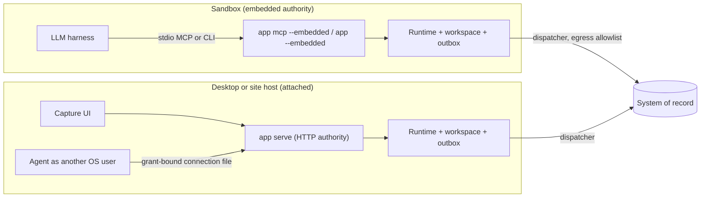
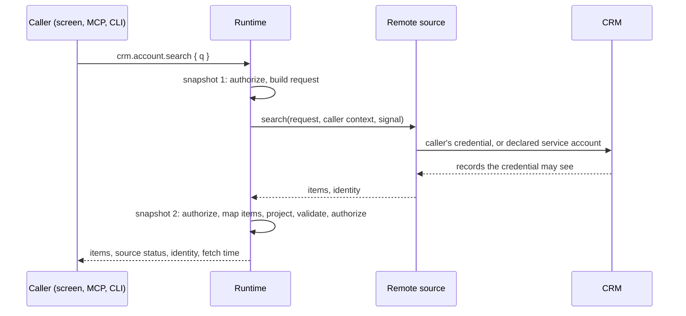

# System-of-record pattern

A bounded capture application sits in front of a system of record (SoR) and forwards what it captures through a transactional outbox. People, CLIs and MCP clients can use every operation.

Two examples carry the pattern:

- **`quality-inspection`**: inspection lots, specifications and code groups arrive from an in-memory quality system. Inspectors, or an agent, record measured values and codes, and each result is forwarded and then accepted or rejected.
- **`crm-capture`**: a live search over a fake CRM that each caller uses with their own access, and adoption of what they find.

## Topologies

**Embedded.** `app mcp --embedded --workspace <dir> --grant-file <file>` runs the runtime inside the MCP process, with no network listener. The orchestrator writes the grant file and starts the process, and tool arguments cannot change the principal or widen the grant. One-shot CLI calls with `--embedded` open the workspace, run one operation and exit. The workspace lock admits one writer, so a second process gets a conflict while an MCP session is live.

**Attached.** `app serve` is the HTTP authority behind the web and desktop frontends. Given a grant file, it also writes a connection file bound to a delegated session, so an agent running as another OS user can attach without the owner's credential. That file is a bearer credential: it is private to its owner and deleted when the authority stops.

Choose by where the SoR credential may live. In embedded mode the dispatcher, and so the credential, runs inside the sandbox. That suits a customer-controlled container whose only egress is the SoR. When the agent's environment is not trusted, run `serve` outside it and attach with a grant-bound connection, so the agent reaches only catalog operations. Neither topology isolates anything by itself. The boundary is the container or user separation, the egress policy and the delegated grant that the deployment provides.

## Outbox and settlement

A command enqueues an effect on a changed resource. The effect commits with the domain change, receipt and journal entry, or not at all. Its ID derives from the receipt, so a replay never enqueues twice, and the SoR can use the ID for deduplication.

The dispatcher delivers pending effects outside any transaction. It records each outcome through the domain's settle command, under the integration principal and with a stable key. A transient failure is journaled as an attempt, so screens show it retrying, and retried with backoff. A business rejection settles as data and is never retried. Delivery is at least once: a target either deduplicates by effect ID, or offers a lookup that the dispatcher consults before every send.

Inbound sync pulls changes after the stored watermark and submits them as a sync command bound to that range. A stale range conflicts, so two pullers cannot apply the same page. The integration principal can only sync, settle and read status, so a misbehaving adapter cannot drive business commands.

An application declares each system of record once with `defineTarget`. The declaration produces the settle, sync and status operations, the integration principal's grant and its policy lane; `targetHandlers` implements the watermark check, the ownership check on settle and the status envelope, and the application supplies only what is domain-specific: how an outcome changes the forwarded record, how a feed item changes local state, and which records the caller may count. A record that forwards carries its effect ID and delivery state (`sync`, `sorRef`, `rejection`), and settle refuses an outcome for a record that forwarded a different effect.

Delivery is pending (with attempts and safe failure text), accepted (with the external reference and time) or rejected (with code and message). A correction supersedes a rejected result and is forwarded again.

`app drain` delivers to every target until nothing is pending, then exits `0`. While effects remain it exits `75`, listing per target what is pending, what is held, what the target acknowledged but has not decided, and which targets this process cannot reach. An orchestrator keeps an ephemeral sandbox, or its workspace, until drain exits `0`. `app sync` pulls master data once per target.

### Claims, acknowledgement and held effects

A dispatcher claims each effect before sending it. The claim names the worker, lapses after a lease, and carries a fencing token that grows with each claim. An attempt or settlement under an older token than the current claim is refused, so a worker that stalled past its lease cannot overwrite the worker that took over; its late report goes to the audit log as evidence. A lapsed claim proves nothing about the target, so the worker that takes over a non-idempotent target looks the effect up before sending.

Before the first claim, the person who committed the effect is asked again whether they may run the command, on the current state. Policies built with `definePolicy` answer from roles and containers only, because the command's preconditions (the record did not exist yet, say) no longer hold once it committed. A denial holds the effect. Later claims skip the recheck: once a worker may have sent it, holding cannot take it back, and the target's answer must still be recorded. Journal visibility is decided at read time, so a revoked actor does not see that answer.

A target can acknowledge an effect before it decides it. Such a target returns `pending`; the effect becomes `upstream`, is never sent again, and its lookup is polled until the target decides. `drain` counts it as delivered. A target that later has no trace of it holds it.

A command can withdraw an effect with `ctx.cancelEffect` only while no worker ever claimed it. After a claim the target may hold it, so the domain must reconcile instead.

`effectPhase` reads an effect's state: `queued`, `claimed`, `retrying`, `upstream`, `held`, `accepted`, `rejected` or `cancelled`. Only a domain command leaves `held`: settle when the target applied or refused it, release when it did not.

A feed that can deliver an older version of a record after a newer one passes `versions` to `targetHandlers`; items not newer than the last applied version are dropped before the application applies the batch.

## Connector ports

A target's port implements `SystemOfRecordPort`. Besides the driver connector and the screen bridge, ready-made ports cover the common routes:

- [`connector-http`](../plugins/connector-http/README.md): a REST system through the network port. Requests, rejection rules and lookup are data, and the port needs an idempotency header or a lookup.
- [`connector-files`](../plugins/connector-files/README.md): a system reached through shared folders. Effects are dropped as files and settled from receipts or the archive; result exports feed inbound sync. The folders are declared requirements the site policy binds.
- [`connector-mqtt`](../plugins/connector-mqtt/README.md) and [`connector-opcua`](../plugins/connector-opcua/README.md): read-only observation of a broker or a controller gateway. They submit readings through an ingest command and never write.

Each passes the shared conformance suite in `@agent-native/testing/connectors` (idempotent delivery or lookup before resend, rejection as data, uncertain outcomes held), and each ships a fake for tests.

## Live search and adoption

The outbox and inbound sync keep a working set current, but neither answers a question at the moment someone asks. A **remote query** does. Mirroring the whole system of record through inbound sync would answer searches locally, but it would copy records the caller may not see under that system's own sharing rules, and it is stale between pulls. Calling the source from a handler would put the call inside the transaction, where it cannot be re-authorized. Page numbers shift as the source changes and cannot be bound to the caller, so paging uses the source's opaque cursors.

- **Declare once, call from anywhere.** A data provider declares search and lookup queries over one target. They are ordinary catalog queries, so the screen, MCP, the CLI and HTTP return the same result. Composition fails unless a declared destination reads that target.
- **The runtime calls the source.** The provider supplies one item mapper, which may consult local state. For example, it scopes rows to the caller's regions and marks local status. The source uses the caller's own credential first (a delegated agent counts as its delegator), and the service account only where the provider declares that fallback. Otherwise it refuses and asks the caller to connect their account. The CRM applies its own sharing, and local policy projects the result.
- **Results come in pages.** Each result carries the CRM's opaque cursor while there is more, and the next screen request or tool call sends it back. The CRM binds a cursor to the search and the credential that produced it, so it cannot be continued under another identity or another query. Local scoping can shorten or empty a page, so only a missing cursor ends the list.
- **Failure is a status.** A missing, slow or failing source returns an unavailable status with a safe message. Adopted records stay usable.
- **Nothing is stored until adopted.** Results are point-in-time and carry their fetch time. Adopting one is a domain command: it records the account as followed and enqueues a follow effect. The CRM checks the requester's access on delivery, and the feed then brings the record in through inbound sync. Content therefore always comes from the integration principal, never from caller input. From then on it is an ordinary local record.

## Capture interface

The web app is the starter around the web frame. Behavior that matters for trust lives in versioned React bindings, and presentational source ships as a shadcn registry that a starter copies and owns.

- **Live queries** subscribe once and refetch only queries whose declared dependencies changed. Remote queries keep the previous result while loading, pass the abort signal through, and are never refetched by change batches.
- **Capability forms** validate with the contract's schema. They keep one idempotency key, with the exact input, across retries until a commit, so a double tap or a scanner's double Enter records once.
- **Capture helpers** detect keyboard-wedge scans, return focus to the next worklist item and time each capture.

The host's CSP rejects injected styles, so components that inject them at runtime are replaced by native dialogs and selects.

## Command line and MCP

`bun run build:cli` compiles the configured application's CLI into one executable that needs no Bun, Node or package install. Every catalog operation is a subcommand with flags typed from its input schema, for example `app inspection result record --lot-id 4000001 --characteristic-id C10 --value 220.01 --occurred-at 1791370306000 --key r-1`. Nested objects take JSON, and `--json` supplies the whole input. `--dry-run` validates without executing, as advice only, because the authority validates and authorizes again. `help`, `schema` and `workflows` work without an authority.

| Exit | Meaning                                   |
| ---- | ----------------------------------------- |
| 0    | Success                                   |
| 1    | Internal failure                          |
| 2    | Invalid input or usage                    |
| 3    | Not found                                 |
| 4    | Forbidden                                 |
| 5    | Conflict, including a live workspace lock |
| 6    | Idempotency key reused for another input  |
| 7    | Cancelled                                 |
| 8    | Unavailable                               |
| 75   | `drain`: effects still pending            |

The generated application skill lists the CLI form next to the MCP tool name for every workflow.

## Limits

- The SoR stays the authority for master data and legal or financial postings. The application owns its capture working set, its pending effects and their outcomes.
- Delivery across two systems is at least once, with deduplication or lookup on the SoR side. Exactly once is not achievable here.
- The fake quality system and fake CRM are in-memory and per process. They are adequate for demos and tests, and they are not stand-ins for a persistent upstream. The fake CRM keeps demo credentials in memory, and a deployment backs caller credentials with its vault.
- A grant limited to specific resources cannot create child records whose IDs it cannot name in advance.

The evidence for each part is in the [implementation status](implementation-status.md).
