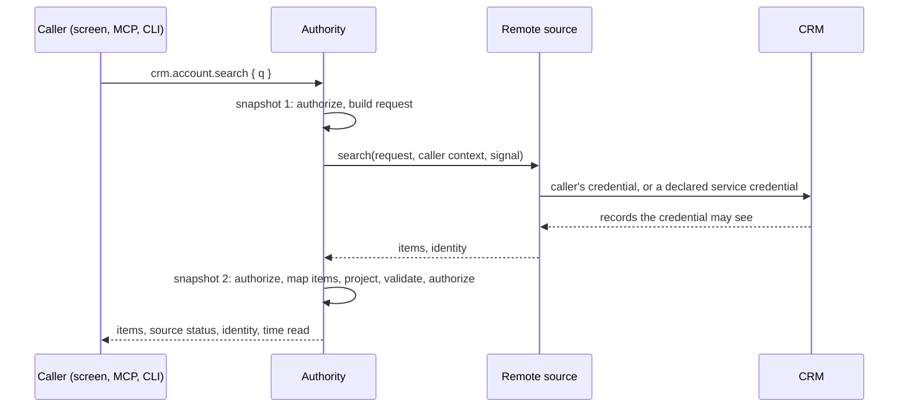

# Systems of record

A [system of record](glossary.md#system-of-record) owns records an [application](glossary.md#application) reads or changes, and decides which of those changes it accepts. It cannot join the application's transaction. A [command](glossary.md#command) that changes those records commits an [outbox effect](glossary.md#effect) with the local change. The [dispatcher](glossary.md#dispatcher) delivers the effect afterwards. The [connect-system-of-record](../packages/integration/skills/connect-system-of-record/SKILL.md) skill covers the connection.

## Concepts

Terms: [system of record](glossary.md#system-of-record), [outbox effect](glossary.md#effect), [dispatcher](glossary.md#dispatcher), [connector](glossary.md#connector), [delivery outcome](glossary.md#delivery-outcome), [settlement](glossary.md#settlement), [reconciliation](glossary.md#reconciliation), [grant file](glossary.md#grant-file) and [remote query](glossary.md#remote-query).

The application keeps its working set, its pending effects and their outcomes. People at [screens](glossary.md#screen), the CLI and agents through MCP can use every [capability](glossary.md#capability). These [examples](glossary.md#example) connect a system of record:

- `quality-inspection`: inspection lots, specifications and code groups arrive from an in-memory quality system. Inspectors or an agent record values and codes, and each result is delivered, then accepted or rejected.
- `crm-capture`: the [caller](glossary.md#caller) searches a fake CRM with the caller's access and adopts the accounts the caller finds.
- `receiving`: an ERP reached only through shared folders. Notices are imported from an inbox, and goods receipts are delivered as files and settled from receipt files.

## Topologies

An agent reaches the [authority](glossary.md#authority) in [embedded or attached mode](architecture.md#embedded-and-attached-modes). Either way, the authority's dispatcher delivers to the system of record.

### Embedded mode

`app mcp --embedded --workspace <dir> --grant-file <file>` runs the authority inside the MCP process over stdio. The process listens on no network port and refuses to start without a grant file. The orchestrator writes the [grant](glossary.md#grant) file and starts the process. Tool arguments cannot change the [principal](glossary.md#principal) or widen the grant.

The process pulls master data once, then delivers and syncs in the background. A failed first pull is reported and does not block capture. A one-shot CLI call with `--embedded` opens the [workspace](glossary.md#workspace), runs one capability and exits. Both take the workspace's OS lock, which [architecture](architecture.md#embedded-and-attached-modes) explains.

### Attached mode

`app serve` is the authority behind the web and desktop screens. With `--grant-file <file>` and `--grant-connection <path>`, which are used together, it also writes a [connection file](glossary.md#connection-file) bound to a delegated [session](glossary.md#session). An agent that runs as another OS user attaches with it, without the owner's credential. The file is a bearer credential, readable by its owner only and deleted when the authority stops. Its session expires with the grant, or after 30 days without a grant expiry.

### Topology choice

The credential's location decides the mode. In embedded mode the dispatcher, and the credential with it, runs inside the sandbox container. The container's only egress is the system of record. When the agent's environment is not trusted, run `serve` outside the environment and attach through a grant-bound connection file. The agent then reaches only capabilities in the [catalog](glossary.md#catalog).

The topology does not isolate the agent. Isolation comes from a sandbox container or a separate OS user, the egress policy and the [delegated grant](glossary.md#grant).

## Outbox and settlement

A [command](glossary.md#command) enqueues an effect on a resource it changed. The effect commits to the [outbox](glossary.md#outbox) in the same transaction as the state change, the [receipt](glossary.md#receipt) and the [journal](glossary.md#journal) entry. A replayed command returns its stored receipt and does not run the handler again, so it enqueues no second effect. The receipt lists the effect ID.

The dispatcher delivers pending effects outside any transaction and records each outcome through the target's settle command, under the [integration principal](glossary.md#integration-principal). That command's [idempotency key](glossary.md#idempotency-key) derives from the effect ID, so a lost settlement response is safe to repeat. Once a target's integration starts, the dispatcher delivers every second and [inbound sync](glossary.md#inbound-sync) pulls every 5 seconds by default.

- A transient failure is journaled as an attempt, so screens show the effect retrying. Backoff grows from one second to 60 seconds by default.
- A business rejection is settled as data and never retried.
- Failure text reaches the workspace only when the connector marked it caller-safe.

Delivery is at least once. A target either deduplicates by effect ID or offers a lookup, which the dispatcher consults before every send. The dispatcher refuses a target with neither.

A record that carries an effect also carries its effect ID and these fields:

- `sync`: pending, accepted or rejected. A held effect reads as pending here; the reconciliation list and `drain` report it as held.
- `sorRef`: the target's reference, once accepted.
- `rejection`: the target's code and message, once rejected.

Settle refuses an outcome for a record that carried a different effect. The effect keeps its attempts and last failure text while pending, and its settlement time once settled. In `quality-inspection`, a correction supersedes a result and is delivered again.

## Targets

An application declares each system of record once with `defineTarget`. The declaration produces:

- the settle, sync and status capabilities, by default `<target>.effect.settle`, `<target>.sync` and `<target>.sync.status`;
- the integration principal's grant, naming only those capabilities;
- a [policy lane](glossary.md#policy-lane) that gives settle and sync to the integration principal only, and status to every caller, scoped by its handler.

The integration principal can therefore only settle, sync and read status, and a misbehaving connector cannot drive business commands. A target without a [feed](glossary.md#feed) has no sync capability and only delivers. The target's `operations` option renames the three capabilities.

`targetHandlers` checks that a sync batch starts at the stored [watermark](glossary.md#watermark), and that a settled effect belongs to this target, inside the transaction. Status adds the watermark and last sync time to the application's counts. The application supplies how an outcome changes its record, how a feed item changes local state, and which records the caller may count.

## Worker claims

The dispatcher takes a [worker claim](glossary.md#worker-claim) on each effect before sending it. The claim names the worker, expires after 120 seconds by default, and carries a [fencing token](glossary.md#fencing-token) that grows with each claim. Two dispatchers for one target must use different worker names.

An attempt or settlement under an older token than the current claim is refused with a conflict. A worker that stalled past its claim's expiry therefore cannot overwrite the worker that took over. Its late attempt goes to the [audit log](glossary.md#audit-log) as denied and changes nothing in the workspace. `packages/integration/test/reliability.test.ts` covers a paused worker against its successor.

An expired claim does not tell the new worker whether the target received the effect. For a target without idempotent delivery, the dispatcher therefore looks the effect up before every send.

### Recheck before the first claim

Before the first claim, the dispatcher authorizes the person who committed the effect again, on the current state. A denial holds the effect and is recorded in the journal and the audit log. Later claims skip the recheck, because a worker may already have sent the effect. A dispatcher can turn the recheck off. [Authorization](authorization.md#delegation-and-replay) explains what the recheck asks.

## Acknowledged effects

A target can acknowledge an effect before it decides it. Its connector then returns `pending`, and the effect becomes upstream. The dispatcher never sends it again and polls the target's lookup until the target decides, so such a target must offer a lookup.

## Held effects

The dispatcher holds an effect in these cases:

- Interrupted delivery: delivery stopped where the target may or may not have applied the effect, during shutdown too.
- Inconclusive lookup: a lookup can neither confirm nor rule out an earlier delivery.
- Lost acknowledgement: the target no longer reports an effect it acknowledged, or offers no lookup.
- Denied recheck: the recheck before the first claim denies the effect's committer.

The dispatcher never retries a held effect. Only a domain command settles or releases it. Releasing a held effect returns it to delivery on the next pass, without backoff, and drops any acknowledgement.

`reconciliationHandlers` serves the reconciliation capabilities. One lists held effects by target or record. The other records a person's decision: applied settles the effect as accepted, with the person's reference or a reference naming the person. Refused settles the effect as rejected, and not applied releases the effect. The domain's `onResolved` runs in the same transaction.

An effect that the domain's visibility rule hides from the caller reads as missing, in the list and in a decision. The held and reconciliation tests in `packages/integration/test` cover this.

## Effect phases

`effectPhase` derives an effect's phase from its record:

- `queued`: committed and never attempted.
- `claimed`: a worker holds a live claim.
- `retrying`: an attempt failed transiently and waits for backoff.
- `upstream`: the target acknowledged it and has not decided.
- `held`: waiting for a person to reconcile it.
- `accepted` or `rejected`: settled with the target's answer.
- `cancelled`: withdrawn by a command and never sent.

Only the outbox changes a phase: a claim, an attempt, a settlement, the release of a held effect or a cancellation. A claim whose expiry passed reads as the phase before it. [Hardware drivers](hardware-drivers.md#failure-kinds) lists how the driver connector maps a driver's failure kinds onto these phases.

A command cancels an effect with `ctx.cancelEffect` and a reason, only while no worker has ever claimed it. After a claim the target may have the effect, so the domain must reconcile instead.

## Inbound sync

Inbound sync pulls changes after the stored watermark and submits them as the target's sync command, bound to that range. The idempotency key names the range, so a repeated pass after a lost response is safe. A stale range conflicts, and two pullers therefore cannot apply the same page. Inbound sync never writes storage itself.

A feed can deliver an older version of a record after a newer one. Such a feed sets the target handlers' `versions` option. Items not newer than the last applied version are dropped before the application applies the batch.

## Connectors

A connector implements `SystemOfRecordPort`. These connectors are ready-made:

- [`connector-http`](../plugins/connector-http/README.md): a REST system through the network port, with requests, rejection rules and lookup as data. It needs an idempotency header or a lookup.
- [`connector-files`](../plugins/connector-files/README.md): shared folders. Effects are dropped as files and settled from receipt files or the archive; result exports feed inbound sync.
- [`connector-driver`](../plugins/connector-driver/README.md): equipment behind a [driver](hardware-drivers.md) process.
- [Screen bridge](../workstations/screen-bridge/README.md): a [workstation application](glossary.md#workstation-application) reached through its screen, as [operator workstations](operator-workstations.md) explains.
- [Peer port](../packages/integration/README.md): another agent-native [host](glossary.md#host), through its HTTP API.

The folders of `connector-files` are [requirement declarations](glossary.md#requirement-declaration) that the [deployment policy](glossary.md#deployment-policy) binds. Each connector plugin ships a fake for tests. The HTTP, files and driver connectors pass the conformance suite in [`packages/testing`](../packages/testing/README.md), whose README lists its six cases. Among them, the suite checks idempotent delivery or lookup before resend, rejection as data, and that a lost reply is held or found again.

[`connector-mqtt`](../plugins/connector-mqtt/README.md) and [`connector-opcua`](../plugins/connector-opcua/README.md) only observe an MQTT broker or an OPC UA server. The connectors submit readings as [observations](glossary.md#observation) through an ingest command and implement no target port.

## Remote queries

The outbox and inbound sync keep a working set current. A remote query answers when the caller runs the query.

Importing the whole system of record through inbound sync would copy records that the caller may not see under that system's own sharing rules, and the copy is stale between pulls. Calling the source from a handler would put the call inside the transaction, where it cannot be authorized again.



The source call runs outside any transaction, under a deadline of 10 seconds by default. The second snapshot authorizes again. A revocation during the source call drops the result.

A [data provider](glossary.md#data-provider) declares search and lookup queries over one target. The queries are ordinary catalog [queries](glossary.md#query), so the screens, MCP, the CLI and HTTP return the same result. Composition fails unless a declared network destination reads that target. `implementDataProvider` builds both handlers from one item mapper, which may consult local state. In `crm-capture` it drops rows outside the caller's regions and marks accounts that exist locally.

### Credentials and paging

The source uses the caller's own credential first. A delegated agent's context carries the principal of the person who delegated, so the agent searches with that person's access. The source uses a service credential only where the query declares that fallback, and otherwise asks the caller to connect the caller's account. The system of record applies its own sharing, and local [policy](glossary.md#policy) then projects the result.

Page numbers shift as the source changes, so paging uses the source's opaque cursors. Each result carries the cursor while there is more, and the next request sends it back. A connector must bind each cursor to the search and the credential that produced it, and refuse it otherwise; the fake CRM does. Local scoping can shorten or empty a page, so only a missing cursor ends the list.

### Failures and adoption

A missing, slow or failing source returns an unavailable status with a safe message. Only a message the connector marked caller-safe is passed on, cut to 200 characters. Adopted records stay usable.

Nothing is stored until a caller adopts a result, and results carry the time they were read. Adopting is a domain command. In `crm-capture` it records the account as followed and enqueues a follow effect. On delivery, the CRM checks the adopting person's access, and the feed then brings the record in through inbound sync. Record content therefore comes from the integration principal, never from caller input, and is then an ordinary local record.

## Capture screens

Screens run remote queries through [`packages/react`](../packages/react/README.md). A screen keeps the previous result while the next one loads. The runtime passes the abort signal of a superseded request on to the source. A change batch never refetches a remote query, because each refetch would call the system of record. Capture helpers detect keyboard-wedge scans, focus the capture field on the next worklist item and time each capture.

## Command line

`bun run build:cli` compiles the CLI into one executable that needs no Bun, Node or package install. It writes `dist/bin/<name>`. `bun run build:cli --target bun-linux-x64` compiles for another platform. [Getting started](getting-started.md#command-line) runs the CLI against a host. Every capability is a subcommand with flags typed from its input schema:

```sh
app inspection result record --lot-id 4000001 --characteristic-id C10 --value 220.01 --occurred-at 1791370306000 --key r-1
```

- A nested object takes JSON, and `--json` supplies the whole input.
- `--dry-run` validates without executing. It is advice only, because the authority validates and authorizes again.
- `help`, `list`, `schema` and `workflows` work without an authority.
- An error prints a JSON error envelope, or `CODE: message` with `--output text`.

The authority verbs open the workspace or serve it:

- `serve` runs the HTTP authority; `--hosted-workspace` keeps the workspace in Postgres under a [workspace lease](glossary.md#workspace-lease).
- `mcp` serves MCP over stdio, attached with `--connection <file>` or embedded.
- `sync` pulls master data from each target once.
- `drain` delivers to every target until nothing awaits delivery or the timeout passes.
- `backup`, `restore` and `migrate` copy, replace or migrate the workspace state.

`drain` reports per target what awaits delivery, what is held, what is upstream, and whether this process can deliver there. Only effects awaiting delivery count toward the exit code, including those for a target this process cannot deliver. An orchestrator keeps an ephemeral sandbox container, or its workspace, until `drain` exits 0.

`examples/quality-inspection/test/sandbox.test.ts` runs the CLI in embedded mode from source. `bun run test:sandbox` runs the same test against the compiled binary. The generated application skill lists the CLI form next to the MCP tool name for every workflow.

### Exit codes

| Exit | Error code | Meaning |
| --- | --- | --- |
| 0 | | Success |
| 1 | `INTERNAL`, `INVALID_OUTPUT` | Internal failure |
| 1 | | `site status`: a site release is installed but not verified |
| 1 | | `driver check`: a check failed |
| 1 | | `serve --hosted-workspace`: the authority lost its workspace lease |
| 2 | `INVALID_INPUT` | Invalid input or usage; also `site check` and `network export` when the deployment policy has error findings. |
| 3 | `NOT_FOUND` | Not found |
| 4 | `FORBIDDEN` | Forbidden |
| 5 | `CONFLICT` | Conflict, including a workspace that a live authority owns |
| 6 | `IDEMPOTENCY_CONFLICT` | Idempotency key reused with other input |
| 7 | `CANCELLED` | Cancelled |
| 8 | `UNAVAILABLE` | Unavailable |
| 10 | | `audit verify`: the hash chain is damaged, or the log holds no entries |
| 10 | | `compliance report`: the posture is failing |
| 75 | | `drain`: effects still await delivery |

The site, network, audit, compliance and driver verbs exist when the application composes the matching [host plugin](glossary.md#host-plugin). [Security and compliance](security-and-compliance.md) explains the first four, and [hardware drivers](hardware-drivers.md) the driver verbs.

## Limits

- The system of record keeps the records it owns. The application owns its working set, its pending effects and their outcomes.
- Exactly-once delivery is not possible across two systems.
- The fake quality system and fake CRM are in-memory and per process, for demos and tests. The fake CRM keeps demo credentials in memory; a site backs caller credentials with its vault.
- A grant limited to specific resources can create new records only of the types its `creates` list names. [Authorization](authorization.md#delegation-and-replay) explains it.

## Related pages

- [Implementation status](implementation-status.md): the evidence for each part.
- [Architecture](architecture.md#authorities-and-hosts): authorities and hosts.
- [Authorization](authorization.md): where access is checked again.
- [Hardware drivers](hardware-drivers.md) and [operator workstations](operator-workstations.md): connectors for equipment and workstation application.
- [Hosting](hosting.md): the hosted authority and its workspace lease.
- [`packages/integration`](../packages/integration/README.md): the dispatcher, inbound sync, targets and remote sources.
- [`packages/react`](../packages/react/README.md): the capture screens' forms, live and remote queries, and scanner capture.
