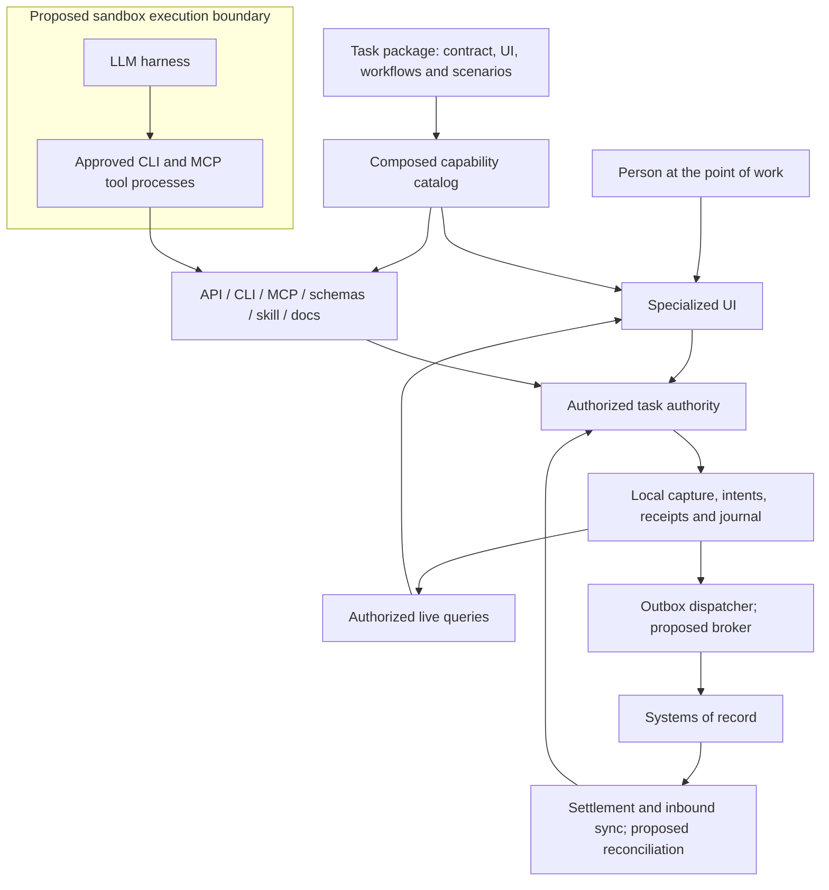

# Task and workflow applications over systems of record

This architecture is for bounded applications at the point where work happens: a receiving station, a field inspection, a customer handover. Each needs an interface fitted to its task. The system of record keeps owning shared records and enterprise rules. The task application provides the interaction, captures the event and coordinates its acceptance into those records. When the work happens at a machine, the application runs beside it ([edge applications](edge-applications.md)).

The hypothesis is that a shared host, interaction contract and delivery process make specialized interfaces cheap enough to build and run. AI-assisted development lowers the build effort, but measured savings still have to cover integration, validation, operation and change. The framework aims to make that testable.

What exists today is the local runtime pattern (the `project-tasks` example) and a quality-inspection capture workflow over a mock system of record, with an outbox, inbound sync and sandbox-ready CLI and MCP ([system-of-record pattern](system-of-record-pattern.md)). The [operator workstation pattern](operator-workstation-pattern.md) applies the same boundaries to station software that has only a screen. Its held effects are a first, person-resolved form of reconciliation. General reconciliation, containment of executable code and fleet updates are proposed ([reference plan](system-of-record-reference-plan.md)).

## Why the unit is a task

A general record-management interface has to support many objects, roles and exceptions. A task interface can constrain the object, sequence, evidence and outcomes much more tightly. Its design starts from the real event: what the worker or agent knows at that moment, what can be observed reliably, and what has to become an attributable business fact.

A receiving worker scans a delivery, confirms the counted quantity and records damaged packaging. The screen keeps the delivery in context, supports repeated scans and asks for evidence only where there is an exception. An agent that processes a machine observation calls the same capability, with the same validation and permissions. Either can hand ambiguity to the other.

Parity means the same business meaning, authorization and outcome, not identical interaction. A scan, a large button and an agent's tool call can all submit the same command. Keep a deterministic path that needs no model, and use a harness where interpretation, coordination or exception handling helps.

Keep the boundary small enough to name its trigger, inputs, decisions, completion and exception owner. A workflow may span systems and turns without becoming a replacement for them, and related workflows can share one package and host.

## Who owns what



| Responsibility                                         | Owner                                                                                                |
| ------------------------------------------------------ | ---------------------------------------------------------------------------------------------------- |
| Durable enterprise objects and rules                   | The relevant system of record, identified per object and field.                                      |
| Task interaction and workflow rules                    | The task package, implemented once as capabilities.                                                  |
| Captures, drafts, delivery intents and task history    | The task authority, with explicit retention and upstream mapping.                                    |
| Local views of upstream records                        | Projections with upstream identity, version and freshness; they never quietly become master records. |
| Identity, policy, credentials and execution isolation  | The host and integration infrastructure chosen for the deployment.                                   |
| Remote API mapping, retries and outcome reconciliation | A connector with explicit delivery semantics.                                                        |

Storage and connectors are different things. The storage port is a local consistency boundary. A connector talks to another authority, and implementing one does not implement the other.

The task authority owns its captures and workflow state, but it is not the only writer upstream. Other applications and people change the system of record too. Their changes come in through a feed or query, are deduplicated, committed as an authorized projection update and published on the local journal, so screens see them like any other change.

## Capture the event before its context is lost

A capture distinguishes an observation from its interpretation and from an upstream posting. "Six units observed at this delivery line" is the captured fact; accepting them into inventory is an upstream decision. Where it matters, a capture records:

- a stable event ID, the site and the upstream object, with local and upstream revisions kept apart;
- when the event happened and when it was captured, with corrections explicit, and acceptance timed separately;
- typed quantities, units and reason codes, and evidence references with access and retention rules;
- the trusted submitting actor and delegation; a claimed sensor source needs its own verification;
- provenance that tells human observation, measurement and model interpretation apart, keeping uncertainty where it matters;
- immutable submitted content, or a versioned amendment, so a retry cannot send a changed observation.

Business event identity has to survive a UI retry, a handoff between person and agent, and a restarted run. Command idempotency keys identify single invocations; they do not provide that cross-surface identity. Do not deduplicate only by object or approximate time, because two observations of the same delivery may both be real.

Optimize the time from event to a correct, attributable capture, and on to acceptance, counting errors, omissions and time spent on failures, not just entry speed. Offline capture is a workflow decision: a queued observation stays visibly pending until upstream accepts it.

## Two commits when another authority is involved

The runtime commits local state, revisions, receipt and journal atomically, but that stops at its own storage. A remote system can accept a request whose reply is lost, and no local rollback undoes that. For external writes:

1. A command validates the observation and current authority, then stores the capture, an immutable delivery intent and its receipt together.
2. A connector claims the intent, rechecks dispatch authority, and calls the remote API outside the transaction, with a stable external key.
3. A trusted completion command records acceptance, rejection or an uncertain result, guarded against stale attempts, and publishes the change.
4. Reconciliation resolves uncertain outcomes through upstream identifiers or a person. Inbound updates take the same path.

Screens and tools show the delivery state, not the run's text or an exit code:

| State                     | Meaning                                                              |
| ------------------------- | -------------------------------------------------------------------- |
| Draft                     | Editable locally; nothing submitted.                                 |
| Queued                    | Capture and intent committed locally.                                |
| Dispatching               | An attempt is underway; not proof of acceptance.                     |
| Upstream pending          | Upstream acknowledged the submission but has not decided.            |
| Accepted                  | Upstream acceptance is evidenced.                                    |
| Rejected                  | A definitive refusal with a safe, actionable reason.                 |
| Needs reconciliation      | The outcome is unknown, and resubmitting could duplicate the effect. |
| Cancelled before dispatch | Cancelled before any external attempt.                               |

Delivery state is separate from the run lifecycle and from the command receipt. A finished model turn can leave queued work, and an interrupted run can already have an accepted effect.

A few rules follow:

- **Retries.** Retry with the same key only where the connector documents idempotency. Otherwise correlate and reconcile before writing again. A lost reply is not a rejection, and there is no distributed atomic transaction.
- **Stale workers.** Local fencing stops a stale worker from overwriting local state, but it cannot stop a delayed request upstream. Recovery relies on upstream idempotency, or on proof that an earlier attempt can no longer take effect.
- **Upstream changes.** Local revisions only detect changes already imported. Use upstream versions and conditional writes where the system supports them, and otherwise document the weaker guarantee.
- **Revocation and cancellation.** Revocation blocks new dispatch, but a worker still needs a narrow way to record the result of an attempt already sent. Cancellation cannot recall a remote effect; reversing one is its own authorized operation.

## CLIs and MCP inside an execution boundary

A harness can run CLI processes, call MCP tools, or both. CLI and MCP describe how operations are reached, not what their implementations may touch.

Application tools come from the catalog. A vendor CLI that writes upstream with broad credentials would bypass the task authority's policy, receipts and live updates. Prefer a broker outside the untrusted boundary that holds upstream credentials and allows only registered operations.

Composing arbitrary executables needs real OS, container or VM isolation. Restrictions written into a prompt or tool manifest contain nothing. Keep secrets out of model context, environment, workspace files and tool output. Sandboxing limits what a compromised process can reach, but an allowed command can still do the wrong business action, so policy, delegation, validation and audit stay necessary. The application CLI can already run embedded under a launcher grant or attach with a grant-bound connection. The executable sandbox and broker are proposed.

## One operating model for many interfaces

The economic unit is a small task package on a maintained host, with reusable connectors and controls. The package brings its UI, capabilities, workflow guidance, tests and declared requirements, and the deployment chooses implementations. Inference is funded separately from identity and record access.

Fit each deployment to its site through versioned configuration and modules: input devices, vocabulary, sequence, constraints and exceptions. Untracked customer forks with their own update and credential handling bring back the cost this pattern is meant to remove.

A delivery layer would add compatibility checks, signed artifacts, approved permissions, staged rollout, telemetry, migration and rollback, with an accountable owner. Task records and pending intents live outside packages, so disabling a bad package stops new work without losing the ability to reconcile existing work. Today the repository exports source and builds a desktop package, with no fleet management.

## Evaluate the economics per workflow

Use measured volume and the whole task cycle, including corrections and exceptions:

```text
hours released per year =
  annual task executions × adoption share × net seconds saved per execution / 3600

annual capacity value = hours released × relevant hourly labor cost

annual net value =
  realizable capacity or throughput value
  + avoided error/rework cost
  + contractually realizable license savings
  - annualized build, integration and validation cost
  - ongoing support, updates, security, devices, hosting and inference cost
```

For illustration, 100 workers doing 80 events a day over 220 days, saving six seconds each at full adoption, release about 2,933 hours a year. That is capacity, not automatically a payroll saving, so establish what it buys: throughput, shorter queues or less overtime. Don't count the same time twice, as both capacity and avoided rework. Count licence savings only after checking the actual terms. A workflow with low repetition, frequently changing rules or costly exceptions may not justify its own application.

A first showcase should show an observed event, specialized input, a handoff between person and agent, upstream acceptance and recovery from a failure in one workflow. The [reference plan](system-of-record-reference-plan.md) defines that work, and a mock connector does not count as a live integration.
