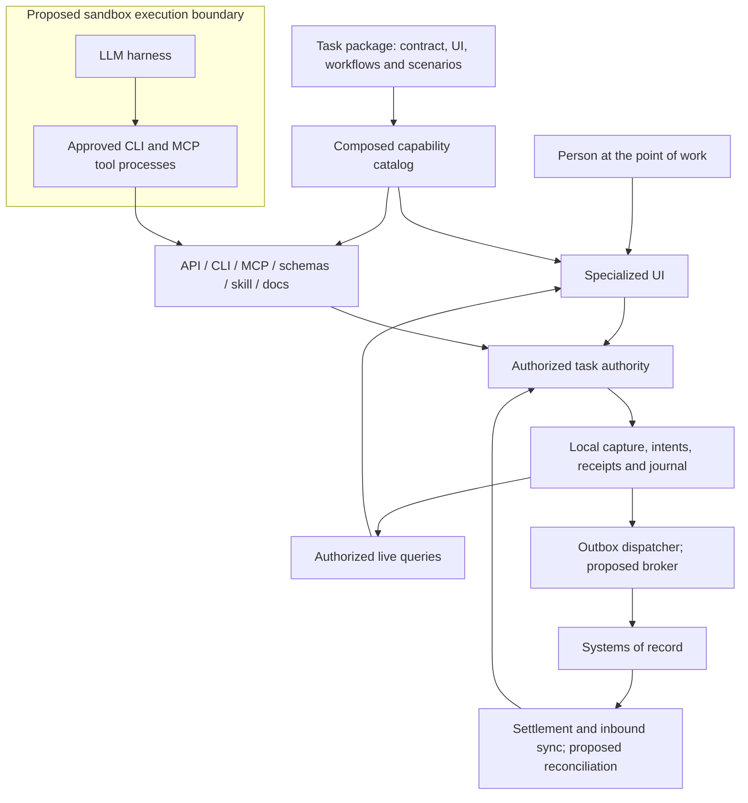

# Task and workflow applications over systems of record

This architecture is intended for bounded applications at the point where work happens. A warehouse receiving station, a field inspection or a customer handover needs an interface fitted to that task. The system of record continues to own shared business records and enterprise invariants. A task application provides the interaction, captures the event and coordinates its acceptance into those records. Where the work happens at a machine and its control software, the application runs at the edge beside it; [edge applications](edge-applications.md) covers that deployment.

The design hypothesis is that a common host, interaction contract and delivery process can make specialized interfaces economical to build and operate. AI-assisted development can reduce implementation effort; measured task savings must still cover integration, validation, operation and change. The framework should make that hypothesis testable.

The current code proves the shared local capability/runtime pattern through a project/task example and a quality-inspection capture workflow over a deterministic mock system of record, with a transactional outbox, inbound sync and sandbox-oriented CLI/MCP surfaces; see the [system-of-record reference](system-of-record-pattern.md). The [operator workstation pattern](operator-workstation-pattern.md) applies the same boundaries to station software reachable only through its screen; its held effects are a first, person-resolved form of reconciliation. General reconciliation of uncertain outcomes, executable-code containment and fleet updates remain proposed extensions. See the [reference implementation plan](system-of-record-reference-plan.md) for their acceptance gates.

## Why the unit is a task or workflow

A general record-management interface has to support many objects, roles and exceptional paths. A task interface can constrain the relevant object, sequence, evidence and allowed outcomes much more tightly. Its design starts with the real event: what the worker or agent knows at that moment, what can be observed reliably, and what must become an attributable business fact.

For example, a receiving worker scans a delivery, confirms the counted quantity and records damaged packaging. The screen can keep the delivery in context, support repeated scans and require evidence only for the relevant exception. An agent processing a machine observation invokes the same recording capability with the same validation and permission rules. Either can ask the other to resolve ambiguity before submitting.

Parity means equivalent business meaning, authorization and observable outcomes. It does not require identical interaction: scanner input, a large confirmation button and an agent's structured tool arguments can all submit the same command. Deterministic input paths should remain available without a model turn. Use a harness where interpretation, coordination or exception handling improves the task.

Keep the boundary small enough to name its trigger, inputs, decisions, completion condition and exception owner. A workflow may span several systems or human/agent turns without becoming a general replacement for those systems. Multiple related workflows can share one package and host; every task does not need its own application installation.

## Separate interaction, execution and record ownership



| Responsibility                                                          | Owner                                                                                                      |
| ----------------------------------------------------------------------- | ---------------------------------------------------------------------------------------------------------- |
| Durable enterprise objects and business rules                           | The relevant system of record; identify its authority per object and field.                                |
| Task interaction and bounded workflow rules                             | The task package, implemented once through capabilities.                                                   |
| Captured observations, drafts, delivery intents and task history        | The task authority, with explicit retention and upstream mapping.                                          |
| Local authorized views of upstream records                              | Projections with upstream identity, version and freshness; they do not silently become new master records. |
| Identity, policy enforcement, credential access and execution isolation | Host and integration infrastructure selected for the deployment.                                           |
| Remote API mapping, retries and outcome reconciliation                  | A connector with explicit delivery semantics.                                                              |

This is compatible with existing storage choices. The runtime's storage port describes a local consistency boundary. A connector describes interaction with another authority. Mapping local transactional state to a database is different from calling an external business API; implementing one does not implement the other.

The local authority is authoritative for its own captures and workflow state. It is not the exclusive writer of the upstream system. Other applications, agents and workers may change that system independently. Import their changes through a supported feed or reconciliation query, deduplicate them, commit an authorized projection update and publish it through the same local journal. Frontends then observe connector-originated changes as well as human- and agent-originated commands.

## Capture the event before losing its context

A capture contract should distinguish an observation from an interpretation and from an upstream business posting. For a receiving workflow, the captured fact might be “six units observed at this delivery line,” while acceptance into inventory remains an upstream decision.

Specify the following where relevant to the task:

- A stable event identifier, tenant/site and upstream object reference; local and upstream revisions remain distinct.
- `observedAt` for the real-world event and authority-assigned `capturedAt`; record an uncertain or corrected observation time explicitly. Upstream acceptance has its own timestamp.
- Typed quantities, units and reason codes; evidence references with access/retention rules rather than unrestricted file paths.
- Trusted submitting actor and delegation context. Claimed sensor/source information needs its own verification; the caller cannot appoint itself a trusted source.
- Human observations, measured values and model-derived interpretations as distinguishable provenance. Preserve uncertainty when it affects the decision.
- Immutable submitted content or a versioned amendment path, so a retry cannot silently send a changed observation.

Business event identity must survive a UI retry, a human/agent handoff and a restarted harness run. Scope it to the tenant, connector and intended target, then enforce immutable-content deduplication under current authorization. The runtime's principal-scoped, run-sensitive idempotency keys identify individual command invocations; they do not establish that cross-surface business identity. Do not deduplicate merely by object or approximate timestamp: two observations of the same delivery may both be legitimate. Replays must not expose an earlier actor's protected data.

Optimize time from event to a correct, attributable capture, together with eventual acceptance. Measure errors, omissions and time spent resolving failures as well as entry speed. Offline capture is a workflow decision: a locally queued observation must remain visibly pending until the upstream system accepts it. The quality-inspection reference queues results in a local outbox and shows them pending until the mock quality system accepts or rejects them; it has not been exercised against a real remote system or a disconnected device.

## Two commits when another authority is involved

The existing runtime atomically commits local state, revisions, a receipt and journal entries. That guarantee stops at its storage boundary. An external system can accept a request even when its reply is lost; local rollback cannot undo that acceptance.

For external writes, the proposed pattern is:

1. A human, agent or job submits a domain command. Validate the observation and current authority, then atomically store the capture, an immutable delivery intent and the local receipt/journal update.
2. A connector worker claims the intent, rechecks current dispatch authority, and calls the remote API outside the local transaction. The intent binds the target, action, payload version, origin and stable external idempotency/correlation key.
3. A trusted completion command records an acknowledgement, rejection or uncertain result, guarded against stale/duplicate attempts. It updates local projections and publishes a journal change.
4. Reconciliation resolves uncertain outcomes through supported upstream identifiers or operator review. Inbound updates follow the same authorized projection path.

The UI and tools must distinguish these states:

| State                     | Meaning                                                                                                                               |
| ------------------------- | ------------------------------------------------------------------------------------------------------------------------------------- |
| Draft                     | Editable local interaction; no submission made.                                                                                       |
| Queued                    | Capture and delivery intent committed locally.                                                                                        |
| Dispatching               | A connector attempt is underway; this is not proof of acceptance.                                                                     |
| Upstream pending          | The upstream system acknowledged submission but has not yet confirmed or rejected the business effect.                                |
| Accepted                  | The upstream acceptance criterion is satisfied and evidenced. A transport-level acknowledgement may still mean processing is pending. |
| Rejected                  | A definitive upstream refusal with a safe, actionable reason.                                                                         |
| Needs reconciliation      | The outcome is unknown; a new submission could duplicate a business effect.                                                           |
| Cancelled before dispatch | Pending work was cancelled before any external attempt.                                                                               |

This is a domain delivery lifecycle, separate from the harness run lifecycle and the command receipt envelope. A completed model turn may leave queued work; an interrupted run may already have an accepted business effect. UI status and agent queries should report the delivery record, not infer success from text or a process exit code.

Retry with the same stable key only under the connector's documented idempotency guarantees. When the remote system lacks those guarantees, correlate and reconcile uncertain outcomes before another write. A lost reply is not a rejection. Multi-system workflows need explicit partial completion and compensating operations where supported; do not claim a distributed atomic transaction or general exactly-once execution.

Local attempt fencing prevents an old worker from overwriting newer local state. It cannot, by itself, stop that worker issuing a delayed upstream request. Recovery must use upstream idempotency or establish that an earlier attempt can no longer produce an effect; an empty lookup alone is insufficient while that attempt may still execute. Retain late acceptance evidence for reconciliation without letting stale workers replace the current delivery state.

Local revisions detect changes already imported into the task authority. Use upstream versions and conditional writes where supported to detect concurrent upstream changes at dispatch. Otherwise document the weaker guarantee and a conflict/reconciliation path. A local cursor is not evidence that the upstream view is current.

Queued authorization and external completion are separate concerns. Revocation blocks new dispatch under the revoked authority; a credentialed worker still needs a narrowly scoped way to record the result of an already-dispatched attempt. Cancellation cannot recall a remote effect. Any reversal is a separately authorized business operation. Permissions for the task's local cache must also track relevant upstream access changes, with a stated freshness/revocation policy.

## CLIs and MCP inside the execution boundary

A harness can orchestrate several CLI processes, call MCP tools, or combine both. An MCP server may be a subprocess inside the sandbox, a host bridge or a remote endpoint. CLI and MCP specify how to reach operations; neither defines the permissions or containment of their implementation.

Application tools derive from the composed capability catalog. External vendor tools need an integration adapter that binds their behavior to the task's contract. A CLI that writes upstream directly with broad credentials would bypass the task authority's policy, receipts and live updates. Prefer a connector broker outside the untrusted execution boundary: the sandbox receives scoped access to registered operations, while the broker holds upstream credentials and enforces target and operation restrictions.

The proposed execution host admits a declared tool set and enforces filesystem, process, network, time and resource limits. Arbitrary executable composition requires an actual OS/container/VM isolation implementation selected for that host. Restrictions described only in a prompt or tool manifest do not establish containment. Keep secrets out of model context, inherited environment, workspace files and tool output; issue bounded broker sessions rather than passing the authority's unrestricted process credential into a sandbox.

Sandboxing can reduce the reach of a compromised process. An allowed command can still perform the wrong business action. Operation/object/row/field policy, bounded delegation, domain validation and audit remain necessary. The current provider adapters restrict application tools and use isolated settings/home directories. The application CLI can run its authority embedded in a sandbox under a launcher-supplied grant, or attach with a grant-bound connection; neither implements this executable sandbox or broker.

## A common operating model for specialized interfaces

The economic unit is a small task package on a maintained host, with reusable connectors and controls. The package contributes its UI, capability modules, workflow guidance, tests and declared requirements. The deployment composition selects implementations and produces the full interaction catalog. Provider subscriptions or API funding pay for inference separately from enterprise identity and permission to use records.

Forward deployment should adapt the task to actual working conditions through versioned configuration and modules: input device, vocabulary, sequence, site constraints and exception handling. Shared rules belong in maintained modules or the system of record. Untracked customer forks and independent credential/update mechanisms would recreate much of the operating cost this pattern aims to reduce.

The proposed delivery layer needs package/contract compatibility, signed artifacts, approved permissions and connector mappings, staged rollout, telemetry, migration handling, rollback compatibility and an accountable owner. Keep task records and pending delivery intents outside executable packages. Disabling a defective package should stop new work without losing the ability to inspect and reconcile existing work. This repository currently exports source and builds a desktop package; it has no fleet management or automatic update service.

## Evaluate the economics per workflow

Use measured volume and the entire task cycle, including correction and exception work:

```text
hours released per year =
  annual task executions × adoption share × net seconds saved per execution / 3600

annual capacity value = hours released × relevant hourly labor cost

annual net value =
  realizable capacity or throughput value
  + avoided error/rework cost
  + contractually realizable license savings
  - annualized build, integration and validation cost
  - ongoing support, updates, security, devices, hosting and inference cost
```

For illustration only, 100 workers completing 80 events per day over 220 days, saving six seconds at full adoption, release approximately 2,933 hours per year. That is capacity, not automatically a payroll reduction. Establish whether it produces throughput, shorter queues, reduced overtime or another observable benefit. Avoid counting the same time benefit again as both capacity and error/rework savings.

AI-assisted implementation, shared packages and automation are cost-reduction hypotheses to measure against actual lifecycle cost. Count license savings only after checking the relevant access and usage terms and whether licenses can actually be retired; a different interface does not establish that. A workflow with low repetition, frequent rule churn or expensive exceptions may not justify a separate task application.

The first showcase should demonstrate an observed event, specialized input, human/agent handoff, upstream acceptance and recovery from a failure in one coherent workflow. The [next reference plan](system-of-record-reference-plan.md) defines that work without treating a mock connector as a live enterprise integration.
