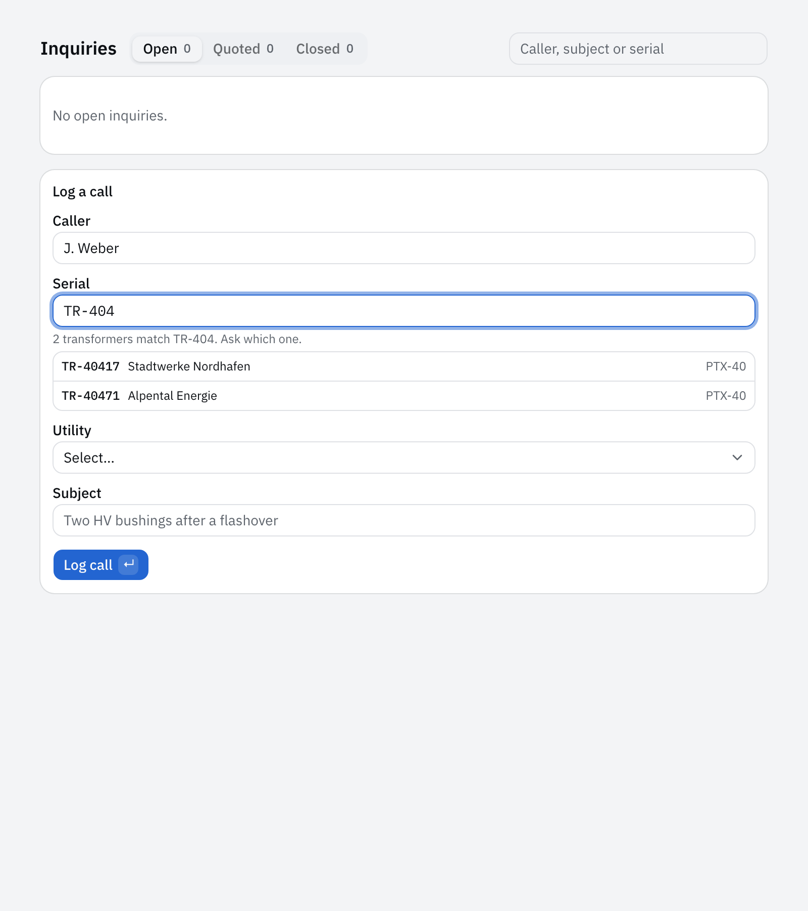
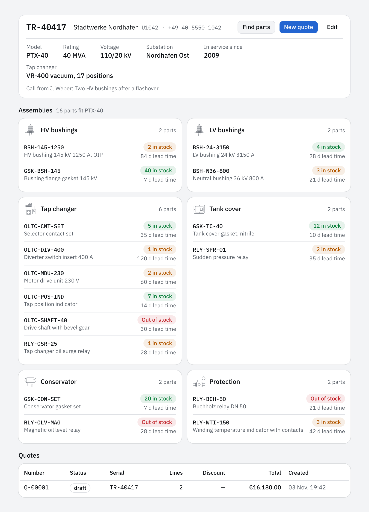
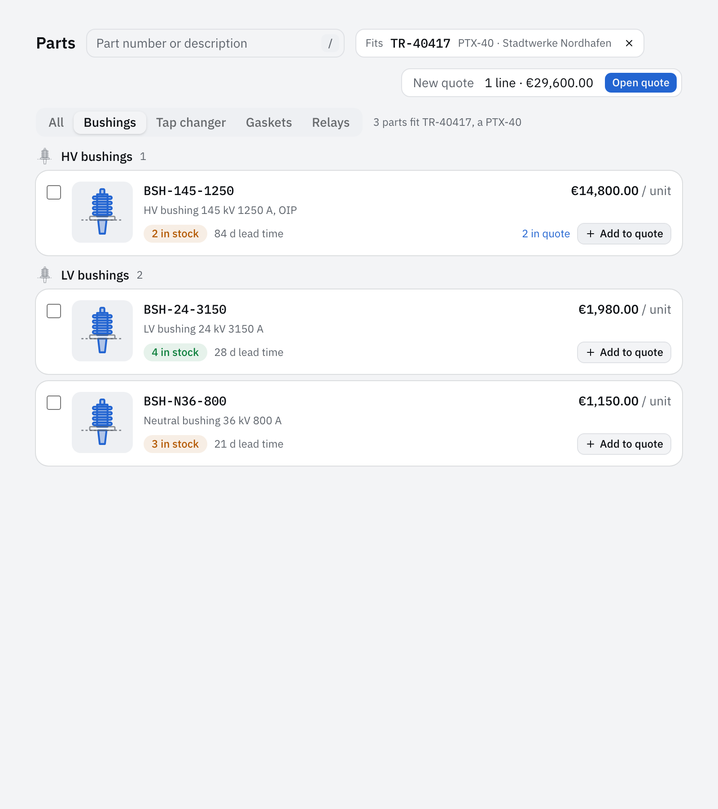
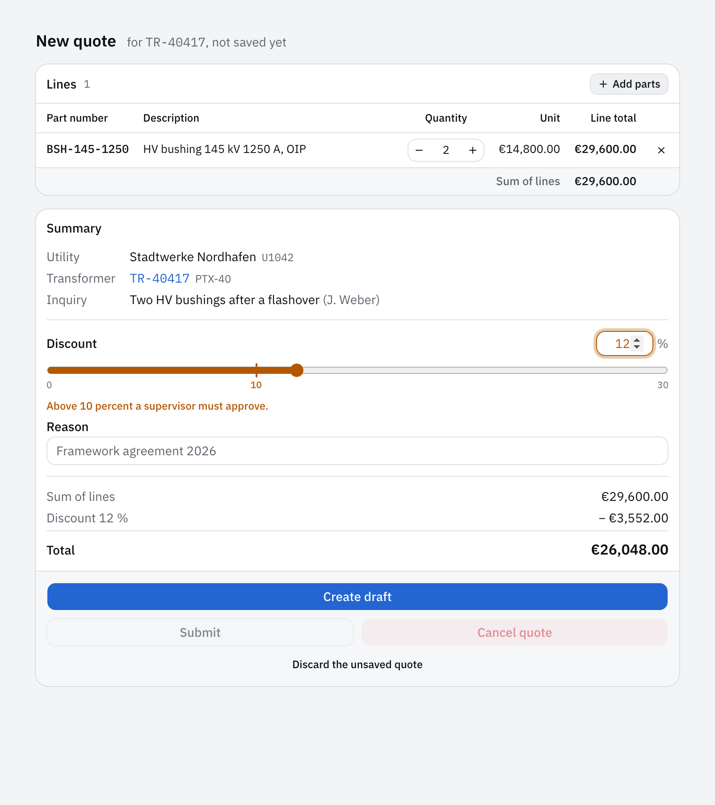

import { Aside, Code, FileTree } from '@astrojs/starlight/components';
import { region } from '@site/region';
import partSearch from '@repo/showcase/examples/parts-desk/handlers/part-search.ts?raw';
import policy from '@repo/showcase/examples/parts-desk/policy.ts?raw';
import transformerFind from '@repo/showcase/examples/parts-desk/contracts/transformer-find.ts?raw';

# Parts desk 1: records and quotes

The spare parts desk of a transformer plant takes calls from utilities about bushings, tap changer parts, gaskets and relays for transformers in service, and quotes the parts. A desk member finds the transformer by its serial, looks up the parts that fit its model, builds a quote and submits it; a discount above 10 percent needs a supervisor. This part exports the application, adds the records, the quotes and the desk screens, and writes the capability descriptions a model will pick tools by. The finished application is `showcase/examples/parts-desk`; [Tutorials](index.md) explains how to work through the steps, and the [tool store](tool-store-1-records-and-screens.mdx) tutorial covers records, screens and integrations in more depth.

## Setup

Open Claude Code or Codex at the root of this repository for the first step, and at the root of the exported `parts-desk` repository from the second step on. The standard check, from the export root, ends with `0 fail`:

```sh
bun run format && bun run generate && bun run typecheck
bun test showcase/examples/parts-desk
```

Steps that change screens add:

```sh
bun run build
bunx playwright test showcase/examples/parts-desk
```

To try the application by hand, run it in one terminal and point the CLI at it from another:

```sh
bun run --cwd showcase/examples/parts-desk dev:web
export AGENT_NATIVE_CONNECTION=$PWD/showcase/examples/parts-desk/.workspace/.connection.json
```

## Export the app

**Goal:** a new repository with an `inquiry` collection. **Skill:** [create-agent-native-app](../../packages/scaffold/skills/create-agent-native-app/SKILL.md).

`scaffold new` writes one application with its browser-safe manifest, its server and its screens, a first collection with generated operations, a policy, tests and a Playwright spec. The CLI and the MCP bridge call the running instance through its connection file. [Architecture](../architecture.md) describes the parts of the export.

```text prompt
Use the create-agent-native-app skill. Create the application for the spare parts customer
service desk of a power transformer plant at /path/to/parts-desk, with the name parts-desk, the
display name "Parts Desk" and the first collection inquiry. Utilities call the desk about
bushings, tap changer parts, gaskets and relays for transformers in service, and the desk quotes
the parts. One build serves the desk for 180 days.

Export it with scaffold new and initialize Git in the new directory. Install it, run the checks
the scaffold prints, and commit the result. Then start it with bun run dev:web in
showcase/examples/parts-desk, and from the new repository's root create one inquiry through the
CLI, list the inquiries through the CLI and through the MCP bridge, and stop the instance. Report
each command and what it printed. Run the checks the create-agent-native-app skill names and
report what passed.
```

**Check:** the report shows `bun test` passing and the same inquiry in the CLI and MCP lists.

## Transformers and parts

**Goal:** the records the desk looks up, plus seed data. Two serials share a prefix, so `TR-404` is ambiguous. **Skill:** [add-capability](../../packages/runtime/skills/add-capability/SKILL.md).

Each collection declares its record and generates its reads and writes; a query such as `transformer.find` adds its own input and output schemas and a handler that filters the rows before it pages them. A handler refuses what it cannot answer with an application error code the surfaces and the model read alike, such as `NOT_FOUND`. The seed script opens the workspace as an embedded instance and creates the records through the commands with fixed idempotency keys, so a second launch returns the stored receipts and adds nothing. [Capability authoring](../capability-authoring.md) covers collections and queries.

```text prompt
Use the add-capability skill. For the application in showcase/examples/parts-desk, run from the
repository root:

bun run scaffold add collection customer
bun run scaffold add collection transformer
bun run scaffold add collection part
bun run scaffold add capability transformer.find --kind query --description "Find transformers by serial, whole or partial. Members."
bun run scaffold add capability part.search --kind query --description "Search parts by transformer, category and text. Members."

Shape the records. Keep id, createdBy and createdAt on each.

- customer: a utility. account (U followed by four digits, unique), name and phone.
- transformer: serial (TR- followed by five digits, unique), customerId, model (the plant's
  design, such as PTX-40), ratingMva, voltage (such as "132/33 kV"), substation, yearInService
  and tapChanger (the on-load tap changer type).
- part: partNumber (unique, such as BSH-145-1250), description, category (bushing, tap-changer,
  gasket or relay), assembly (hv-bushings, lv-bushings, tap-changer, tank-cover, conservator or
  protection), fits (the transformer models it fits), unitPrice in euro cents, stock and
  leadTimeDays.
- inquiry: a utility's call. caller, customerId, an optional transformerSerial, subject and
  status (open, quoted or closed). A new inquiry is open.

The serial, account, part number and inquiry subject are the records' titles. Rename the editor
role to desk; desk members write and viewers read. transformer.find takes serial text, matches
case-insensitively on the whole serial or its start, and returns up to ten transformers with
their customer's name, an exact match first. part.search takes an optional transformerSerial,
category and text, returns the parts that fit that transformer's model, filtered before paging,
and refuses an unknown serial with NOT_FOUND.

Add showcase/examples/parts-desk/dev.ts, which dev:web runs before the launch: it opens the
workspace with openEmbeddedInstance and creates, through the commands with fixed idempotency
keys, three utilities, six transformers of three models (two of them TR-40417 and TR-40471) and
twenty-four parts across the four categories and six assemblies, some out of stock. A relaunch
adds nothing. The workspace holds only trial records, so delete
showcase/examples/parts-desk/.workspace instead of writing a state migration. Update the tests,
the Playwright spec and the application README. Run the checks the add-capability skill names
and report what passed.
```

The search filters by the transformer's model, the category and the text before it counts and pages:

<Code code={region(partSearch, 'handler')} lang="ts" title="handlers/part-search.ts" />

<FileTree>

- showcase/examples/parts-desk/
  - contracts/customer.ts
  - contracts/transformer.ts
  - contracts/part.ts
  - contracts/inquiry.ts
  - contracts/transformer-find.ts
  - contracts/part-search.ts
  - handlers/transformer-find.ts
  - handlers/part-search.ts
  - trial-records.ts the seed records
  - dev.ts seeds them before the launch
  - policy.ts

</FileTree>

**Check:** the standard check. Start the app with `bun run --cwd showcase/examples/parts-desk dev:web`, set `AGENT_NATIVE_CONNECTION` to `showcase/examples/parts-desk/.workspace/.connection.json`, then:

```sh
bun run cli transformer find --serial TR-404 --output text
```

The output shows two rows: `TR-40417` and `TR-40471`. If the flag differs, `bun run cli help transformer find` shows it.

## Quotes

**Goal:** quotes, and the rule that a discount above 10 percent needs a supervisor. **Skill:** [add-capability](../../packages/runtime/skills/add-capability/SKILL.md).

The policy authorizes the operation, the object and the fields inside the transaction, so a rule can read the input: `quote.discount` above 10 percent is `FORBIDDEN` unless the caller holds the supervisor role. A run under an agent definition carries a grant that names the agent, and the policy sees that grant whoever started the run, so the assistant can never set more than 10 percent itself. A quote's status changes only through the commands that name the change, and any other transition is a `CONFLICT`. [Authorization](../authorization.md#command-checks) covers rules on input and [Agents](../agents.md) the grant of a run.

```text prompt
Use the add-capability skill. For the application in showcase/examples/parts-desk, run from the
repository root:

bun run scaffold add collection quote
bun run scaffold add capability quote.discount --kind command --description "Set the discount of a draft quote. Above 10 percent, supervisors only."
bun run scaffold add capability quote.submit --kind command --description "Send a draft quote to the utility. Desk."
bun run scaffold add capability quote.cancel --kind command --description "Cancel a draft or submitted quote with a reason. Desk."

A quote records number (Q- followed by five digits, assigned in order), customerId,
transformerSerial, an optional inquiryId, lines (partNumber, description, quantity from 1 to 99
and unitPrice copied from the part), discountPercent from 0 to 30, discountReason, status
(draft, submitted or cancelled), cancelReason and total in euro cents after the discount. The
number is the title.

quote.create takes customerId, transformerSerial, lines (partNumber and quantity) and an optional
inquiryId. It refuses a transformer of another customer and a part that does not fit the
transformer's model with INVALID_INPUT, creates a draft with no discount, and sets the inquiry to
quoted in the same transaction. quote.update replaces the lines of a draft. quote.discount takes
id, percent and reason for a draft. quote.submit sets a draft to submitted. quote.cancel takes id
and reason and sets a draft or submitted quote to cancelled. Every other change of status is a
CONFLICT.

Add a supervisor role that may do what desk members do. The policy refuses quote.discount above
10 percent with FORBIDDEN unless the caller is a supervisor. A run under an agent definition, whose
grant names the agent, never sets more than 10 percent, whoever started it. dev.ts adds the member
mara as a supervisor. Write behavioral tests for a part that does not fit, 10 percent allowed and
12 percent refused for desk, 12 percent allowed for a supervisor, a submitted quote that refuses
a discount, and the inquiry set to quoted. Run the checks the add-capability skill names and
report what passed.
```

The rule reads the role from stored state and the percent from the validated input, and refuses a run under an agent definition more than the desk's limit:

<Code code={region(policy, 'discount')} lang="ts" title="policy.ts" />

<FileTree>

- showcase/examples/parts-desk/
  - contracts/quote.ts
  - contracts/quote-discount.ts
  - contracts/quote-submit.ts
  - contracts/quote-cancel.ts
  - handlers/quote.ts numbering, fitting parts and the inquiry set to quoted
  - handlers/quote-discount.ts
  - policy.ts the supervisor role and the discount rule
  - test/quote-discount.test.ts

</FileTree>

**Check:** the standard check. The new tests cover 10 percent allowed and 12 percent refused for desk, and 12 percent allowed for a supervisor.

## Desk screens

**Goal:** the screens the desk uses during a call. **Skill:** [build-screens](../../packages/frame/skills/build-screens/SKILL.md).

A custom screen is TSX from the starter's shadcn components and Tailwind classes, reading through live queries and writing through catalog commands. Color comes from the starter's tokens, so light and dark need no second set of rules, and the instance's content security policy rejects inline scripts and injected styles, which is why the components render native elements. Every command a screen issues needs a UI binding, and the UI-binding test fails for an operation that has neither a screen nor a declared headless exception.

```text prompt
Use the build-screens skill. In showcase/examples/parts-desk, replace the default list and record
screens with these, written as custom TSX layouts from the starter's shadcn components (Card,
Badge, Button, Tabs, Table, Input, Separator, Tooltip, Kbd) and Tailwind classes:

- Inquiries, the first screen: open inquiries as dense rows with caller, utility, serial and
  subject, and a form to log a new call.
- Transformer: a header band with the serial in a monospace face, the utility, model, rating,
  voltage, substation and year in service. Below it, an exploded view of the transformer: one
  card per assembly (HV bushings, LV bushings, tap changer, tank cover, conservator, protection)
  laid out roughly where the assembly sits on the tank, each listing the parts that fit with
  stock and lead time. Then the transformer's quotes.
- Parts: a lookup with a search field, category tabs and an optional serial filter. Results are
  exploded-view cards grouped by assembly: a small inline SVG outline of the assembly (a bushing,
  a tap changer, a gasket ring, a relay) with the part's position marked, the part number in a
  monospace face, description, stock, lead time, unit price and an Add to quote button.
- Quote builder: lines with quantity steppers, unit and line totals on the left; on the right a
  summary card with utility, transformer, a discount field with the 10 percent limit marked on
  its track, the reason, the total, and Create draft, Submit and Cancel quote. Above 10 percent
  the field says that a supervisor must approve, in the warning color.

Style: use only the starter's color tokens (background, card, muted, accent, primary, success,
warning, destructive, border and their foregrounds), no literal colors. Stock badges are success
in stock, warning at three or fewer, destructive at none. Prices and quantities use tabular
numbers. Check every screen in light and dark. Keep it dense and work-like: no hero blocks, no
large display headings, no taglines.

Bind every operation that still has a headless exception, keep the UI-binding test passing, and
extend the Playwright spec: open TR-40417, add two HV bushings from the parts lookup to a quote,
set 8 percent, create the draft and submit it. Run the checks the build-screens skill names and
report what passed.
```

<FileTree>

- showcase/examples/parts-desk/
  - screens.tsx routes and navigation
  - ui/inquiry.tsx Inquiries and the call form
  - ui/transformer.tsx the rating plate and the assembly cards
  - ui/part.tsx the parts lookup
  - ui/outline.tsx the assembly outlines
  - ui/quote-builder.tsx
  - e2e/screens.pw.ts

</FileTree>

A call on Inquiries, where the first digits of a serial match two transformers:



The transformer with the parts that fit each assembly:





At 12 percent the builder says that a supervisor must approve:



**Check:** the standard check and Playwright. Open `TR-40417` in the browser: the assembly cards show parts and stock badges.

## Capability descriptions

**Goal:** descriptions a model can pick tools by. **Skill:** [add-capability](../../packages/runtime/skills/add-capability/SKILL.md).

The host generates the MCP tool list from the catalog, so a capability's description and the descriptions of its input properties are everything a model knows about a tool before it calls it. A description says what the capability does, when to call it, what it returns or changes and what it refuses; the application's own test then keeps every capability and property described as the application grows. [Agents](../agents.md#application-tools) describes what a model sees of the application.

```text prompt
Use the add-capability skill. In showcase/examples/parts-desk, rewrite the description of every
command and query, and of every input property, for a model that picks tools by description.
Each says what the capability does, when to call it, what it returns or changes and what it
refuses. transformer.find says it takes a serial as a caller reads it off the rating plate, whole
or partial, and that more than one match means asking the person which one. part.search says it
needs a serial for fitting parts. quote.discount says that above 10 percent an agent requests
approval instead. quote.cancel says it needs a reason. Keep each description under 400 characters.
Add a test that every capability and every input property of the application has a description.
Run the checks the add-capability skill names and report what passed.
```

<Code code={region(transformerFind, 'description')} lang="ts" title="contracts/transformer-find.ts" />

<FileTree>

- showcase/examples/parts-desk/
  - contracts/ every description
  - test/descriptions.test.ts

</FileTree>

**Check:** the standard check, including the new test that every capability and input property has a description.

## Limits

The desk runs on its seeded records; no model is involved yet. [Part 2](parts-desk-2-assistant.mdx) defines the assistant, serves it from a local model and docks its panel beside every screen.

## References

- [Parts desk 2: assistant](parts-desk-2-assistant.mdx)
- [Getting started](../getting-started.md)
- [Capability authoring](../capability-authoring.md)
- [Authorization](../authorization.md)
- [Agents](../agents.md)
- [showcase/examples/parts-desk](../../showcase/examples/parts-desk/README.md)
