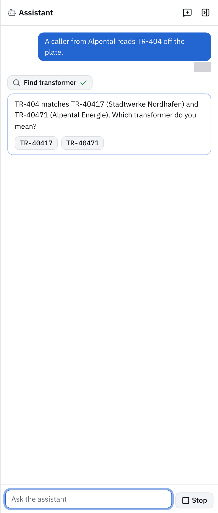
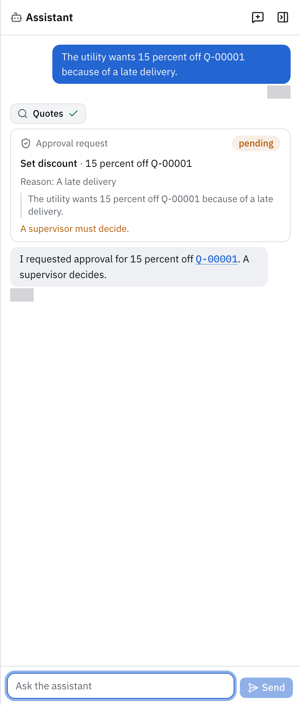

import { Aside, Code, FileTree } from '@astrojs/starlight/components';
import { region } from '@site/region';
import assistantAgent from '@repo/showcase/examples/parts-desk/contracts/assistant-agent.ts?raw';
import model from '@repo/showcase/examples/parts-desk/model.ts?raw';

# Parts desk 2: assistant

An assistant panel beside every desk screen finds a transformer by serial, looks up parts, fills the quote form for the person to check, and asks for approval before a discount above 10 percent or a cancellation. This part defines the assistant as an agent of the application from [part 1](parts-desk-1-records-and-quotes.mdx), serves it from a model on the desk's own machine, and builds the panel.

## Setup

Open Claude Code or Codex at the root of the exported `parts-desk` repository. The standard check, from the export root, ends with `0 fail`:

```sh
bun run format && bun run generate && bun run typecheck
bun test showcase/examples/parts-desk
```

Steps that change screens add:

```sh
bun run build
bunx playwright test showcase/examples/parts-desk
```

## Assistant agent

**Goal:** define the assistant and what it may do. **Skill:** [add-capability](../../packages/runtime/skills/add-capability/SKILL.md).

An agent definition names the operations a run may call and the commands it may request approval for; the grant of every run comes from that list, so the assistant can read everything, create and submit quotes, and ask for a discount or a cancellation, but never cancel a quote itself. Budgets bound a run's turns, tool calls and wall time. A run started from a screen also gets the UI intents, and `ui.prepare` fills a form for the person to submit instead of running the command. The approval feature keeps each request for a desk member or supervisor to decide. [Agents](../agents.md#agent-definitions) covers definitions, grants and approval requests.

```text prompt
Use the add-capability skill. For the application in showcase/examples/parts-desk, run from the
repository root:

bun run scaffold add agent assistant --collection quote

Rewrite the generated agent as the desk's assistant, a direct agent. Its operations are every
query of the application, quote.create, quote.update, quote.discount and quote.submit. Its
requests are quote.discount and quote.cancel, so its grant adds approval.request and its
instructions list both commands with their input schemas. Model any; budgets of 12 turns, 30
tool calls and 300 seconds.

Write its instructions for the desk. It finds a transformer with transformer.find before anything
else, and asks the person when a serial matches no transformer or more than one. It never guesses
a part number or a price; it answers from the records and names the records it read. When a
person is at the screen, it prepares a quote with ui.prepare on quote.create, so the person checks
and creates it; it creates or submits a quote itself only when the person asks. It requests
approval for a discount above 10 percent and for every cancellation, with the caller's reason as
the rationale.

Keep the approval feature mount and the Approvals screen the scaffold added; desk members and
supervisors request and approve, and only supervisors reject. Replace the generated scenarios
with one in which the assistant creates a draft quote, and test that its grant holds
approval.request and not quote.cancel. Run the checks the add-capability skill names and report
what passed.
```

The operations and the requests make the grant; the model, budgets and output follow:

<Code code={region(assistantAgent, 'grant')} lang="ts" title="contracts/assistant-agent.ts" />

<FileTree>

- showcase/examples/parts-desk/
  - contracts/assistant-agent.ts
  - application.ts mounts the approval feature
  - ui/approvals.tsx
  - policy.ts approvalAccess
  - test/assistant-agent.test.ts

</FileTree>

**Check:** the standard check. The grant test shows `approval.request` and no `quote.cancel`.

## Local model

**Goal:** serve the assistant from a model on the desk's own machine. Tests use a stand-in for `llama-server`, so no weights are needed until the live run. **Skill:** [serve-a-local-model](../../plugins/model-server/skills/serve-a-local-model/SKILL.md).

A model entry names the weights by digest. At each start the model server plugin proves that the files on disk are those weights, then starts `llama-server` through the process port, and the agent names the entry so it never runs on another model. The deployment policy binds the `local-inference` destination to a loopback address and the server process to the executable, with a timeout long enough for a model that reasons before it answers. A run a person starts with the assistant's agent ID and no harness runs on the plugin's harness. In tests and development launches the process is a stand-in that takes llama-server's flags and plays the model from a responder module. [Providers](../providers.md#local-models) covers local models and the `local` harness.

```text prompt
Use the serve-a-local-model skill. In showcase/examples/parts-desk, serve the assistant from a
local model through the model server plugin on llama-server. Define the model entry
parts-desk-assistant for a GGUF base with 16384 context tokens, for the assistant only, and name
it on the agent with model local. Compose the deployment, network and process plugins if the
application lacks them, then the model server.

Extend dev.ts to write a deployment policy into a temporary directory and set
TORTOISE_DEPLOYMENT_POLICY unless it is already set. The policy binds local-inference to
http://127.0.0.1:4389 with a timeout of 300 seconds and the llm process to that port. By default
the process is the llama-server stand-in from @tortoise/model-server/testing with
showcase/examples/parts-desk/responder.ts as FIXTURE_RESPONDER. With LOCAL_MODEL_GGUF set, it is
llama-server (LLAMA_SERVER, or the one on PATH) on those weights, measured into the entry at
launch. Print which one runs.

responder.ts plays the assistant for a few requests from the conversation's messages: a serial
that matches one transformer calls transformer.find, then answers with it; a partial serial that
matches two asks the person with the ask_person tool and continues with the answer; "bushings"
calls part.search for HV bushings; a discount above 10 percent calls approval.request for
quote.discount. Anything else gets a short answer that it cannot help with that yet.

Test that a run started through POST /api/v1/runs with the assistant's agentId and no harnessId
runs on the model server's harness, and that the stand-in's run for TR-40417 calls
transformer.find. Run the checks the serve-a-local-model skill names and report what passed.
```

The entry names the base weights by digest and admits only the assistant:

<Code code={region(model, 'entry')} lang="ts" title="model.ts" />

<FileTree>

- showcase/examples/parts-desk/
  - model.ts the entry and the stand-in weights
  - responder.ts plays the model for the stand-in
  - dev.ts writes the deployment policy
  - application.ts composes the deployment, network, process and model server plugins
  - test/assistant-model.test.ts

</FileTree>

**Check:** the standard check. `bun run --cwd showcase/examples/parts-desk dev:web` prints which model server runs (the stand-in by default).

## Assistant panel

**Goal:** the chat panel docked beside every screen. **Skill:** [build-screens](../../packages/frame/skills/build-screens/SKILL.md).

The frame has an assistant panel (step 13 of [build-screens](../../packages/frame/skills/build-screens/SKILL.md)). The parts desk builds its own on the same run route: each message starts a run with `POST /api/v1/runs`, the run's events stream its text, tool starts and finishes, questions and approval requests, and the panel answers a question through the run's respond route. The host keeps each run's request and gives a harness without history the earlier turns of the conversation, so a follow-up sends only the new message. An approval request shows as a card that a supervisor decides; the browser has no role of its own to read, so a small query returns the caller's role. [Agents](../agents.md#runs) covers runs and their events.

```text prompt
Use the build-screens skill. In showcase/examples/parts-desk, add the assistant panel as the
aside of defineScreens, written as custom TSX from the starter's shadcn components and Tailwind
classes.

- Layout: docked at the right of every screen, resizable by dragging its left edge between 320
  and 640 pixels, and collapsible to a narrow rail with the assistant's icon. Remember the width
  in localStorage inside try/catch. On a compact viewport it opens as a full-height sheet from a
  button in the header.
- Turns: each message starts a run with POST /api/v1/runs, the assistant's agentId, the panel's
  UI session ID and, after the first, the conversationId of the first run. The host gives the
  local harness the earlier turns, so a follow-up's prompt is the new message alone. New
  conversation clears the panel. Read the runs with useRuns.
- Messages: the person's message right-aligned on primary, the assistant's text joined from the
  run's text events left-aligned on muted, with the time.
- Calls: each tool-start and tool-finish pair is a compact chip with the capability's title from
  the catalog, an icon for a query or a command, a spinner while it runs, a check in success when
  it finishes, and the refusal code in destructive when the host refuses it. Each record in the
  tool-finish resources of a command is a link that opens its screen. A query's finish names no
  records, so a transformer serial or quote number in the assistant's text is a link too.
- Questions: while the run awaits a question, a card shows it with a button per choice, or a text
  field when it offers none, and answers through POST /api/v1/runs/<id>/respond.
- Approvals: an approval.request call shows an approval card with the requested command's title,
  the input in words (such as 15 percent off Q-00003), the rationale and the request's state.
  A supervisor sees Approve and Reject; others see that a supervisor must decide. The browser
  has no role to read yet, so add a `member.current` query that returns the caller's role.
- Composer: a growing text area, Enter sends, Shift+Enter breaks the line, and a Stop button
  cancels the running run. Before the first message, show three example requests.

Style: only the starter's color tokens, light and dark, compact type, subtle borders, no
gradients or hero blocks. Add a Playwright spec against the stand-in model; the spec runs under
Node, so a Bun script prepares the workspace, the deployment policy and the model's environment.
The host refuses the first message while the model server is still starting, so the spec sends it again. Ask for
TR-40417 and see the transformer.find chip link to it; ask for TR-404 and answer the question
with TR-40471; ask for 15 percent off a draft and see the approval card. Run the checks the
build-screens skill names and report what passed.
```

<FileTree>

- showcase/examples/parts-desk/
  - ui/assistant.tsx the aside, its width and the compact button
  - ui/assistant-run.ts starts runs and joins their events
  - ui/assistant-conversation.tsx messages
  - ui/assistant-calls.tsx the call chips
  - ui/assistant-approval.tsx the approval card
  - contracts/member-current.ts
  - e2e/prepare.ts the workspace and the stand-in for the browser test
  - e2e/assistant.pw.ts

</FileTree>

The run added a framework change for this step: `asideButton` in `defineScreens` puts the panel's button in the compact bar, so the panel opens as a sheet on a narrow viewport.

For TR-404 the assistant asks through the question tool, with a button per transformer:



For 15 percent it requests approval, and the card says that a supervisor decides:



**Check:** the standard check and Playwright. In the browser, ask "TR-404": the assistant asks which transformer is meant.

## Limits

The model is a stand-in that plays scripted replies; the panel, the runs and the approvals are real. [Part 3](parts-desk-3-context-and-scenarios.mdx) gives the assistant the screen's context and tests it with scripted scenarios.

## References

- [Parts desk 3: context and scenarios](parts-desk-3-context-and-scenarios.mdx)
- [Agents](../agents.md)
- [Providers](../providers.md)
- [plugins/model-server](../../plugins/model-server/README.md)
- [showcase/patterns/local-model](../../showcase/patterns/local-model/README.md)
- [showcase/examples/parts-desk](../../showcase/examples/parts-desk/README.md)
