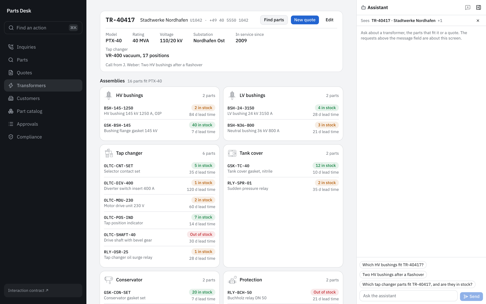
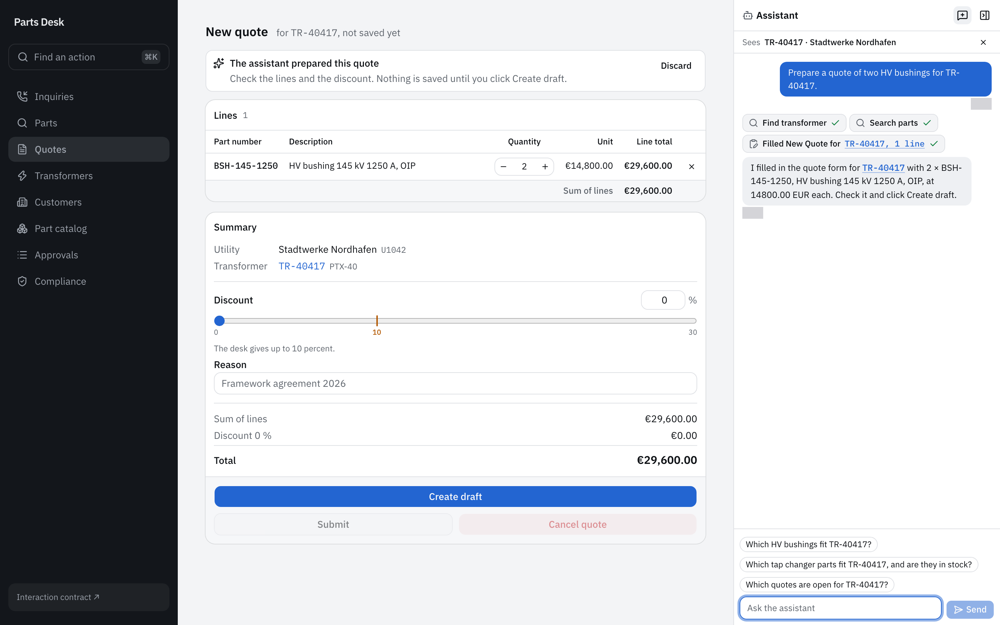

import { Code } from '@astrojs/starlight/components';
import { region } from '@site/region';
import screenContext from '@repo/showcase/examples/parts-desk/ui/screen-context.ts?raw';
import intents from '@repo/showcase/examples/parts-desk/ui/assistant-intents.ts?raw';
import scenarios from '@repo/showcase/examples/parts-desk/test/agent-scenarios.test.ts?raw';

# Parts desk 3: screen context and evaluation

The assistant panel from [chapter 2](parts-desk-2-assistant.mdx) starts runs in its own UI session. This chapter connects the desk's visible records to that session and handles a prepared quote form. It then evaluates the assistant's permitted behavior with scripted runs.

Continue in the same exported Parts Desk repository. A run for `TR-40417` must already execute through the stand-in and display its tool events. The quote operations must still enforce the rules from chapter 1. This chapter changes how the browser supplies context; it does not grant additional record access.

Source excerpts below come from the completed reference. They show the code to inspect after your coding agent has implemented the step. The reference tests may include helpers introduced later in the series, so use the checkpoint's stated behavior when reviewing your own intermediate application.

## Setup

Run from the export root after each change:

```sh
bun run format
bun run generate
bun run typecheck
bun test showcase/examples/parts-desk
```

For a screen change, rebuild the application and run the browser specification:

```sh
bun run build
bunx playwright test showcase/examples/parts-desk
```

The reference browser fixture prepares temporary trial records and a draft quote. Its assertions about a particular quote number depend on that fixture. In a manually used workspace, inspect the created quote's returned number and ID before asking the assistant about it.

## Screen context

A person can ask about the transformer currently displayed without typing its serial again. The application must identify that record to the panel that starts the run. A session created inside a routed screen does not automatically become the panel's session.

The reference screens publish compact descriptions to `ui/screen-context.ts`. The panel reads them through `useShownRecords`, derives resource IDs, and passes them to its own `useUiSession`. The host reads the selected resources under the current person's access before capturing context for a run.

```text prompt
Use the build-screens skill. In showcase/examples/parts-desk, let each screen publish the record
it shows (inquiry, transformer, part or quote) and the person's selection to the assistant panel,
and let the panel send them through its UI session, so each run's context names them.

The panel sits beside the routes, so a screen's own UI session does not reach its runs: the screens hand their record to the panel through a small store, and the panel's session names it. The panel's header shows what the next run will see, such as "TR-40417 · Northgrid Energy", with
a control to leave it out. The composer offers up to three requests drawn from the screen, such
as "Which HV bushings fit TR-40417?" on a transformer, "Discount Q-00003 by 12 percent" on a
draft quote, and the inquiry's subject on an inquiry. Add a unit test of the requests for each
kind of record, and extend the Playwright spec: open TR-40417, see its requests, send one, and
check through GET /api/v1/runs that the run's UI context names the transformer. Run the checks
the build-screens skill names and report what passed.
```

The publication hook in the finished reference is:

<Code code={region(screenContext, 'publish')} lang="ts" title="Finished reference: ui/screen-context.ts" />

The effect retains the exact array it published. On unmount, it clears the shared store only when that array is still current. Without the ownership check, a screen being removed during navigation could clear the new screen's records after the new screen has published them. The panel would then start its next run with an empty selection.

`ui/screen-records.ts` converts each displayed record into its `<kind>:<id>` resource. These identifiers use record IDs; a serial such as `TR-40417` is a displayed field and is not substituted for the ID. The reference's read schemas do not project record revisions, so this application publishes revision `0`, the observation accepted for those reads. An application that projects revisions must use the observed values from its responses.

The server composition declares `selectableResources` in `application.ts`, mapping each resource kind to its get query. Inspect that declaration as part of this step. The browser publication store alone is insufficient: the host needs a read operation through which it can authorize each selected resource.

When the person sends a message, the panel prepares the session and sends its context version with the run request. The run captures that context. Navigating to another transformer changes the context available to the next run; it does not change the records already captured by an active run.

The panel's suggested requests are derived from the displayed records. In this demo they are editable text placed in the composer. Clicking a suggestion must not immediately start a run. The quote screen may include an entered, unsaved discount in a suggestion, so the visible requested value can differ from the quote's stored percentage. The command's authorization still uses the actual input when the run calls it.

The finished-reference screenshot shows the current transformer in the panel header:



Start development and open `TR-40417`. The panel header should identify Stadtwerke Nordhafen with that serial. Select its bushing request and inspect the message field before sending. After the run completes, inspect its record through `GET /api/v1/runs` using the browser test's authenticated request context. The run's `context.uiContext.selectedResources` must contain the transformer's actual resource ID.

Use **Leave out of the next run**, send another message, and inspect the new run. Its captured selection should be empty. The earlier run's captured selection should remain unchanged. Navigating to another record should replace the header and restore inclusion for the new record.

In the test fixture, also attempt to start a run with a selected resource the person may not read. The host must refuse it. A readable label in browser state does not establish permission to send that record to the assistant.

## UI intents

The assistant needs to prepare a quote for review in the builder. The host queues a UI intent for the captured session, and the browser's handler applies that request. The pending form remains browser state until the person issues `quote.create`.

```text prompt
Use the build-screens skill. In showcase/examples/parts-desk, handle the assistant's UI intents
in the panel's UI session: open goes to the record's screen, select selects it, and prepare on
quote.create fills the quote builder through usePreparedInput. The builder shows a notice that
the assistant prepared the form, with Discard, and creates nothing until the person clicks
Create draft. The quote builder is a route of its own, so the panel passes a `prepare` handler that
navigates to it. Calls to ui.open and ui.prepare show as chips that say what opened or which form
they filled; a run's events name the call but not its input, so the handlers note what they received.
The panel narrows every screen, so lay the screens out by the width of the screen, not of the
window.

Extend responder.ts: "prepare a quote" for a serial and parts calls transformer.find, part.search
and ui.prepare on quote.create. Extend the Playwright spec: ask for a quote of two HV bushings for
TR-40417, see the builder open with the lines, create the draft and check that the person, not
the run, created the quote. Run the checks the build-screens skill names and report
what passed.
```

Follow the prepare path in the finished handler:

<Code code={region(intents, 'prepare')} lang="ts" title="Finished reference: ui/assistant-intents.ts" />

The handler accepts `quote.create` and parses its proposed input with `preparedQuote`. It keeps the intent ID when calling `holdRunPrefill`; that ID lets the form associate its prepared values with the request. The handler then navigates to `/quotes/new` with the resolved serial and an optional inquiry reference.

The builder consumes that prefill through `usePreparedInput`. In the reference, `draftFromPrepared` resolves the proposed part numbers against the parts found for the selected transformer. It copies displayed prices from those query results, combines repeated parts, and reports proposed parts that were left out. The server verifies the complete command input again when the person creates the draft. The prefill cannot supply a trusted price or customer identity.

A rejected prepare handler must be reported as a rejected intent. An unsupported operation cannot silently populate some other form. `ui.open` separately resolves a resource through its get query before choosing a route. `ui.select` requires a screen that currently supports the resource being selected. These handlers belong to the panel session so navigation does not discard the route-local recipient halfway through the action.

The reference run event records a UI tool call but does not include the complete form input. `useAssistantIntents` keeps a note of what its handler received so the panel can label the call chip. Inspect the form and saved records when checking the effect; a chip that names `ui.prepare` is not enough.

The finished-reference screenshot shows a quote that has been prepared for review:



Ask `Prepare a quote of two HV bushings for TR-40417.` through the stand-in panel. The builder should open with `BSH-145-1250` at quantity `2`, with a notice identifying the prepared form. Query `quote.list` before selecting **Create draft**. The count must not have increased as a result of preparation.

Select **Discard** during a separate preparation. The prepared values should be removed and no quote should be created. Ask again, inspect the proposed lines, and select **Create draft**. The saved quote should now appear. Use the audit record to confirm that its create command came from the person's HTTP session without a `runId`. `createdBy` alone does not distinguish that command, because an assistant run also acts under the person who started it.

The reference browser test checks this through `compliance.events.list` for `command.committed` records, supported by the audit and compliance plugins composed in this application. It also inspects the assistant's tool finishes and verifies that preparation did not call `quote.create`. Include equivalent assertions in your test even if your code uses a different helper layout.

Run the assistant browser specification after rebuilding. Check navigation and selection as well as preparation. Use a scripted UI run when the stand-in does not implement a particular message; that run checks the handler's integration with the UI session, and its script must be recorded in the test.

## Scripted scenarios

The application's policy should hold for any caller reaching its operations. The assistant definition adds a particular grant whose permitted paths can be checked without a language model. A scripted scenario specifies the calls to make and verifies the resulting changes through the application.

```text prompt
Use the add-capability skill. In showcase/examples/parts-desk, write the assistant's scripted
scenarios with runAgentScenarios and the deterministic harness:

- A quote: the run finds TR-40417, searches its bushings, creates a draft quote with two of them
  and sets 5 percent. It commits the quote.
- A cancellation without approval: the run calls quote.cancel on a submitted quote and gets
  FORBIDDEN; nothing commits and the quote stays submitted.
- A cancellation with approval: the run requests approval for quote.cancel with a rationale. It
  commits nothing; a supervisor approves, and the cancellation runs as the supervisor.
- A discount above the limit: the policy refuses quote.discount at 15 percent and accepts
  approval.request for it.
- A clarifying question: for TR-404 the run asks which transformer and gets the answer TR-40471,
  then searches that transformer's parts. The scenario expects one question.

A scripted run cannot use a result and ends at its first refused call, so the discount on the
created quote takes the fixture's next record ID, and the refusal and the approval request of the
discount are two scenarios. Put them in test/agent-scenarios.test.ts. Run the checks the
add-capability skill names and report what passed.
```

The finished cancellation-request scenario is:

<Code code={region(scenarios, 'approval')} lang="ts" title="Finished reference: test/agent-scenarios.test.ts" />

The run requests approval for `quote.cancel` with the quote resource and the complete cancellation input. The scenario expects the request to exist while the quote remains submitted. In this scenario API, `expect.commits` describes the domain commits being evaluated; the saved approval request is inspected under `approvals`.

The reference test then invokes `approval.approve` as the supervisor fixture and inspects its continuation. That continuation must identify `quote.cancel` and the cancelled quote. A subsequent `quote.get` establishes the saved status, while `approval.get` records the approver in `closedBy`. This additional execution catches requests whose payload looks plausible but cannot actually be approved.

A direct cancellation call uses a different scenario and expects `FORBIDDEN`. It verifies that the quote remains submitted and that the run records no domain commit. For an excessive discount, the agent's grant contains `quote.discount`, so the application's percentage policy causes the refusal. The test then uses a separate scenario to request approval for that percentage and confirms that the saved quote is still unchanged.

The deterministic harness stops after a refused call. It also cannot read a generated result and use that ID in the next scripted call. The finished reference fixes its fixture's ID generator; its draft-and-discount scenario knows which ID the next create will return. Treat that ID as a fixture dependency. If your trial records or generator differ, derive the expected fixture ID or separate the scenario setup. Document the fixture ID dependency.

The clarification scenario scripts a host question and supplies `TR-40471` as the person's answer. It verifies that the run asks and resumes into the search for that transformer. The question has been supplied by the test, so this does not establish that a model will choose to ask when presented with an ambiguous serial. The live chapter records that behavior separately.

Run the application suite after inspecting its scenario assertions:

```sh
bun test showcase/examples/parts-desk
```

Read the assertions for each behavior. The reference contains a draft-and-discount path, a direct cancellation refusal, an approved cancellation, the discount refusal and request paths, and a question response. A test count does not identify which behavior has been covered. Add a post-run query where a scenario's outcome depends on a record remaining unchanged.

The stand-in host test exercises a different route: it sends HTTP run requests through the composed model-server harness and interprets the responder's tool calls. Keep that test with the policy scenarios. The browser specification establishes whether the panel displayed and handled the resulting session actions. Each check covers a particular part of this application.

## Next chapter

The deterministic route now covers the assistant definition and its application interaction. [The live-model chapter](parts-desk-4-live-model-and-voice.mdx) describes an optional run with supplied weights and records an existing conversation's observed failures. It also adds dictation to the composer without requiring live weights.
