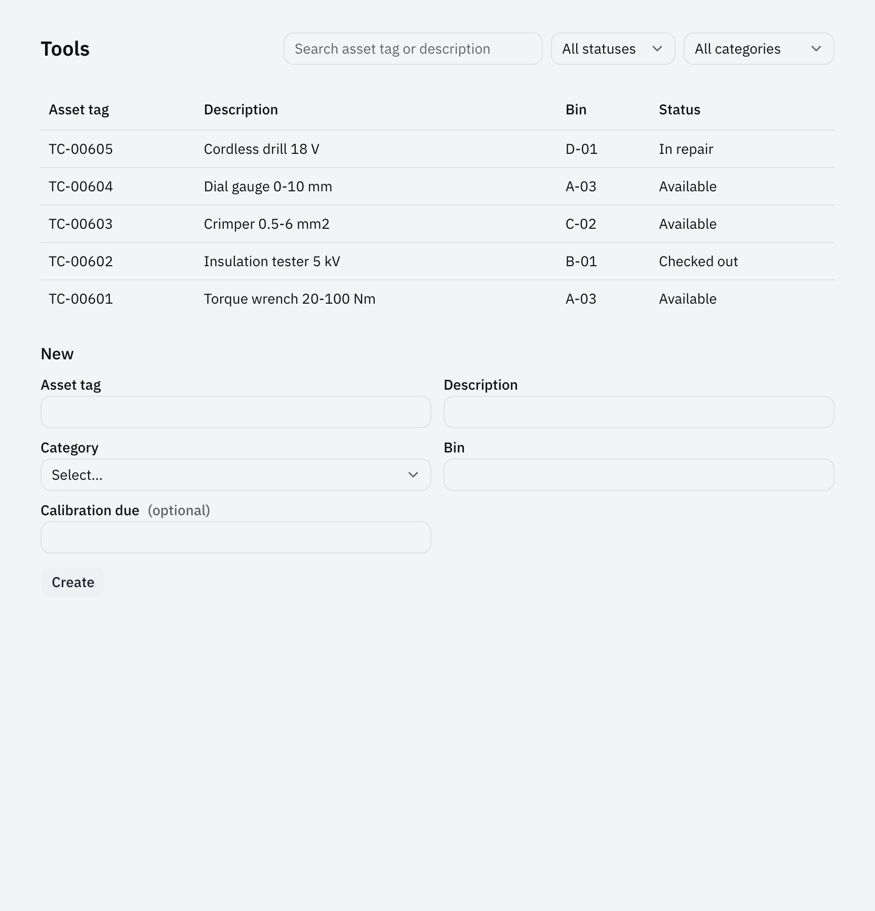
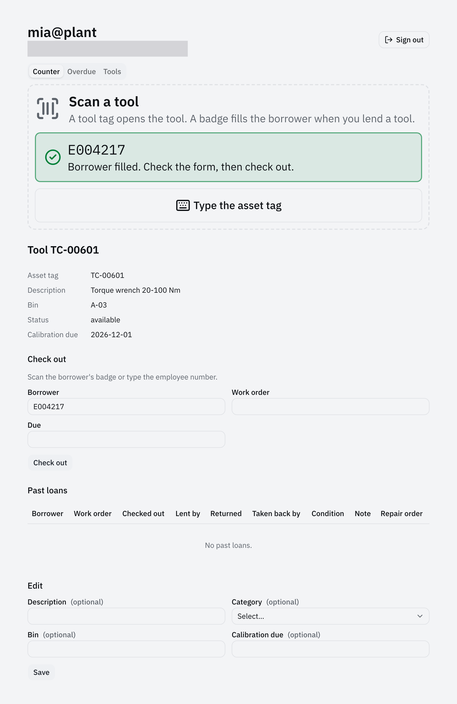
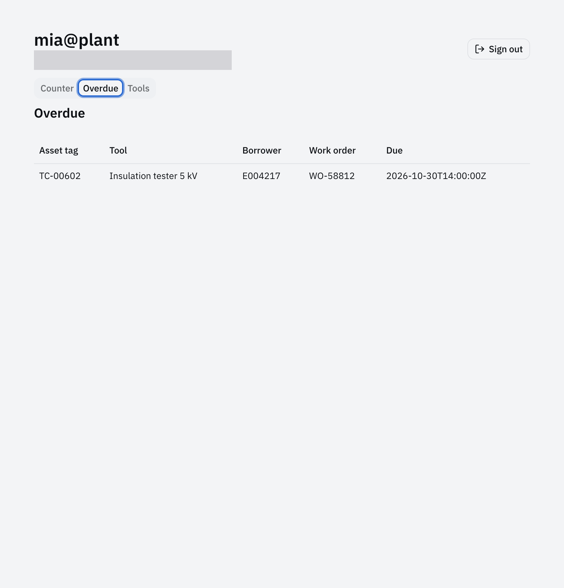

import { Aside, Code, FileTree } from '@astrojs/starlight/components';
import { region } from '@site/region';
import toolContract from '@repo/showcase/examples/tool-store/contracts/tool.ts?raw';
import policy from '@repo/showcase/examples/tool-store/policy.ts?raw';
import checkOutHandler from '@repo/showcase/examples/tool-store/handlers/tool-check-out.ts?raw';
import overdueHandler from '@repo/showcase/examples/tool-store/handlers/loan-overdue.ts?raw';
import overdueScreen from '@repo/showcase/examples/tool-store/ui/overdue.tsx?raw';
import application from '@repo/showcase/examples/tool-store/application.ts?raw';

# Tool store 1: records and screens

The tool store of a transformer plant is the room where attendants lend shared tools such as torque wrenches, crimpers and insulation testers to employees and take them back. Each tool carries an etched asset tag like `TC-00601`, sits in a shelf bin and is available, checked out, in repair, missing or retired. This part exports the application, replaces the generated record with the store's tool, adds the two commands that lend and return a tool, lists overdue loans and builds the counter screen. The finished application is `showcase/examples/tool-store`; [Tutorials](index.md) explains how to work through the steps.

## Setup

Open Claude Code or Codex at the root of this repository for the first step, and at the root of the exported `tool-store` repository from the second step on. Every step's check starts with these commands, which end with no errors and `0 fail`:

```sh
bun run format && bun run generate && bun run typecheck
bun test showcase/examples/tool-store
```

Steps that change screens add:

```sh
bun run build
bunx playwright test showcase/examples/tool-store
```

To try the application by hand, run it in one terminal and point the CLI at it from another:

```sh
bun run --cwd showcase/examples/tool-store dev:web
export TORTOISE_CONNECTION=$PWD/showcase/examples/tool-store/.workspace/.connection.json
```

## Export the app

**Goal:** a new repository with a `tool` collection, default screens and tests. **Skill:** [create-agent-native-app](../../packages/scaffold/skills/create-agent-native-app/SKILL.md).

`scaffold new` writes one application with three entrypoints: the browser-safe `manifest`, the server `application` and the browser `screens`. The first collection comes with generated list, get, create and update operations, a policy with an editor and a viewer role, behavioral tests and a Playwright spec, and the application composes the deployment, network, audit and compliance host plugins. The CLI and the MCP bridge call the running instance through its connection file, so both lists in the report come from the same records. [Architecture](../architecture.md) describes the parts the export contains.

```text prompt
Use the create-agent-native-app skill. Create the application for the tool store of a power
transformer plant at /path/to/tool-store, with the name tool-store, the display name "Tool Store"
and the first collection tool. Attendants at the store counter lend torque wrenches, crimpers,
insulation testers and gauges to employees. One build serves the store for 180 days.

Export it with scaffold new and initialize Git in the new directory. Install it, run the checks
the scaffold prints, and commit the result. Then start it with bun run dev:web in
showcase/examples/tool-store, and from the new repository's root create one tool through the CLI,
list the tools through the CLI and through the MCP bridge, and stop the instance. Report each
command and what it printed.
```

The export holds the framework packages, the starter under `apps/` and the application:

<FileTree>

- showcase/examples/tool-store/
  - manifest.ts browser-safe identity, modules, features, plugins
  - application.ts the server: state, handlers, policy, plugins
  - screens.tsx the routes and navigation
  - contracts.ts the module and its operations
  - contracts/tool.ts the collection
  - handlers/tool.ts
  - policy.ts
  - domain.ts the state and its upgrade
  - test/
  - e2e/default-screens.pw.ts
- app.config.json selects the application

</FileTree>

**Check:** the report shows `bun test` passing and the same tool in the CLI list and the MCP list.

## Tool records

**Goal:** replace the generated title and status with the store's real tool fields, and rename `editor` to `attendant`. **Skills:** [add-capability](../../packages/runtime/skills/add-capability/SKILL.md), [build-screens](../../packages/frame/skills/build-screens/SKILL.md).

A collection declares its record as a strict Zod schema and display metadata: a label, the title field and the fields a list shows. The generated operations take their input and output from that schema, and the default screens, forms and the command palette read the metadata, so changing the record changes every surface at once. The policy lists each operation with a rule and denies everything it does not list; a read is `open` where the handler scopes the rows itself. The workspace holds trial records only, so deleting it replaces a state migration. [Capability authoring](../capability-authoring.md) covers collections and [Authorization](../authorization.md) the policy.

```text prompt
Use the add-capability skill and the build-screens skill. In showcase/examples/tool-store,
replace the generated tool record with the store's tool record. Keep id, createdBy and createdAt.

- assetTag: the etched tag, TC- followed by five digits, unique among tools.
- description: such as "Torque wrench 20-100 Nm".
- category: torque-tool, crimper, insulation-tester, gauge, hand-tool or power-tool.
- bin: the shelf bin, such as A-03.
- status: available, checked-out, in-repair, missing or retired. A new tool is available.
- calibrationDue: an optional date, for tools that need calibration.

tool.create takes assetTag, description, category, bin and calibrationDue, and refuses a
duplicate asset tag. tool.update changes description, category, bin and calibrationDue. The
asset tag is the record's title. Rename the editor role to attendant; attendants write and
viewers read. The tool list shows asset tag, description, bin and status, filters by status and
category, and searches asset tag and description. The workspace holds only trial records, so
delete showcase/examples/tool-store/.workspace instead of writing a state migration. Update the
tests, the Playwright spec and the application README for the new record. Run the checks the
add-capability skill names and report what passed.
```

The record in the finished example, with the description each field carries into the MCP tool list:

<Code code={region(toolContract, 'record')} lang="ts" title="contracts/tool.ts" />

The policy's rule for the commands, and the reads left open because their handlers scope the rows:

<Code code={region(policy, 'rules')} lang="ts" title="policy.ts" />

<FileTree>

- showcase/examples/tool-store/
  - contracts/tool.ts the record, categories, statuses and the generated operations
  - handlers/tool.ts the unique asset tag and the calendar date checks
  - domain.ts the attendant and viewer roles
  - policy.ts
  - ui/tool.tsx the list with its filters and search
  - test/tool.test.ts
  - e2e/default-screens.pw.ts
  - README.md

</FileTree>

The Tools screen in the finished app, with five tools:



**Check:** the standard checks, then with the app running:

```sh
bun run cli tool create --asset-tag TC-00601 --description "Torque wrench 20-100 Nm" --category torque-tool --bin A-03 --key t1
bun run cli tool create --asset-tag TC-00601 --description "Copy" --category gauge --bin A-04 --key t2; echo "exit $?"
```

The first command prints the tool with `"status":"available"`; the second prints an error and a non-zero exit for the duplicate tag.

## Loans

**Goal:** check a tool out and back in. Only these two commands write loans. **Skill:** [add-capability](../../packages/runtime/skills/add-capability/SKILL.md).

A command runs inside one workspace transaction: the instance validates the input, checks the policy and any expected revisions, runs the handler, then assigns a new revision to each changed resource and commits. A check-out therefore opens the loan and sets the tool to checked out as one change, and a second check-out of the same tool finds it already checked out. The receipt names the revisions of `tool:<id>` and `loan:<id>`, a caller that passes a stale revision gets `CONFLICT`, and a repeated idempotency key returns the stored receipt instead of running again. [State and reactivity](../state-and-reactivity.md) lists the steps of a command.

```text prompt
Use the add-capability skill. For the application in showcase/examples/tool-store, run
from the repository root:

bun run scaffold add collection loan
bun run scaffold add capability tool.check-out --kind command --description "Lend an available tool to an employee for a work order. Attendants only."
bun run scaffold add capability tool.return --kind command --description "Take a lent tool back and record its condition. Attendants only."

A loan records toolId, the tool's assetTag, borrower (an employee number, E followed by six
digits), workOrder, dueAt, checkedOutBy, checkedOutAt, and on return returnedAt, returnedBy,
condition (ok or damaged) and note. Remove the generated loan create and update commands, so only
these two commands write loans; members read loans.

tool.check-out takes toolId, borrower, workOrder and dueAt. It refuses a tool that is not
available with CONFLICT, creates the open loan and sets the tool to checked-out in the same
transaction. tool.return takes toolId, condition and an optional note, closes the tool's open
loan and sets the tool to available when the condition is ok or in-repair when it is damaged.
Bind both commands to the tool screen. Write behavioral tests for a viewer refused, a stale
revision refused, a repeated idempotency key returning the same receipt, and a second check-out
refused. Run the checks the add-capability skill names and report what passed.
```

The check-out handler. `records` reads and writes a collection's rows and declares each changed resource, so the commit assigns their revisions:

<Code code={region(checkOutHandler, 'handler')} lang="ts" title="handlers/tool-check-out.ts" />

<FileTree>

- showcase/examples/tool-store/
  - contracts/loan.ts the loan record and its reads
  - contracts/tool-check-out.ts
  - contracts/tool-return.ts
  - handlers/loan.ts
  - handlers/tool-check-out.ts
  - handlers/tool-return.ts
  - ui/loan.tsx the read-only loan screens
  - test/loan.test.ts no other command writes loans
  - test/tool-check-out.test.ts
  - test/tool-return.test.ts

</FileTree>

**Check:** the standard checks, then with the tool from the previous step (`bun run cli tool list --output text` shows its id):

```sh
bun run cli tool check-out --tool-id <id> --borrower E104233 --work-order WO-58812 --due-at 2026-12-01T14:00:00Z --key out-1
bun run cli tool check-out --tool-id <id> --borrower E104233 --work-order WO-58812 --due-at 2026-12-01T14:00:00Z --key out-2; echo "exit $?"
bun run cli tool return --tool-id <id> --condition damaged --key back-1
```

The commands print the tool `checked-out`, then `CONFLICT` with `exit 5`, then the tool `in-repair`.

## Overdue tools

**Goal:** a query that lists loans past their due time. **Skill:** [add-capability](../../packages/runtime/skills/add-capability/SKILL.md).

A query reads one snapshot of the workspace. The policy's caller gate admits members only, and the handler filters the rows before it counts them and cuts the page, so the total a screen shows is the total the caller may see. The handler takes the time from the instance clock in `services`, which a test replaces with a fixed value. [Authorization](../authorization.md#lists) explains why lists filter before paging.

```text prompt
Use the add-capability skill. For the application in showcase/examples/tool-store, run
from the repository root:

bun run scaffold add capability loan.overdue --kind query --description "List open loans past their due time, oldest due first. Members."

The query takes an optional borrower and the usual page arguments, and returns open loans whose
dueAt is before the time the query runs, with the tool's asset tag and description. Filter the
rows before paging and counting. Test it with a fixed clock: it lists a loan due one minute
ago, leaves out a loan due in one minute and a returned loan, and a viewer can call it. Run the
checks the add-capability skill names and report what passed.
```

<Code code={region(overdueHandler, 'handler')} lang="ts" title="handlers/loan-overdue.ts" />

<FileTree>

- showcase/examples/tool-store/
  - contracts/loan-overdue.ts
  - handlers/loan-overdue.ts
  - test/loan-overdue.test.ts a fixed clock

</FileTree>

**Check:** the standard checks. Check out a tool with `--due-at` in the past; `bun run cli loan overdue --output text` lists it.

## Counter screen

**Goal:** the screen the attendant uses at the window. **Skill:** [build-screens](../../packages/frame/skills/build-screens/SKILL.md).

Screens read through live queries and write only through catalog commands. A live query follows the workspace journal from the snapshot it read, so a check-out on the counter updates the Overdue screen without a reload; the overdue list also refetches on a timer, because a loan falls due by the clock alone. Every command a screen issues needs a UI binding on its capability, and the UI-binding test fails for an operation that has neither a screen nor a declared headless exception. The UI session shares the open tool with agent runs as `tool:<id>` with its revision, which is why `tool.get` returns the revision and the application lists `tool` among its selectable resources. [Interaction contract](../interaction-contract.md#ui-bindings) covers bindings and the UI session context.

```text prompt
Use the build-screens skill. In showcase/examples/tool-store, replace the default tool record
screen with the counter screen:

- the tool's asset tag, description, bin, status and calibration due date;
- when the tool is available, a check-out form for borrower, work order and due time;
- when the tool is checked out, the open loan and a return form for condition and note;
- the tool's past loans, newest first.

Add an Overdue screen to the navigation that lists loan.overdue and updates when a loan changes.
Share the open tool with agent runs through the UI session. Bind every operation that still has
a headless exception, keep the UI-binding test passing, and extend the Playwright spec: create a
tool, check it out with a due time in the past, find it on the Overdue screen, return it damaged
and see the status in-repair. Run the checks the build-screens skill names and report what
passed.
```

The Overdue screen's query, live and on a timer:

<Code code={region(overdueScreen, 'query')} lang="tsx" title="ui/overdue.tsx" />

The application names the resource kind a screen may share with a run:

<Code code={region(application, 'selectable')} lang="ts" title="application.ts" />

<FileTree>

- showcase/examples/tool-store/
  - ui/tool.tsx the list and the counter screen
  - ui/overdue.tsx
  - screens.tsx the Overdue navigation item
  - application.ts selectableResources
  - contracts/tool.ts tool.get returns the revision
  - test/ui-bindings.test.ts
  - e2e/default-screens.pw.ts the overdue flow

</FileTree>

In the finished app the counter is a tab of the terminal, after the attendant signs in, and a scan has filled the borrower:



The Overdue tab of the finished app:



**Check:** the standard checks and the Playwright run. In the browser, an open tool shows a check-out form when it is available and a return form when it is out. The **Overdue** tab is in the navigation.

## Limits

The store runs on its own records only; no scanner, badge reader, EAM or model is involved yet. The next part adds the counter terminal: a handover log, asset tag scanning and attendant sign-in.

## References

- [Tool store 2: counter terminal](tool-store-2-counter-terminal.mdx)
- [Getting started](../getting-started.md)
- [Capability authoring](../capability-authoring.md)
- [Authorization](../authorization.md)
- [State and reactivity](../state-and-reactivity.md)
- [Interaction contract](../interaction-contract.md)
- [showcase/examples/tool-store](../../showcase/examples/tool-store/README.md)
