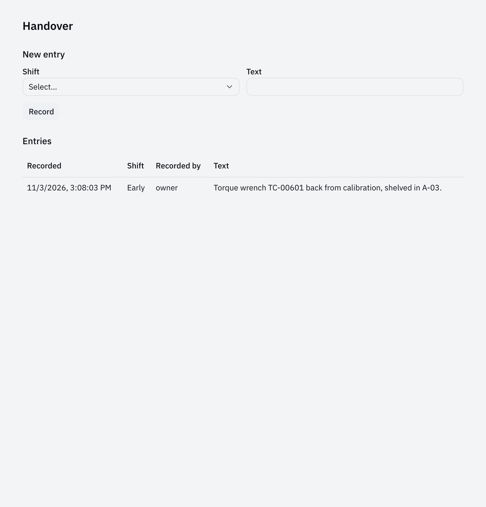
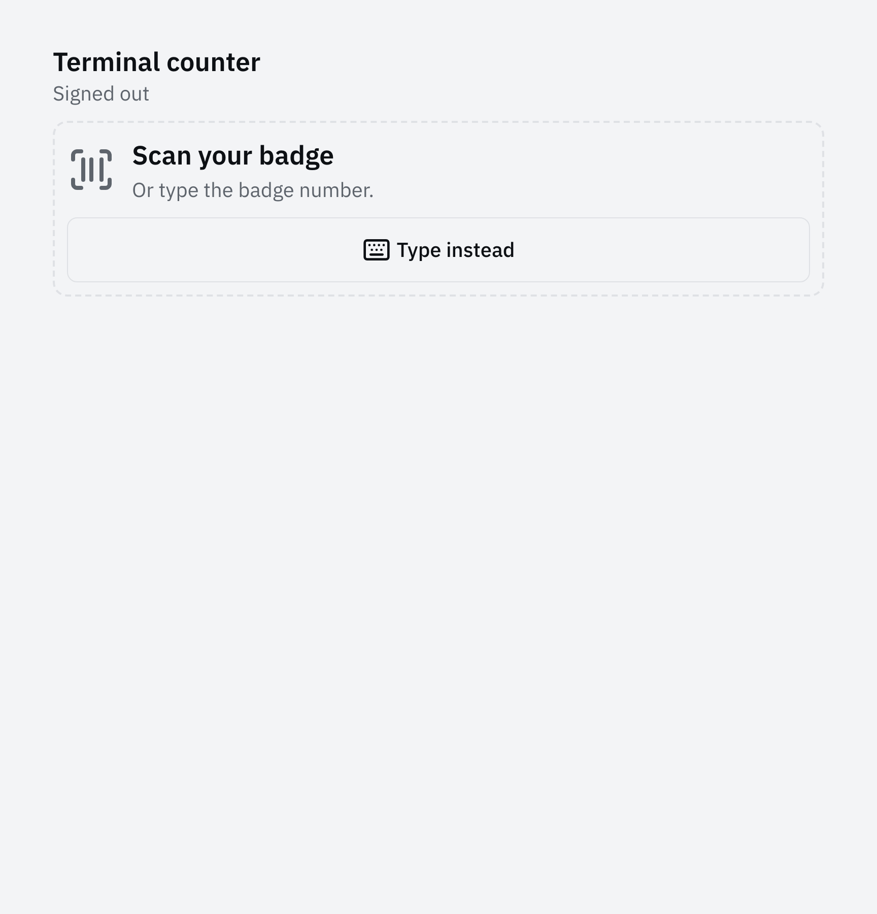

import { Code } from '@astrojs/starlight/components';
import { region } from '@site/region';
import handoverFeature from '@repo/showcase/examples/tool-store/features/handover/feature.ts?raw';
import policy from '@repo/showcase/examples/tool-store/policy.ts?raw';
import scanner from '@repo/showcase/examples/tool-store/scanner.ts?raw';
import application from '@repo/showcase/examples/tool-store/application.ts?raw';

# Tool store 2: counter terminal

This chapter continues the Tool Store application from [Records and screens](tool-store-1-records-and-screens.mdx). The previous checkpoint has working checkout and return commands. The counter now needs to record which attendant performed the work on a shared workstation. The scanner supplies tool tags and employee numbers as input.

A handover entry is separate from a loan. It records a note from a store shift without changing a tool. Its feature is kept inside this application for the tutorial, with an access contract that permits it to be mounted elsewhere.

## Setup

Use the exported repository containing the completed previous chapter. Start from its checkpoint commit and record the current application ID. The committed example already includes the work in later chapters; it is the reference when inspecting the excerpts below, not the starting export for this step.

Run these checks from the export root after each prompt:

```sh
bun run format
bun run generate
bun run typecheck
bun test showcase/examples/tool-store
bun run build
bunx playwright test showcase/examples/tool-store
```

The browser tests at this point must follow the current screen flow. When sign-in is introduced, update existing browser tests so they enroll and sign in before attempting a counter action. A test that still sends a command using the launch session does not establish that the operator form uses the attendant's identity.

For manual checks, start the application with `bun run --cwd showcase/examples/tool-store dev:web` and open its launch URL. Keep the host running while exercising the browser. Stop it before code changes that affect the host definition.

## Shift handover

The handover feature owns a state slice named `handover`. Its record operation takes the shift and text, then derives the author from the execution context. The application decides membership and roles through `handoverAccess`; it supplies no direct access to its tool or loan collections.

The feature's own policy rejects delegated callers for recording. This makes the person-only rule apply to every mount of this feature. An attendant's agent grant cannot make that rule disappear merely because the attendant may record the note themselves.

Use [write-a-feature](../../packages/host/skills/write-a-feature/SKILL.md):

```text prompt
Use the write-a-feature skill. For the application in showcase/examples/tool-store, run
from the repository root:

bun run scaffold add feature handover --screens

Shape it into the handover log between store shifts. An entry records the shift (early, late or
night), the text, recordedBy and recordedAt. Attendants record entries, and only a person may
record one, never an agent. Every member reads them. The Handover screen lists the latest
entries first with a form above them. Keep the feature's access view and conformance test, and
remove any application policy rule the feature now owns. Run the checks the write-a-feature skill
names and report what passed.
```

Inspect the feature manifest in the browser-safe contracts file. It declares `handover.list` and `handover.record`, with inputs a screen can validate. The server feature definition adds handlers and creates the empty state slice. `mountFeature` supplies the application access view and hooks, and the application manifest must name the corresponding feature manifest. A missing composition entry must refuse startup.

The finished reference evaluates the person-only condition before asking the application's access view. It also requires both current and previous access when a command changes the state used to derive that access:

<Code code={region(handoverFeature, 'policy')} lang="ts" title="Finished reference: features/handover/feature.ts" />

The application view answers the feature's `read` and `record` actions from Tool Store membership. This is the relevant application-specific policy:

<Code code={region(policy, 'handover-access')} lang="ts" title="Finished reference: policy.ts" />

The feature handler records `ctx.context.principalId` and uses the mounted clock hook for `recordedAt`. It must call `ctx.change` for the entry resource so a committed note becomes visible through the journal. The list sorts by record time, with the ID breaking ties; test equal timestamps as well as different shifts.

With the application running and the connection set to this export, record a note from the CLI:

```sh
bun run cli handover record --shift early --text "Torque wrench TC-00601 is in repair." --key tutorial-handover-1
bun run cli handover list --output text
```

The record must identify the caller as `recordedBy`. Open Handover in the browser and confirm that the new entry appears without a reload. Record another entry and check the order. The default local user is an attendant in this demo, so this manual check does not exercise the viewer rule.

Read the delegated-call test with the agent context. It must get `FORBIDDEN` with `PERSON_ONLY` and leave the entry count unchanged. The feature conformance test should also remain present; a custom application-level happy path does not cover the feature's composition contract.



## Asset tag scanning

The counter scanner is configured for a keyboard wedge that emits a code followed by Enter. Its profile describes the timing and keyboard layout. The scan routes match the tag patterns already used by the tool and borrower schemas. Routing identifies which input the application received; it does not establish that the tool exists or grant permission to lend it.

Use [add-scanner-input](../../packages/devices/skills/add-scanner-input/SKILL.md):

```text prompt
Use the add-scanner-input skill. In showcase/examples/tool-store, add a keyboard wedge scanner at
the store counter. A scan route for asset tags (TC- followed by five digits) opens that tool's
counter screen from any screen. On the counter screen's check-out form, a scan of an employee
badge (E followed by six digits) fills the borrower. A scan never submits a command by itself;
the attendant confirms. Mount the device feature with its access view, and keep a scan burst
from firing keyboard shortcuts. Test both routes and an unknown code, and add the scan to the
Playwright spec as a typed burst. Run the checks the add-scanner-input skill names and report
what passed.
```

The finished reference shares the schema patterns with the route declarations:

<Code code={region(scanner, 'routes')} lang="ts" title="Finished reference: scanner.ts" />

Follow the tool route into `useCounterScans` in `ui/counter-scanner.tsx`. It queries the tool list using the scanned tag, then requires an exact `assetTag` match from the result. A syntactically valid tag that is absent from the store displays a lookup failure. It must not select a different record returned by a partial search. The reference also tracks the latest lookup so a slower response for an earlier scan cannot open the wrong tool.

The badge route sends the employee number to the mounted checkout form. The form's fill operation changes only the borrower input and preserves a work order already typed by the attendant. The fill must not call `tool.check-out`. The attendant still selects the tool and confirms the request.

Mount the device feature and give it the access view for station `counter`. An attendant can save a profile or routes; a viewer can read that configuration. The counter uses the default profile until saved configuration exists. A saved route set replaces the defaults, so a test must not assume that new routes are always appended.

The wedge listener and keyboard shortcut handling run on the same key stream. Inspect the burst guard: characters should still reach an editable input, while a burst's terminator must not submit the form. Outside an input, the scan must not activate a focused control or a shortcut. This behavior needs a browser check because unit routing alone does not execute the page's event listeners.

Run the application tests from the export root. The reference scanner assertions are in [`scanner.test.ts`](../../showcase/examples/tool-store/test/scanner.test.ts); your agent may organize them elsewhere:

```sh
bun test showcase/examples/tool-store
```

Ask the agent to demonstrate an unknown code and a slowly typed tag in its test. The finished reference uses a synthetic key target and fixed event times; it is testing the decoder and router without a physical scanner. The unknown-code test should leave application records unchanged.

In the browser, click outside input fields and send `TC-00601` as a rapid key burst followed by Enter. The tool opens. Use the browser test's burst helper for a repeatable timing check; typing the text at normal speed is not a reliable scanner test. On an available tool's checkout form, fill the work order, then burst `E004217`. Check that the borrower is filled, the work order is preserved and no loan exists until checkout is submitted.

After the terminal step below, the global scanner panel pauses on the terminal route because the terminal handles those scans itself. The Scanner setup route and badge enrollment field also have their own listeners. Avoid mounting competing active listeners on those routes.

## Attendant sign-in

Badge enrollment links a badge and PIN to an existing Tool Store member. The sign-in plugin validates those credentials and issues an operator session for station `counter`. The server then authorizes the operator's role on each counter request.

The terminal route owns the signed-in work area. Its checkout and return forms must use the operator client from `useOperatorSession`. In the finished reference, `OperatorForm` accepts that client's transport and uses `useCapabilityForm` for command submission. A form that silently uses the frame's ordinary client would record the terminal's launch identity as the attendant.

Use [sign-in-at-a-terminal](../../workstations/sign-in/skills/sign-in-at-a-terminal/SKILL.md):

```text prompt
Use the sign-in-at-a-terminal skill. In showcase/examples/tool-store, the store counter has one
shared terminal. Put the counter screen and the Overdue screen behind workstation sign-in with an
attendant badge (E followed by six digits) and a PIN, and sign the attendant out after five idle
minutes. Check-outs and returns record the signed-in attendant as checkedOutBy and returnedBy.
The local user enrolls badges on the badge screen. Write an HTTP test that enrolls a badge,
signs in, checks out a tool as that attendant, refuses a viewer's badge for a check-out, and
refuses a revoked badge. Run the checks the sign-in-at-a-terminal skill names and report what
passed.
```

Ensure the new workspace contains the principals used by badge enrollment. The finished application supplies these demo members when it creates a workspace:

<Code code={region(application, 'members')} lang="ts" title="Finished reference: application.ts" />

An existing workspace keeps its stored membership. Adding `mia@plant` to the factory defaults does not automatically add her to a workspace created in chapter 1. For this disposable tutorial export, stop the host and back up or explicitly reset only that export's tutorial workspace before checking enrollment. Record that reset and recreate the tool needed for the check. A deployed application needs an explicit membership change or migration appropriate to its records.

The server application and browser manifest must compose matching sign-in plugins. Include the plugin's browser source in the UI-binding test's scan roots so its badge operations are checked against their own screens. The finished server list is:

<Code code={region(application, 'plugins')} lang="ts" title="Finished reference: application.ts" />

In `screens.tsx`, the reference mounts `stationSignInScreens` for `counter` and configures `idleMs` to five minutes. The work component contains Counter and Overdue as tabs so changing between them keeps the operator inside the terminal route. Leaving that route ends the operator session.

The reference terminal keeps the token in session storage so a reload of the same browser tab can recover the still-valid session. The server can invalidate that session through badge revocation or another sign-in at the counter. Its expiry is also checked on the server. Browser idle sign-out is an additional control and must not be the only credential check.

Open Badges using the local launch session. Enroll badge `E100001` with PIN `2468` for `mia@plant`. Open Terminal and enter that badge, then try a wrong PIN. The work area must stay unavailable. Sign in with the correct PIN, create an available tool if needed, and check it out to borrower `E004217`.

Read the resulting loan from the CLI or Loans screen. Its `checkedOutBy` must be `mia@plant`. Returning it from the signed-in counter must record `mia@plant` as `returnedBy`. The borrower may differ from the attendant; do not infer the author of the command from the scanned borrower number.

Enroll `sam@plant` with a different badge and sign in. Sam's viewer role must still prevent checkout. The finished HTTP test makes the request directly with Sam's operator token so it verifies the server refusal as well as the browser's presentation. The tool remains available after that refusal.

Revoke Mia's badge using the badge screen and check that the earlier operator token is refused. The HTTP test also advances a fixed clock beyond session expiry and verifies that a later query fails. These checks cover the server credential lifetime without waiting for the browser idle timer.



## Checkpoint

Run the full application checks for this export and inspect the browser results. Record the loan's signed-in author and the viewer refusal in the checkpoint report. The scan checks use synthetic keystrokes; no hardware operation is established by that result.

Continue with [Connections and agents](tool-store-3-connections-and-agents.mdx) from this completed application state.
