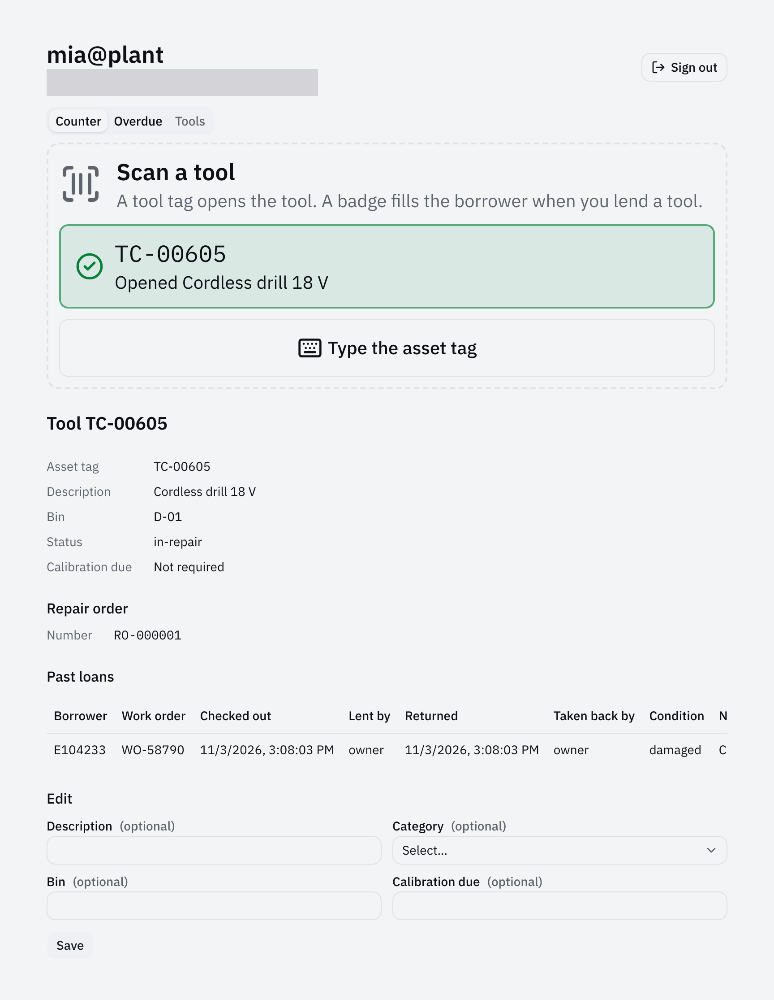
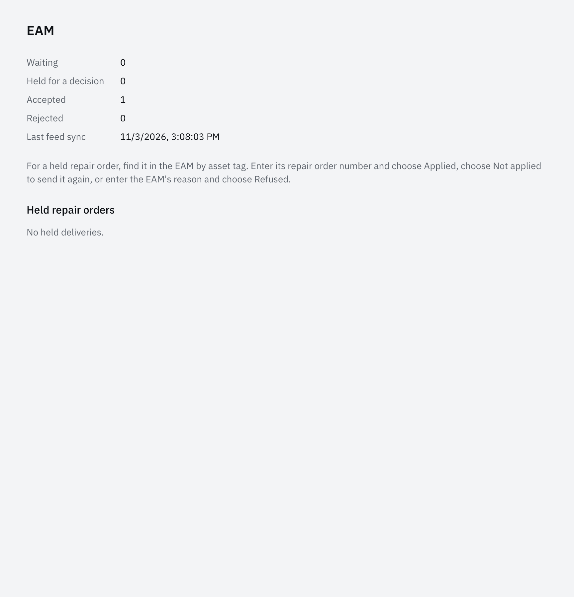
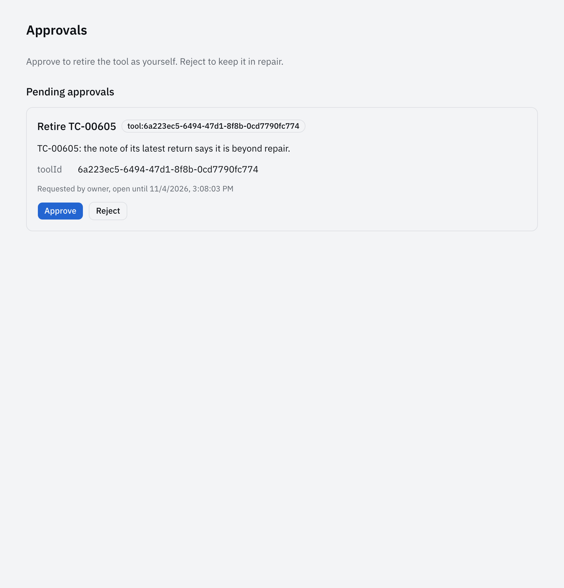
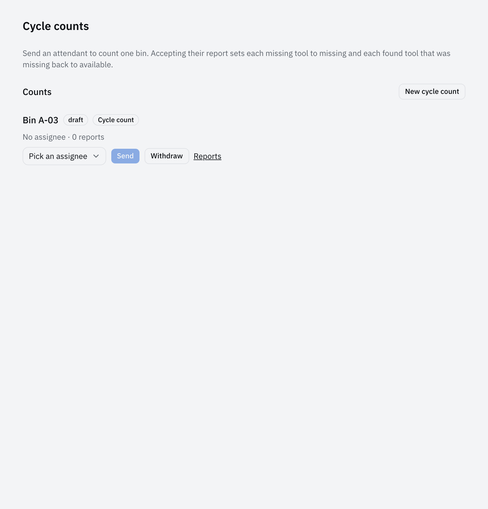
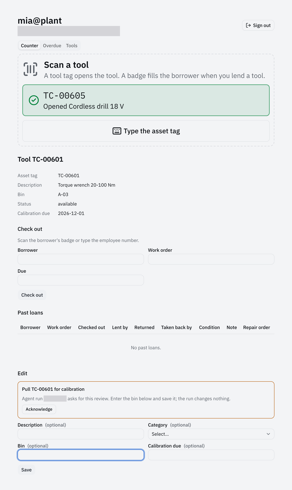

import { Aside, Code, FileTree } from '@astrojs/starlight/components';
import { region } from '@site/region';
import toolReturn from '@repo/showcase/examples/tool-store/handlers/tool-return.ts?raw';
import eamTarget from '@repo/showcase/examples/tool-store/contracts/eam-target.ts?raw';
import triageAgent from '@repo/showcase/examples/tool-store/contracts/repair-triage-agent.ts?raw';
import cycleCount from '@repo/showcase/examples/tool-store/contracts/cycle-count-assignment.ts?raw';
import calibration from '@repo/showcase/examples/tool-store/contracts/tool-calibration-due.ts?raw';
import counter from '@repo/showcase/examples/tool-store/ui/counter.tsx?raw';

# Tool store 3: connections and agents

The plant's EAM owns the tool master data and the repair orders, so a damaged return becomes a repair order there. An agent proposes retiring worn-out tools, attendants count bins, Claude Code pulls tools due for calibration over MCP, and a run started from the terminal asks the attendant to review a change instead of writing it. This part connects the application from [part 2](tool-store-2-counter-terminal.mdx) to a fake EAM and adds its agents.

## Setup

Open Claude Code or Codex at the root of the exported `tool-store` repository. Every step's check starts with these commands, which end with no errors and `0 fail`:

```sh
bun run format && bun run generate && bun run typecheck
bun test showcase/examples/tool-store
```

Steps that change screens add:

```sh
bun run build
bunx playwright test showcase/examples/tool-store
```

To try the application by hand, run it in one terminal and point the CLI at it from another:

```sh
bun run --cwd showcase/examples/tool-store dev:web
export AGENT_NATIVE_CONNECTION=$PWD/showcase/examples/tool-store/.workspace/.connection.json
```

## Repair orders

**Goal:** a damaged return sends a repair order to the plant's EAM through the outbox. The EAM is a fake. **Skill:** [connect-system-of-record](../../packages/integration/skills/connect-system-of-record/SKILL.md).

A system of record is an outside system that owns records the application changes. The command never calls it: `tool.return` writes an outbox effect in its own transaction, and a dispatcher delivers it afterwards. The target declares the operations only its integration principal may call: `complete` records the EAM's answer, `sync` applies an inbound batch, and `status` shows the pending, accepted and rejected counts to everyone. A delivery whose outcome is unknown is held, and a person resolves it on the reconciliation screen, because the dispatcher must not guess what the EAM decided. [Systems of record](../systems-of-record.md) covers targets, the outbox, held effects and inbound sync.

```text prompt
Use the connect-system-of-record skill. For the application in showcase/examples/tool-store, run
from the repository root:

bun run scaffold add target eam --collection tool

The plant EAM owns the tool master data and the repair orders. A return with condition damaged
enqueues a repair order effect in the same transaction, with the asset tag, the note and the
attendant who took the tool back. The EAM accepts it with a repair order number, which the tool
screen shows; it rejects an asset tag it does not know with ASSET_UNKNOWN, which the tool screen
shows as needing attention. The outbox holds a delivery whose outcome is unknown, and a
reconciliation screen resolves it. Inbound sync takes description, category, bin and calibration due date
from the EAM's feed by asset tag, and never changes status.

Keep the in-memory fake EAM port, make its behavior deterministic, and let
DEMO_EAM_UNKNOWN_TAGS name asset tags it rejects in the demo. Test an accepted order, a rejection,
a lost reply the dispatcher holds and a person resolves, and a stale feed item. Run the checks the
connect-system-of-record skill names and report what passed.
```

The return enqueues the repair order in the same transaction that closes the loan:

<Code code={region(toolReturn, 'enqueue')} lang="ts" title="handlers/tool-return.ts" />

The target names the records each direction changes and the status it reports:

<Code code={region(eamTarget, 'target')} lang="ts" title="contracts/eam-target.ts" />

<FileTree>

- showcase/examples/tool-store/
  - contracts/eam-target.ts the target, the repair order payload and the feed item
  - eam-port.ts the fake EAM
  - handlers/eam-target.ts completion, the feed and the reconciliation hook
  - handlers/tool-return.ts enqueues the repair order
  - ui/eam-target.tsx the EAM screen
  - test/eam-port.test.ts
  - test/eam-target.test.ts

</FileTree>





**Check:** the standard checks. Return a tool as damaged: its screen shows a repair order number. Start the app with `DEMO_EAM_UNKNOWN_TAGS=TC-00601` and do the same: the screen shows the tool as needing attention.

## Repair triage agent

**Goal:** an agent that proposes retiring worn-out tools; an attendant approves. **Skill:** [add-capability](../../packages/runtime/skills/add-capability/SKILL.md).

An agent is one more caller. It calls the same commands and queries as a person, through the same validation and authorization, inside an agent run whose grant lists the operations the definition allows. This agent reads tools and loans and may only request approval for `tool.retire`; the approval feature keeps the request, and an attendant decides it on the Approvals screen, where the command then runs as the attendant. Scripted scenarios run the agent on the deterministic harness without a model and judge what the run read, committed and requested. [Agents](../agents.md) covers definitions, runs, approval requests and evaluation.

```text prompt
Use the add-capability skill. For the application in showcase/examples/tool-store, run
from the repository root:

bun run scaffold add agent repair-triage --collection tool

Rewrite the agent for repair triage. For a tool in repair, it reads the tool's loans and repair
orders. It requests approval to retire the tool when the tool came back damaged three times in 90
days or the last note says it is beyond repair, and requests nothing otherwise. It may only read
tools and loans and request approval for tool.retire. Add tool.retire as an attendant command
that sets the status to retired. An attendant approves or rejects on the Approvals screen. Write
the agent's scripted scenarios for both outcomes. Run the checks the add-capability skill names
and report what passed.
```

The agent lists `tool.retire` among its operations, and `output: 'request-approval'` turns that command into an approval request:

<Code code={region(triageAgent, 'agent')} lang="ts" title="contracts/repair-triage-agent.ts" />

<FileTree>

- showcase/examples/tool-store/
  - contracts/repair-triage-agent.ts
  - contracts/tool-retire.ts
  - handlers/tool-retire.ts the command and the request check
  - ui/approvals.tsx the Approvals screen
  - test/repair-triage-agent.test.ts the scripted scenarios
  - test/tool-retire.test.ts

</FileTree>



**Check:** the standard checks; the scripted scenarios for both outcomes pass. Proposals appear on the **Approvals** screen.

## Cycle counts

**Goal:** hand a bin count to an attendant and accept the report. **Skill:** [assign-work](../../packages/assignments/skills/assign-work/SKILL.md).

An assignment hands work to an assignee with a brief and takes structured reports back. A person reviews each report and accepts it into the records or discards it, so the count itself changes nothing: accepting the report runs the application's own tool commands. The kind declares its scope, brief and report as schemas, and the assignment feature generates the plan, work, report and review operations from it. [Assignments](../assignments.md) describes kinds, the lifecycle and the assignee types.

```text prompt
Use the assign-work skill. For the application in showcase/examples/tool-store, run
from the repository root:

bun run scaffold add assignment-kind cycle-count --collection tool

Shape it into a bin count. The scope is one bin; the brief lists the bin and the asset tags
expected there with their status. The report lists the tags found and the tags missing.
Accepting the report sets each missing tool to missing and each found tool that was missing back
to available, through tool commands. Attendants plan, work and review counts; viewers read them.
Test the lifecycle for each role, a report naming a tag outside the bin, and an accept that
refuses a checked-out tool reported missing. Run the checks the assign-work skill names and report
what passed.
```

The assignment kind declares the scope, the brief and the report, and the commands accepting a report may run:

<Code code={region(cycleCount, 'kind')} lang="ts" title="contracts/cycle-count-assignment.ts" />

<FileTree>

- showcase/examples/tool-store/
  - contracts/cycle-count-assignment.ts
  - contracts/tool-missing.ts tool.mark-missing and tool.mark-found
  - handlers/assignments.ts the brief and the accept hook
  - ui/cycle-count-assignments.tsx the Cycle counts and My cycle counts screens
  - test/cycle-count-assignment.test.ts

</FileTree>



**Check:** the standard checks. Accepting a report that lists a tag as missing sets that tool to `missing`.

## Calibration over MCP and the CLI

**Goal:** Claude Code uses the app over MCP while the CLI shows the records change. **Skill:** [add-capability](../../packages/runtime/skills/add-capability/SKILL.md).

The host generates the MCP tools, the CLI subcommands and the HTTP API from the catalog, so a capability's description is what a model reads when it picks a tool, and the input property descriptions are its arguments' help. Workflow text is an MCP resource the model reads before it acts. A command carries the revision a read returned as an expected revision, and the instance refuses a stale one with `CONFLICT` inside the transaction, so two callers cannot overwrite each other's change. [Adapters](../adapters.md) covers the generated surfaces and [Agents](../agents.md#application-tools) the tools a model sees.

```text prompt
Use the add-capability skill. For the application in showcase/examples/tool-store, run
from the repository root:

bun run scaffold add capability tool.calibration-due --kind query --description "List tools whose calibration falls due within a number of days, soonest first. Members."

The query takes days (1 to 90, default 14) and the usual page arguments, and returns the tools
that are not retired and whose calibrationDue is on or before the day the query runs plus days.
Filter the rows before paging and counting.

Add workflow text named calibration-pull for an agent that pulls tools due for calibration:
call tool.calibration-due, and for each available tool not in bin CAL-01 call tool.update with
bin CAL-01 and the revision just read. Leave checked-out tools where they are and list them in
the answer. Name operation IDs only. Read the tool operations' descriptions as a model reads
them in the MCP tool list, and make each command's description say which role may call it and
that a stale revision conflicts.

Test the query with a fixed clock. Write a test through the MCP adapter that lists the
tool.calibration-due tool and the calibration-pull workflow resource, calls tool.update with the
revision a tool.get returned, and gets CONFLICT for a stale revision. Run the checks the
add-capability skill names and report what passed.
```

The workflow text names operation IDs only; each surface shows them under its own tool names:

<Code code={region(calibration, 'workflow')} lang="ts" title="contracts/tool-calibration-due.ts" />

<FileTree>

- showcase/examples/tool-store/
  - contracts/tool-calibration-due.ts the query and the workflow text
  - handlers/tool-calibration-due.ts
  - test/tool-calibration-due.test.ts a fixed clock
  - test/calibration-pull-mcp.test.ts through the MCP adapter

</FileTree>

**Check:** the standard checks. Then start the app, register three tools due for calibration and lend one:

```sh
bun run --cwd showcase/examples/tool-store dev:web
export AGENT_NATIVE_CONNECTION=$PWD/showcase/examples/tool-store/.workspace/.connection.json
bun run cli tool create --asset-tag TC-00601 --description "Torque wrench 20-100 Nm" --category torque-tool --bin A-03 --calibration-due 2026-10-31 --key create-wrench
bun run cli tool create --asset-tag TC-00602 --description "Insulation tester 5 kV" --category insulation-tester --bin B-01 --calibration-due 2026-11-05 --key create-tester
bun run cli tool create --asset-tag TC-00603 --description "Crimper 6-50 mm2" --category crimper --bin C-02 --calibration-due 2026-11-09 --key create-crimper
bun run cli tool check-out --tool-id <crimper id> --borrower E104233 --work-order WO-58812 --due-at 2026-10-30T14:00:00Z --key lend-crimper
```

Give Claude Code the app's MCP tools only, and the task:

```sh
claude mcp add --scope project tool-store -e AGENT_NATIVE_CONNECTION=$AGENT_NATIVE_CONNECTION -- bun run mcp
claude -p "Pull the tools due for calibration in the tool-store application. Read the calibration-pull workflow resource first and follow it." \
  --allowedTools mcp__tool-store ListMcpResourcesTool ReadMcpResourceTool \
  --disallowedTools Bash Edit Write
bun run --silent cli tool list --output text
```

The list shows the wrench and the tester moved to bin `CAL-01`, and the lent crimper still in `C-02` (columns trimmed):

```text
assetTag  description              bin     status       calibrationDue
TC-00603  Crimper 6-50 mm2         C-02    checked-out  2026-11-09
TC-00602  Insulation tester 5 kV   CAL-01  available    2026-11-05
TC-00601  Torque wrench 20-100 Nm  CAL-01  available    2026-10-31
```

The model chooses its own calls, so another run can differ. Remove the server with `claude mcp remove --scope project tool-store`.

## Selection and UI intents

**Goal:** the attendant selects tools, starts an agent run on them, and the run opens a tool and asks the attendant to review a change. The run never writes. **Skill:** [build-screens](../../packages/frame/skills/build-screens/SKILL.md).

A screen shares what the person has in front of them through the UI session: the selected records, each as `tool:<id>` with the revision the row shows, become the run's context. A run started with a UI session gets the UI intent tools `ui.open`, `ui.select`, `ui.prepare` and `ui.request-review`, which reach that session only; the host refuses an intent that names a record the run may not read. The screen handles each intent itself, so inside the terminal an open shows the tool at the counter instead of navigating away, and a review puts the proposed change in front of the attendant, who submits the command as themselves. [Interaction contract](../interaction-contract.md#ui-intents) lists the intents and [Agents](../agents.md) the runs.

```text prompt
Use the build-screens skill. In showcase/examples/tool-store, let an attendant signed in at the
terminal start an agent run on the tools selected in the terminal's work area, and let the run
open a tool at the counter and ask the attendant to review a change.

- A Tools tab beside Counter and Overdue lists the tools, with a checkbox on each row that
  selects it. The work area shares the selected tools as the UI session context, each as
  tool:<id> with the revision the row shows. Add the tool kind to the application's selectable
  resources if it is missing.
- An agent panel under the list holds the Accounts component for the harness, a brief, a Start
  run button and the RunPanel, and shows the tools the latest run captured. The deterministic
  demo harness gets a script that reads each selected tool with tool.get.
- A Pull for calibration action starts a demo run that sends ui.open for the first selected tool
  and ui.request-review with the title "Pull <assetTag> for calibration", the operation
  tool.update and that tool. A provider harness gets the brief with an instruction to use
  ui.open and ui.request-review and to leave the change to the attendant.
- The work area handles the intents through useUiSession. An open shows the tool at the counter
  instead of navigating, since leaving the terminal ends the session. A review that names
  tool.update shows its title above the tool's update form on the counter, with the bin field
  focused. The attendant enters the bin and submits; the run never writes. Acknowledging the
  review closes it.

Keep the terminal's style. Give the review the warning token's border and a line that names the
run. Write an HTTP test in which a run's ui.open and ui.request-review reach the session the run
captured, the host refuses a ui.open for an unknown tool, and a run started without a session has
no ui tools. Add a Playwright spec: sign in at the terminal, select a tool on the Tools tab, start
the demo run, see the counter open with the review, submit the bin and see the tool's bin
change. Run the checks the build-screens skill names and report what passed.
```

The work area shares the ticked tools and handles the run's intents itself:

<Code code={region(counter, 'session')} lang="tsx" title="ui/counter.tsx" />

<FileTree>

- showcase/examples/tool-store/
  - ui/terminal-tools.tsx the Tools tab with a checkbox per row
  - ui/terminal-agent.tsx the agent panel and the review
  - ui/terminal-runs.ts the selection and the demo scripts
  - ui/counter.tsx useUiSession
  - e2e/terminal-agent.pw.ts
  - test/terminal-agent-run.test.ts

</FileTree>

The run added a framework change for this step: an intent a run sent carries the run's ID, so the review names the run.



**Check:** the standard checks and the Playwright run, including the new spec.

## Limits

The EAM is an in-memory fake with deterministic answers, the triage agent and the terminal run use the deterministic harness, and only the calibration step uses a model: Claude Code as an MCP client. [Part 4](tool-store-4-deployment.mdx) deploys the store to a site.

## References

- [Tool store 4: deployment](tool-store-4-deployment.mdx)
- [Systems of record](../systems-of-record.md)
- [Agents](../agents.md)
- [Assignments](../assignments.md)
- [Adapters](../adapters.md)
- [Interaction contract](../interaction-contract.md)
- [showcase/examples/tool-store](../../showcase/examples/tool-store/README.md)
